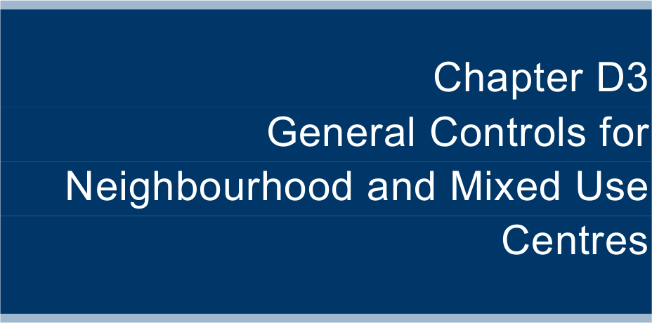

# Woollahra Development Control Plan 2015 - Chapter D3 General Controls for Neighbourhood and Mixed Use Centres

> This chapter is split into 10 section file(s), one per numbered heading, in the order they appear in the PDF.

Source PDF: [chapter-d3-general-controls-for-neighbourhood-and.pdf](chapter-d3-general-controls-for-neighbourhood-and.pdf)

> [Picture on page 1: a picture, saved as a picture (images/chapter-d3-general-controls-for-neighbourhood-and-mixed-use-page-1-1.gif, 150 dpi).]

### Chapter D3

General Controls for

### Neighbourhood and Mixed Use

### Centres

### Part D  Business Centres

### CHAPTER D3 APPROVED ON 27 APRIL 2015 AND COMMENCED ON 23 MAY 2015

### Last amended on 2 December 2024

Chapter D3  General Controls for

### Neighbourhood and Mixed Use Centres

| Contents |  |
|---|---|
| D3.1 | INTRODUCTION ........................................................................................ 1 Land where this chapter applies ........................................................... 1 Relationship to other parts of the DCP .................................................... 1 How to use this chapter...................................................................... 3 |
| D3.2 | USES ...................................................................................................... 4 |
| D3.3 | STREET CHARACTER .................................................................................. 6 |
| D3.4 | BUILT FORM ............................................................................................ 9 |
| D3.5 | BUILDING ARTICULATION .......................................................................... 15 |
| D3.6 | HERITAGE AND CONTRIBUTORY BUILDINGS ................................................... 18 |
| D3.7 | ACOUSTIC AND VISUAL PRIVACY ................................................................. 20 |
| D3.8 | LANDSCAPED AREA AND PRIVATE OPEN SPACE ............................................... 24 |
| D3.9 | CAR PARKING AND VEHICULAR ACCESS ......................................................... 26 |
| D3.10 | SITE FACILITIES ...................................................................................... 30 |

> [Picture text on page 5 is stored in the PDF without readable letters (no character map), so it could not be copied; see the original PDF.]

<!-- sections -->
## Sections

1. [D3.1 Introduction](01-d3-1-introduction.md)
2. [D3.2 Uses](02-d3-2-uses.md)
3. [D3.3 Street character](03-d3-3-street-character.md)
4. [D3.4 Built form](04-d3-4-built-form.md)
5. [D3.5 Building articulation](05-d3-5-building-articulation.md)
6. [D3.6 Heritage and contributory buildings](06-d3-6-heritage-and-contributory-buildings.md)
7. [D3.7 Acoustic and visual privacy](07-d3-7-acoustic-and-visual-privacy.md)
8. [D3.8 Landscaped area and private open space](08-d3-8-landscaped-area-and-private-open-space.md)
9. [D3.9 Car parking and vehicular access](09-d3-9-car-parking-and-vehicular-access.md)
10. [D3.10 Site facilities](10-d3-10-site-facilities.md)
