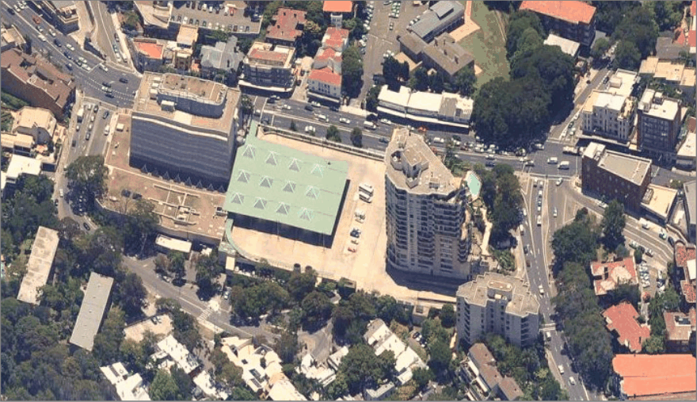
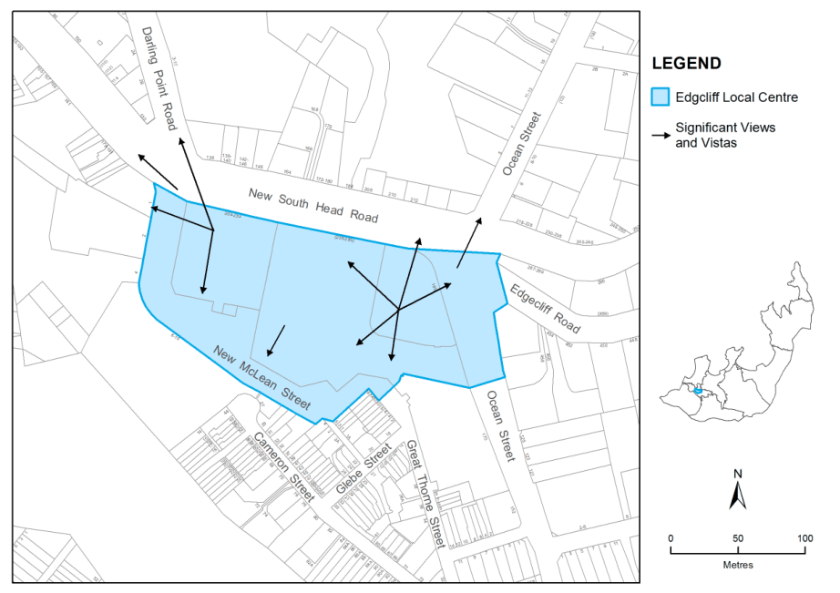

#### D4.1 Introduction

This is Chapter D4 of the Woollahra Development Control Plan 2015 (DCP), Part D Business Centres.

This chapter contains controls for the Edgecliff Centre, zoned E1 Local Centre under the Woollahra Local Environmental Plan 2014 (LEP).

This chapter seeks to ensure that development has regard to its context and is compatible with the desired future character for the Edgecliff Centre as described in this chapter.

Oblique aerial of the Edgecliff Centre (bounded by New South Head Road, Ocean Street, New McLean Street

and Arthur Street)

> [Picture on page 5: a picture, saved as a picture (images/chapter-d4-edgecliff-centre-page-5-10.gif, 150 dpi).]

.

#### D4.1.1 Land where this chapter applies

The Edgecliff Centre is located between New South Head Road to the north, New McLean Street and Arthur Street to the south and Ocean Street to the east, as identified in Map 1.

The centre comprises the following land: 203-233 New South Head Road (Lot 2 DP 553702, Lot 203 DP 1113922 and Lot 5 in DP 243380) 235-285 New South Head Road (Lot 61 DP 748554) 180 Ocean Street (SP 21608, SP 22762 and SP 30426).

MAP 1  Edgecliff Centre

> [Picture on page 6: a picture, saved as a picture (images/chapter-d4-edgecliff-centre-page-6-2.gif, 150 dpi).]

#### D4.1.2 Development to which this chapter applies

This chapter applies to development that requires development consent.

Generally this will be mixed use retail, business, office and /or residential development, but may also include permitted uses such as child care centres, community facilities, and other uses as permitted by Woollahra LEP 2014.

#### D4.1.3 Objectives

The objectives of this chapter are:

O1     To encourage a high standard of architectural and landscape design in any new development within the centre.

O2     To protect the amenity of residential and commercial development.

O3     To protect the amenity of adjoining residential areas.

O4     To improve connections within the centre and into the surrounding commercial and residential areas.

O5 To enhance the way development contributes to a sense of place.

O6 To encourage a diverse mix of uses in the centre, whilst maintaining its role of providing medical services.

O7 To activate the frontage to New McLean Street and Arthur Street.

#### D4.1.4 Relationship to other parts of the DCP

This chapter is to be read in conjunction with the other parts of the DCP that are relevant to the development proposal, including: Part E: General Controls for All Development – this part contains chapters on Parking and Access, Stormwater and Flood Risk Management, Tree Management, Contaminated Land, Waste Management, Sustainability, Signage and Adaptable Housing. Part F: Land Use Specific Controls – this part contains chapters on Child Care Centres, Educational Establishments, Licensed Premises and Telecommunications.

#### D4.1.5 How to use this chapter

The controls for the Edgecliff Centre comprise the following elements: map showing the extent of the centre; a precinct character statement, providing a brief description of the centre; desired future character, establishing the direction and outcomes required to be achieved through development in the centre;  and a list of controls relating to uses, built form, building articulation and streetscape, and amenity. The controls represent specific ways in which a development proposal can meet the objectives. Applicants need to demonstrate how their development fulfills the relevant objectives and preserves or enhances the important character elements for the precinct, having particular regard to: − surrounding building height, bulk and scale − any predominant architectural styles, roof forms, materials and colours − prevailing building lines − existing and proposed uses − landscape and vegetation features − topography − view corridors − pedestrian access and amenity − interface between the private and public domain − adjacent residential areas.
