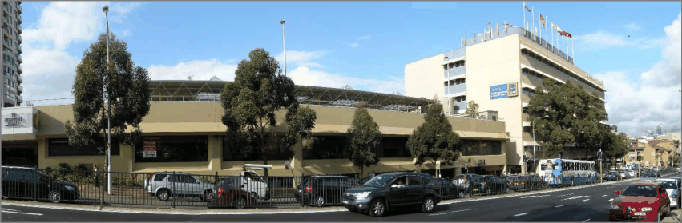
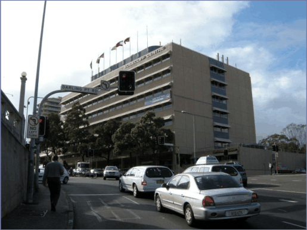

#### D4.2 Edgecliff Centre controls

#### D4.2.1 Precinct character statement

The Edgecliff Centre is part of the wider Edgecliff commercial area which includes the land zoned

MU1 Mixed Use along New South Head Road.  New South Head Road is a major State road linking the Eastern Suburbs to the city and is the primary route for vehicles to the Edgecliff Centre.

The Edgecliff Centre comprises three main sites: two contain a multi-storey retail and commercial buildings.  The centre provides a good range of convenience retailing opportunities, including supermarkets and speciality stores and services the surrounding residential suburbs including, Edgecliff, Elizabeth Bay, Darlinghurst, Darling Point, Kings Cross, Paddington, Potts Point, and Woollahra. The centre also has a high proportion of medical services and experienced a 40% increase in health care related jobs from 2006 to 2011.

The Edgecliff Bus and Rail Interchange also form part of the centre.  Local and regional bus routes service the bus interchange which is located above the Eastpoint Shopping Centre.

Edgecliff bus and rail interchange and the Edgecliff Centre building

> [Picture on page 8: a picture, saved as a picture (images/chapter-d4-edgecliff-centre-page-8-15.gif, 150 dpi).]

> [Picture on page 8: a picture, saved as a picture (images/chapter-d4-edgecliff-centre-page-8-16.gif, 150 dpi).]

The Edgecliff Centre building

#### Historical development and transport

Early photographs from the 1860s reveal clusters of dwellings and business along the southern side of New South Head Road. During that era, there was a toll for using New South Head Road.

In September 1894 a cable tram service opened operating from King Street in the city to Ocean Street in Edgecliff.

In the 1960s, the shop top houses on the southern side of New South Head Road were demolished to make way for Edgecliff Station. Edgecliff railway station and bus interchange opened in 1979, when the Illawarra line was extended from Town Hall railway station to Bondi Junction.

#### Built form

The built form consists of: a building called the Edgecliff Centre—a seven storey building over one level of car parking, located at the western end of the centre, containing retail, business and office uses; the Eastpoint Shopping Centre—a three storey building containing retail and business uses and a car park.  The railway station and bus interchange are also accessed from this building; and Eastpoint Tower—a 2 to 14 storey mixed use residential and commercial building on Ocean Street, located at the eastern end of the centre.

The centre primarily addresses New South Head Road.  On New McLean Street, car park entries and loading bays dominate the streetscape, and the landscaping is sparse and uncoordinated. This creates an unwelcoming pedestrian environment with little visual interest and provides a harsh transition to the residential land opposite.

Connectivity across the centre is restricted as the Eastpoint Shopping Centre and Edgecliff Centre car parks are separate despite being located next to each other. This also unnecessarily increases the number of vehicle crossings on the New McLean Street frontage.

#### Heritage and contributory buildings

There are no heritage items or contributory buildings in the Edgecliff Centre.

#### Public parks

There are no public parks in the Edgecliff Centre. However, Edgecliff Square is located on the eastern side of Ocean Street and Trumper Park is 100m to the south.

#### Views and vistas

Due to its position on top of a hill, there are significant views from existing buildings to Port Jackson in the north, Sydney CBD to the west and generally within the region. From street level views of the local region, CBD and Harbour Bridge are possible.   The key views and vistas are identified in Map 1 above.

From the residential tower and commercial offices at either end of the centre, iconic views are possible, such as to the Opera House and Harbour Bridge.

#### D4.2.2 Desired future character

The Edgecliff Centre will reinforce its role as the focus of retail and business activity and continue to be convenient place for people to meet, work, shop and use services.

The built form will promote an urban environment which meets high standards of visual quality and pedestrian amenity.

Buildings will be up to eight storeys on New South Head Road and transition down to one to two storeys at New McLean Street frontage.  At the corner of Ocean Street and New South Head Road buildings up to 10 storeys are permitted.

New McLean Street will have an active street frontage and parking and servicing arrangements will be reconfigured to be less visually intrusive. The amenity will be improved by including streetscape works, landscaping and reducing the frontage dedicated to vehicle movements.

Pedestrian links across the centre, and through the centre to the bus interchange and railway station, will be enhanced.  The connections to the surrounding New South Road commercial corroder and nearby residential land will increase pedestrian activity and convenience. Where commercial development addresses a street, awnings will be provided at street level for weather protection.

Given the excellent public transport access, the centre is ideally located for increased residential and commercial land uses. Retailing, medical and health related services and professional services will continue to cater for the needs of the local community.

#### D4.2.3 Objectives and controls

| Objectives | Controls |
|---|---|
| O1 To promote an attractive street wall. C1 The ground floor of the building on New South Head Road is setback 3m. O2 To ensure building articulation makes a significant contribution to the design of C2 The building at 203-233 New South Head buildings. Road addresses New McLean Street, is related to the scale of pedestrians and O3 To improve the relationship of buildings provides visual interest. This may be to the public domain. achieved by: O4 To ensure that development enhances a) providing an active frontage to the visual quality and identity of the New McLean Street; centre through well considered design, high quality materials and facade colours b) reconfiguring the parking and that do not dominate the street. servicing arrangements so these do not dominate the streetscape; and c) reducing the number and width of vehicle cross overs. C3 The design of the lower part of the street facade relates to the scale of pedestrians. C4 Facades are richly articulated and express the different levels of the building and/or its functions. C5 Facade design incorporates similar proportions of glazed and non-glazed surfaces and achieves a balance between vertical and horizontal divisions. The extensive use of glass is avoided. C6 Facade elements are generally contained in vertical planes aligned with the street. Sloping facades are avoided. C7 Where visible from the public domain, party walls include articulation. Blank party walls are avoided. C8 Large expanses of highly reflective, brightly coloured surfaces or black shading are not used on facades. C9 New buildings and facades do not result in glare that causes discomfort or |  |

| Objectives | Controls |
|---|---|
| threatens safety of pedestrians or drivers. Note: A reflectivity report analysing potential glare from the proposed new development on pedestrians or motorists may be required to be submitted with the DA. |  |
| O5 To ensure that the colour of the building C10 The external painting of a building in facade is not intrusive or unreasonably bright colours, corporate colours or dominant within the streetscape, and is fluorescent colours is avoided. compatible with the desired future character of the centre. C11 Any individual business branding and identity in external painting and colour schemes is subordinate to the main colour schemes in the street. Note: Also refer to the signage controls in Part E7 of the DCP, Section 7.2.2 When external painting of a building constitutes a wall sign. |  |
| O6 To improve pedestrian access between C12 The permeability and connectivity of the the commercial buildings in the centre. centre is improved. For example, by providing north-south thoroughfares and improving links between the retailing spaces and the public transport facilities. C13 Access to public car parking areas from the different buildings in the centre is integrated to improve connectivity. |  |
| O7 To require the provision of public art in C14 Development with a capital investment significant or large-scale developments. value of $15M or more includes public art. O8 To integrate the public art so it is a cohesive part of the building design, C15 The public art is installed on the interior or landscaping of the development site or in the immediate development. vicinity of the site. O9 To design and locate the public art so C16 The public art is located so that it is not that the aesthetics and amenity of the unreasonably inaccessible or obscured by art can be appreciated by people within a building element which makes it and outside the development. impossible to see in full by the building occupants and the general public. |  |

| Objectives | Controls |
|---|---|
| O10 To enhance the experience of the C17 The public art is prepared and occupants of the development and their undertaken in accordance with the relationship with the development Woollahra Public Art Guidelines for through public art. Developers. O11 To use public art to facilitate a connectedness between the development and the public domain. |  |
| O12 To provide an attractive and comfortable C18 Development provides an active frontage pedestrian environment. to New South Head Road, New McLean Street and Arthur Street. C19 Development provides a continuous awning to New South Head Road and New McLean Street. C20 Awnings are designed and constructed to: a) provide continuity and complement the facade and adjoining awnings; b) follow the street grade; and c) be of sufficient depth to provide good shade and shelter to pedestrians. C21 Where under awning lighting is included, the lighting is either recessed into the soffit of the awning or wall mounted on the building. C22 Public domain improvements, including street tree planting and pavement upgrading, are consistent and unify the centre and improve pedestrian amenity. |  |
| O13 To ensure that signage and structures do Refer to Part E of the DCP, Chapter E7 not compromise the visual amenity of Signage. the streetscape. Note: Advertising signage is not permitted. |  |
| O14 To ensure that mixed use developments Note: State Environmental Planning Policy No. are designed to minimise conflict 65 - Design Quality of Residential Flat between different uses on the site. Development (SEPP 65) is a mandatory consideration for all applications for a |  |

| Objectives | Controls |
|---|---|
| O15 To ensure that building design and layout residential flat building that is three or provides quality residential living more storeys and contains four or more environments. self-contained dwellings. This includes mixed use development with a residential component. C23 The internal layout of rooms, courtyards, terraces and balconies, the use of openings, screens and blade walls, and choice of materials, is designed to minimise the transmission of noise externally. C24 Visual privacy is protected by providing adequate distance between opposite windows of neighbouring dwellings where direct view is not restricted by screening or planting. |  |
| O16 Ensure adequate provision of site C25 Site facilities are suitably integrated facilities. with the development and its landscaping to minimise visibility from O17 Ensure site facilities are accessible, the street. functional and unobtrusive. C26 Hydraulic fire services such as fire O18 To protect the amenity of adjoining hydrants and booster installations are residential zoned land. concealed. These services are to be: O19 Minimise overshadowing of adjoining a) enclosed with doors if located in the properties and Cooper Park Oval. building façade, or b) housed in a cabinet or enclosure if located external to the building. The location, design, colour and material of the doors, cabinet or enclosure are visually unobtrusive and suitably integrated with the development, including any fencing and landscaping. C27 The building design minimises overlooking into the habitable rooms and open space areas of adjoining residential uses. C28 Development maintains solar access to existing adjoining dwellings for a period of two hours between 9am and 3pm on 21 June to existing north facing windows |  |

| Objectives | Controls |
|---|---|
| of habitable rooms, and for at least two hours to at least 50% of the private open space. Where existing overshadowing is greater than this, sunlight is not to be further reduced. C29 Solar access to the Trumper Park Oval is provided between the hours of 10am and 2pm on 21 June. Where existing overshadowing is greater than this, sunlight is not to be further reduced. |  |
| O20 To ensure that an electricity substation C30 The substation is to be suitably located, is not visible from the street, or any screened and/or concealed. Council’s other adjoining public place. preference is for a chamber substation. O21 To ensure that any screening or C31 Any screening or enclosure to conceal enclosure to conceal the substation does the substation is to be visually not detract from the streetscape unobtrusive and suitably integrated with character or design quality of the the development, including the fencing development. and landscape design. |  |
| O22 To protect the amenity of adjoining C32 The substation is to be located away residential dwellings from the impact of from neighbouring properties or substations. sufficiently screened from neighbouring properties. |  |
| O23 To ensure that vegetation does not C33 The location and design of the electricity interfere with the functioning of the substation must be considered and substation. integrated with the landscaping of the proposed development, and must ensure that: a) Vegetation does not overhang or encroach within the substation site. b) The substation is installed outside of the mature growth root zone of any trees to be retained, or proposed to be planted, to prevent roots damage to underground cables. |  |

| Objectives | Controls |
|---|---|
| O24 To minimise the impact of other types of C34 The design and location of all other electricity infrastructure in the aboveground utility infrastructure (such streetscape. as electrical pillars etc.) should minimise visual clutter within the streetscape and provide for a continuous accessible path of travel, where practical to ensure safe and equitable pedestrian circulation for people of all abilities. (Where this provision and Ausgrid’s requirements cannot both be satisfied, the applicant is to develop in consultation with Council and Ausgrid a solution that meets the acceptance of both consent authorities. |  |
| Notes: • At the DA stage the applicant should demonstrate that they have engaged with Ausgrid and have a network capacity assessment undertaken for the proposed development. • Where a substation is required, the substation should be identified on the DA plans and addressed in the SEPP 65 Design Verification Statement (also see Apartment Design Guide Objective 3C-2 Amenity of the public domain is retained and enhanced). • The DCP requirements apply in addition to the Ausgrid Network Standards, such as NS113 Site selection and construction design requirements for chamber substations. Separate Ausgrid approval for the substation will be required. • A dedicated access way/easement through the site to the substation will also need to be provided in accordance with the requirements of Ausgrid and Council. |  |
