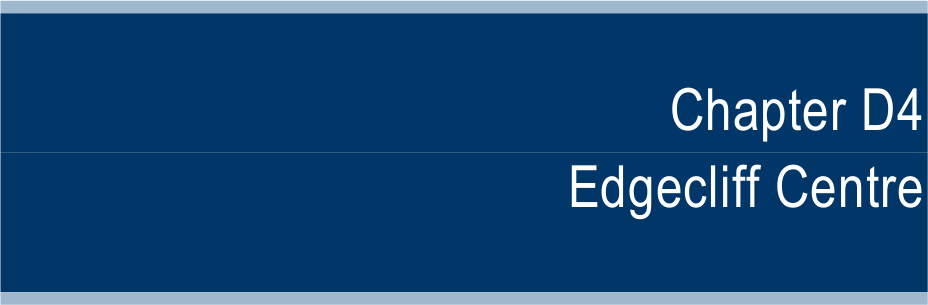

# Woollahra Development Control Plan 2015 - Chapter D4 Edgecliff Centre

> This chapter is split into 3 section file(s), one per numbered heading, in the order they appear in the PDF.

Source PDF: [chapter-d4-edgecliff-centre.pdf](https://planfortomorrow.sharepoint.com/sites/Planfortomorrow/Shared%20Documents/00%20NSW-Planning-Resources/dcp/woollahra-development-control-plan-2015/chapter-d4-edgecliff-centre/chapter-d4-edgecliff-centre.pdf)

> [Picture on page 1: a picture, saved as a picture (images/chapter-d4-edgecliff-centre-page-1-1.gif, 150 dpi).]

### Chapter D4

### Edgecliff Centre

### Part D  Business Centres

### CHAPTER D4 APPROVED ON 27 APRIL 2015 AND COMMENCED ON 23 MAY 2015

### Last amended on 31 May 2024

<!-- sections -->
## Sections

1. [D4 Edgecliff Centre](01-d4-edgecliff-centre.md)
2. [D4.1 Introduction](02-d4-1-introduction.md)
3. [D4.2 Edgecliff Centre controls](03-d4-2-edgecliff-centre-controls.md)
