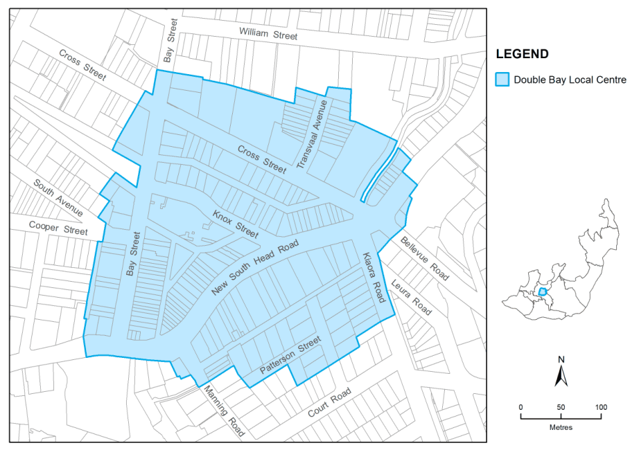
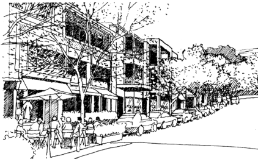

#### D5.1 Introduction

This is Chapter D5 of the Woollahra Development Control Plan 2015 (DCP), Part D Business Centres.  It establishes detailed controls to guide future development in the Double Bay Centre.

Double Bay is a unique local centre, which enjoys a privileged position near the southern edge of Sydney Harbour at the base of a large natural amphitheatre.

Its accessibility and distinctive landscape quality evoke an appealing cosmopolitan character that is warmly valued by local residents and users of the centre.

#### D5.1.1 Land where this chapter applies

This chapter applies to the Double Bay Centre, as identified in Figure 1.

FIGURE 2  Location plan

> [Picture on page 5: a picture, saved as a picture (images/chapter-d5-double-bay-centre-page-5-11.gif, 150 dpi).]

#### D5.1.2 Development to which this chapter applies

This chapter applies to development that requires development consent.

Generally this will be mixed use retail, business, office and /or residential development, but may also include permitted uses such as child care centres, community facilities, and other uses as permitted by Woollahra LEP 2014.

Development should contribute to a vibrant centre that offers a unique living, working and shopping experience within a pedestrian friendly and attractive urban environment.

FIGURE 2  View along Bay Street towards New South Head Road indicating possible future development

> [Picture on page 6: a picture, saved as a picture (images/chapter-d5-double-bay-centre-page-6-10.gif, 150 dpi).]

#### D5.1.3 Objectives

The objectives of this chapter are:

O1 To retain and enhance through block connections which allow pedestrians to move freely within the Double Bay Centre.

O2 To develop the particular qualities of different parts of the Double Bay Centre.

O3 To encourage a diverse mix of uses in the Double Bay Centre and maintain retail uses at ground level.

O4 To conserve and enhance the visual and environmental amenity of all buildings and places of heritage significance in the Double Bay Centre.

O5 To enhance the way development contributes to a sense of place.

O6 To ensure a high standard of architectural and landscape design in any new developments within the Double Bay Centre.

O7 To preserve and enhance the diversity of uses in the Double Bay Centre.

O8 To ensure that new development is compatible with the existing built form, and streetscape and village character.

O9 To encourage view sharing and individual privacy.

O10 To ensure new development is designed to be compatible with the heritage significance of listed heritage items.

#### D5.1.4 Relationship to other parts of the DCP

This chapter is to be read in conjunction with the other parts of the DCP that are relevant to the development proposal, including: Part E: General Controls for All Development – this part contains chapters on Parking and Access, Stormwater and Flood Risk Management, Tree Management, Contaminated Land, Waste Management, Sustainability, Signage and Adaptable Housing. Part F: Land Use Specific Controls – this part contains chapters on Child Care Centres, Educational Establishments, Licensed Premises and Telecommunications.

#### D5.1.5 How to use this chapter

Applicants seeking to redevelop or alter sites within the Double Bay Centre must carefully consider the context of their proposal and identify the Built Form Envelopes, Control Drawings and Development Controls in this chapter which apply.

Compliance with the provisions of this chapter does not guarantee that consent to a development application will be granted. Each development application will be assessed having regard to Woollahra LEP 2014, this DCP, other matters listed in section 79C of the Environmental Planning and Assessment Act 1979 and any other policies adopted by the Council.

The Double Bay Public Domain Improvements Plan (1999) should also be used as a guide to works in the public domain, and includes details of street tree planting, footpaths, street furniture, and vehicular and pedestrian crossings.

This chapter of the DCP is structured as follows:
