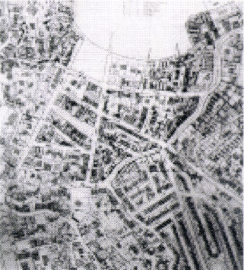

#### D5.2 Understanding the context

#### D5.2.1 Siting

The Double Bay Centre is located in Sydney’s Eastern Suburbs, in a large natural amphitheatre close to, but visually separated from the harbour foreshore. It sits at the base of a valley, cradled between the two ridges of Darling Point/Edgecliff and Bellevue Hill.

The principal entry into Double Bay is New South Head Road which traverses the centre. Other street connections include Ocean Avenue, Bellevue, Kiaora and Manning Roads and Greenoaks Avenue. New South Head Road is characterised by its unique street geometry, views to extensive landscape elements beyond, and a sense of spatial containment from the street edge building and surrounding landscape.

#### D5.2.2 Historical development

The settlement of Double Bay was established in 1834 by the creation of five streets between Ocean Avenue and Bay Street, forming the blocks containing 50 generously sized allotments. The catalyst for the establishment of the Double Bay village was the opening of New South Head Road as a private tollway.

FIGURE 3  Historical plan circa 1950

> [Picture on page 10: a picture, saved as a picture (images/chapter-d5-double-bay-centre-page-10-17.gif, 150 dpi).]

The development of Double Bay intensified and shifted toward New South Head Road around the time of the tramline extension past Edgecliff in 1898. This shift is revealed by the extension of Cross Street east to connect to New South Head Road, the creation of Short Street, and the tightly knit terrace house subdivision on the corner of Bay Street and New South Head Road.

Development between the wars concentrated along the New South Head Road corridor. During the 1960s and 1970s, the commercial area expanded into the adjoining predominantly residential areas of Bay, Cross, Knox and Patterson Streets.

Woollahra LEP 2014 identifies heritage listed properties in the centre, such as the Inter-War Golden Sheaf Hotel. An archaeological site containing sewerage infrastructure is located underground at the corner of Cross Street and New South Head Road.  A heritage conservation area in Transvaal Avenue comprises single storey semi-detached cottages, and is a remnant of the centre's former housing stock.

#### D5.2.3 Built form

The building stock in and around the centre reveals a cross section of architecture of varying quality. The built form of the centre reflects a mix of periods, building types and scale with no particular period predominating. The architectural and streetscape quality is generally undistinguished, with a few exceptions.

The buildings between New South Head Road, Bay and Short Streets have retained the fine grain evident in the early subdivision pattern. The allotments and buildings between Knox Street and Cross Streets are generally wider and shallower, but are coherent as a group in terms of grain, scale and massing. These buildings are honeycombed with arcades that allow a variety of pedestrian connections between the two streets.

The amalgamation and redevelopment of some sites along the north side of Cross Street have created buildings of different height and bulk to the predominant building stock. Some site amalgamation and redevelopment has also occurred along Bay Street and south of New South Head Road. The recent Kiaora Lands development contains a three storey retail building and car park with over 440 spaces.

#### D5.2.4 Public parks and facilities

The centre has one small park as a median in the centre of Guilfoyle Avenue. Two other parks adjoin the centre. Foster Park includes a baby health centre Woollahra Preschool and the Local History Centre, with a park which is heavily compromised by its steepness. Steyne Park on the harbour is very well used and its facilities include two playing fields, a playground and Double Bay's only public toilet. It is also regularly used by the school children attending Double Bay Public School across William Street.

The minor community buildings include the small church hall at the corner of Transvaal Avenue and Cross Street, in the centre and the synagogue nearby in Kiaora Road.

Community facilities within the centre are the three storey public library which is part of a retail arcade that opens onto and a landscaped public plaza at Kiaora Lands, and the Studio 1 meeting room which is part of the Cross Street car park site.

#### D5.2.5 Access and circulation

The centre has limited street connections to the surrounding area along New South Head Road, Manning Road, Kiaora Road and Bellevue Road. The scarcity of connections arises from topographical constraints and very large block sizes that limit pedestrian accessibility and concentrates traffic into a few access points.

Vehicular traffic in the centre operates reasonably effectively, despite relatively few access points and the presence of through traffic. Parking is concentrated in council car parks on Cross Street and Kiaora Road. On-street parking is heavily used throughout the centre and adjoining areas.

The Double Bay Centre is serviced by a number of bus routes. Edgecliff Railway Station and the ferry wharf at the end of Bay Street provide further public transport links to the city centre and other parts of Woollahra.

The centre has an attractive ambience for pedestrians due to the generally continuous shop fronts along streets and through block arcades on shallow lots.

The harbour is accessible across Steyne Park and from Beach Street, Bay Street and Ocean Avenue. Extending streetscape improvements down to the ferry wharf will strengthen the connection of Bay Street to the waterfront.

#### D5.2.6 Building uses

The Double Bay Centre contains a mix of retail, commercial, service and residential uses. The retail activity is concentrated between Knox and Cross Streets, and along New South Head Road, Bay Street and Cross Streets.

High quality small scale speciality retailing defines the image and character of the Double Bay Centre.  And in late 2014 the InterContinental Hotel opened on the former site of the Ritz Carlton Hotel after a significant renovation of the existing building.

The provision of more local services such as the Double Bay Library, which is part of the Kiaora Lands development, will benefit residents in and near the centre.
