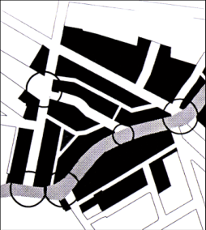
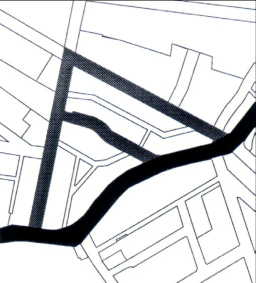
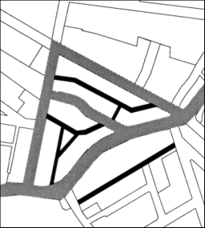
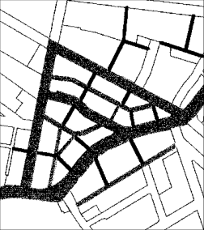
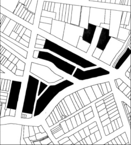
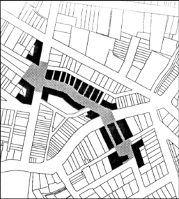
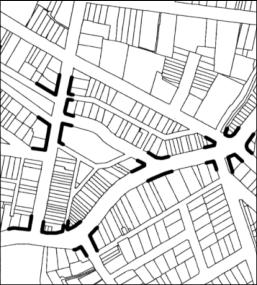
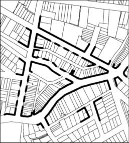

#### D5.3 Urban structure

#### D5.3.1 Structure of the Double Bay Centre

These maps provide an understanding of the current urban structure of the Double Bay Centre including key elements and features in the centre.

#### FIGURE 4 Urban structure

#### FIGURE 5 Layout - major streets

The extent of the Double Bay Centre showing significant places and the axis of New South Head Road.

> [Picture on page 13: a picture, saved as a picture (images/chapter-d5-double-bay-centre-page-13-12.gif, 150 dpi).]

Four or five storey buildings built to the street boundary are encouraged along the major streets to provide spatial definition.

> [Picture on page 13: a picture, saved as a picture (images/chapter-d5-double-bay-centre-page-13-16.gif, 150 dpi).]

#### FIGURE 6 Layout - lanes

#### FIGURE 7 Layout - pedestrian connections

The lanes are considerably narrower than the streets. Generally, two storey buildings are encouraged to spatially define lanes. Lanes provide discrete service access necessary for retail centres.

> [Picture on page 13: a picture, saved as a picture (images/chapter-d5-double-bay-centre-page-13-26.gif, 150 dpi).]

The pedestrian connections shown in this diagram indicate their most desirable locations. They supplement the existing layout of streets and lanes, increasing their accessibility. Through block connections are encouraged in most locations but not on corner sites.

> [Picture on page 14: a picture, saved as a picture (images/chapter-d5-double-bay-centre-page-14-1.gif, 150 dpi).]

#### FIGURE 8 Layout - pedestrian axis

#### FIGURE 9 Subdivision layout - small lots

This plan encourages the continuity of the fine building grain of Double Bay by applying a rationale of controls for  lots that are less than 6m wide and/or less than 30m deep which differ from controls for other lots

> [Picture on page 15: a picture, saved as a picture (images/chapter-d5-double-bay-centre-page-15-10.gif, 150 dpi).]

This plan recognises the importance of the structure of public places from Guilfoyle Park along Knox Street to New South Head Road. Extending this pedestrian axis to the new library and square on Kiaora Lane should be encouraged to strengthen the connection between places on each side of New South Head Road.

> [Picture on page 15: a picture, saved as a picture (images/chapter-d5-double-bay-centre-page-15-19.gif, 150 dpi).]

#### FIGURE 10 Built form - building to the street boundary

#### FIGURE 11 Built form -  prominent corners

Buildings built to the street boundary spatially define the street. Building controls in this plan respond to street width and orientation, and adopt a consistent rationale relating to:

- street alignment

The unusual street geometry creates prominent corner sites and significant urban spaces. This plan recognises the importance of these places and encourages well designated buildings built to the street boundary which contribute to their spatial definition.

> [Picture on page 15: a picture, saved as a picture (images/chapter-d5-double-bay-centre-page-15-35.gif, 150 dpi).]

- building lines

- building height

- building articulation depth.

> [Picture on page 15: a picture, saved as a picture (images/chapter-d5-double-bay-centre-page-15-39.gif, 150 dpi).]

Note: Figure 4 (Urban structure), Figure 6 (Layout – lanes), Figure 8 (Layout – pedestrian axis) and Figure 10 (Built form –building to the street boundary) do not apply directly to Kiaora Lands. Refer to Appendix 2 for the relevant provisions for Kiaora Lands.

#### D5.3.2 Key strategies for the Double Bay Centre

Our vision for Double Bay is as a vibrant centre that offers a unique living, working and shopping experience within a pedestrian friendly and attractive built environment.

The intention of this chapter is to strengthen and enrich the existing urban structure of Double Bay and to create a memorable character for the Double Bay Centre by incorporating the following:

#### Enhance and improve the public domain and the provision of public facilities

a) Enhance the public domain of Double Bay by applying a coordinated approach to the public domain and streetscape.

b) Encourage multiple uses of Council car park sites such as providing community services and facilities at the ground floor and/or street façade and/or the roof terrace of Council’s car park properties.

c) Promote the important role that public transport plays in Double Bay.

Ensure that the centre maintains its commercial viability and competitive position within the

#### Sydney retail market

a) Foster the existing mix of uses of the centre such as hotels, retail and commercial and upper level residential.

b) Encourage a flexible built form that can potentially support a diverse mix of uses in the centre.

c) Consolidate the retail centre and intensify its usage by encouraging active retail frontage to laneways and establishing transition areas on the edge of the centre to mediate between the centre and residential areas beyond.

d) Enhance the image of Double Bay as a premier boutique and designer fashion store destination.

e) Encourage increased food and service retail uses.

#### Develop the particular qualities of different parts of the centre

a) Encourage redevelopment of Double Bay’s address to New South Head Road by: − intensifying the urban scale and vitality of New South Head Road; − encouraging development that responds to and continues to describe the strong curved form of New South Head Road through the centre; and − retaining the views to large areas of vegetation existing at each end of the centre, beyond Bellevue Road to the east and Manning Road to the west.

b) Retain and enhance the sunlit block of arcades between Knox Street and Cross Street.

c) Spatially define the distinctive street geometry of Knox Street.

d) Reinforce the Bay Street promenade and vista to the harbour foreshore.

e) Retain the scale of small lot development and street character of Bay Street south of Short Street.

f) Reinforce the urban space at the end of Guilfoyle Park, using built form controls.

g) Create a new local focus on Kiaora Lane by completing the Kiaora Lands development which includes new retail shops, a library and public plaza.

#### Retain and enhance pedestrian access and amenity in and around the centre

a) Reinforce the intimate scale, active retail frontage and pedestrian amenity of the lanes and little streets in the centre.

b) Improve the pedestrian environment by: − increasing connectivity through the large block bound by Cross, Bay and William Streets, and Jamberoo Lane; − providing building setbacks and footpaths in lanes; − requiring continuous awnings in nominated areas.

c) Improve the pedestrian environment by encouraging well designed arcades and open air connections at nominated locations that complement the street and lane structure and which: − promote public access across private land; − are transition spaces between public places; − are activated by retail frontage; − have through-site visibility.

Improve Double Bay's built form to provide appropriate definition to the public domain

a) Provide direction and certainty of outcome in relation to built form to ensure: − a coherent street scale; − compatibility with existing urban fabric; − a variety of building types; − a high level of environmental amenity.

b) Promote high quality architectural design throughout the centre that positively contributes to the streetscape.

c) Ensure that new development is compatible with the existing built, streetscape and village character

d) Establish building envelopes that define building height and building lines (at lower and upper levels) to provide coherent street definition.

e) Reinforce continuous active retail frontages along street boundaries.

f) Reinforce the presence of corner buildings addressing the public domain, recognising their importance in the centre in terms of street vistas, urban scale and identity.

g) Include public art in significant or large-scale development.

h) Encourage view sharing and privacy.

i) Encourage discrete vehicle access from rear lanes, while retaining some active use and address to those lanes.

j) Preserve the 'small shop' urban character of the centre by limiting the width of retail frontages.

Promote sustainable design principles and objectives in the development and use of the built environment

a) Promote environmentally sustainable design (ESD) principles such as conserving energy, facilitating natural ventilation and lighting, limiting the depth of buildings and providing favourable orientation.

b) Promote developments that innovatively combine ecological, social, cultural and economic objectives.

Conserve and enhance the visual and environmental amenity of all buildings and places of heritage significance in the centre.

a) To identify character buildings within the Double Bay Centre.

b) To ensure that alterations and additions to character buildings and heritage items are compatible in scale, form and material with these buildings and items, and adjoining developments.

#### To improve parking in the centre

a) Improve parking and traffic conditions in the centre.

b) To improve traffic and parking management in the centre and minimise vehicular/pedestrian conflicts.

c) Provide adequate parking in new developments at basement level, in the centre of blocks or in other discrete locations.

d) Limit the impact of overflow commercial parking in predominantly residential areas.
