#### D5.4 Street character

#### D5.4.1 Desired future character

The street is the primary organising element of urban structure. The street edge is the place where the public and private domains meet. By defining a particular vision for each street, public domain improvements and private development can be coordinated to produce a desired outcome.

This section describes the desired future character of each street in the Double Bay Centre. The Double Bay Centre Public Domain Improvements Plan (1999) should be used as a reference for works in the public domain, such as street tree planting, footpath design, street furniture and traffic devices.

The following is provided for each street in the centre: Existing character, which describes elements such as built form, streetscape, lighting, landscape and views; Desired future character, which outlines the urban design criteria for each street; Annotated street sections, which illustrate the existing and the desired future built form.

This information sets the context for development control described in Sections D5.5 and D5.6.

#### D5.4.2 Common street strategies

Strengthen the spatial definition of streets by encouraging building to the street boundary. Provide continuous active retail frontage at ground floor level. Increase street surveillance and promote a safe environment. Strengthen all built form on corner sites.

#### D5.4.3 New South Head Road

#### Existing character

New South Head Road is a historically significant road connecting the city to South Head. The road traverses the Double Bay Centre where it has a strong curved form punctuated with

vistas of green at either end. The quality and scale of existing buildings do not yet realise the potential of the space.

Location map and section direction

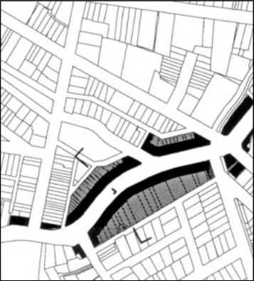

> [Picture on page 21: a picture, saved as a picture (images/chapter-d5-double-bay-centre-page-21-4.gif, 150 dpi).]

#### Desired future character

a) Accentuate the curved street geometry of New South Head Road with four and five storey buildings.

b) Retain green vistas at each end of New South Head Road.

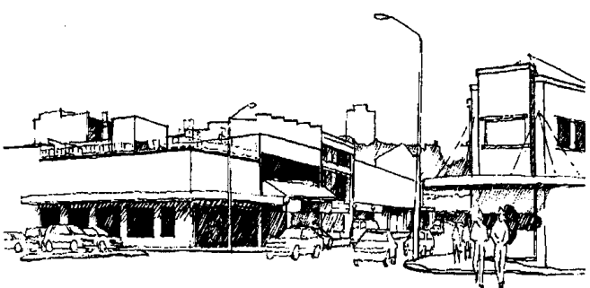

> [Picture on page 21: a picture, saved as a picture (images/chapter-d5-double-bay-centre-page-21-11.gif, 150 dpi).]

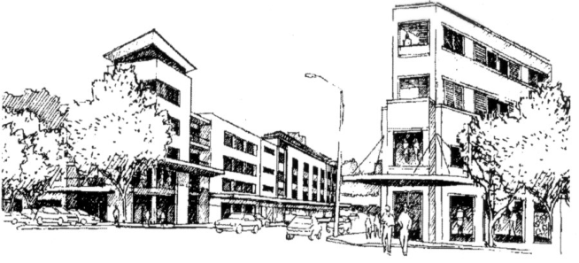

> [Picture on page 21: a picture, saved as a picture (images/chapter-d5-double-bay-centre-page-21-12.gif, 150 dpi).]

#### FIGURE 12

Existing view towards the south west at the five way intersection of Cross Street and New South Head Road

#### FIGURE 13

Potential development at the five way intersection and New South Head Road based on the controls in this DCP

Parapets encouraged

Setback development of the upper-most floor level from the street boundary Build to the street alignment with masonry walls, articulated with deep window reveals or punched openings

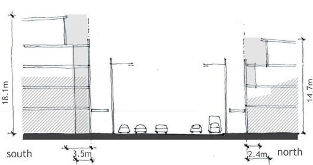

> [Picture on page 22: a picture, saved as a picture (images/chapter-d5-double-bay-centre-page-22-13.gif, 150 dpi).]
> Words printed on the picture (title and legend, copied from the PDF):
> 14.7m
> 18.1m
> 3.5m
> 2.4m north
> south

3.5m

2.4m

#### New South Head Road

Use the ground floor level articulation zone to encourage transition from the street to the shop

– this space could also be used for outdoor dining or shop display

#### Indicative existing built form Articulation zone

Provide continuous awning

Integrate sound attenuation devices into the design of the built street edge with enclosable balconies, articulated window sills, string courses, double glazing and the like

#### D5.4.4 Bay Street (south)

#### Existing character

Bay Street connects New South Head Road with the harbour. Its north-south orientation results in the street being sunny throughout the day. It is lined by modest buildings on narrow lots, with irregular setbacks at street level and street trees. Together the elements contribute to an intimate and relaxed atmosphere. There are a number of buildings that have been identified as

character buildings in Section 5.6.3.8 Heritage items and character buildings. These include several Victorian terraces that have been modified for retail use.

Location map and section direction

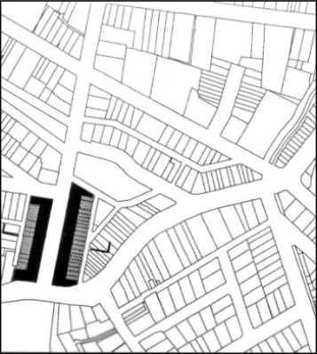

> [Picture on page 23: a picture, saved as a picture (images/chapter-d5-double-bay-centre-page-23-4.gif, 150 dpi).]

#### Desired future character

a) Retain the existing modest, lot related building widths and retail frontages.

b) Provide setback areas at ground level that can be used for outdoor eating or public circulation.

c) Retain the character buildings along Bay Street.

d) Maintain the avenue of trees.

FIGURE 14 Existing view down Bay Street to Cross Street

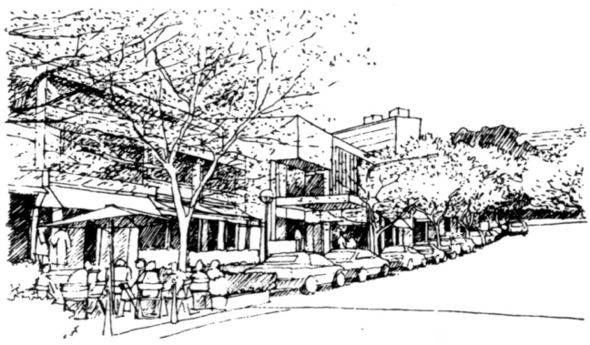

> [Picture on page 23: a picture, saved as a picture (images/chapter-d5-double-bay-centre-page-23-13.gif, 150 dpi).]

FIGURE 15 Potential architectural resolution and address on Bay Street (south) based on the

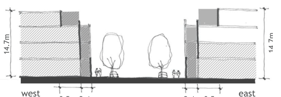

> [Picture on page 24: a picture, saved as a picture (images/chapter-d5-double-bay-centre-page-24-2.gif, 150 dpi).]
> Words printed on the picture (title and legend, copied from the PDF):
> 14 7m
> 14.7m
> west
> east

controls in this chapter

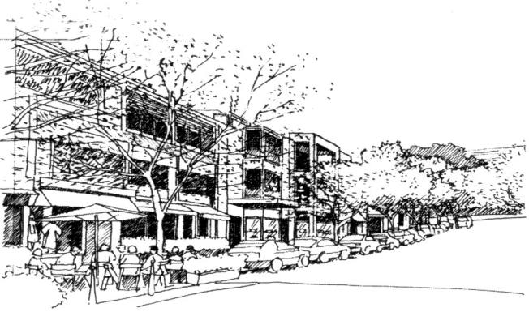

> [Picture on page 24: a picture, saved as a picture (images/chapter-d5-double-bay-centre-page-24-4.gif, 150 dpi).]

A variety of roof forms is encouraged Balconies and rooms should overlook the street

Partially build to the street alignment with shop fronts, projecting rooms and balconies

3.5m 2.4m

2.4m 3.5m

#### Bay Street (south)

Outdoor dining at street level is encouraged

Use adjustable screening to protect rooms from low angle summer sun

#### Indicative existing built form

#### Articulation zone

Character buildings retain existing front setback

Character buildings retain existing front setback

#### D5.4.5 Bay Street (centre)

#### Existing character

The central section of Bay Street is focused on Guilfoyle Park, which together with the surrounding streets, creates a generous area of open space. This space is defined and contained by the buildings on Bay Street and Guilfoyle Avenue.

Location map and section direction

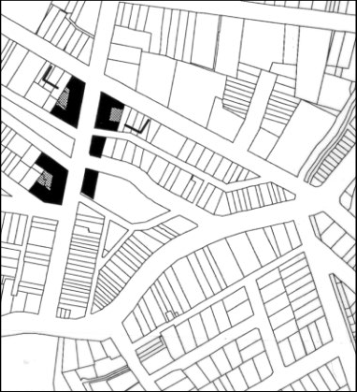

> [Picture on page 25: a picture, saved as a picture (images/chapter-d5-double-bay-centre-page-25-7.gif, 150 dpi).]

#### Desired future character

a) Lot amalgamations on blocks in proximity to Guilfoyle Park.

b) Expand the public domain at street level and improve the civic character with street level building colonnades that face central Bay Street and Guilfoyle Park. Provide a built form that responds to the scale and civic importance of Guilfoyle Park.

c) Higher buildings are permitted around the park to provide appropriate definition of the space.

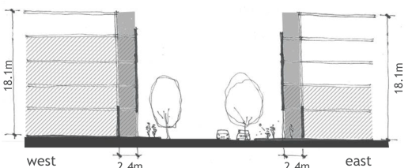

> [Picture on page 25: a picture, saved as a picture (images/chapter-d5-double-bay-centre-page-25-19.gif, 150 dpi).]
> Words printed on the picture (title and legend, copied from the PDF):
> 18.1m
> 18.1m
> west
> east

A variety of roof forms is encouraged Build to street alignment with loggias and balconies

2.4m

2.4m

#### Bay Street (centre)

Design colonnades including the size and spacing of the columns integral with the building design and with regard to adjoining colonnades if they exist

Provide adjustable screening to protect rooms from low angle summer sun

#### Indicative existing built form

#### Articulation zone

#### D5.4.6 Knox Street

#### Existing character

Knox Street is located at the physical centre of Double Bay, and has high value retail premises. The street section is asymmetrical with the Cosmopolitan Centre having a higher form to the south. The lower built edge to the north is fragmented and varied, and some buildings suggest street level connections to other streets. The street has a pronounced curve which is articulated by the buildings on the north side and the lower levels of the Cosmopolitan Centre.

Location map and section direction

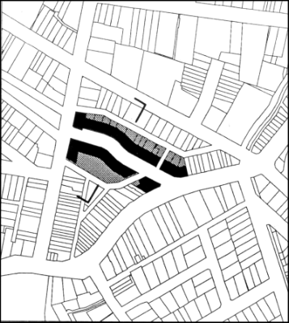

> [Picture on page 26: a picture, saved as a picture (images/chapter-d5-double-bay-centre-page-26-9.gif, 150 dpi).]

#### Desired future character

a) Retain the asymmetrical street section.

b) Accentuate the curved street geometry of Knox Street by encouraging building to the street boundary and continuous awning cover on the south side.

c) Retain street level connections to Knox Lane.

d) Allow 4 storey built forms on 50% of each site frontage to Knox Lane. See Control Drawings for

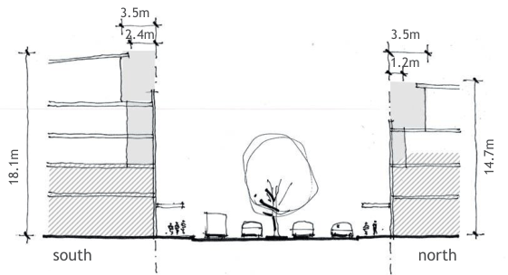

> [Picture on page 26: a picture, saved as a picture (images/chapter-d5-double-bay-centre-page-26-19.gif, 150 dpi).]
> Words printed on the picture (title and legend, copied from the PDF):
> 3.5m
> 2.4m
> 3.5m
> 1.2m
> 14.7m
> 18.1m
> south
> north

more information.

Extend median planting of Oriental Plane trees

Generally setback level 5 development from the street boundary

#### Knox Street

Continuous awning Build to street alignment with articulated deep window reveals and balconies

#### Indicative existing built form

#### Articulation zone

#### D5.4.7 Cross Street

#### Existing character

The subdivision pattern on each side of Cross Street differs significantly resulting in highly differentiated built form. The southern side of the street has wide and shallow lots, with arcades and sunny courtyards, which perforate the built form. The large buildings on the northern side are generally coarsely modelled and articulated. Corner buildings on Cross Street do not, in the main, provide good street definition.

Location map and section direction

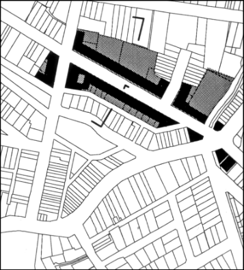

> [Picture on page 27: a picture, saved as a picture (images/chapter-d5-double-bay-centre-page-27-9.gif, 150 dpi).]

#### Desired future character

a) Unify the street on the north side by building to the street boundary.

b) Retain street level connections to Knox Lane.

c) Allow 4 storeys on 50% of each site frontage to Knox Lane. See Control Drawings for more information.

d) Encourage arcades and courtyards on the south side that cater for outdoor eating and informal gathering.

e) Strengthen built form on corner sites.

FIGURE 16 Existing view down Cross Street at the corner of Transvaal Avenue

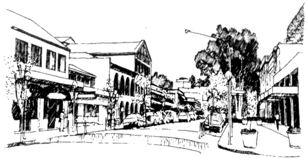

> [Picture on page 27: a picture, saved as a picture (images/chapter-d5-double-bay-centre-page-27-22.gif, 150 dpi).]

FIGURE 17 Potential street character on Cross Street based on the proposed controls

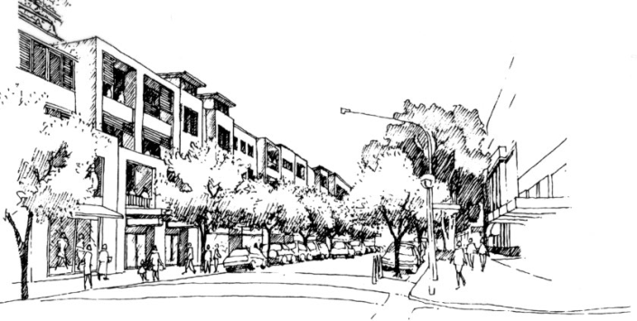

> [Picture on page 28: a picture, saved as a picture (images/chapter-d5-double-bay-centre-page-28-2.gif, 150 dpi).]

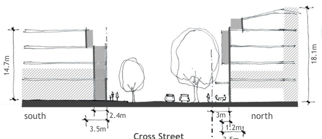

> [Picture on page 28: a picture, saved as a picture (images/chapter-d5-double-bay-centre-page-28-3.gif, 150 dpi).]
> Words printed on the picture (title and legend, copied from the PDF):
> 18.1m
> 14.7m
> south
> north
> 2.4m
> 3m
> 3.5m
> 1.2m
> Cross Street 3.5m

Continuous awning

Set back level 4 development from the street boundary

Demountable enclosures for outdoor eating are permissible on this side of Cross Street

street boundary

Use the ground level articulation zone to create courtyards or outdoor rooms which activate the street edge

Indicative existing built form Articulation zone

Continuous retail frontage

#### D5.4.8 The Lanes

#### Existing character

Most of the lanes are currently the “back” of lots. These are characterised by their lack of pedestrian amenity and extensive vehicle crossovers, and tend to be visually blighted by service areas and unscreened rubbish areas.

#### Desired future character

a) Facilitate the service role of lanes, while encouraging increased active retail frontage.

b) Improve pedestrian amenity by providing adequate footpaths, limiting the width and numbers of vehicle crossovers, setting buildings back on one side and preserving natural daylight to the lanes.

c) Enhance the spatial definition of lanes with ground and first floor building lines and buildings up to two storeys in height.

#### D5.4.9 Knox Lane

#### Existing character

Knox Lane has an intimate scale which is partly due to the lane's changing alignment and related spatial enclosure. Physical and visual connection to other spaces at street level is primarily via

through-site connections to Knox Street and courtyards to Cross Street. The spatial definition along the lane varies although most of the buildings are two to three storeys.

Location map and section direction

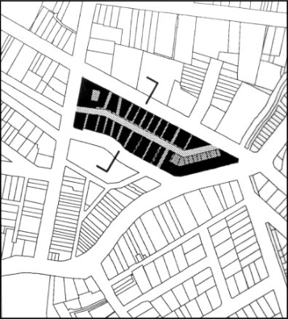

> [Picture on page 30: a picture, saved as a picture (images/chapter-d5-double-bay-centre-page-30-4.gif, 150 dpi).]

#### Desired future character

a) Retain and enhance the varied spatial definition of Knox Lane.

b) Retain and enhance the honeycomb of arcades and courtyards which connect Knox Street to Cross Street.

c) Encourage visual and physical connections between Knox and Cross Streets using: − arcaded and/or outdoor connections; − north oriented courtyards; and − arcade and courtyard creating buildings, which may vary from the control drawings in Section 5.5.8.

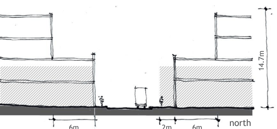

> [Picture on page 30: a picture, saved as a picture (images/chapter-d5-double-bay-centre-page-30-18.gif, 150 dpi).]
> Words printed on the picture (title and legend, copied from the PDF):
> 14.7m
> north
> 6m
> 6m
> 2m

The use of roof terraces as open space is encouraged

Two storey buildings along the lane frontage may be interspersed with arcades and courtyards.

Widen footpath to increase pedestrian activity Increase active retail frontage

#### Knox Lane

south

Indicative existing built form

Each development site may be permitted to build to 4 storeys on 50% of the Knox Lane frontage if it is interspersed with 2 storey development. The build-to line is setback to expand the public domain at street level and improve pedestrian amenity

#### D5.4.10 Short Street

#### Existing character

The building on the northern side of Short Street, and its extensive vehicle crossovers, establishes an overbearing scale and unmodulated façade which dominates the spatial quality of Short Street.

Location map and section direction

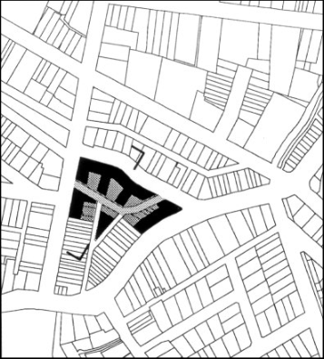

> [Picture on page 31: a picture, saved as a picture (images/chapter-d5-double-bay-centre-page-31-7.gif, 150 dpi).]

#### Desired future character

a) Increase active retail frontage.

b) Moderate the scale of built form along the north side of the lane with buildings of predominantly two storeys, set back 2m from the lane boundary, and interspersed with four storey development.

c) Apply a 3m setback on No.2 Short Street at the Short Street frontage.

d) Protect the amenity of the lane by preventing uninterrupted four storey buildings constructed to the street boundary along the northern built edge.

e) Widen footpath to southern side of Short Street.

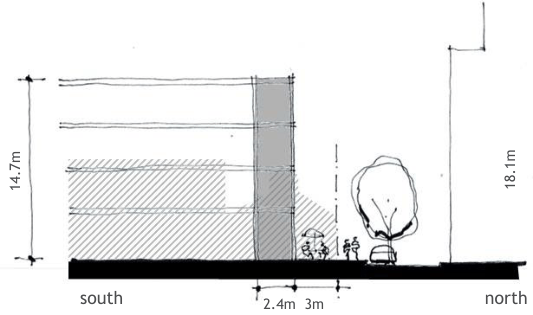

> [Picture on page 31: a picture, saved as a picture (images/chapter-d5-double-bay-centre-page-31-22.gif, 150 dpi).]
> Words printed on the picture (title and legend, copied from the PDF):
> 18.1m
> 14.7m
> 3m
> 2.4m
> south
> north

The building line is setback to expand the public domain at street level and improve pedestrian amenity

Each development site may be permitted to build to 4 storeys on 50% of Short Street frontage if it is interspersed with 2 storey development. Increase active retail frontage

#### Short Street

Indicative existing built form Articulation zone

#### D5.4.11 Gumtree Lane

#### Existing character

Gumtree Lane is spatially defined by the discontinuous two storey built form on its west side and the lane geometry that creates a central triangular site.

Location map and section direction

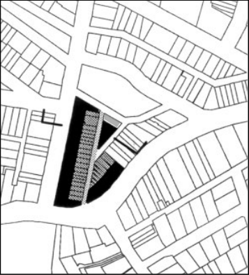

> [Picture on page 32: a picture, saved as a picture (images/chapter-d5-double-bay-centre-page-32-6.gif, 150 dpi).]

#### Desired future character

a) Retain the two storey built form and 2m setback on the west side.

b) Apply a 1m setback to the eastern side of Gumtree Lane.

c) Increase the spatial definition of the lane, and street surveillance with an articulated building addressing the lane from the central triangular

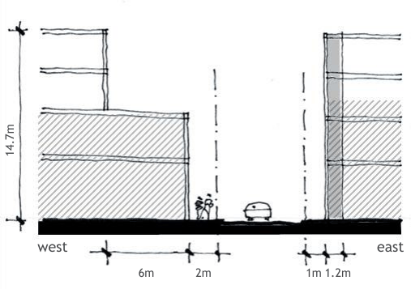

> [Picture on page 32: a picture, saved as a picture (images/chapter-d5-double-bay-centre-page-32-15.gif, 150 dpi).]
> Words printed on the picture (title and legend, copied from the PDF):
> 14.7m
> west
> east
> 6m 2m
> 1m 1.2m

site.

The use of roof terraces as open space is encouraged

The building line is set back to expand the public domain at street level and improve pedestrian amenity

Increase active retail frontage

#### Gumtree Lane

Indicative existing built form Articulation zone

#### D5.4.12 Goldman Lane

#### Existing character

The character of Goldman Lane is quite intimate with restaurant entrances on both sides of the lane and through-site links connecting to New South Head Road. Its spatial quality could be improved by strengthening the built form along each side.

Location map and section direction

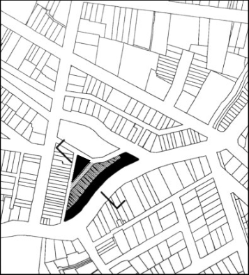

> [Picture on page 33: a picture, saved as a picture (images/chapter-d5-double-bay-centre-page-33-7.gif, 150 dpi).]

#### Desired future character

a) Increase the spatial definition of the lane and street surveillance with an articulated building addressing the lane from the central triangular site.

b) Retain and extend the 2m set back on the south-eastern side of Goldman Lane.

c) Apply a 1m setback on the north-western side

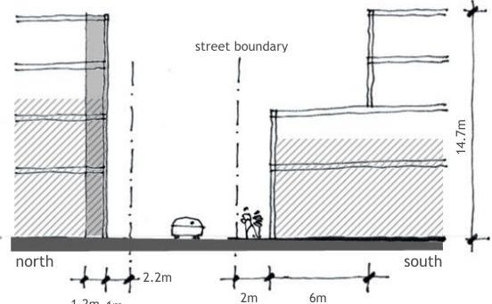

> [Picture on page 33: a picture, saved as a picture (images/chapter-d5-double-bay-centre-page-33-16.gif, 150 dpi).]
> Words printed on the picture (title and legend, copied from the PDF):
> street boundary
> 14.7m
> north
> south
> 2.2m
> 2m 6m

of Goldman Lane.

The use of roof terraces as open space is encouraged

The building line is setback to expand the public domain at street level and improve pedestrian amenity

Increase active retail frontage

1m

1.2m

#### Goldman Lane

Indicative existing built form Articulation zone

#### D5.4.13 Kiaora Lane

#### Existing character

The character of Kiaora Lane is compromised by its current “back of house” status, with loading vehicles, exposed on-site loading bays and rubbish bins. Recent lane widening creates a framework within which to improve the general character and particularly pedestrian amenity. A setback zone to its north side has been partially built.

Kiaora Lands occupies the southern side of the laneway. It comprises a three storey retail development with public space opposite the Double Bay Library and public car park. An arcade provides access from Kiaora Lands to New South Head Road near Knox Street.

Location map and section direction

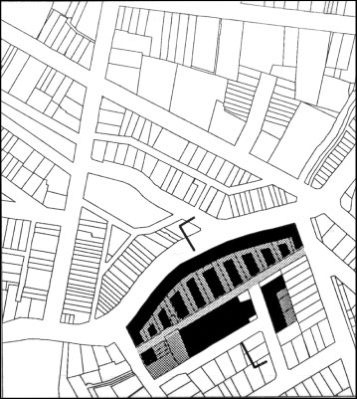

> [Picture on page 34: a picture, saved as a picture (images/chapter-d5-double-bay-centre-page-34-11.gif, 150 dpi).]

#### Desired future character

a) Improve the civic quality of the lane and this side of the centre with a public building and public square adjacent to a through-site link to New South Head Road.

b) Enhance pedestrian amenity with a car park on the existing car park site with active retail addressing the lane.

c) Moderate the scale of built form along the north side of the lane with buildings of predominantly two storeys, set back 2m from the lane boundary, and interspersed with four storey development.

d) Protect the amenity of the lane by preventing uninterrupted four storey buildings constructed to the street boundary along the northern built edge.

A variety of roof forms is encouraged

Provide an active retail edge to the lane

4 storey development may be permitted on 50% of the site frontage.

Provide retail on the ground floor with car parking above or below retail levels.

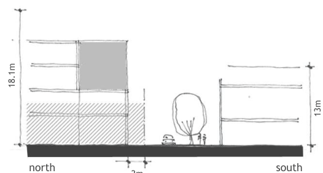

> [Picture on page 35: a picture, saved as a picture (images/chapter-d5-double-bay-centre-page-35-15.gif, 150 dpi).]
> Words printed on the picture (title and legend, copied from the PDF):
> 18.1m
> 13m
> north
> south

2m

Colonnade edging the lane

#### Kiaora Lane

A 2m setback is required to expand the public domain at street level and improve pedestrian amenity

Indicative existing built form (2014) Articulation zone

Note:  Refer to the built form envelopes in Appendix 2 Kiaora Lands for objectives and strategy for Kiaora Lane as it relates to the Kiaora Lane site.
