#### D5.5 Built form envelopes: Control drawings

#### D5.5.1 Urban form methodology

This section contains control drawings which show building envelopes for every site in the Double Bay Centre.

The envelopes generally establish: four storey heights along streets; two storey heights along lanes; and lesser building depths above the first floor to achieve high amenity development flexible for residential or commercial uses.

This framework has been tailored to each site, taking into consideration its particular characteristics. These include: the relationship of buildings to the public domain such as the street, public park or square; the desired future character of the street in which the site is situated; its size and orientation; the significance of existing buildings and landscape; its optimum development potential; and managing the impact of its development on adjoining commercial or residential properties.

This urban form methodology defines a physical outcome for the centre, while encouraging innovative architectural design within the building envelopes. It provides more certainty of outcome for Council, community and site owners.

Controls for levels 1-2 (ground and first floor) differ to those for levels 3-5.

At street level the integration of retail and commercial uses, vehicular access and street awnings, are the primary needs to be considered. Upper floor level envelopes are designed to facilitate quality residential and commercial development.

For this reason there are two control drawings for each urban block in the Double Bay Centre, illustrating the level 1 and 2 and level 3-5 envelopes for every site. Summary built form drawings for the Double Bay Centre are provided in Sections 5.5.3 and 5.5.4.

The maximum floor space permitted is determined by the floor space ratio (FSR) in Woollahra LEP

2014\. All development must comply with the applicable FSR control.

The control drawings use building envelopes to illustrate how floor space is to be distributed over the site. The envelopes have been designed to achieve a loose fit with the FSR to encourage building articulation, through-site connections, and some variation of building form and building character.  The envelopes allow varied and innovative design; they are not to be used as a justification for FSR in excess of the LEP control.

A summary of some of the development controls in Section D5.6 such as setbacks and building articulation are provided with the control diagrams. The control drawings in this section should be read in conjunction with Section D5.6 which provides further explanation, and includes other relevant controls.

#### D5.5.2 Explanatory legend

The control drawings incorporate the following graphic symbols:

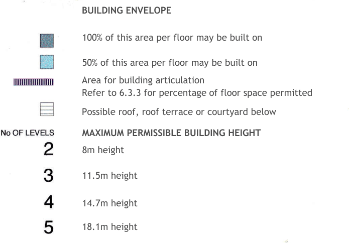

> [Picture on page 38: a picture, saved as a picture (images/chapter-d5-double-bay-centre-page-38-3.gif, 150 dpi).]
> Words printed on the picture (title and legend, copied from the PDF):
> BUILDING ENVELOPE
> 100% of this area per floor may be built on
> 50% of this area per floor may be built on
> Area for building articulation
> Refer to 6.3.3 for percentage of floor space permitted
> Possible roof, roof terrace or courtyard below
> MAXIMUM PERMISSIBLE BUILDING HEIGHT
> 8m height
> 11.5m height
> 14.7m height
> 18.1m height

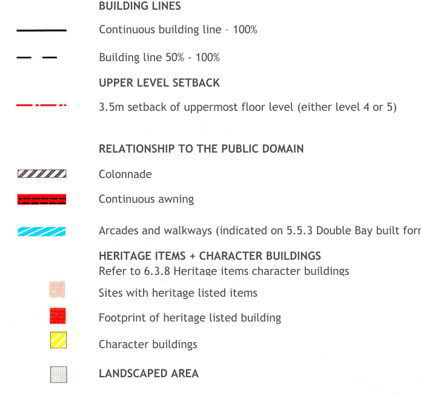

> [Picture on page 38: a picture, saved as a picture (images/chapter-d5-double-bay-centre-page-38-4.gif, 150 dpi).]
> Words printed on the picture (title and legend, copied from the PDF):
> BUILDING LINES
> Continuous building line – 100%
> Building line 50% - 100%
> UPPER LEVEL SETBACK
> 3.5m setback of uppermost floor level (either level 4 or 5)
> RELATIONSHIP TO THE PUBLIC DOMAIN
> Colonnade
> Continuous awning
> Arcades and walkways (indicated on 5.5.3 Double Bay built form envelopes – ground and first floor)
> HERITAGE ITEMS + CHARACTER BUILDINGS
> Refer to 6.3.8 Heritage items character buildings
> Sites with heritage listed items
> Footprint of heritage listed building
> Character buildings
> LANDSCAPED AREA

#### D5.5.3 Double Bay Centre built form envelopes, ground and first floors

#### (levels 1 and 2)

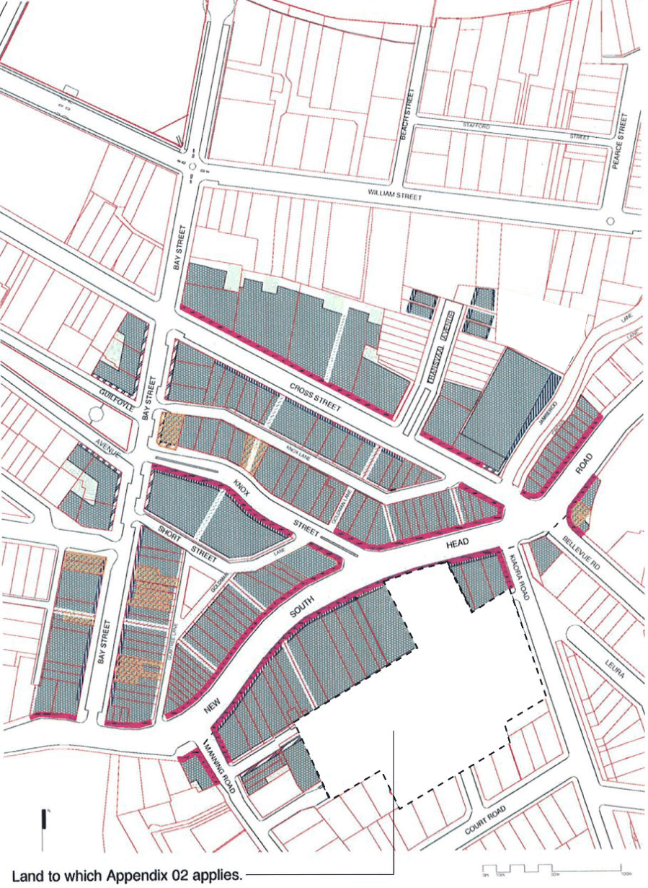

> [Picture on page 39: a picture, saved as a picture (images/chapter-d5-double-bay-centre-page-39-3.gif, 150 dpi).]

#### D5.5.4 Double Bay Centre built form envelopes (levels 3 and above)

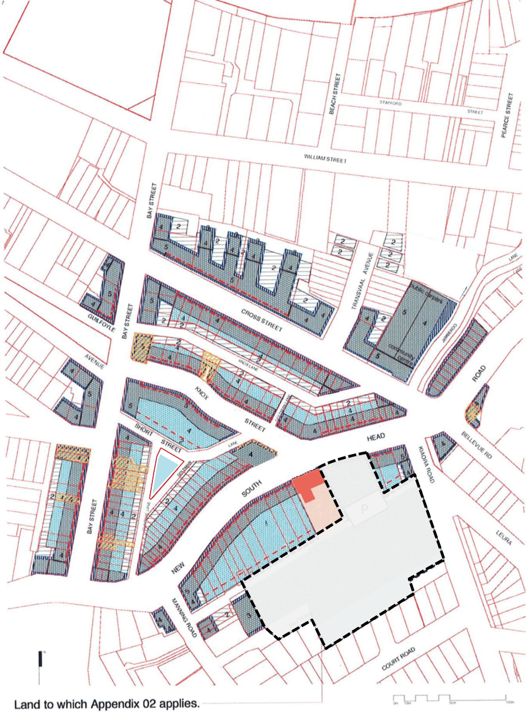

> [Picture on page 40: a picture, saved as a picture (images/chapter-d5-double-bay-centre-page-40-2.gif, 150 dpi).]
> Words printed on the picture (title and legend, copied from the PDF):
> 4

#### D5.5.5 Control drawing 1

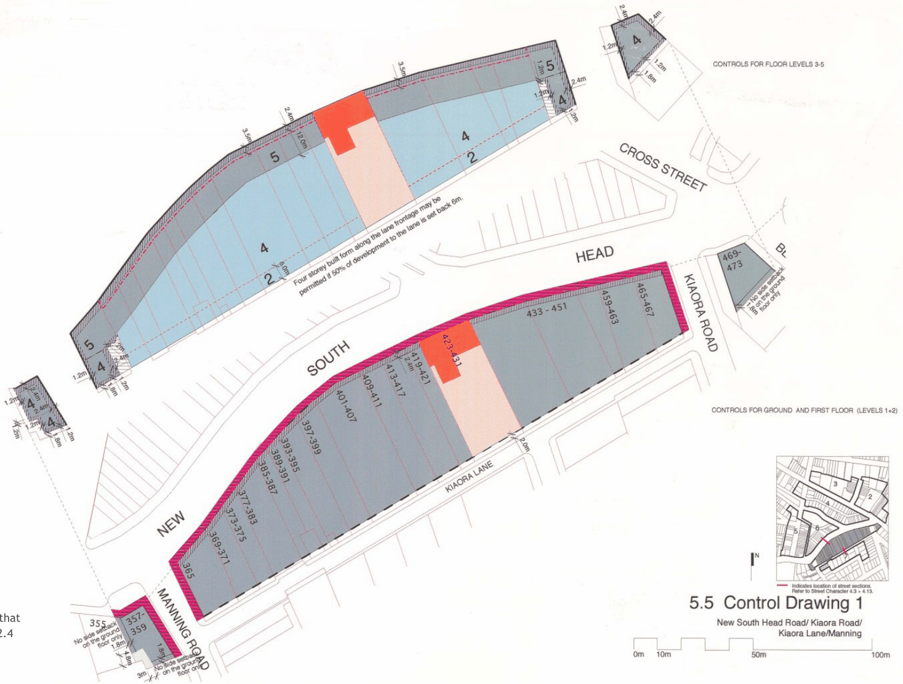

> [Picture on page 42: a picture, saved as a picture (images/chapter-d5-double-bay-centre-page-42-2.gif, 150 dpi).]

#### Control summary

#### 5.6.3 Urban character

#### Articulation

At the street frontage on levels 2-5 articulation comprises 80% internal space 20% external space. For the ground floor along New South Head Road, at least 60% of the articulation zone is external space. See Section 5.6.3.3 Building articulation for more information.

#### Setbacks

Zero front setback to New South Head Road, Manning Road and Kiaora Road. 2m rear setback on Kiaora Lane. See Section 5.6.3.4 Setbacks for more information.

#### Corner buildings

Selected corner sites are eligible for bonus FSR under Woollahra LEP 2014. See Section 5.6.3.5 Corner buildings for more information.

#### Heritage items

New development or work to the Golden Sheaf Hotel at 423-431 New South Head Road  must be compatible with the significance of this heritage item. See Section 5.6.3.8 Heritage items and character buildings for all heritage controls and Woollahra LEP 2014. Note: Section 5.6.3 also includes Architectural resolution and Roof design.

#### 5.6.5 Amenity

#### Landscaped areas

357-359 New South Head Road includes 50m2 of landscaped area. See also: Section 5.6.4 Relationship to public domain Section 5.6.6 Solar access and natural ventilation

s control drawing that shown in clause A2.4

#### BUILDING ENVELOPE

#### UPPER LEVEL SETBACK

#### Control drawing 1

100% of this area per floor may be built on

3.5m setback of uppermost floor level (either level 4 or 5)

50% of this area per floor may be built on

#### RELATIONSHIP TO THE PUBLIC DOMAIN

Area for building articulation. Refer to 6.3 for configuration

Continuous awning

New South Head Road/ Kiaora Road/ Manning Road

Possible roof, roof terrace or courtyard below

#### HERITAGE ITEMS

#### BUILDING LINES

Sites with heritage listed items

Indicates location of street sections

Continuous building line  – 100%

Footprint of heritage listed building

Building line 50% - 100%

#### LANDSCAPED AREA

#### Control summary

#### 5.6.3 Urban character

#### Articulation

New South Head Road: On levels 2-5, up to 80% of the street façade articulation zone must be internal space with the balance of the area used for external space. Elsewhere: At the street frontage, articulation on all levels should be comprised of up to 40% internal space with 60% external space. See Section 5.6.3.3 Building articulation for more information.

#### Setbacks

Ground floor: Zero front setback to New South Head Road, Cross Lane and Transvaal Avenue, except Nos. 17-19 Transvaal Avenue which must be setback to align with adjoining cottages in the HCA. A 2.4m setback applies on Cross Street between Transvaal Avenue and Jamberoo Lane. Levels 2-5: Setbacks to match ground floor except at the corners of Transvaal Avenue and Jamberoo Lane as illustrated. See Section 5.6.3.4 Setbacks for more information.

#### Character buildings

Character building: Cooper’s Corner, 475 New South Head Road. See Section 5.6.3.8 Heritage items and character buildings for controls for character buildings.

#### Heritage conservation areas

Refer to Appendix 1 for development in the Transvaal Heritage Conservation Area. Note: Section 5.6.3 also includes Architectural resolution and Roof design. See also:

#### 5.6.4 Relationship to public domain

#### 5.6.5 Amenity

#### 5.6.6 Solar access and natural ventilation

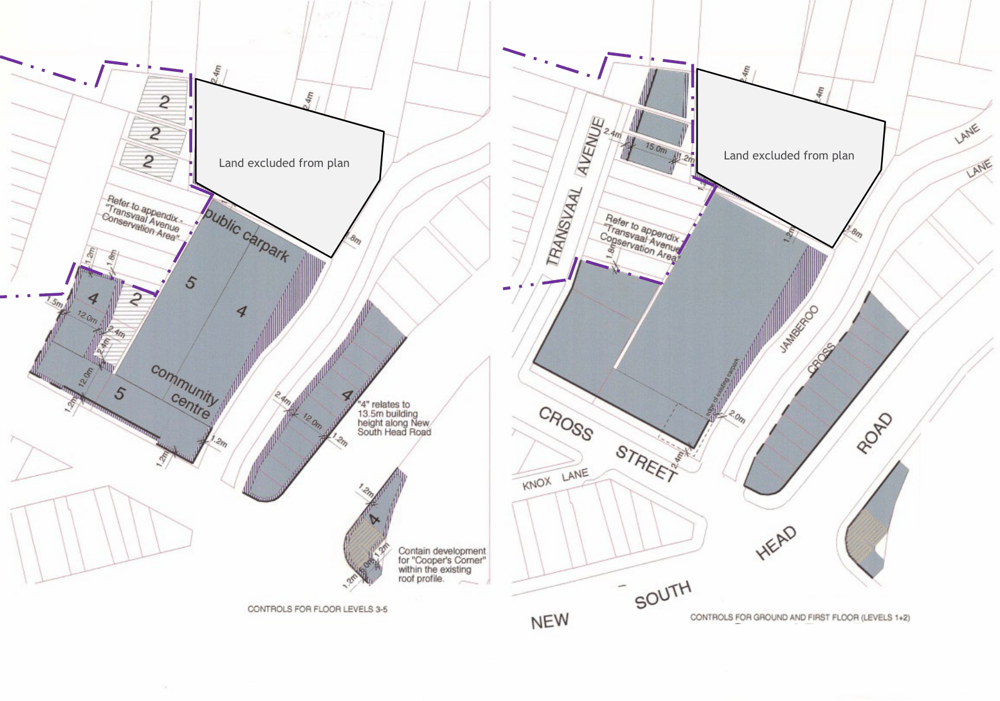

> [Picture on page 44: a picture, saved as a picture (images/chapter-d5-double-bay-centre-page-44-32.gif, 150 dpi).]
> Words printed on the picture (title and legend, copied from the PDF):
> Land excluded from plan
> Land excluded from plan

#### BUILDING ENVELOPE

#### CHARACTER BUILDINGS

#### Control drawing 2

100% of this area per floor may be built on

Character buildings

Area for building articulation. Refer to 6.3 for configuration Possible roof, roof terrace or courtyard below

Heritage Conservation Area

Transvaal Avenue/ Cross Street/ Jamberoo Lane

#### BUILDING LINES

Continuous building line  – 100% Building line 50% - 100%

#### Control summary

#### 5.6.3 Urban character

#### Articulation

At the street frontage, articulation on levels 2-5 should be comprised of up to 40% internal space with 60% external space. See Section 5.6.3.3 Building articulation for more information.

#### Setbacks

Ground floor: Zero front setback to Bay Street. 3m setback on Transvaal Avenue except for Nos. 18-20 which must be setback to align with adjoining cottages in the HCA. 3.5m on Cross Street between Bay Street and Transvaal Avenue.

CONTROLS FOR FLOOR LEVELS 3-5

Levels 2-5: Setbacks to match ground floor except at the corner of Cross Street and Transvaal Avenue as illustrated. Balconies on levels 3 and 4 can project 1.2m into the setback, except balconies on level 4 if it is the top level. See Section 5.6.3.4 Setbacks for more information.

#### Heritage conservation areas

Refer to Appendix 1 for development within the Transvaal Avenue Heritage Conservation Area. Note: Section 5.6.3 also includes Architectural resolution and Roof design. See also:

#### 5.6.4 Relationship to public domain

#### 5.6.5 Amenity

#### 5.6.6 Solar access and natural ventilation

CONTROLS FOR GROUND AND FIRST FLOOR (LEVELS 1 + 2)

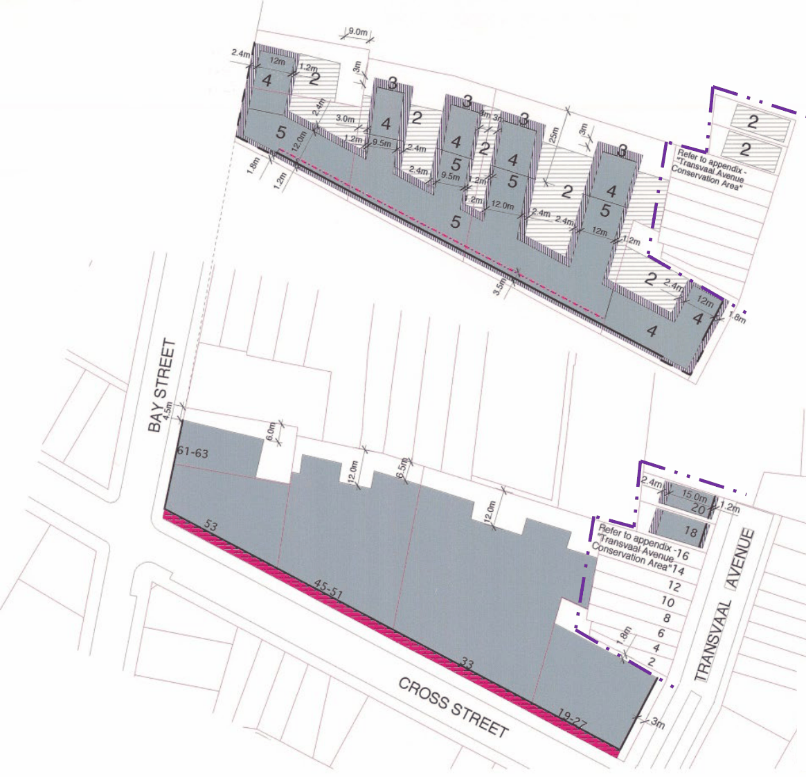

> [Picture on page 46: a picture, saved as a picture (images/chapter-d5-double-bay-centre-page-46-28.gif, 150 dpi).]

#### BUILDING ENVELOPE

#### UPPER LEVEL SETBACK

#### Control drawing 3

100% of this area per floor may be built on

3.5m setback of uppermost floor level (either level 4 or 5)

Area for building articulation. Refer to 6.3 for configuration

#### RELATIONSHIP TO THE PUBLIC DOMAIN

Possible roof, roof terrace or courtyard below

Continuous awning

Bay Street/ Cross Street/ Transvaal Avenue

#### BUILDING LINES

Continuous building line  – 100%

Heritage Conservation Area

Indicates location of street sections

Building line 50% - 100%

#### Control summary

#### 5.6.3 Urban character

#### Articulation

Cross Street: On the ground floor, internal space can occupy up to 100% of articulation zone. On levels 2-5, up to 40% of the articulation zone may be internal or external space. New South Head Road: On levels 2-5, up to 80% of the street façade articulation zone must be internal space with the balance of the area used for external space.

#### Setbacks

Ground floor: A zero front setback applies except in Bay Street and Guilfoyle Avenue where a 2.4m setback applies, and at the Knox Street frontage of 45A Bay Street where a 3m setback applies. Levels 4-5: A 3.5m setback applies to the uppermost level as indicated.

Corner buildings Selected corner sites are eligible for bonus FSR under Woollahra LEP 2014. See Section 5.6.3.5 Corner buildings for more information.

#### Character buildings

Character buildings: 45A Bay Street and 21-25 Knox Street. See Section 5.6.3.8 Heritage items and character buildings for controls for character buildings. Note: Section 5.6.3 includes information on Architectural resolution and Roof design.

#### 5.6.4 Relationship to public domain

#### Colonnades

Colonnades must be constructed on the ground floor frontage of Guilfoyle Avenue, Bay Street and at the Bay Street frontage of 45A Bay Street. Note: Section 5.6.4 includes more information on colonnades and a section on awnings.

#### 5.6.5 Amenity

#### Landscaped areas

38 Bay Street must include 265m2 of landscaped area. See Section 5.6.6 Solar access and natural ventilation also.

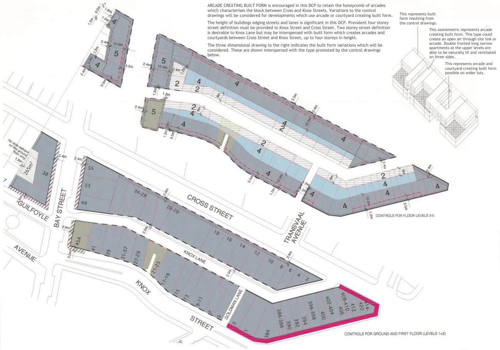

> [Picture on page 48: a picture, saved as a picture (images/chapter-d5-double-bay-centre-page-48-37.gif, 150 dpi).]
> Words printed on the picture (title and legend, copied from the PDF):
> ARCADE CREATING BUILT FORM is encouraged in this DCP to retain the honeycomb of arcades
> which characterises the block between Cross and Knox Streets. Variations to the control
> drawings will be considered for developments which use arcade or courtyard creating built form.
> This represents built
> form resulting from
> the control drawings.
> The height of buildings edging streets and lanes is significant in this DCP. Prevalent four storey
> street definition must be provided to Knox Street and Cross Street. Two storey street definition
> is desirable to Knox Lane but may be interspersed with built form which creates arcades and
> courtyards between Cross Street and Knox Street, up to four storeys in height.
> The three dimensional drawing to the right indicates the built form variations which will be
> considered. These are shown interspersed with the type promoted by the control drawings
> below.
> This axonometric represents arcade
> creating built form. This type could
> create an open air through site link or
> arcade. Double fronted long narrow
> apartments at the upper levels are
> able to be naturally lit and ventilated
> on three sides.
> This represents arcade and
> courtyard creating built form
> possible on wider lots.

#### BUILDING ENVELOPE

#### UPPER LEVEL SETBACK

#### Control drawing 4

100% of this area per floor may be built on

3.5m setback of uppermost floor level (either level 4 or 5)

50% of this area per floor may be built on

#### RELATIONSHIP TO THE PUBLIC DOMAIN

Area for building articulation. Refer to 6.3 for configuration

Colonnade

Knox Street/ Bay Street/ Cross Street New South Head Road Option 1

Possible roof, roof terrace or courtyard below

Continuous awning

#### BUILDING LINES

#### CHARACTER BUILDINGS

Indicates location of street sections

Continuous building line  – 100%

Character buildings

Building line 50% - 100%

#### LANDSCAPED AREA

#### Control summary

#### 5.6.3 Urban character

#### Articulation

Bay Street: On the ground floor, internal space can occupy up to 100% of articulation zone. On levels 2-5, up to 40% of the articulation zone may be internal or external space. See Section 5.6.3.3 Building articulation for more information.

#### Setbacks

Ground floor: Zero front setback except for Nos. 28 and 30-36 Bay Street and 2 Guilfoyle Avenue which require a 2.4m for colonnades. A 2m rear setback applies to Gumtree Lane and a 0.7m setback applies to part of Brooklyn Lane. Levels 2-5: Setbacks to match ground floor, except level 4 which must be setback 3.5m as indicated along Bay Street. See Section 5.6.3.4 Setbacks for more information.

#### Character buildings

Character buildings are located at 14, 24-26, 9-15 and 29-37 Bay Street. See Section 5.6.3.8 Heritage items and character buildings for controls for character buildings. Note: Section 5.6.3 includes Architectural resolution and Roof design.

#### 1.6.4 Relationship to public domain

#### Colonnades

Colonnades must be constructed on the ground floor frontage of Guilfoyle Avenue and Bay Street. Note: Section 5.6.4 includes more information on colonnades and a section on awnings.

#### 1.6.5 Amenity

#### Landscaped areas

28 and 30-36 Bay Street and 2 Guilfoyle Avenue must include landscaped areas as indicated. See Section 5.6.6 Solar access and natural ventilation for more information.

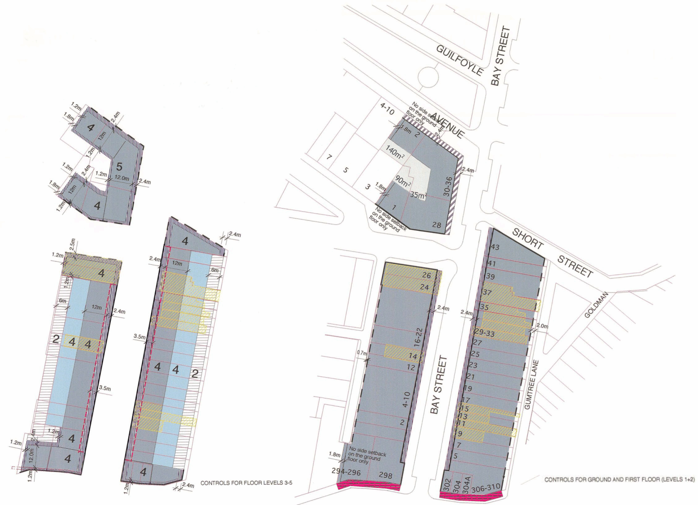

> [Picture on page 50: a picture, saved as a picture (images/chapter-d5-double-bay-centre-page-50-35.gif, 150 dpi).]

#### BUILDING ENVELOPE

#### UPPER LEVEL SETBACK

#### Control drawing 5

100% of this area per floor may be built on

3.5m setback of level 4

50% of this area per floor may be built on

#### RELATIONSHIP TO THE PUBLIC DOMAIN

Indicates location of street sections

Area for building articulation. Refer to 5.6.3.3 for configuration

Colonnade

Possible roof, roof terrace or courtyard below

Continuous awning

#### BUILDING LINES

#### CHARACTER BUILDINGS

Continuous building line  – 100%

Character buildings

Building line 50% - 100%

#### LANDSCAPED AREA

#### Control summary

#### 5.6.3 Urban character

#### Articulation

New South Head Road: On levels 3-5, up to 80% of the street façade articulation zone must be internal space with the balance of the area used for external space. Knox Street: On the ground floor, internal space can occupy up to 100% of articulation zone. On levels 2-5, up to 40% of the articulation zone may be internal space See Section 5.6.3.3 Building articulation for more information.

#### Setbacks

The following setbacks apply: Bay Street, ground floor - 2.4m. 320-366 New South Head Road - 2m rear setback. 2-22 Knox Street 2m to Short Street and Goldman Lane. The uppermost floor of levels 4 or 5 at 2-22 Knox Street and 316-374 New South Head Road

- 3.5m. See Section 5.6.3.4 Setbacks for more information. Note: Section 5.6.3 also includes Architectural resolution and Roof design.

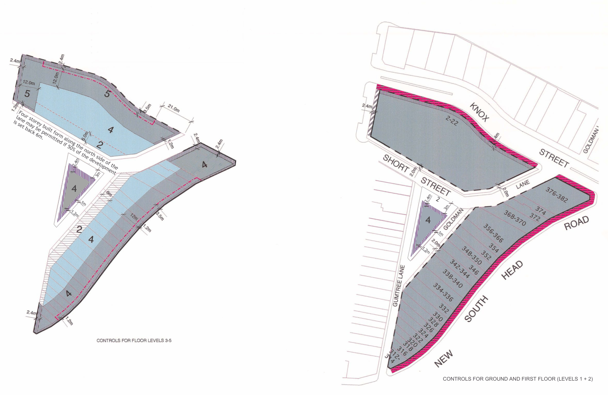

> [Picture on page 52: a picture, saved as a picture (images/chapter-d5-double-bay-centre-page-52-20.gif, 150 dpi).]
> Words printed on the picture (title and legend, copied from the PDF):
> CONTROLS FOR GROUND AND FIRST FLOOR (LEVELS 1 + 2)

#### 4

#### 4

#### 4

#### 4

#### 5.6.4 Relationship to public domain

#### 4

#### 4

#### Awnings

A continuous awning must be provided at the frontage of properties on New South Head Road and Knox Street. See Section 5.6.4.1 Awnings for more information.

#### Colonnades

Colonnades must be constructed on the ground floor frontage of Bay Street. See Section 5.6.4.2 Colonnades for more information.

#### BUILDING ENVELOPE

#### UPPER LEVEL SETBACK

#### Control drawing 6

100% of this area per floor may be built on

3.5m setback of uppermost floor level (either level 4 or 5)

50% of this area per floor may be built on

#### RELATIONSHIP TO THE PUBLIC DOMAIN

New South Head Road/ Kiaora Road/ Manning Road

Area for building articulation. Refer to 5.6.3.3 for configuration

Colonnade

Possible roof, roof terrace or courtyard below

Continuous awning

#### BUILDING LINES

Continuous building line  – 100%

Indicates location of street sections

Building line 50% - 100%

#### Control summary

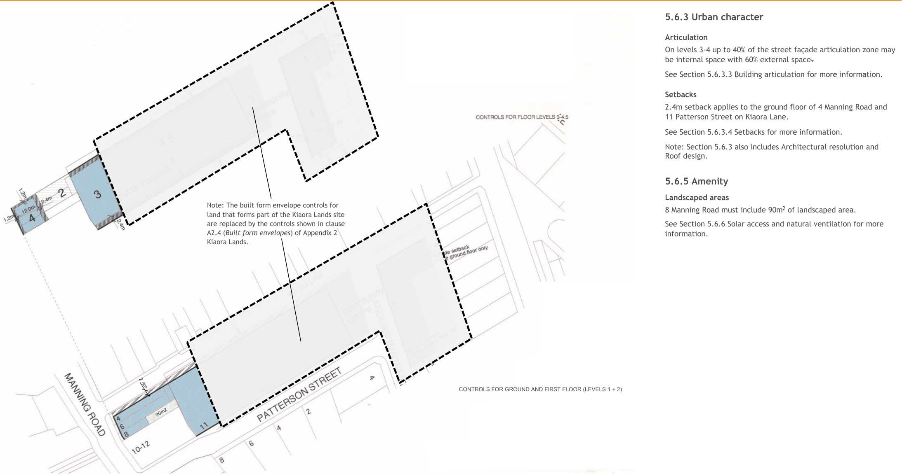

> [Picture on page 54: a picture, saved as a picture (images/chapter-d5-double-bay-centre-page-54-2.gif, 150 dpi).]
> Words printed on the picture (title and legend, copied from the PDF):
> Articulation
> On levels 3-4 up to 40% of the street façade articulation zone may
> be internal space with 60% external space.
> See Section 5.6.3.3 Building articulation for more information.
> Setbacks
> 2.4m setback applies to the ground floor of 4 Manning Road and
> 11 Patterson Street on Kiaora Lane.
> See Section 5.6.3.4 Setbacks for more information.
> Note: Section 5.6.3 also includes Architectural resolution and
> Roof design.
> Landscaped areas
> 8 Manning Road must include 90m2 of landscaped area.
> See Section 5.6.6 Solar access and natural ventilation for more
> information.
> Note: The built form envelope controls for
> land that forms part of the Kiaora Lands site
> are replaced by the controls shown in clause
> A2.4 (Built form envelopes) of Appendix 2
> Kiaora Lands.
> CONTROLS FOR GROUND AND FIRST FLOOR (LEVELS 1 + 2)

#### 5.6.3 Urban character

#### 5.6.5 Amenity

#### BUILDING ENVELOPE

#### UPPER LEVEL SETBACK

#### Control drawing 7

100% of this area per floor may be built on

3.5m setback of uppermost floor level (either level 4 or 5)

50% of this area per floor may be built on

#### RELATIONSHIP TO THE PUBLIC DOMAIN

Indicates location of street sections

Area for building articulation. Refer to 5.6.3.3 for configuration

Colonnade

Possible roof, roof terrace or courtyard below

#### LANDSCAPED AREA

#### BUILDING LINES

Continuous building line  – 100% Building line 50% - 100%

#### D5.5.12 View 1: 3D view of building envelopes

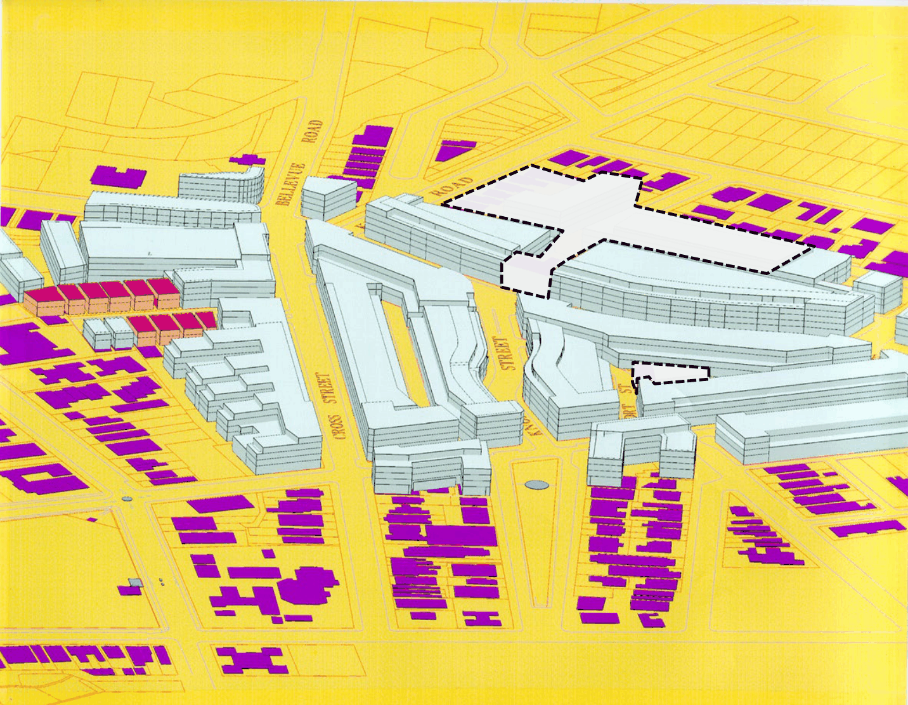

> [Picture on page 56: a picture, saved as a picture (images/chapter-d5-double-bay-centre-page-56-2.gif, 150 dpi).]

#### View east along Cross Street

The building envelopes illustrate the permitted distribution of floor space in the centre. The FSR controls in Woollahra LEP 2014 limit the amount of floor space in the centre. Note: This 3D view does not illustrate building envelopes as described in Appendix 2 Kiaora Lands.

#### D5.5.13 View 2: 3D view of building envelopes

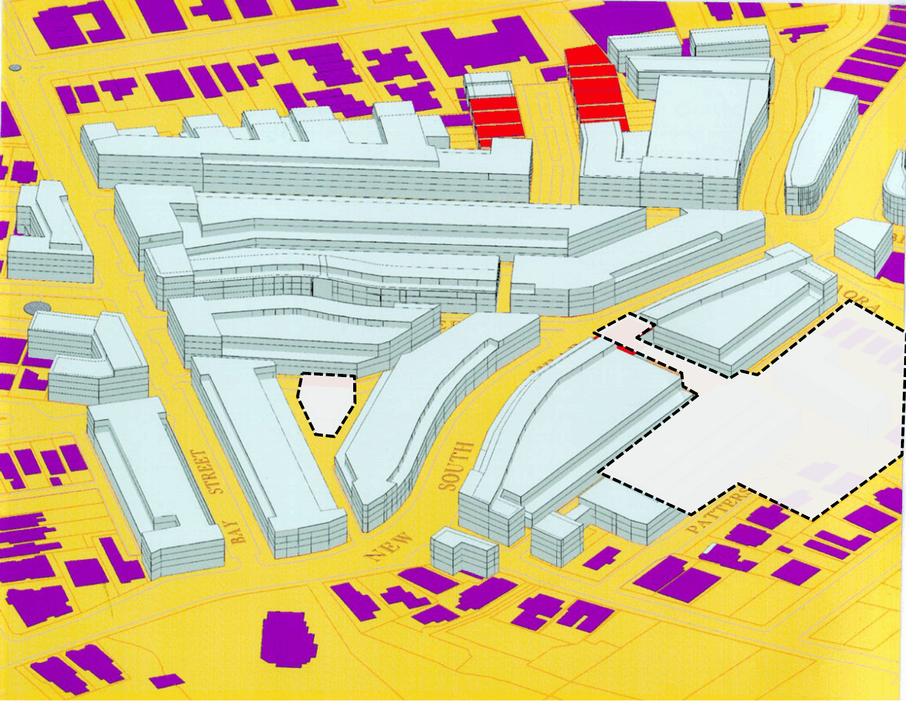

> [Picture on page 58: a picture, saved as a picture (images/chapter-d5-double-bay-centre-page-58-2.gif, 150 dpi).]

#### View north along Bay Street

The building envelopes illustrate the permitted distribution of floor space in the centre. The FSR controls in Woollahra LEP 2014 limit the amount of floor space in the centre. Note: This 3D view does not illustrate building envelopes as described in Appendix 2 Kiaora Lands.
