#### D5.6 Development controls

#### D5.6.1 Format

This section contains the development controls for building and site elements in the Double Bay Centre. It provides further explanation of the Section D5.5 Built Form Envelopes: Control Drawings, and introduces additional controls not described in these drawings.

The following format is used:

#### Introduction

For most controls there is an introduction which explains the need and importance of including that particular element.

#### Objectives

The objectives define Council’s intention. They relate to the aims and objectives in Section D5.3 Urban structure, and the desired future character outlined in Section D5.4 Street character.

#### Controls

The controls establish the means of achieving the objectives. This section must be read in conjunction with the Built Form Envelopes: Control drawings that illustrate the site specific controls. Diagrams are incorporated with the development controls to assist interpretation.

Not all controls will be relevant to every development. The applicant must nominate and provide justification for any controls they consider irrelevant to their development.

If a development proposal departs from a relevant control the applicant must demonstrate how the development satisfies the underlying objectives of the control.

#### D5.6.2 Use

The distinctive mix of small scale shops, boutiques, restaurants, cafes, hotels, commercial premises and the like in the Double Bay Centre creates a friendly street environment that caters for the daily needs of the centre’s users and creates an attractive environment for visitors.

Continuous ground level retail frontage offers the benefits of safety, commercial activity and street life. The provision of mixed development can make a significant contribution to the local character, providing street surveillance and after hour activity in the centre.

Previously there was very little residential use within the Double Bay Centre. Development in the last 10 years has tended to be mixed use, with ground floor retail with residential above. Residential development is encouraged within the centre to: increase the areas activity and vibrancy at night; encourage the provision of a range of retail services, particularly food stores; and reduce the reliance on cars to access the centre.

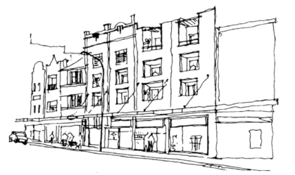

> [Picture on page 61: a picture, saved as a picture (images/chapter-d5-double-bay-centre-page-61-14.gif, 150 dpi).]

FIGURE 18  Building use Retain the range and intensity of existing retail uses in Double Bay and increase the level of activity in the centre by increasing the residential component of mixed use development

#### Objectives

O1 Encourage upper storey residential development within the centre to enhance the cosmopolitan character of the Double Bay Centre.

O2 Encourage mixed use development to reduce transport and travel requirements.

O3 Encourage the continuation of retail and commercial uses at street level in the centre.

O4 Encourage first floor retail and commercial use.

O5 Encourage arcades and double fronted shops that provide through block connections for pedestrians.

O6 Limit the width of retail frontage to preserve the small shop character of the centre.

O7 Encourage multi-level dwellings on the upper storeys of development as a means of redeveloping small narrow allotments.

O8 Encourage activities which do not have unacceptable noise or other environmental impacts.

O9 Ensure that buildings are designed and constructed to minimise noise and other impacts on building occupants and adjoining properties.

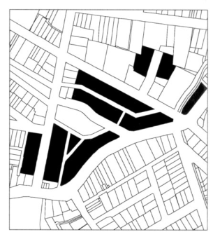

> [Picture on page 62: a picture, saved as a picture (images/chapter-d5-double-bay-centre-page-62-4.gif, 150 dpi).]

FIGURE 19  Reinforce existing small lot development prevalent in the centre Site amalgamation is particularly discouraged on these lots. Where small lots (lots that are less than 6m wide and/or less than 30m deep) are amalgamated, the façade of the new buildings should be articulated and modulated to reflect the historic subdivision pattern.

#### Controls

C1 Design for a mix of uses within buildings.

C2 Design durable and adaptable buildings, spaces and places.

C3 Design for retail, commercial and community uses at ground and first floor levels. Consider design solutions that promote retail, commercial use at first floor level such as galleried arcades.

C4 Access to residential uses should not occupy more than 20% of the ground floor frontage.

C5 The maximum retail frontage at street level for individual premises identified on the diagram above must correspond with current lot widths. Other lots must not exceed 15m for each street frontage.

C6 The architectural resolution of buildings on amalgamated small lots identified in Figure 19 must express existing lot widths.

#### D5.6.3 Urban character

#### 5.6.3.1 Building envelopes

Building envelopes illustrate the limits of permissible building height, depth and location and are described on the control drawings, Section 5.5.5—5.5.11. The envelopes allow development that maintains the environmental amenity of buildings and the public domain with regard to building bulk, overshadowing, access to natural light and ventilation and views.

The building envelopes have been developed to foster a mix of uses in the centre, and to promote built form not reliant on artificial lighting, heating and ventilation. The deep ground and first floor building envelopes are suitable for retail and commercial uses, while the depths of envelopes for levels 3-5 are suitable for residential uses. The depth of residential buildings promoted in this chapter is based on the guidelines contained in the Residential Flat Design Code.

The building envelopes have been considered in conjunction with FSR. The FSR controls in Woollahra LEP 2014 limit the amount of floor space in the centre. The building envelopes illustrate the permitted distribution of floor space in the centre. The permissible floor space for each site (determined by FSR) is generally 80% of the theoretical floor space achievable within the building envelopes.

Uniform FSR facilitates development equity between sites; the envelopes allow flexibility in the ways the built form will be realised including the provision of arcades and through-site links.

Car parking above ground is not encouraged. If car parking is proposed at or above ground level (i.e. within the building envelope) the development may not achieve its maximum permissible floor space, and Council will not support a larger building envelope to provide for additional floor space.

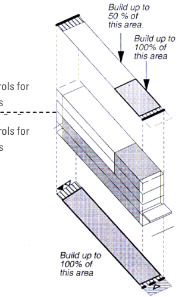

> [Picture on page 63: a picture, saved as a picture (images/chapter-d5-double-bay-centre-page-63-23.gif, 150 dpi).]
> Words printed on the picture (title and legend, copied from the PDF):
> 3  5

FIGURE 20  3-dimensional controls Highlighting the building envelopes.

Controls for levels

Controls for levels

FIGURE 21  Building envelope Potential architectural resolution within 100% and 50% building envelopes.

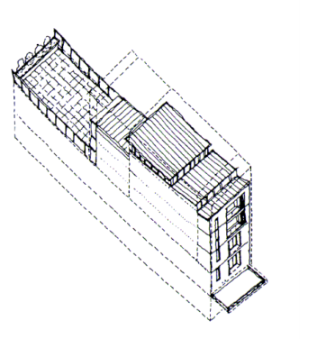

> [Picture on page 64: a picture, saved as a picture (images/chapter-d5-double-bay-centre-page-64-4.gif, 150 dpi).]

#### Objectives

O1 Development should contribute to the desired future character of streetscapes with appropriate and consistent building forms.

O2 Encourage courtyards and light wells at ground and first floor level of deep blocks to allow natural lighting and ventilation.

O3 Enable the provision of through-site links and arcades.

O4 Encourage a variety of interior volumes, i.e. split levels, double height spaces and arcades.

#### Controls

C1 Development must occur within the building envelopes shown on the Built Form Envelopes: Control Drawings, Section 5.5.5—5.5.11.

C2 To create built form which is not reliant on artificial heating and cooling:

a) habitable rooms should generally achieve a minimum floor to ceiling height of 2.7m; and

b) level 3-5 building depth is limited to 15.6m including the articulation zones. When this is difficult to achieve in the residential component of a development, Council will consider variations to the overall building depth providing a minimum 80% of dwellings have windows that can be opened and/or doors in walls with differing orientations, to facilitate cross ventilation.

C3 Deep building footprints are permitted at the ground and first floor only.

C4 Building forms allow for:

a) natural day lighting and ventilation; and

b) privacy between dwellings or commercial premises.

#### 5.6.3.2 Height

The permissible height of development in the Double Bay Centre is set in Woollahra LEP 2014. The control drawings in Section 5.5.5—5.5.11 illustrate the desired number of storeys for each part of the centre.

Building height has been determined by the need to preserve a pedestrian scale in the centre. Factors which play a role in achieving an appropriate scale relate to the width, orientation and character of streets and lanes. The envelopes generally establish three to four storey building heights along streets, and two storey building heights along lanes. Building above this height is required to be setback from the street or lane boundary to preserve amenity in the public domain.

Short Street, Kiaora Lane and Knox Lane have the potential to be more like little streets than lanes being wider than other lanes in the centre, and may include four storey buildings along the lane frontage interspersed with two storey buildings, provided that at least 50% of lane frontage is two storeys or less.

#### Objectives

O1 Encourage buildings to achieve the heights along street and lane frontages described by the control drawings.

O2 Provide floor to floor heights that provide amenity to building users and allow adaptable reuse of levels.

#### Controls

C1 To reinforce the built definition of streets, buildings should be well designed and achieve the maximum prescribed height along the primary street frontage.

C2 To achieve a variety of roof forms the floor level of the uppermost habitable storey must be at least 3.5m below the maximum permissible building height.

C3 The building (including lift tower machinery plant rooms and storage space) must be contained within the envelope height, with the following exclusions: chimneys, flues, masts, flagpoles communication devices, satellite dishes and antennae.

C4 The minimum floor to floor heights for the Double Bay Centre comply with the table below.

| Level | Use | Height |
|---|---|---|
| Ground floor Retail1 4m |  |  |
| Levels 2-5 Commercial office 3.4m |  |  |
| Levels 2-5 Residential 3.1m |  |  |

1 Applicants may choose to vary storey height using 3.7m height for ground floor and Level 2 to create double storey spaces with a combined floor to floor height of 7.4m.

#### 5.6.3.3 Building articulation

Building articulation refers to the three dimensional modelling of a building facade. The control drawings indicate the area for building articulation on a site-by-site basis (see Section 5.5.5— 5.5.11).

Building articulation along the street or laneway frontage establishes the relationship between a building and the street, through the use of entry porches, loggias, balconies, bay windows and the like. Building facades can be articulated to create a strong street address, and enrich the character of the street or laneway. Existing buildings along the south-eastern side of Bay Street in particular demonstrate a range of transition areas and modelled facades.

Building articulation should respond to environmental conditions such as orientation, noise, breezes, privacy and views, through the use of appropriate sun shading devices, noise barriers, privacy screens, and the careful location of balconies, terraces and loggias.

The street façade articulation zone shown on the control diagrams may be occupied by two types of space: External: − open balconies − void not occupied by built form − recessed balconies counted in proportion to the amount of the façade they are open to.

Internal: − habitable rooms − bay windows − enclosed balconies − wintergardens.

FIGURE 23  Building articulation

FIGURE 22  3-dimensional controls Highlighting the area for building articulation

The written controls nominate percentages of the building articulation zone to be “external space or internal space”. These include loggias, balconies, terraces, open stairs and walkways, and the like and must be wholly contained within the envelope.

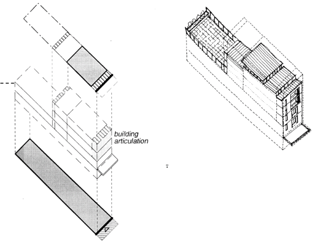

> [Picture on page 67: a picture, saved as a picture (images/chapter-d5-double-bay-centre-page-67-10.gif, 150 dpi).]
> Words printed on the picture (title and legend, copied from the PDF):
> .

Controls for levels 3  5 Controls for levels

#### Objectives

O1 Promote buildings of articulated design and massing, with building facades that contribute to the character of the street, and provide useable external spaces.

O2 Use building articulation to:

a) generate high quality architectural resolution;

b) provide private open space which addresses and overlooks streets and lanes;

c) provide environmental amenity such as noise reduction and visual privacy through building articulation;

d) provide thermal amenity within buildings such as screening and balconies for summer sunshading and maximising solar access in winter, appropriately scaled to their use and context; and

e) encourage activity such as outdoor eating along street edges, to help animate the street.

#### Controls

C1 The following percentages of internal and external space should be incorporated with the composition of the building to achieve high quality architectural resolution at the street or laneway frontage.

C2 The mix of internal and external space for articulation areas shown on the control drawings that do not front a street or laneway may be determined by the applicant.

Note:  The use of a palette of articulation elements is recommended to achieve high quality architectural resolution.

FIGURE 24  New South Head Road On levels 2-5 up to 80% the street façade articulation zone may be internal space with the balance of the area used for external space. On the ground floor of the south side of New South Head Road up to 40% of the street facade articulation zone should be internal space. The remaining 60% must be level with the footpath and should be part of the building or shop entry.

FIGURE 25  Bay Street South and south side of Cross Street On levels 2-5 up to 40% of the street façade articulation zone must be occupied with either or both internal or external space. On the ground floor up to 100% of the street façade articulation zone can be internal space.

FIGURE 26  All other areas On levels 2-5 up to 40% the street façade articulation zone can be occupied with internal space. On the ground floor up to 100% of the street façade articulation zone can be internal space.

#### 5.6.3.4 Setbacks

Setbacks at street level can increase pedestrian amenity. Street level setbacks are most successful when they establish continuous and consistent building alignments.

Setbacks on upper levels allow solar access to streets, and establish an appropriate relationship between building height and street width.

The controls include a continuous or discontinuous building line that requires development to meet this alignment to reinforce or create a particular street character. For example the building lines and articulation zones will create lightly articulated buildings (New South Head Road) or highly articulated buildings with recessed balconies (Knox Street).

#### Objectives

O1 Encourage consistent building lines to provide coherent streetscapes.

O2 Introduce new setbacks at street level in selected laneways to improve pedestrian amenity.

O3 Where indicated provide street setbacks to the upper level of development to permit mid-winter sunlight.

#### Controls

C1 Building alignment must comply with the building lines shown on the Built Form Envelopes: Control Drawings, Section 5.5.5—5.5.11.

C2 Front setbacks are identified as building lines on the control drawings, Section 5.5.5— 5.5.11. Front setbacks must define a coherent alignment to the public domain.

C3 Side setbacks must:

a) protect privacy to adjoining buildings; and

b) protect access to natural light and ventilation to adjoining buildings and residential areas.

C4 Rear setbacks must:

a) where required, accommodate vehicle access to the rear of lots, provide consolidated deep soil landscaped areas where blocks adjoin residential areas; and

b) protect privacy and facilitate solar access to adjoining buildings and gardens.

C5 Upper level street setbacks are identified on the control drawings, Section 5.5.5—5.5.11. Building articulation excluding floor area elements may be used between the setback line and the street boundary. Refer to Section 5.6.3.3 Building articulation.

#### 5.6.3.5 Corner buildings

Corner buildings are highly visible and provide the opportunity for notable design solutions. Strong corner buildings can provide valuable street definition.  Existing buildings within the study area that provide this definition include the buildings on the corners of Knox Street and New South Head Road, and Coopers Corner on the intersection of Bellevue Road and New South Head Road. Due to the distinctive street geometry strong corner buildings can play an important urban design role in the Double Bay Centre.

The corner lots that may be granted additional floor space are identified in clause 4.4A of Woollahra LEP 2014.  Figure 27 is an example of a strong existing corner building.  Figure 28 is an example of existing corner building that lacks scale. New development at this corner intersection should take a form similar to that illustrated in Figure 29.

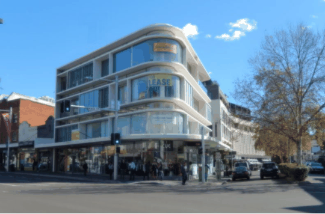

> [Picture on page 70: a picture, saved as a picture (images/chapter-d5-double-bay-centre-page-70-12.gif, 150 dpi).]

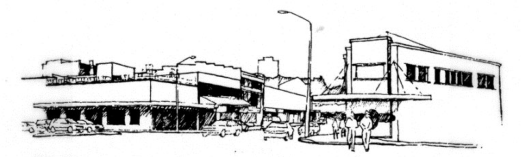

> [Picture on page 70: a picture, saved as a picture (images/chapter-d5-double-bay-centre-page-70-13.gif, 150 dpi).]

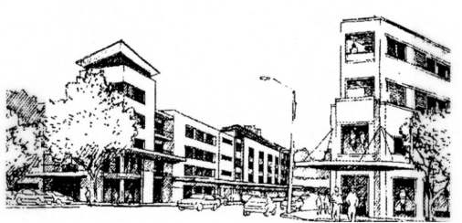

> [Picture on page 70: a picture, saved as a picture (images/chapter-d5-double-bay-centre-page-70-14.gif, 150 dpi).]

FIGURE 27  376 New South Head Road Located on the corner of Knox Street and New South Head Road, this building demonstrates good corner address

FIGURE 28  Existing corner buildings at the five way intersection near Cross Street currently lack the scale to adequately address this large space

FIGURE 29  The five way intersection could become a distinctive entry to the Double Bay Centre as illustrated, with buildings that strongly address the intersection. Where street geometries permit entries and windows should address the corner such as shown in this example

#### Objectives

O1 Encourage building massing and articulation that creates strong corner buildings.

O2 To outline the desired future character of corner sites where applicants seek to use an FSR of 3:1 per clause 4.4A of Woollahra LEP 2014.

#### Controls

C1 Consider the design of corner buildings in relation to street geometry, topography, sight lines and the design of skyline elements.

C2 Distribute building massing, such as height, to enhance the corner.

C3 Corner buildings are encouraged to achieve the maximum prescribed height along the street edge.

C4 Developments on sites listed below that comply with the development controls may be eligible for an FSR of 3:1 (refer to the floor space provisions in clause 4.4A of Woollahra LEP 2014):

a) Bay Street – 26, 28, 30/36, 38, 43, 45A, 49, 55;

b) Cross Street – 53; and

c) New South Head Road – 298, 302, 304, 304A, 306/310, 312/314, 357/359, 365, 376/382, 408/410, 412, 414/420, 422/424, 465/467, 469/473.

#### 5.6.3.6 Architectural resolution

Buildings in the Double Bay Centre represent a mixture of 20th century buildings that are of variable style and quality. High quality architectural resolution will improve living and working environments, contribute toward an improved built definition of the public domain, and can help to define a local identity.

FIGURE 30  Architectural resolution The masonry elements of a building can give it coherence

FIGURE 31  An existing building at Knox Lane showing an articulated upper level and roof

FIGURE 32  Architectural resolution The building wall is set back from the street and is modelled with attached building elements

FIGURE 33  Twenty One Espresso demonstrates fine grained building form in Knox Street

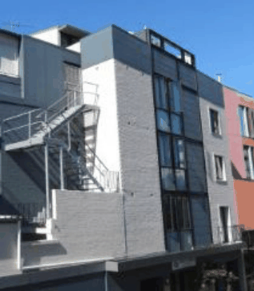

> [Picture on page 72: a picture, saved as a picture (images/chapter-d5-double-bay-centre-page-72-11.gif, 150 dpi).]

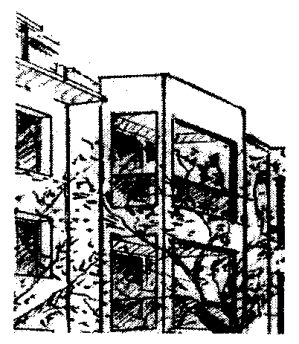

> [Picture on page 72: a picture, saved as a picture (images/chapter-d5-double-bay-centre-page-72-12.gif, 150 dpi).]

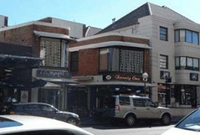

> [Picture on page 72: a picture, saved as a picture (images/chapter-d5-double-bay-centre-page-72-13.gif, 150 dpi).]

#### Objectives

O1 Promote high quality architectural design throughout the Double Bay Centre to create a desirable and memorable environment.

O2 Encourage coherent streetscapes based on common design principles for each street and lane.

O3 Minimise the negative impacts of glare and reflectivity on adjoining public and private properties.

04 To ensure that development enhances the visual quality and identity of the centre through well considered design, high quality materials and facade colours that do not dominate the street.

O5 The colour of the building facade is not intrusive or unreasonably dominant within the streetscape, and is compatible with the character of the centre.

#### Controls

C1 Provide a clear street address to each building. Clearly define pedestrian entries.

C2 Provide predominantly glazed shopfronts to ground floor retail areas. Roller shutters to shopfronts are not permitted.

C3 New buildings and facades do not result in glare that causes discomfort or threatens safety of pedestrians or drivers. Note: A reflectivity report that analyses the potential glare from the proposed new development on pedestrians or motorists may be required.

C4 New buildings and facades must minimise the impact of glare and reflectivity on adjoining land.

C5 Materials must be compatible with the existing urban context, such as red face brick and rendered masonry, in street facade design.

C6 The external painting of a building in bright colours, corporate colours or fluorescent colours should be avoided.

C7 Any individual business branding and identity in external painting and colour schemes is to be subordinate to the main colour schemes in the street.  (Also refer to the signage controls in Part E7 of the DCP, Section 7.2.2 When external painting of a building constitutes a wall sign.)

C8 The design of window and balcony openings must account for streetscape, heritage items, privacy, orientation and outlook.

C9 Richly articulate facades to express the different levels of the building and/or its functions.

C10 Blank party walls are to be avoided.

C11 Design commercial space to permit maximum flexibility for future uses.

C12 All rooms above ground floor level, including kitchens and bathrooms, are to have windows or skylights.

C13 The residential component of buildings must contain a variety of apartment sizes and layouts.

C14 Vehicular entries must be discrete and minimise conflicts with pedestrians.

#### 5.6.3.7 Roof design

The Double Bay Centre is located at the base of a large natural amphitheatre. As a result, building roof forms are highly visible, often forming the foreground to a harbour view, and require a well-considered design response.

Existing roof forms vary with building type and architectural style and include a range of hip roofs, gables, flat roofs, parapets and roof decks. A predominance of buildings with parapets contributes to the urban quality of New South Head Road.

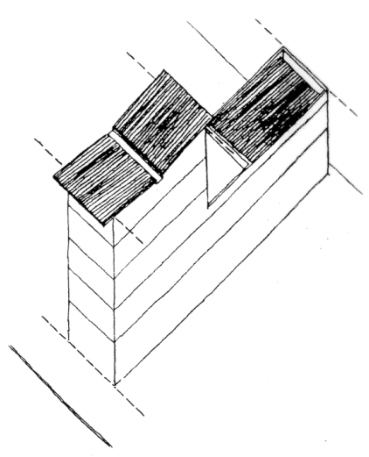

> [Picture on page 74: a picture, saved as a picture (images/chapter-d5-double-bay-centre-page-74-13.gif, 150 dpi).]

FIGURE 34  Roof design A variety of roof types are possible in the Double Bay Centre. Roof forms need to be articulated to control the apparent scale of the building when viewed from above

#### Objectives

O1 Encourage highly articulated roof design that responds to building orientation and the location and character of Double Bay.

O2 Roof designs should create distinctive building silhouettes.

O3 Encourage a variety of articulated roof forms for the Double Bay Centre such as hips, gables, flat roofs, parapets and roof decks.

O4 Discourage the provision of air conditioning plant and equipment on the roofs of buildings to minimise visual impact of these services.

> [Picture text on page 75 is stored in the PDF without readable letters (no character map), so it could not be copied; see the original PDF.]

#### Controls

C1 Roof design must form a coherent part of the whole building and be articulated.

C2 A variety of roofs are permitted, including gabled and hipped roofs with habitable attic spaces, flat roofs and roof decks.

C3 Buildings along New South Head Road should provide a parapet.

C4 The profile and silhouette of parapets, eaves and roof top elements must be considered in roof design.

C5 Roof design must minimise building bulk and overshadowing.

C6 Air conditioning plant and equipment must be concealed from the exterior and be within the building. When roof plant is proposed it must be screened from neighbours and be integrated with the design of the roof and the composition of the building.

#### 5.6.3.8 Heritage items and character buildings

Woollahra Council supports the conservation of the rich mixture of buildings, parks and places of special significance within the Municipality. Woollahra LEP 2014 contains various controls relating to the conservation of heritage items and areas. Woollahra LEP 2014 also contains incentives for developments that include the conservation of heritage items.

In the Double Bay Centre Woollahra LEP 2014 identifies heritage items and a conservation area. For example, the Golden Sheaf Hotel and the Transvaal Avenue Heritage Conservation Area which comprises single storey Federation semi-detached cottages. Development proposals must comply with the heritage provisions in Woollahra LEP 2014.

In addition, a number of buildings have been identified as character buildings. These have high streetscape value because of their strong architectural character and the way in which they address the street: Coopers Corner, 475-479 New South Head Road; Twenty One, 21-25 Knox Street; 45A Bay Street; 24-26 Bay Street; 14 Bay Street; 37 Bay Street; 35 Bay Street; 29-33 Bay Street; 9 Bay Street; 11 Bay Street; 13 Bay Street; and 15 Bay Street.

.

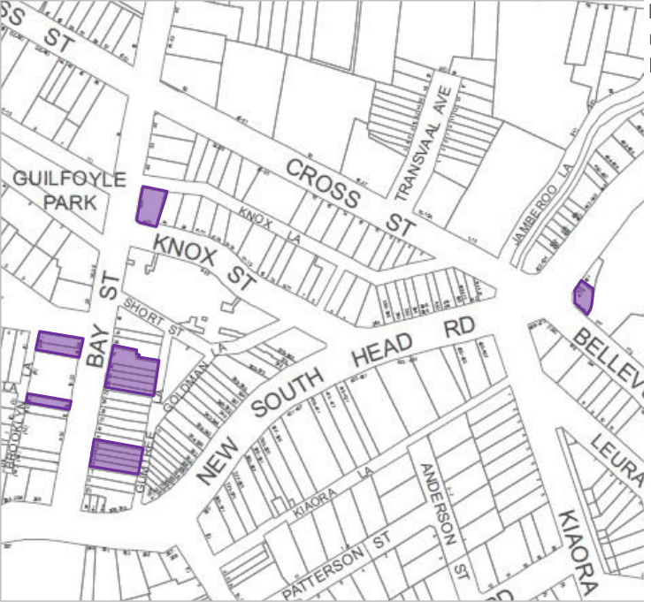

> [Picture on page 76: a picture, saved as a picture (images/chapter-d5-double-bay-centre-page-76-2.gif, 150 dpi).]

#### FIGURE 35

Character buildings

Character building

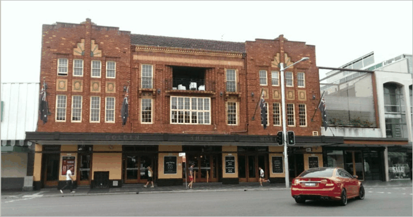

> [Picture on page 76: a picture, saved as a picture (images/chapter-d5-double-bay-centre-page-76-7.gif, 150 dpi).]

#### FIGURE 36

Golden Sheaf Hotel The Golden Sheaf Hotel is a heritage listed building. It demonstrates the contribution buildings constructed to the street boundary can make to the

public spaces they address

#### Objectives

O1 Protect and enhance heritage items and conservation areas.

O2 Encourage the sensitive adaptation or reuse of buildings that contribute to the spatial definition of the urban spaces they address.

#### Controls

C1 All new developments and works to existing developments are to be designed to be compatible with the significance of listed heritage items, conservation areas and nominated character buildings.

C2 For development within the Transvaal Avenue Heritage Conservation Area refer to Appendix 1.

C3 Development to a character building is to respect the building and complement and enhance the key characteristics of the building including:

a) street edge definition;

b) its material, detailing and character;

c) its holistic building character related to articulation, massing, and patterns and distribution of wall opening.

C4 Variations to the building envelope will only be considered where it can be demonstrated that the variations support the sensitive adaptive reuse of heritage  items relating to the building's massing.

C5 Where a character building is proposed to be replaced, the architectural quality and streetscape contribution of the proposed building must be at least equal to the quality of the building's material, character and detailing.

C6 Modifications to character buildings must retain or enhance the architectural streetscape value of the existing building.

#### D5.6.4 Relationship to public domain

The success of commercial centres is dependent on street edge activity. Street activation requires a safe, cohesive and attractive public domain. This section establishes objectives and controls for the street frontage elements of built form such as awnings, colonnades, arcades, walkways, courtyards, public art, outdoor eating and address to laneways.

#### 5.6.4.1 Awnings

Continuous awnings contribute to the street character of retail centres and provide weather protection for pedestrians. There are currently continuous awnings on both sides of New South Head Road and along a considerable part of the southern side of Knox Street. Awnings elsewhere in the centre are more varied and less continuous, and are often used to highlight building

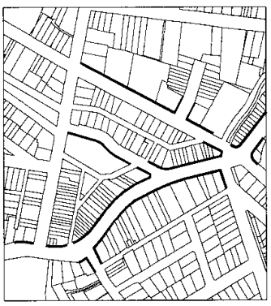

> [Picture on page 78: a picture, saved as a picture (images/chapter-d5-double-bay-centre-page-78-11.gif, 150 dpi).]

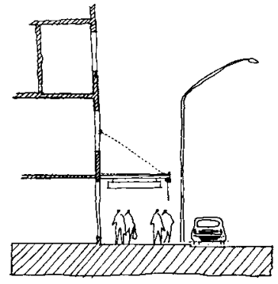

> [Picture on page 78: a picture, saved as a picture (images/chapter-d5-double-bay-centre-page-78-12.gif, 150 dpi).]

entrances.

FIGURE 37  Continuous awnings Continuous awnings are required in these locations

FIGURE 38  Awning design Suspended steel box section type with a minimum soffit height of 3.2m

#### Objectives

O1 Retain and supplement the existing awnings in the designated areas shown in the control drawings.

O2 Encourage consistent awning design throughout the centre.

#### Controls

C1 Development must provide continuous awnings to street frontages as indicated on the control drawings, Section 5.5.5-5.5.11.

C2 Awning cover should be within 5° of horizontal, with a minimum soffit height of 3.2m.

C3 The awning design should provide protection from sun and rain and be integrated with the building’s architectural resolution.

C4 Where no awnings are indicated on the control drawings, Section 5.5.5-5.5.11—the building entrances must have generous cover.

C5 Canvas blinds along the outer edge of awnings may be used to provide sun shading to the east and west facades. No advertising is permitted, however business identification signage may be acceptable.

C6 Under awning lighting may be recessed into the soffit of the awning or wall mounted on the building.

#### 5.6.4.2 Colonnades

A colonnade is created when a building is set back from the boundary at street level with vertical supports such as columns supporting the building directly above. A continuous colonnade improves pedestrian amenity by extending the footpath at ground floor level, and providing shelter. Consistently spaced colonnade posts establish a pedestrian related rhythm.

Colonnades are most successful when they are continuous and consistent. Guilfoyle Park on Bay Street makes a substantial contribution to the ambience of the centre. This quality could be

enhanced through appropriate built form which interprets the park's civic importance in its address to the park.

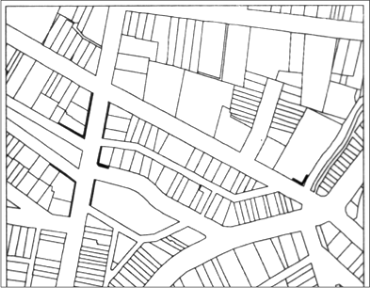

> [Picture on page 80: a picture, saved as a picture (images/chapter-d5-double-bay-centre-page-80-3.gif, 150 dpi).]

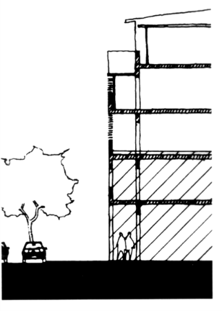

> [Picture on page 80: a picture, saved as a picture (images/chapter-d5-double-bay-centre-page-80-4.gif, 150 dpi).]

FIGURE 39  Colonnades Colonnades are required in these locations

FIGURE 40  Colonnades on Bay Street articulate the importance of Double Bay’s main public place – Guilfoyle Park

#### Objectives

O1 Encourage colonnaded buildings in Bay Street, between Cross Street and Short Street, which interpret Guilfoyle Park's civic importance and establishes a spatial relationship between the park and the buildings which address it.

#### Controls

C1 Colonnades should be provided at ground floor level to street frontages as indicated on the control drawings, Section 5.5.5—5.5.11 and the street sections.

C2 Colonnade width must be 2.4m.

C3 Colonnades must have a minimum soffit height of 3.6m.

C4 Colonnade supports must be integrated with the building design and adjoining colonnades if they exist, and not unduly impact upon pedestrian thoroughfare, or obscure ground floor activity from the street.

C5 Colonnade design must respond to the articulation of adjacent buildings, and the broader desired future character.

C6 Colonnades must be level with the street paving, and be paved in accordance with the standard Double Bay pavers (refer to the Public Domain Improvements Plan 1999 and Council’s Technical Services Division for advice).

#### 5.6.4.3 Arcades, walkways and courtyards

One of the defining characteristics of Double Bay is its honeycomb of external walkways and arcades. Good quality arcades have active retail frontages, and contribute to a vibrant pedestrian shopping environment. The provision of good quality arcades and walkways with a light and airy character is encouraged.

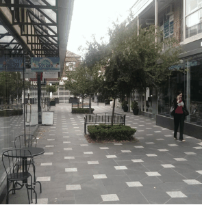

> [Picture on page 82: a picture, saved as a picture (images/chapter-d5-double-bay-centre-page-82-6.gif, 150 dpi).]

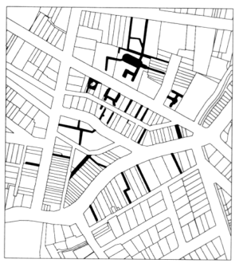

> [Picture on page 82: a picture, saved as a picture (images/chapter-d5-double-bay-centre-page-82-7.gif, 150 dpi).]

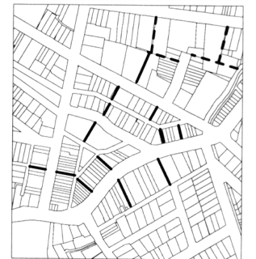

> [Picture on page 82: a picture, saved as a picture (images/chapter-d5-double-bay-centre-page-82-8.gif, 150 dpi).]

FIGURE 41  Goldman Lane This walkway off Knox Street has retail frontages on both sides and a light airy character, which is promoted in this chapter

FIGURE 42  Locations of existing arcades and through site links When redeveloping a site, existing arcades or through site links must be retained arcade walkway

FIGURE 43  Desirable through block connections Arcades are permitted throughout the centre except on corner lots. This drawing shows the most desirable through block connections. Consider the proximity of nearby arcades when providing a new arcaded connection arcade walkway

#### Objectives

O1 Encourage new arcades and walkways that provide:

a) public access across private land; and

b) connections between streets and other parts of the public domain.

O2 Create arcades with active retail frontages.

O3 Encourage arcades that are supplemented with outdoor areas such as courtyards or outdoor rooms.

O4 To provide suitable amenity within arcades.

#### Controls

C1 All existing arcades and walkways must be retained or replaced when a site is redeveloped.

C2 Arcades must be mostly naturally lit and ventilated.

C3 External walkways must be paved in accordance with the standard Double Bay pavers (refer to the Public Domain Improvements Plan 1999 and Council’s Technical Services Division for advice).

C4 The proportions and character of arcades should reflect their importance in expanding the public domain and their location in the centre.

C5 Arcades must have a minimum:

a) width of 3m; and

b) ceiling height of 3.6m.

C6 Arcades must, to the extent possible, provide a clear sightline from one end to the other for surveillance and accessibility.

#### 5.6.4.4 Public art

Public art in developments can enhance the experience of the occupants and contribute to a sense of place.

#### Objectives

O1 To require the provision of public art in significant or large-scale developments.

O2 To integrate the public art so it is a cohesive part of the building design, interior or landscaping of the development.

O3 To design and locate the public art so that the aesthetics and amenity of the art can be appreciated by people within and outside the development.

O4 To enhance the experience of the occupants of the development and their relationship with the development through public art.

O5 To use public art to facilitate a connectedness between the development and the public domain.

#### Controls

C1 Development with a capital investment value of $15M or more includes public art.

C2 The public art is installed on the development site or in the immediate vicinity of the site.

C3 The public art is located so that it is not unreasonably inaccessible or obscured by a building element which makes it impossible to see in full by the building occupants and the general public.

C4 The public art is prepared and undertaken in accordance with the Woollahra Public Art Guidelines for Developers.

#### 5.6.4.5 Outdoor eating

The Double Bay Centre is a desirable location for the provision of outdoor eating facilities due to the temperate climate, favourable orientation, leafy quality of streets and active street frontage.

Outdoor eating facilities have the potential to add to the liveliness of streets and activate other outdoor places.

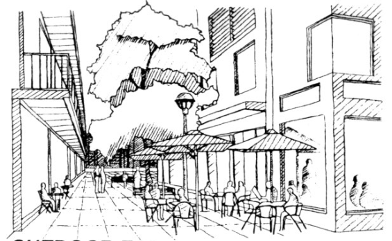

> [Picture on page 84: a picture, saved as a picture (images/chapter-d5-double-bay-centre-page-84-17.gif, 150 dpi).]

FIGURE 44  Outdoor eating Outdoor eating establishments can provide lively street activity in suitable locations

#### Objectives

O1 Encourage outdoor eating establishments where they provide a pleasant outdoor eating environment with minimal disturbance to pedestrian circulation and where they comply with Councils associated codes and policies.

#### Controls

C1 Development is to comply with Council’s policy for footway restaurants.

#### 5.6.4.6 Ground floor active lane frontage

Active street frontage is characterised by liveliness and activity associated with pedestrian activity, building entrances, shop entries and attractive shop displays.

The Double Bay Centre benefits greatly from a network of lanes that work in conjunction with arcades to provide pedestrian connections. As active pedestrian environments, the laneways have unrealised potential to intensify retail activity in the centre.

Note: An active frontage is defined as one or a combination of the following: entrance to retail, retail shopfront, entrance to residential/commercial above, cafe or restaurant if accompanied by an entry.

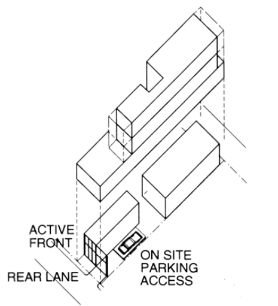

> [Picture on page 85: a picture, saved as a picture (images/chapter-d5-double-bay-centre-page-85-12.gif, 150 dpi).]

FIGURE 45  Active retail frontage Consider using a car hoist with basement parking as a means of maximising active retail frontage. Lane address should incorporate active frontage and minimise the impact of access to on-site parking

#### Objectives

O1 Provide an active frontage at the ground level of buildings facing lanes to add to the vitality, and usefulness of both lane and building.

O2 Coordinate the provision of vehicular and service access to maximise ground floor activity along lanes.

O3 Improve the pedestrian amenity of lanes to encourage a wide range of uses.

O4 Improve safety and security by providing active shopfronts to improve general lane surveillance.

O5 Discourage off-street loading facilities in laneways if on-street loading bays are available.

#### Controls

C1 A minimum of 75% active frontage to lanes, measured as a linear ratio across the width of a lot, is generally required. Development on narrow lots may vary this requirement if applicants demonstrate that the vitality and usefulness of the lot frontage is maximised.

C2 Vehicle access points and building entrances must be separate and clearly defined to avoid pedestrian and vehicular conflicts.

C3 Ensure service areas are unobtrusive and have minimal lane presence. Preferably orientate service areas within the building envelope, perpendicular to lane frontage.

C4 Services, such as garbage areas and electrical substations, should not dominate the laneway frontage or otherwise unreasonably reduce the opportunity to establish an active frontage to the laneway. Services should generally be located within the building envelope and integrated with the building design.

C5 Retail, restaurant, cafe shopfronts should be glazed and able to be opened and/or provide through shop/lot visibility.

#### D5.6.5 Amenity

#### 5.6.5.1 Visual privacy

Visual privacy is an important consideration for residential development within the centre, and neighbours adjacent to the centre, as it is a major determinant of amenity.

FIGURE 46  Recommended minimum separations between openings to achieve visual privacy

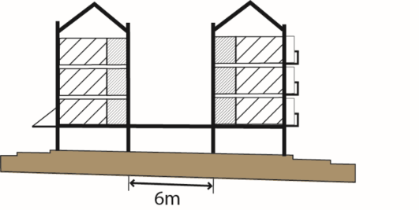

> [Picture on page 87: a picture, saved as a picture (images/chapter-d5-double-bay-centre-page-87-6.gif, 150 dpi).]

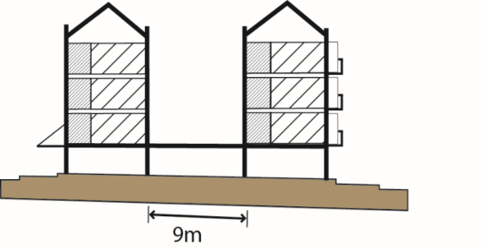

> [Picture on page 87: a picture, saved as a picture (images/chapter-d5-double-bay-centre-page-87-7.gif, 150 dpi).]

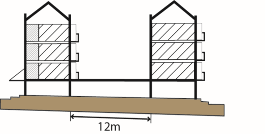

> [Picture on page 87: a picture, saved as a picture (images/chapter-d5-double-bay-centre-page-87-8.gif, 150 dpi).]

#### Habitable room

A room used for normal domestic activities that includes: a bedroom, living room, lounge room, music room, television room, dining room, sewing room, study, playroom, sunroom and kitchen.

#### Non-habitable room

A room of a specialised service nature occupied neither frequently nor for extended periods, including a bathroom, laundry, water closet, food storage pantry, walk in wardrobe, corridor, hallway, lobby or clothes drying room. Source: AMCORD, 1995

#### Objectives

O1 Ensure development protects the privacy of adjacent residential neighbours.

O2 Ensure residential apartments and private open spaces have adequate visual privacy.

#### Controls

C1 Orientate main living spaces, and their primary openings, to the street or rear garden to avoid overlooking between neighbouring properties. Living areas with primary openings facing the side boundary should be avoided.

C2 Where openings face the side boundaries of properties, protect visual privacy between neighbouring dwellings by:

a) providing adequate distance between opposite windows – use the illustrations in this section as a guide;

b) offsetting facing windows of neighbouring dwellings; and

c) providing obscure glazing, screening or planting.

C3 Protect privacy between dwellings proposed on a single development by adopting the recommended distance between openings illustrated in Figure 46. Alternatively use vegetation and balcony screening to protect privacy.

C4 Use building articulation, particularly in required building articulation zones, to provide visual privacy between buildings and the public domain.

C5 Primary door and window openings in residential living areas should be located towards the street and/or rear to protect privacy. Living areas with primary openings facing the side boundary should be avoided.

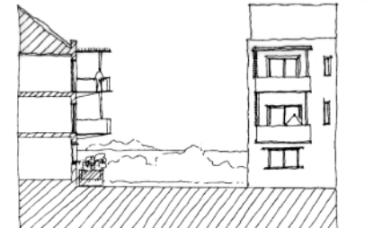

> [Picture on page 88: a picture, saved as a picture (images/chapter-d5-double-bay-centre-page-88-19.gif, 150 dpi).]

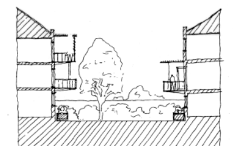

> [Picture on page 88: a picture, saved as a picture (images/chapter-d5-double-bay-centre-page-88-20.gif, 150 dpi).]

FIGURE 47  Carefully locate balconies to protect privacy

FIGURE 48 Vegetation and balcony screening must be used to enhance privacy when the recommended separations are not able to be achieved. Source: AMCORD, 1995

#### 5.6.5.2 Acoustic privacy

The Double Bay Centre is a vibrant place that contains a range of uses however, sometimes there can be tension between the business activities and residential amenity particularly when there is an active night-time economy.

Acoustic privacy is an important consideration in relation to the residential component of the centre, and neighbours adjacent to the centre, because it is a major determinant of amenity.

#### Objectives

O1 Ensure adequate acoustic privacy to residential apartments and private open spaces in the centre.

O2 Protect the acoustic privacy of residential neighbours adjacent to the centre.

O3 Ensure the viability of housing, and greatly increase the amenity of dwellings, by minimising the impact of external noise sources.

#### Controls

C1 Building siting and layout, particularly with regard to the location of courtyards, terraces and balconies and the like, should minimise the transmission of noise to other buildings and private open space on the site and on adjacent land. The use of openings, screens and blade walls, and the choice of materials, should also be designed to minimise the transmission of noise. For example this may include:

a) using solid concrete/masonry balcony upstands to shield noise

b) using absorbent material to reduce sound bouncing off the balcony soffits.

C2 Minimising the impact of external noise sources on dwellings near noise sources by:

a) addressing New South Head Road with recessed balconies, enclosed balconies, kitchens and/or living rooms;

b) locating bedrooms away from noise sources; and

c) designing and constructing dwellings with sound attenuation measures such as double glazed external doors and windows.

C3 Bedrooms should be located away from noise sources such as goods delivery and early morning garbage collections.

C4 Restaurants should be designed to minimise the impact of noise associated with late night operation on nearby residents.

C5 Rear courtyards are only permitted for restaurant use if Council is satisfied that the hours of operation do not have an unreasonable impact on residential amenity.

Note: Council may require a noise impact assessment report to accompany a development application. Council will exercise its discretion when deciding if a noise assessment report is required. Examples of such circumstances include but are not limited to, development containing residential uses in close proximity to areas activated by the night time economy, or development containing residential uses located in close proximity to New South Head Road.

#### 5.6.5.3 Landscaped areas

Private gardens at the rear of residential blocks adjoining the centre collectively create large scale open spaces. To ensure development immediately adjoining these blocks preserves and extends these open spaces a landscaped area requirement is included in the control drawings, Section 5.5.5—5.5.11. Landscaped areas may be private, communal or publicly accessible.

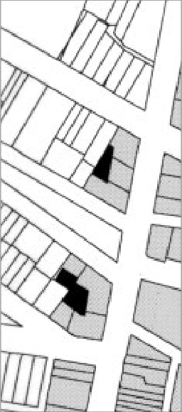

> [Picture on page 90: a picture, saved as a picture (images/chapter-d5-double-bay-centre-page-90-6.gif, 150 dpi).]

FIGURE 49 Landscaped areas Landscaped open space provides a transition between the commercial area and adjoining residential properties.

Bay Street and Guilfoyle Avenue

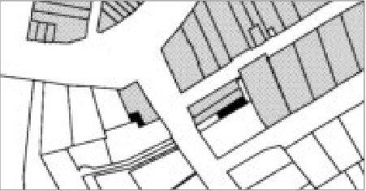

> [Picture on page 90: a picture, saved as a picture (images/chapter-d5-double-bay-centre-page-90-12.gif, 150 dpi).]

Manning Road

#### Objectives

O1 Ensure development immediately adjoining residential blocks continues the pattern of built form and open space established in the block.

O2 Provide landscaped areas, typically in the centre of blocks, to preserve and extend established open spaces.

O3 Provide landscaped areas that preserve neighbouring residences' access to day light and natural ventilation and provides visual privacy.

O4 Mature trees and other planting is encouraged within landscaped areas to maintain Double Bay’s existing leafy quality. Permeable surfaces are also encouraged to maximise the on-site infiltration of stormwater.

#### Controls

C1 Above ground development may not occur within the landscaped area shown on the control drawings, Section 5.5.5—5.5.11. 50% of the area designated as landscaped area must be a deep soil landscaped area.

C2 Car parking should be located under the building footprint to maximise deep soil landscaped areas.

C3 Plantings over underground structures should have sufficient soil depth to allow sustainable planting.

Note: A site-specific landscape specification is to be prepared for landscaping above underground structures. The specification should include considerations such as plant species, soil depth and drainage.

C4 One large mature tree, planted in deep soil, is required for every 100m² of landscaped area.

#### 5.6.5.4 Private open space

Private open space includes ground floor garden areas and above ground open spaces such as terraces, loggias, balconies, or decks. The availability and accessibility of comfortable private

and communal outdoor living areas is a major determinant of the ability of occupants to enjoy living and working in the Double Bay Centre.

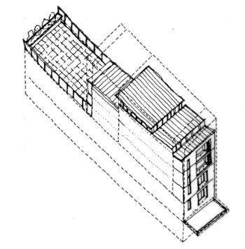

> [Picture on page 92: a picture, saved as a picture (images/chapter-d5-double-bay-centre-page-92-3.gif, 150 dpi).]

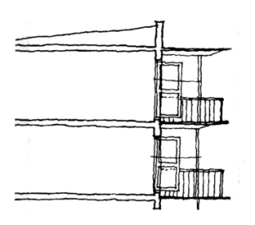

> [Picture on page 92: a picture, saved as a picture (images/chapter-d5-double-bay-centre-page-92-4.gif, 150 dpi).]

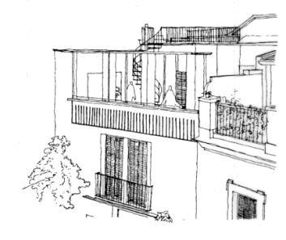

> [Picture on page 92: a picture, saved as a picture (images/chapter-d5-double-bay-centre-page-92-5.gif, 150 dpi).]

FIGURE 50  Above ground open space Above ground open space may be created as a roof terrace

FIGURE 51  Above ground open space Above ground open space may be created within the articulation zone and should utilise prevalent breezes

FIGURE 52  Lightweight pergolas, sun screens and planters can enhance the quality of roof spaces, and provide privacy

#### Objectives

O1 Ensure every dwelling in the Double Bay Centre has direct access to private open space.

O2 Encourage occupied roof areas with roof gardens behind parapets where private open space at ground level is not available.

#### Controls

C1 Provide at least one balcony, terrace, verandah, loggia, roof terrace or deck for each dwelling, within the area nominated for building articulation. This open space must be accessible from a principal living area.

C2 The preferred depth of the required open space is 2.4m and the minimum permissible depth is 1.8m. The minimum area of private open space is determined by the dwelling size:

| Dwelling size | Minimum required area of above ground open space |
|---|---|
| Small dwelling: less than 60m² 8m² |  |
| Medium dwelling: 60m² - 90m² 12m² |  |
| Large dwelling: more than 90m² 16m² |  |

C3 Roof terraces and balconies must be designed and orientated to protect the privacy of neighbours.

C4 Lightweight pergolas, sunscreens, privacy screens and planters are permitted on roof terraces provided they do not increase the bulk of the building. These elements should not significantly affect the views available from adjoining properties, the immediate vicinity or on the nearby ridges.

C5 The profile and silhouette of parapets, eaves and roof top elements must be considered in roof terrace design to provide an attractive building finish when viewed from the public and private domain.

#### D5.6.6 Solar access and natural ventilation

#### 5.6.6.1 Solar access

Solar access is a major determinant of environmental comfort and residential amenity. Good passive solar design offers financial and environmental benefits, by reducing the need for artificial heating and cooling.

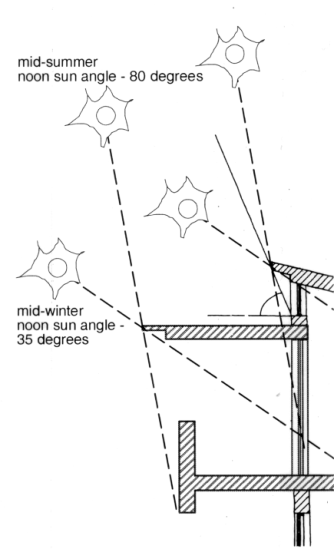

> [Picture on page 94: a picture, saved as a picture (images/chapter-d5-double-bay-centre-page-94-6.gif, 150 dpi).]

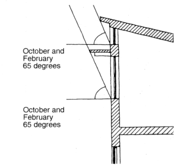

> [Picture on page 94: a picture, saved as a picture (images/chapter-d5-double-bay-centre-page-94-7.gif, 150 dpi).]

FIGURE 53  Mid-winter and mid-summer solar angles for openings facing true north The design of north facing balconies and rooms should aim to admit low angle winter sunlight, and exclude high angle summer sunlight

FIGURE 54  Solar angles for windows facing true north Eaves, screens and the size of openings for north facing balconies and rooms, should be designed with regard to the noon 17 October / 26 February sun angles to maximise winter sunlight penetration, and minimise summer sunlight penetration Source: Energy Information Centre information sheet, May 1994

#### Objectives

O1 Minimise overshadowing of adjoining properties or publicly accessible spaces.

O2 Building form, separation and plan layout should facilitate good solar access to internal and external living spaces, to maximise natural heating and cooling and minimise the use of artificial systems.

#### Controls

C1 Preserve solar access to Guilfoyle Park and the footpath on the south side of Knox Street, Cross Street, and New South Head Road between 12 noon and 2pm on 21 June.

C2 Development should comply with the control drawings in Section D5.5 to ensure adequate solar access is provided to neighbouring properties.

C3 Development which does not comply with the control drawings must maintain existing solar access to existing development for at least three hours between 9am and 3pm on 21 June to north facing windows of habitable rooms, and at least two hours to at least 50% of the private open space.

C4 Access to sunlight should be achieved for a minimum period of three hours between 9am and 3pm on 21 June to windows of habitable rooms and two hours to private open space of new development.

C5 Locate main living spaces including lounge, dining, kitchen and family rooms toward north where possible.

C6 Skylights which provide the sole source of daylight and ventilation to habitable rooms are not permitted in residential or commercial development.

#### 5.6.6.2 Cross ventilation

The design of buildings provides an opportunity to reduce long term energy consumption. Building envelopes in this plan promote thin cross section buildings which do not rely on artificial

lighting and ventilation.  Building design for natural ventilation should capitalise on Double Bay’s harbour side location and on-shore breezes.

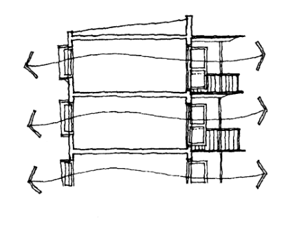

> [Picture on page 96: a picture, saved as a picture (images/chapter-d5-double-bay-centre-page-96-3.gif, 150 dpi).]

FIGURE 55  Cross ventilation Thin cross-section design achieves good cross ventilation and assists day lighting of rooms

#### Objectives

O1 All buildings should be designed to achieve natural ventilation.

O2 Design buildings with naturally lit habitable rooms.

#### Controls

C1 The maximum building depth of development for levels 3-5 is 15.6m to achieve buildings that are substantially naturally lit and ventilated.

C2 Encourage the provision of windows to all rooms, including kitchens and bathrooms, to facilitate natural light and ventilation. Avoid or minimise the reliance on mechanical ventilation or air conditioning.

C3 Encourage building articulation, such as light wells and courtyards, that allows daylight into ground and first floor levels.

C4 All dwellings in each development must have windows that can be opened and /or doors in walls with differing orientations, to facilitate cross ventilation by locating windows opposite each other. When this is difficult to achieve on non-rectangular lots with limited street address, at least 80% of dwellings within that development must comply.

C5 Skylights that provide the sole source of daylight and ventilation to habitable rooms are not permitted.

#### D5.6.7 Groundwater (hydrogeology) and geotechnical impacts

Refer to Chapter E2 Stormwater, Flood and Geotechnical Risk Management of Woollahra DCP 2015, including section E2.2.10 Groundwater (hydrogeology) and geotechnical impacts.

#### D5.6.8 Parking and site facilities

#### 5.6.8.1 On-site parking

The opportunity for on-site parking is restricted in many areas of the Double Bay Centre. The narrow width of some lots makes it impossible to accommodate more than two spaces on-site, and the level of the existing water table in the centre may make site excavation for underground parking difficult. This chapter aims to satisfy the parking demand likely to be generated by future development, whilst facilitating the redevelopment of narrow lots and discouraging over-reliance on cars.

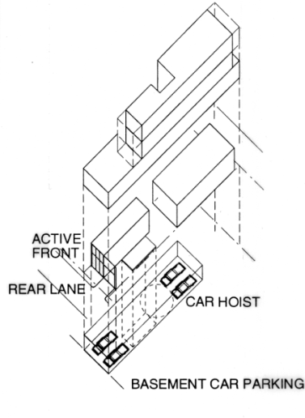

> [Picture on page 98: a picture, saved as a picture (images/chapter-d5-double-bay-centre-page-98-9.gif, 150 dpi).]

FIGURE 56  On-site parking If on-site parking is provided consider using a car hoist and turntable to maximise the efficiency of basement  parking

#### Objectives

O1 Ensure the impact of car parking on the site and streetscape is handled discretely.

O2 Ensure the design of on-site car parking is safe and efficient, and integrated with the overall site and building design.

O3 Maximise natural light and ventilation to parking areas where possible.

O4 Encourage cooperative approaches to car parking provision between adjoining lots that are less than 6m wide and/or less than 30m deep.

O5 Ensure underground car parking facilities do not collectively create a continuous barrier to subsurface water flow.

#### Controls

C1 Parking provision must comply with Part E of this DCP, Chapter E1 Parking and Access, except where detailed below.

C2 Consolidated parking areas are preferred below ground level where possible and concentrated under building footprints to maximise the area for landscaping areas.

C3 Basement parking should be naturally ventilated if possible.

Notes:

Part E of this DCP, Chapter E1 Parking and Access provides the parking generation rates for the Double Bay Centre. In certain circumstances on-site parking is not required. See the Parking and Access chapter for details.

Major developments on the north-western side of New South Head Road are encouraged to provide spaces additional to their development requirements for public parking. This should be negotiated with Council during the pre-DA stage.

A cooperative approach to parking provision, where car parks may be amalgamated and share access and egress points, are encouraged between two or three lots that are less than 6m wide and/or less than 30m deep.

#### 5.6.8.2 Vehicular access

The continuity of retail frontages is essential to the liveliness of the Double Bay Centre and its urban character. Vehicular crossings interrupt street activity, diminish amenity, and reduce the area for public on-street parking.

#### Objectives

O1 Maximise retail frontage in streets and lanes.

O2 Maximise pedestrian safety and amenity by minimising conflict between pedestrians and vehicles.

O3 Entrances to parking and servicing should not dominate the streetscape. The design, size and location of access to parking and servicing areas are to be discrete.

O4 Encourage cooperative approaches to car parking provision to reduce the number of vehicle access and egress points.

O5 Coordinate vehicular access with the provision of active frontages to lanes.

#### Controls

C1 Vehicular access to a building is only permitted via a rear lane or rear right of way where possible.

C2 If loading facilities are provided they must be located in a rear lane or side street.

C3 Driveway widths should be kept to minimum dimensions. Driveway crossings should generally be 3m, however a maximum width of 6m may be considered depending on the site, the location of the access point, and the capacity of the car park. Wider driveways are permitted only when it is necessitated by compliance with Australian Standards.

C4 Driveways to car parking above, below and at the ground floor level should be designed with minimal visual impact on the street, and maximum pedestrian safety. Pedestrian access to the development should be separate and clearly defined.

C5 Garage doors should be set back from the building line.

C6 Access ways to car parking should not be located in direct proximity to doors or windows to habitable rooms.

C7 Devices such as car hoists and turntables may be incorporated to provide access to car parking above and below the ground floor.

Note:  Driveways and kerb crossings must be sited to have minimum impact on the root zone of existing street trees, and be designed having regard to the Public Domain Improvements Plan (1999) and Streetscape Design Manual and advice from Council’s Technical Services Division.

#### 5.6.8.3 First floor car parking

This chapter aims to maximise the active frontage at street level throughout the Double Bay Centre. As car parking is an inactive space that can disrupt the vitality of a street, the provision of street level car parking should be minimised. Where basement car parking is not possible, first floor car parking may be permitted. Where first floor car parking is necessary, careful design should ensure it is unobtrusive and does not detract from the streetscape.

#### Objective

O1 Ensure first floor car parking is unobtrusive and does not have a negative impact on streetscapes.

#### Controls

C1 First floor car parking is not permitted to address street fronts. Parking space must be located in the middle of blocks or toward the rear of the allotment.

C2 First floor car parking that is incorporated within the building must be behind the building alignment and screened from the street.

C3 Facades screening car parks from the street must be high quality and allow natural lighting and ventilation.

C4 Vehicle access to first floor car parking must be integrated with the provision of active frontage to laneways. Vehicle access may not ramp along the street or lane alignments.

C5 Innovative approaches to car access and changing level, that minimise street impact and use space efficiently, such as car hoists, are encouraged.

#### 5.6.8.4 Site facilities

Site facilities include loading areas, garbage areas, fire safety systems, mailboxes, external stores, laundries and clothes drying areas. Development should provide appropriate site facilities for retail, commercial and residential uses, and minimise impact on the streetscape.

#### Objectives

O1 Ensure adequate provision of site facilities.

O2 Ensure site facilities are accessible, functional and unobtrusive.

#### Controls

C1 Site facilities, particularly garage areas, are to be visually integrated with the development to minimise their visibility from the street. Preferably orientate service areas within the building envelope, perpendicular to lane frontage. Such facilities must be located away from operable windows to habitable rooms to avoid amenity problems associated with smell. They must be located close to rear lanes where access is available.

C2 Ensure service areas are unobtrusive and have minimal lane presence. Preferably orientate service areas within the building envelope, perpendicular to lane frontage.

C3 Hydraulic fire services such as fire hydrants and booster installations are concealed. These services are to be:

a) Enclosed with doors if located in the building façade, or

b) Housed in a cabinet or enclosure if located external to the building.

The location, design colour and material of the doors, cabinet or enclosure are visually unobtrusive and suitably integrated with the development, including any fencing and landscaping.

C4 Lockable mailboxes must be provided close to the street, integrated with front fences or building entries.

C5 Buildings are designed to accommodate venting from ground floor uses to avoid potential impacts from exhaust and odour such as cooking smells.

C6 Air conditioning units and other plant equipment should not be readily visible from the public domain.

C7 An electricity substation is to be suitably located, screened and/or concealed so it is not visible from the street, or any other adjoining public place. Council’s preference is for a chamber substation. Any screening or enclosure to conceal the substation is to be visually unobtrusive and suitably integrated with the development, including the fencing and landscape design.

C8 The design and location of all other aboveground utility infrastructure (such as electrical pillars etc.) should minimise visual clutter within the streetscape and provide for a continuous accessible path of travel, where practical to ensure safe and equitable pedestrian circulation for people of all abilities. (Where this provision and Ausgrid’s requirements cannot both be satisfied, the applicant is to develop in consultation with Council and Ausgrid a solution that meets the acceptance of both consent authorities.)

Notes:

• At the DA stage the applicant should demonstrate that they have engaged with Ausgrid and have a network capacity assessment undertaken for the proposed development.

• Where a substation is required, the substation should be identified on the DA plans and addressed in the SEPP 65 Design Verification Statement (also see Apartment Design Guide Objective 3C-2 Amenity of the public domain is retained and enhanced).

• The DCP requirements for substations apply in addition to the Ausgrid Network Standards, such as NS113 Site selection and construction design requirements for chamber substations. Separate Ausgrid approval for the substation will be required.

• A dedicated access way/easement through the site to the substation will also need to be provided in accordance with the requirements of Ausgrid and Council.

#### D5.6.9 Application of concessions

#### Concessions for cultural facilities

Cultural facilities are encouraged within the Double Bay Centre. Where applicants can demonstrate that the building form required for a cultural facility does not comply with the building envelope, flexibility with regard to the building envelopes may be granted.

The following building uses are considered cultural facilities: − entertainment facilities; and − community facilities. Cultural facilities may be granted concessions with regard to permissible building envelope. No concessions to the LEP height and FSR controls will be permitted. To warrant concessions applicants need to demonstrate the proposed cultural facility: − maintains a building form compatible with the surrounding built form and streetscape; − meets the objectives of solar access; and − provides natural lighting and ventilation where possible.

#### Concessions for corner buildings

Strong corner buildings, which enhance the spatial definition of the public spaces they address, are encouraged. Selected corner buildings are eligible for an additional 0.5:1 of FSR under Woollahra LEP 2014, subject to meeting certain requirements.

Refer to Section 5.6.3.5 Corner buildings in this chapter and clause 4.4A of Woollahra LEP 2014, which outlines the controls that relate to corner buildings.

#### Appendix 1: Transvaal Avenue Heritage Conservation Area
