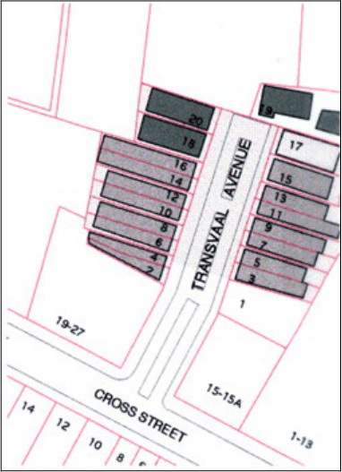
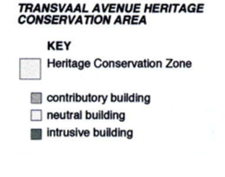
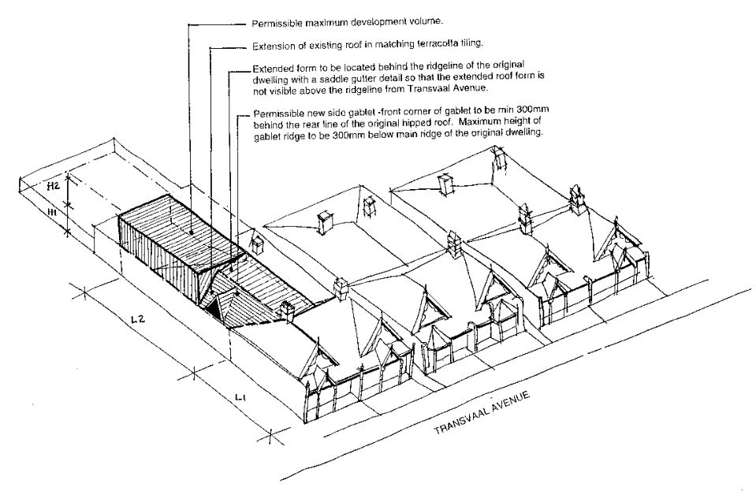

#### A1.5 Management policy

The following policy statement encapsulates the approach to the development and care of the heritage significance of the Transvaal Avenue Heritage Conservation Area:

In recognition of the heritage significance of the Transvaal Avenue Heritage Conservation Area and its contributory buildings, the impact of proposed development on individual buildings, on the character of the streetscape and on the overall significance of the area must be considered as part of the assessment of all development applications in the area.

A heritage impact statement must accompany all development applications involving proposed changes to the external appearance of properties within the area, unless those proposed changes are deemed by Council to be of a minor nature and to not result in adverse heritage impacts.

Evidence of the historical fabric of the buildings must be retained and conserved, including evidence of the previous residential historical uses. Former place names and the decorative architectural features of the front two rooms and of the front roof form and elevations are of particular interest and must be retained and conserved.

> [Picture on page 107: a picture, saved as a picture (images/chapter-d5-double-bay-centre-page-107-1.gif, 150 dpi).]

> [Picture on page 107: a picture, saved as a picture (images/chapter-d5-double-bay-centre-page-107-2.gif, 150 dpi).]

The original terracotta roof forms, chimneys and chimney pots must be retained and conserved.

Significant and contributory shopfronts and interiors must be retained and conserved. Other shopfronts may either be retained or replaced unless identified as intrusive, in which case, replacement is the preferred option.

Contributory buildings in the Transvaal Avenue Heritage Conservation Area map, must be retained and conserved - specifically Nos. 2-16 and 3-15 Transvaal Avenue. These buildings must comply with the diagram of proposed controls below.

Contributory buildings which have been structurally altered should be reconstructed to their original appearance as viewed from the street front.

Buildings whose contribution is ranked as neutral in the Transvaal Avenue Heritage Conservation Area map shall (preferably) be retained and enhanced, but alternatively, may be redeveloped.

Buildings whose contribution is ranked as intrusive or neutral which are proposed to be redeveloped must comply with Section D5.5 Built form envelopes: Control drawings and

D5.6 Development controls.

Additions must be located at the rear behind an extension of the existing terra cotta tile roof form, screened by a gablet form as indicated in the diagram of proposed controls. Additions must have regard to their potential impact on the character of the streetscape and should not result in changes in the apparent scale, form or bulk of existing buildings.

Off-street car parking is not permitted.

Significant street trees must be retained. The planting of trees and shrubs on the verges by property owners is discouraged unless the species and location is in accordance with Council’s Street Tree Master Plan.

#### Diagram of proposed controls KEY

L1 Existing main section with tiled hip roof

L2 Existing secondary wing with corrugated steel roof

H1 Height to be equal to existing eaves

H2 Maximum permissible height to be equal to the height of the existing front ridgeline

> [Picture on page 108: a picture, saved as a picture (images/chapter-d5-double-bay-centre-page-108-10.gif, 150 dpi).]

#### Appendix 2: Kiaora Lands
