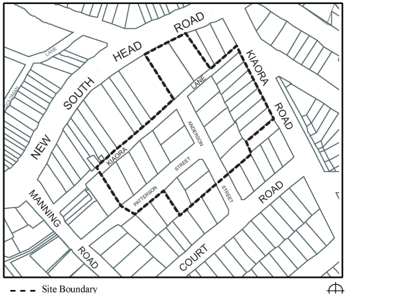

#### A2.1 Background

The Kiaora Lands site shown in Figure 1 is a significant local precinct within the Double Bay Commercial Centre. The site comprises substantial public and private land holdings. In recognition of the precinct’s importance to the Double Bay Centre’s function and commercial vitality special provisions have been prepared.

Appendix 2 provides development objectives, strategies, principles and controls for the Kiaora Lands site. Other relevant objectives and controls are provided in Sections D5.1 to D5.6 of this plan. The provisions of Appendix 2 prevail over those in other parts unless otherwise specified.

Land beyond the boundary shown on Figure 1 may be included within the site for the purpose of development such as awnings, signs, architectural features, public domain improvement works and car parking.

FIGURE 1  Kiaora Lands

> [Picture on page 109: a picture, saved as a picture (images/chapter-d5-double-bay-centre-page-109-15.gif, 150 dpi).]
