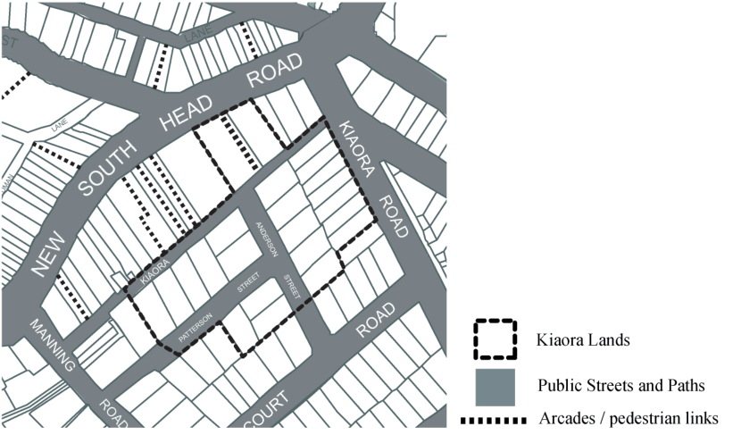
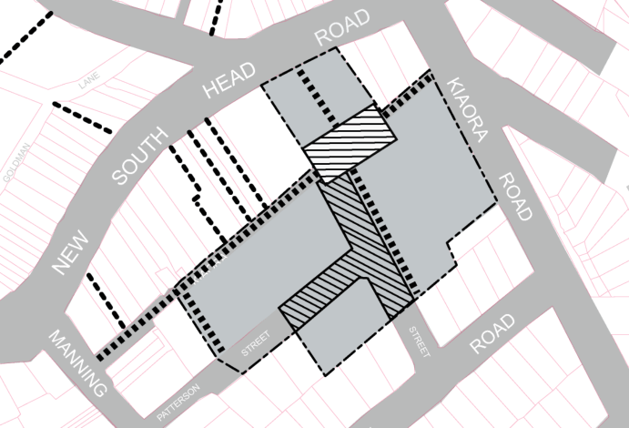

#### A2.3 Development framework

#### A2.3.1 Urban structure of Kiaora Lands site

#### Layout and street pattern

Provides pedestrian connections. Provides a large footprint for a potential supermarket. Allows the closure of public roads to provide for a large footprint supermarket and car parking.

#### Built form

Reinforces the form of buildings constructed to the street boundary along New South Head Road. Provides a transition between commercial and residential areas.

#### Public domain

Provides a new arcade between Kiaora Lane and New South Head Road. Upgrades Kiaora Lane. Provides a public plaza adjoining Kiaora Lane. Provides new street tree planting. Provides an integrated pedestrian network.

FIGURE 2  Existing structure

> [Picture on page 112: a picture, saved as a picture (images/chapter-d5-double-bay-centre-page-112-2.gif, 150 dpi).]

FIGURE 3  Future structure

> [Picture on page 112: a picture, saved as a picture (images/chapter-d5-double-bay-centre-page-112-4.gif, 150 dpi).]

#### A2.3.2 Street character

This section describes the desired future character of existing streets within the Kiaora Lands site.

It takes into consideration the scale of each street and the interface between the public and private domains. The redevelopment of the Kiaora Lands site will bring about changes to the character of the existing streets.

The Double Bay Centre Public Domain Improvements Plan (1999) should be used as a guide to works in the public domain such as street tree planting, pavement design and street furniture. Applicants should also speak with Council’s Technical Services staff prior to submitting applications for work in the public domain.

The description of street character is to be read in conjunction with the built form envelope controls in Section A2.4 of this appendix.

#### Kiaora Road Existing character

The Kiaora Road section of the Kiaora Lands site is currently residential and is dominated by modest scaled attached and detached bungalows. It is located opposite the Jamberoo Creek stormwater channel, which has been identified as one of several urban projects in the Double Bay Centre Public Domain Improvements Plan. Kiaora Road forms an edge of the commercial centre and reads as a continuum of the important Post Office intersection on New South Head Road.

#### Desired future character objectives

O1 Ensure that the built form on Kiaora Road is integrated with the desired future character of the commercial centre.

O2 Create a distinctive and identifiable edge to the commercial centre.

#### Strategy

a) Provide highly articulated buildings constructed to the street boundary.

b) Strengthen the built form at the corner of Kiaora Road and Kiaora Lane.

c) Design loading docks to minimise conflicts between pedestrian and vehicles. Pedestrians are to be given priority where car park and loading dock crossovers occur.

d) Provide new street planting to contribute to the tree lined nature of Kiaora Road.

#### Patterson Street Existing character

Patterson Street is currently a leafy residential street with detached single storey dwellings on the south side with the Council car park and a three storey residential flat building on the north side.

#### Desired future character objectives

O1 Allow the closure of the eastern part of Patterson Street to accommodate a suitable footprint for a supermarket and car parking.

O2 Reinforce the existing leafy character at the western part of Patterson Street.

O3 Provide a transition between the commercial centre and the adjacent residential areas.

#### Strategy

a) Retain the existing London Plane tree on the northern side of Patterson Street opposite No.4 Patterson Street.

b) Retain existing street trees where feasible and supplement with new street tree planting.

c) Minimise conflict between pedestrians and vehicles.

d) Provide a dedicated pedestrian connection between Patterson Street and the car park.

e) Built form should be designed to contribute to the street. Outlook from the supermarket retailing area should be considered at the end of these streets as a means of providing surveillance along the street, hence increasing safety and animating and enlivening the building, particularly at night.

#### Anderson Street Existing character

Anderson Street is currently a leafy tree lined street with car parks to both sides at the northern end.

#### Desired future character objectives

O1 Allow for the closure of part of the street to provide a suitable footprint for a supermarket and car parking.

O2 Reinforce the existing leafy character at the southern end of Anderson Street.

#### Strategy

a) Provide a dedicated pedestrian access and egress point between Anderson Street and the car park.

b) Built form should be designed to contribute to the street. Outlook from the supermarket retailing area should be considered at the end of these streets as a means of providing surveillance along the street, hence increasing safety and animating and enlivening the building, particularly at night.

#### New South Head Road Existing character

The New South Head Road frontage is currently occupied by the single storey Woolworths supermarket.

This building provides a blank single storey frontage which is setback from the back of pavement approximately 1.2m.

#### Desired future character objectives

O1 Reinforce the character of building to the street boundary along New South Head Road.

O2 Provide a built form that recognises, and is sympathetic to, the adjacent heritage item.

O3 Establish a new civic building and presence.

O4 Provide a new, clearly visible arcade which connects New South Head Road to development south of Kiaora Lane.

#### Strategy

a) Comply with the street edge profile specified in Section D5.5 Built form envelopes: Control Drawings, except as stated in the following: − Clearly indicate the entry point to the arcade on the elevation. Refer to Section A2.5.7 The new arcade. − Setback the building to the west of the arcade at least 1.35m from the street boundary. Refer to edge condition D (West). − Omit the 3.5m setback at the upper level of the New South Head Road frontage east of the arcade. Refer to edge condition D (East).

b) Provide a sophisticated high quality design response that reflects the civic role of the building.

#### Kiaora Lane Existing character

The existing character of Kiaora Lane is compromised by its ‘back of house’ status, with loading vehicles, exposed on-site loading bays and rubbish bins. The lane lacks containment and activity on its south side due to the at-grade car park.

Pedestrian activity is generated by the car park and the four existing arcades that feed onto the lane from New South Head Road. Narrow and inadequate pathways on the lane cause conflict between vehicles and pedestrians.

#### Desired future character objectives

O1 To make Kiaora Lane into a significant part of the public domain in the Double Bay Centre.

The controls for Kiaora Lane are located in Section A2.5.5 The new public domain.

#### A2.3.3 Street trees Existing character

The existing character of Kiaora Lands is strongly influenced by the mature trees on the site.

#### Desired future character objectives

O1 Retain the tree lined character of streets on and surrounding Kiaora Lands.

#### Strategy

Retain the following trees:

| Tree type | Botanical name | Location |
|---|---|---|
| 1 London Plane Plantanus orientalis Road verge north side of Patterson Street approx. 85m east of Manning Road 2 London Plane Plantanus orientalis Road verge south side of Patterson Street approx. 85m east of Manning Road 3 London Plane Plantanus orientalis Road verge south side of Patterson Street approx. 65m east of Manning Road 4 London Plane Plantanus orientalis Road verge north side of Patterson Street approx. 45m east of Manning R Road 5 London Plane Plantanus orientalis Road verge east side of Anderson Street approx. 40m north of Court Road 6 London Plane Plantanus orientalis Road verge west side of Anderson Street approx. 35m north Court Road 7 London Plane Plantanus orientalis Road verge west side of Anderson Street approx. 20m north of Court Road 8 London Plane Plantanus orientalis Road verge east side of Anderson Street approx. 15m north of Court Road 9 Swamp Mahogany Eucalyptus robusta Road verge west side of Kiaora Road approx. 20m south of Kiaora Lane 10 Southern Mahogany Eucalyptus botryodios Road verge west side of Kiaora Road approx. 30m south of Kiaora Lane 11 Oak Genus quercus Road verge south side of Kiaora Lane approx. 55m east of Manning Road |  |  |
