#### A2.4 Built form envelopes

Building envelopes illustrate the limits of permissible building height, depth and location and are described on the control drawings for New South Head Road and Kiaora Lane/Patterson Street.

Note:  The statutory maximum building heights are in Woollahra LEP 2014. The maximum building heights are also shown in the chapter to provide detail to the envelope controls.

#### FIGURE 4 Edge conditions

D (East) – Boundary edge façade up to 18.1m to the east part of the frontage. D (West) – A 1.35m setback to west part of frontage up to 14m and with a 3.5m setback up to 18.1m. E – 32° inclined plane springing from the southern edge of the Plaza. Frontage a minimum of 18m from the southern edge of the Plaza. Variation to the inclined plane may be considered if the principal dining /public area on the south side of the plaza has sunlight access at 12 noon in mid-winter.

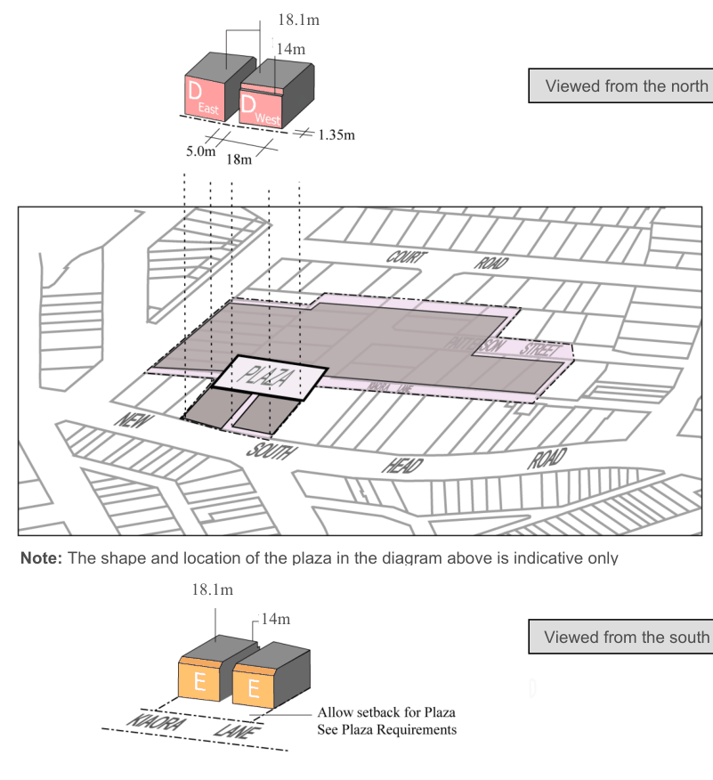

> [Picture on page 118: a picture, saved as a picture (images/chapter-d5-double-bay-centre-page-118-14.gif, 150 dpi).]
> Words printed on the picture (title and legend, copied from the PDF):
> 18.1m
> 14m
> Viewed from the north
> Note: The shape and location of the plaza in the diagram above is indicative only
> 18.1m
> 14m
> Viewed from the south

#### FIGURE 5 Edge conditions

A – 32° inclined plane springing from 3.5m south of the boundary, and with a building setback from the boundary of 7m for the ground floor level and 13.8m for levels above. B – 64° inclined plane springing from the boundary, and a building setback of 1.5m from the boundary. C – 32° inclined plane springing from the southern side of Patterson Street. F – Plaza edge façade up to 13m. 2m deep colonnade at ground level. G – Kiaora Road edge frontage up to 13m. H – 45° inclined plane springing from a point 3m above ground level and 2.5m from the boundary to the adjacent property. I  – 64° inclined plane springing from the boundary, and a building setback of 2.5m from the boundary. J – Kiaora Lane edge frontage up to 13m. A minimum of 7.9m from northern boundary of Kiaora Lane.

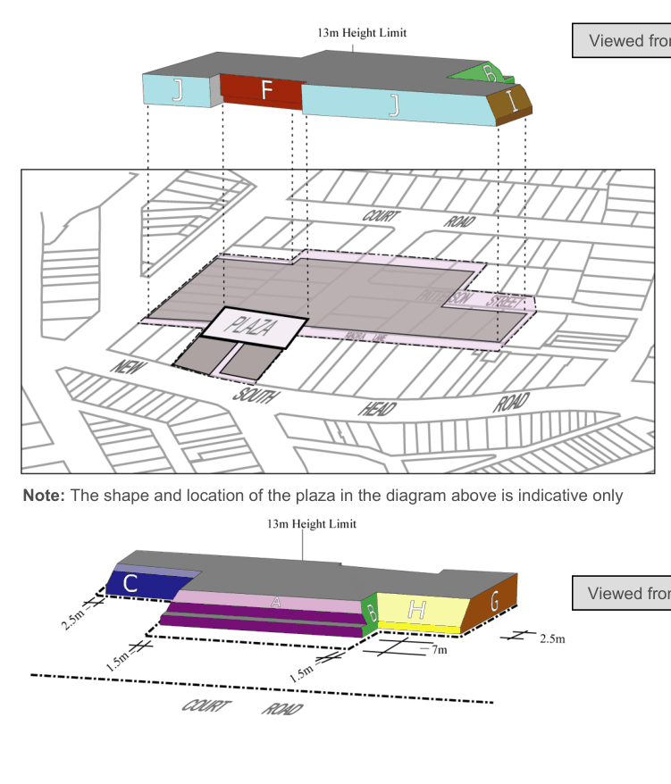

> [Picture on page 119: a picture, saved as a picture (images/chapter-d5-double-bay-centre-page-119-15.gif, 150 dpi).]
> Words printed on the picture (title and legend, copied from the PDF):
> Note: The shape and location of the plaza in the diagram above is indicative only

Viewed from the north

Viewed from the south

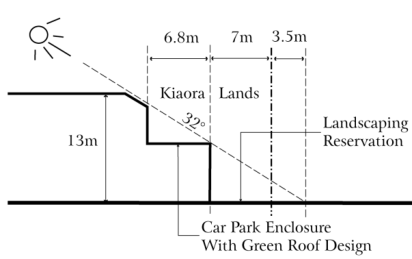

> [Picture on page 120: a picture, saved as a picture (images/chapter-d5-double-bay-centre-page-120-1.gif, 150 dpi).]

Section

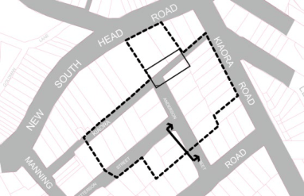

> [Picture on page 120: a picture, saved as a picture (images/chapter-d5-double-bay-centre-page-120-3.gif, 150 dpi).]

#### Condition A

Location

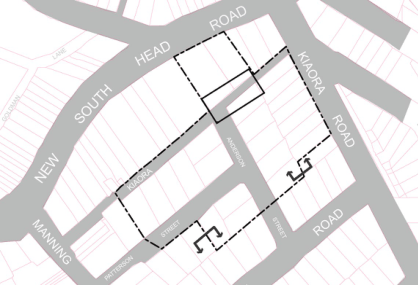

> [Picture on page 120: a picture, saved as a picture (images/chapter-d5-double-bay-centre-page-120-6.gif, 150 dpi).]

Section

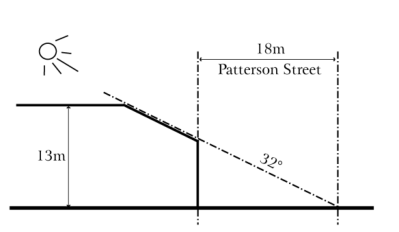

> [Picture on page 120: a picture, saved as a picture (images/chapter-d5-double-bay-centre-page-120-8.gif, 150 dpi).]

#### Condition B

Location

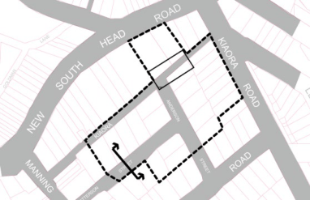

> [Picture on page 120: a picture, saved as a picture (images/chapter-d5-double-bay-centre-page-120-11.gif, 150 dpi).]

Section

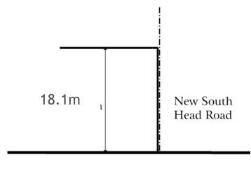

> [Picture on page 120: a picture, saved as a picture (images/chapter-d5-double-bay-centre-page-120-13.gif, 150 dpi).]
> Words printed on the picture (title and legend, copied from the PDF):
> 18.1m

#### Condition C

Location

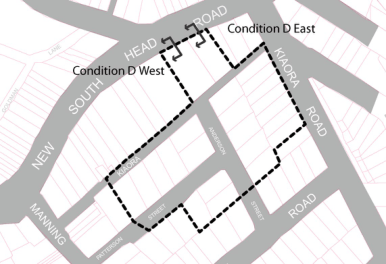

> [Picture on page 120: a picture, saved as a picture (images/chapter-d5-double-bay-centre-page-120-16.gif, 150 dpi).]

Condition D (East) Location

Section

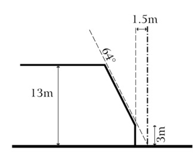

> [Picture on page 120: a picture, saved as a picture (images/chapter-d5-double-bay-centre-page-120-19.gif, 150 dpi).]

> [Picture on page 121: a picture, saved as a picture (images/chapter-d5-double-bay-centre-page-121-1.gif, 150 dpi).]

Condition D (West) Location

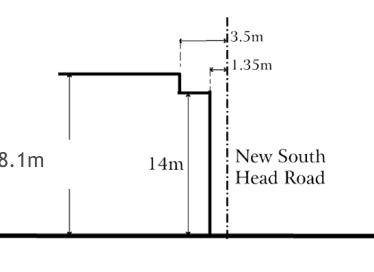

> [Picture on page 121: a picture, saved as a picture (images/chapter-d5-double-bay-centre-page-121-3.gif, 150 dpi).]
> Words printed on the picture (title and legend, copied from the PDF):
> 18.1m

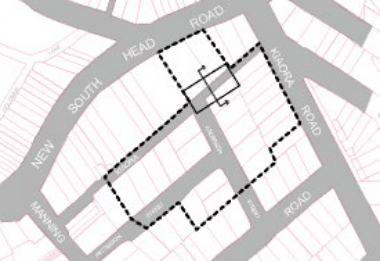

> [Picture on page 121: a picture, saved as a picture (images/chapter-d5-double-bay-centre-page-121-4.gif, 150 dpi).]

Section

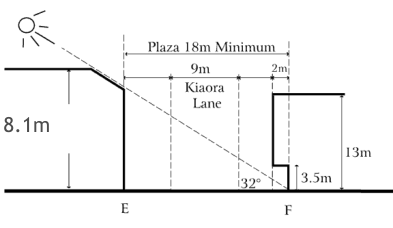

> [Picture on page 121: a picture, saved as a picture (images/chapter-d5-double-bay-centre-page-121-6.gif, 150 dpi).]
> Words printed on the picture (title and legend, copied from the PDF):
> 18.1m

Conditions E + F Location

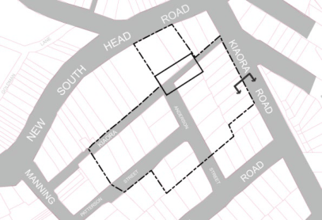

> [Picture on page 121: a picture, saved as a picture (images/chapter-d5-double-bay-centre-page-121-8.gif, 150 dpi).]

Section

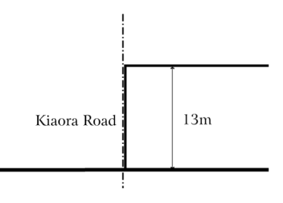

> [Picture on page 121: a picture, saved as a picture (images/chapter-d5-double-bay-centre-page-121-10.gif, 150 dpi).]

#### Condition G

Location

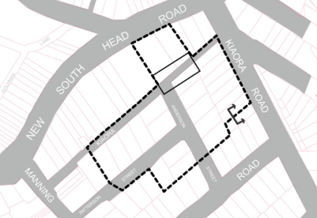

> [Picture on page 121: a picture, saved as a picture (images/chapter-d5-double-bay-centre-page-121-13.gif, 150 dpi).]

Section

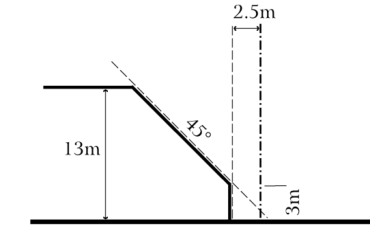

> [Picture on page 121: a picture, saved as a picture (images/chapter-d5-double-bay-centre-page-121-15.gif, 150 dpi).]

Section

#### Condition H

Location

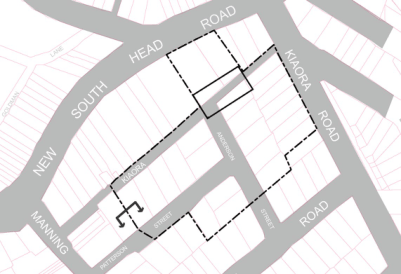

> [Picture on page 122: a picture, saved as a picture (images/chapter-d5-double-bay-centre-page-122-1.gif, 150 dpi).]

#### Condition I

Location

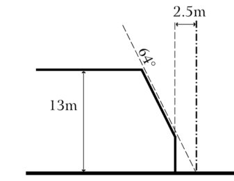

> [Picture on page 122: a picture, saved as a picture (images/chapter-d5-double-bay-centre-page-122-4.gif, 150 dpi).]

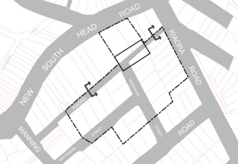

> [Picture on page 122: a picture, saved as a picture (images/chapter-d5-double-bay-centre-page-122-5.gif, 150 dpi).]

Section

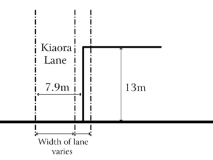

> [Picture on page 122: a picture, saved as a picture (images/chapter-d5-double-bay-centre-page-122-7.gif, 150 dpi).]

#### Condition J

Location

Section
