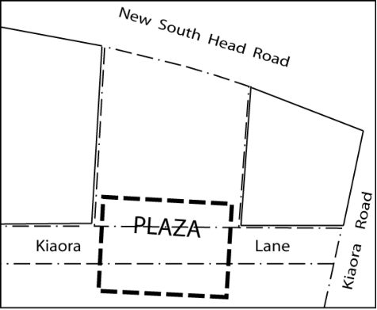

#### A2.5 Development controls

This section contains development controls that apply specifically to the Kiaora Lands site. These are to be read in conjunction with the relevant development controls in Sections 5.6.1—

5.6.7 of this chapter.

#### A2.5.1 Use

The image and vitality of the Double Bay Centre will benefit from the mix of uses that is permissible on the Kiaora Lands site.

These uses include: shopping facilities such as a major supermarket, specialty food outlets and additional retail floor space, all of which supplement the existing distinctive mix of small scale shops, boutiques, restaurants, cafes and commercial premises that characterise the centre; community facilities that will give a civic presence to the centre; commercial premises; and parking.

#### A2.5.2 Height

The height of the building envelope for the Kiaora Lands site is indicated on the control drawings in Section A2.4 Built form envelopes.

The following table provides the approximate floor to floor heights for different uses:

| Retail (small footprint) | 4m |
|---|---|
| Supermarket | 6m |
| Library | 5.5m |
| Commercial | 3.5m |
| Car parking | 3m |

#### A2.5.3 Built form south of Kiaora Lane

#### Principles

P1 The functional and operational requirements of large retail outlets should not compromise the qualities of the adjacent public domain.

P2 The built form should not compromise the amenity of adjoining properties.

P3 The built form should be compatible with producing attractive public domain.

#### Controls

C1 Comply with edge conditions in Section A2.4 Built form envelopes, Figure 5.

C2 The building setback included in edge condition A is to accommodate deep soil landscaped areas to mitigate the impact of the built form. The minimum width for deep soil landscaped area is 4.5m.

C3 The supermarket should not present uninterrupted blank walls onto streets and public spaces.

C4 The building frontage facing Kiaora Lane, Patterson Street and Kiaora Road is to be articulated so as to break up the length of the built form and reflect the vertical proportions of development in the Double Bay Centre.

C5 The main frontage of the supermarket is to be highly transparent and activated.

C6 Access to specialty retail outlets is to be directly from the public domain.

C7 Awnings are to be provided along the Kiaora Road and Kiaora Lane retail frontages.

C8 Provide wet weather protection at the entrance of the supermarket.

C9 The retail and office development at Kiaora Road should provide articulated walls and windows to street.

C10 All mechanical plant is to be designed on the basis that if that equipment could operate at any time of the day or night, then its noise emission component, when measured at the nearest, or at any other residential property façade, must not exceed the nocturnal background level.

The cumulative noise level from all relevant items of mechanical plant and equipment, when measured at the same location must not exceed the nocturnal background level by more than 5dB(A).

Note: The background noise level is to be measured on a windless Tuesday night which is normally the quietest night of the week. The results of this measurement must not be degraded by the noise of passing traffic, or by the noise from vehicles entering, or exiting the Anderson Street entry and exit. This may require the background noise level to be measured when the Anderson Street entry and exit is closed.

C11 The use of the premises must not give rise to noise which exceeds the relevant nocturnal background sound levels by more than 5dB(A) when measured at the façade of the nearest, or any other residential premises.

C12 External pipes, vents, fans or other items of plant must be individually specified to produce components of noise emission which are less than the relevant background sound level at the façade of the nearest of any other residential property. All such plant is to be located as far away as possible from residential properties. In the event that pipes, high velocity air discharge outlets or other pipe work are installed on the face of the building or extend through the rooftop, those outlets must be equipped with acoustically effective discharge silencers and have their directional discharge pointing in a north-westerly direction.

C13 The façade to Patterson Street is to be highly articulated with the use of a variety of materials and finishes to mitigate its bulk and visual impact.

C14 Screen landscaping sufficient to mitigate the bulk of the building is to be provided in the perimeter landscape areas.

C15 The landscaped area between the Court Road property boundaries and the proposed supermarket is to be a minimum of 7m wide.

C16 The landscaped area is to be free of car parking.

C17 The ground floor car parking where it faces residential properties to the south is to be completely enclosed.

C18 The ground floor level car park roof is to have a green roof design.

#### A2.5.4 Built form north of Kiaora Lane Principles

P1 The building is to be of exemplary design commensurate with its civic function.

P2 The building should not compromise the adjoining heritage item.

P3 The pedestrian connection between New South Head Road and Kiaora Lane is to be strengthened.

#### Controls

C1 Comply with edge conditions in Section A2.4 Built form envelopes, Figure 4.

C2 At the New South Head Road frontage, the setback between the adjacent heritage item to the west and the northern end of the arcade is to be a minimum of 1.35m from the street

boundary to reflect that point on the adjoining heritage item where the gable parapet wall springs up from the façade parapet.

C3 The building is to accommodate a clearly visible arcade which connects New South Head Road to development south of Kiaora Lane (see Section A2.5.7 The new arcade).

C4 A public plaza is to be provided to the south of the building (see Section A2.5.8 The new public plaza).

C5 Active retail or civic frontages are to be provided to the New South Head Road frontage, the plaza and the arcade.

C6 Access to specialty retail outlets is to be directly from the public domain.

#### A2.5.5 The new public domain

The public domain of Double Bay is characterised by an intricate pedestrian network of streets, lanes, walkways and arcades, making it a highly permeable shopping centre.

The planning and urban design provisions for the Kiaora Lands site reinforce this permeability with requirements for a new arcade between New South Head Road and Kiaora Lane, a new plaza, restrictions on vehicle movements along Kiaora Lane and the maintenance of pedestrian links between Kiaora Lane and Anderson Street.

The Double Bay Centre is also characterised by a series of distinctive public places such as Knox Street, Bay Street, Guilfoyle Park and Transvaal Avenue.

The public domain of the Kiaora Lands site will be a premier public space within the centre’s hierarchy of spaces. The character of the public domain is largely derived from the relationship between the buildings that address and form the public domain. It is also dependent upon the nature and quality of streetscape elements such as paving, street furniture, lighting and planting material.

#### Principles for all public domain on Kiaora Lands

P1 Ensure the public domain is of a high standard and exemplary urban design.

P2 Provide a high level of pedestrian amenity and create improved public spaces with a community focus.

P3 Consider the needs of people with access difficulties.

P4 Reduce conflicts between pedestrians and vehicles.

P5 Enrich and enliven the main spaces by providing high quality design elements and/or works of contemporary art.

#### Controls

C1 The public domain design should consider the Double Bay Centre Public Domain Improvement Plan 1999 and seek advice from Council’s Technical Services staff prior to submitting a development application.

C2 The pavement system used in the main spaces is to be of predominantly segmental stone elements (laid on a suitable concrete base).

C3 The pavement system is to comply with AS/NZS 4586 Slip resistance classification of pedestrian surface materials for safety and slip resistance.

C4 Ensure that shops are level with the adjacent external public spaces.

C5 Reinstate the tree lined nature of the streets and lanes.

C6 Awnings must be designed to accommodate street trees.

C7 Minimise the presence of vehicles in Kiaora Lane and the plaza.

C8 Use bollards to allow freedom of pedestrian movement while preventing vehicular access to specific areas. Bollards are to be used sparingly and are not to be used simply to define edges to vehicular paths.

C9 Minimise use of signage.

C10 The Davis Cup commemorative plaque is to be reinstated and is to be explained with interpretive signage. The position of the plaque is to be determined with regard to the location of the original tennis courts.

#### A2.5.6 Kiaora Lane

Kiaora Lane is to function as a shared pedestrian and vehicular way for the whole of its length. Its role as a service lane will continue but this is to be subservient to its primary role as a high quality public space. The predominant character of the lane is to be that of a high quality, pedestrian dominated space that maximises pedestrian connections between other public spaces and building entrances.

#### Principles

P1 Ensure that Kiaora Lane has good connections to existing arcades.

P2 Enhance the pedestrian experience and amenity of the lane.

P3 Reinforce the spatial definition of the lane.

P4 Encourage a mix of uses onto the lane including community facilities and food retailing.

P5 Enhance public safety and security of the lane.

P6 Encourage an active shared zone.

P7 Provide a high quality urban space.

#### Controls

C1 Frontages to Kiaora Lane are to be active retail or civic functions.

C2 Kiaora Lane is to be a shared zone as defined by the Roads and Traffic Authority.

C3 Provide a high quality unified pavement treatment along the full length of Kiaora Lane from Manning Road to Kiaora Road.

C4 The selection of materials for the shared zone in Kiaora Lane is to identify it as a space where pedestrians have priority.

#### A2.5.7 The new arcade

A major arcade is to be provided between New South Head Road and Kiaora Lane.

#### Principles

P1 Provide a major public pedestrian link between New South Head Road and Kiaora Lane.

#### Controls

C1 The arcade must be naturally lit from above and naturally ventilated.

C2 The arcade is to be a minimum width of 5m at the ground and upper levels.

C3 The arcade is to be designed for 24 hour public access.

C4 The entrance to the arcade at New South Head Road is to be clearly identified through architectural design.

C5 The shop frontages to the arcade are to be designed to create a visually unified whole.

C6 The floor treatment to the arcade should read as a continuation of the adjacent public spaces.

#### A2.5.8 The new public plaza

A new pedestrian plaza is required as part of the redevelopment of the site. The plaza is to be designed as a special place. It will require site specific design elements and the incorporation of public art. The space should be modulated to allow for defined areas of public circulation, seating areas and potential outdoor eating areas.

FIGURE 6  Location of plaza Note: The shape and location of the plaza in the diagram below is indicative only

> [Picture on page 129: a picture, saved as a picture (images/chapter-d5-double-bay-centre-page-129-3.gif, 150 dpi).]

#### Principles

P1 Ensure that the plaza has a distinctive character that is commensurate with its importance as a key civic space in the Double Bay Centre and the civic role of the adjoining building which fronts New South Head Road.

P2 Active retail and civic uses are to face the plaza.

P3 Ensure the plaza is animated by sunlight.

#### Controls

C1 Provide a space which accommodates the section diagram (see edge condition diagram E + F in Section A2.4 Built form envelopes).

C2 Ensure that the floor of the plaza receives solar access at midday on June 21.

C3 Provide a 32° inclined plane as a component of the building envelope controls to ensure solar access during winter. Refer to condition E of Section A2.4 Built form envelopes.

C4 The plaza is to be designed as an identifiable public space, allowing 24 hour access.

C5 The plaza is to be designed primarily as a place for people, but will permit vehicles to pass through under the shared zone arrangements for Kiaora Lane.

C6 The plaza is to be a minimum of 18m in any direction. It is to have an area of at least 500m² which is a single space such that people in any two places in the plaza can see each other.

C7 Frontages to the plaza are to accommodate active retail or civic functions.

C8 The majority of the area of the plaza is to be uncovered and free of overhanging buildings, colonnades and awnings.

C9 An overhang of 2m, 3.5m above the finished ground level of the plaza is permitted on the southern side of the plaza.

C10 Overhanging balconies of 2.4m on the first floor level are permitted on up to 30% of the building on the northern side of the plaza.

C11 The northern edge of the supermarket, where it adjoins the plaza, should provide windows overlooking the plaza.

C12 The plaza shall have a distinctive unified ground treatment.

#### A2.5.9 Public toilets

Public toilets are to be provided.

#### Principles

P1 Provide public toilet facilities on the Kiaora Lands site.

P2 Public toilets are to be in a safe and convenient location.

#### Controls

C1 Position the public toilets close to the plaza in a safe and convenient location.

C2 Ensure adequate surveillance to the entries of the public toilets.

C3 Access from the plaza to the public toilets is to comply with the performance criteria in the Building Code of Australia DP1 DP2 DP3.

#### A2.5.10 Car park and loading dock design

#### Principles

Ensure the design of the car park:

P1 Facilitates ease of access.

P2 Facilitates walking and bicycle use.

P3 Provides a high level of safety for all uses.

P4 Minimises opportunities for crime to property and persons through consideration of crime prevention through environmental design principles.

P5 Minimises the amenity impacts of the car parking and loading docks on surrounding properties and public domain.

#### Controls

C1 Provide a car park layout that maximises visibility and legibility.

C2 Ensure dedicated pedestrian entry and egress points to the public car parking are available from the plaza, Kiaora Lane, Patterson Street, Anderson Street and the supermarket entry.

C3 Access to liftwells and stairways or directions to the car park access points must be clearly visible from every car parking space.

C4 Car parking spaces for disabled people should be located in highly visible and accessible locations and in proximity to lifts and ramps.

C5 Dedicated bicycle parking is to be provided in a convenient location at the rate of 1 bicycle per 25 car spaces.

C6 Dedicated motorbike parking is to be provided in a convenient location at the rate of 1 motorbike per 25 car spaces.

C7 Lighting throughout the car park must conform to the requirements of AS 2890 Off Street Car parking and AS 1680.2 Interior Lighting.

C8 Pedestrian access ways to, from and around the car park must be well lit.

C9 A ground level through-site pedestrian footpath linking the plaza and Anderson Street must, as a minimum, incorporate the following design and operational features:

a) dignified, direct and unobstructed access from the plaza to Anderson Street;

b) have a minimum clear width of 2.5m;

c) have a minimum headroom of 3m.

C10  Vehicular access to the car park and loading docks south of Kiaora Lane is not to be provided from Kiaora Lane, unless it can be demonstrated that a turntable solution for the Kiaora Lane/Patterson Street loading dock is not feasible.

C11 Access to loading docks may be from Kiaora Road and Patterson Street only, unless it can be demonstrated that a turntable solution for the Kiaora Lane/Patterson Street loading dock is not feasible.

C12 If a loading dock is located off Patterson Street, the design and size of the dock must be limited to accommodate fixed rigid vehicles only (i.e. not semi-trailers).

C13 Vehicle ramps between car parking levels are to be enclosed to contain noise and light spill impacts. The walls and ceiling of the ramp enclosure are to be provided with an appropriately selected and effective fire resistant, sound absorbing facing (an approved acoustical spray, or modular acoustical panels/tiles) to provide an effective reduction of the reverberant characteristics of that area.

C14 Loading docks are to be designed to minimise conflict between pedestrians and vehicles.

C15 Loading docks are to be as unobtrusive as reasonably possible.

C16 Loading dock doors are to be no larger than the dimensions required for functional operation.

C17 Loading docks must be fully enclosed.

C18 The loading docks are to provide for the forward entry and exit of service vehicles. The docks are to be designed so that all truck reversals can take place within the loading docks with the loading dock doors closed.

C19 The loading docks are to be provided with automated doors with a surface mass greater than 3kg/m² and the sides, head and thresholds of each is to be designed to obviate, or minimise any undesirable sound leakage.

C20 The loading dock doors are to be designed so that their noise emission components when either opening or closing are no more than 5dB(A) above the background sound level when measured at the façade of the nearest, or any other residential property.

C21 The ceiling, as well as significant areas of the walls of the loading docks are to be provided with an appropriately selected and effective fire resistant, sound absorbing facing (an approved acoustical spray, or modular acoustical panels/tiles) to provide an effective reduction of the reverberant characteristics of that area and ensure there is minimum possibility of the loading docks impacting on neighbours.

C22 The consent authority may impose conditions restricting the operation of the loading docks and car parks to specified hours.

C23 A Carparking and Loading Dock Plan of Management is to be prepared and submitted with the development application for the comprehensive redevelopment of the site. The Plan of Management must address the following matters:

a) the designated areas in which motorcycles will be permitted to park;

b) the areas within the car park from which motorcycle traffic will be excluded;

c) the hours of operation, or restrictions, that may be imposed in relation to the use of the upper level car park and the mechanisms through which any such restrictions may be further strengthened in order to deal with unexpected situations;

d) explicit restrictions in relation to times of use of specific entries or exits which may be imposed to control, or minimise potentially intrusive nocturnal noise emission. This requirement most aptly applies to the Anderson Street entry and exit because vehicular movement both within, and outside the car park will be exacerbated by the nocturnal use of that entry and exit;

e) signage to identify entry restrictions for vehicles which may be too large, too high or too noisy to enter the car parks; and

f) appropriate signage and designated areas of the ground floor car park where patrons of licensed premises should park their vehicles in order to minimise the potential for neighbour noise at night.

C24 Appropriately designed and acoustically effective barriers are to be provided around the perimeter of the ground floor car park. The uppermost 2m or 3m section of the acoustic barrier is to be angled inwards. The acoustic barriers are to be provided with a sound

absorbing lining to reduce the sound reflections and reverberant characteristics of the car park.

C25 To achieve the noise goal referred to in C11 Section A2.5.3 Built form south of Kiaora Lane, a roof is to be provided over the car park, adjacent to the Kiaora Road vehicular entry and exits at the rear of 8 Kiaora Road. The underside of that roof is to be provided with an appropriately selected and effective fire resistant, sound absorbing facing (an approved acoustical spray, or modular acoustical panels/tiles) to provide an effective reduction of the reverberant characteristics of that area.

C26 The soffit of the supermarket floor is to be provided with an appropriately selected and effective fire resistant, sound absorbing facing (an approved acoustical spray, or modular acoustical panels/tiles) to provide an effective reduction of the reverberant characteristics of that area.

C27 The car park floors, as well as the interconnecting ramp between the ground level and rooftop car park are to have a surface that will not generate tyre squeal. The development application must include the specifications for the quality of the surface finish which may be achieved by the addition of an appropriate and functionally effective particular dusting or surface coating or by the application of fine sand on the finished floor surface before it has cured which will ensure positive tyre adhesion, and preclude tyre squeal problems.

C28 The interconnecting ramp between the ground level and rooftop car park is to have a smooth primary surface and not parallel ribbed surfaces. The ramp should incorporate small angled parallel grooves in a chevron pattern which may be cut into the surface of the cured concrete. The surface must be designed to preclude structural vibration and adverse related intrusive noise levels (or noise radiation from the main building structure) as well as provide positive tyre adhesion in the presence of water or oil.

C29 The car park is to be equipped with an effective electronic vacant car space identification system through which a driver may more rapidly find an empty car space to minimise the need to circle around the car park to find where they can park.

C30 Appropriately designed and effective acoustic barriers are to be provided around the perimeter of the rooftop car park to prevent noise impact on surrounding residential properties.

C31 The car park ramp is to be fully enclosed as required to meet the noise goal set out in

C11 Section A2.5.3 Built form south of Kiaora Lane. If necessary, the enclosure is to extend beyond the point where the ramp surface intersects with the upper level car park floor.

C32 The ceiling and walls of the entry and exit structure to Kiaora Road are to be provided with an appropriately selected and effective fire resistant, sound absorbing facing (an approved acoustical spray, or modular acoustical panels/tiles) to provide an effective reduction of the reverberant characteristics of that area.

C33 The south-eastern wall of the car park entry/exit to Kiaora Road must extend to the street alignment.

#### A2.5.11 Roof design

The roofscape is a significant visual component of the development and can be seen from the surrounding suburbs of Edgecliff, Darling Point and Bellevue Hill. These controls seek to reduce potential visual and amenity impacts of the roof top parking.

#### Principles

P1 The roofscape should not present as an obtrusive and single unarticulated mass.

P2 The roof is to be designed to minimise the amenity impacts to surrounding residences.

#### Controls

C1 A combination of landscape treatments and shade structures should be used so that the roofscape does not present as an obtrusive and single unarticulated mass.

C2 A combination of landscape treatments and shade structures should be used to minimise glare from the surface of the roof top and the cars parked on the roof.

C3 The roof treatment is to provide shade structures for vehicles.

C4 Surface treatments which minimise noise are to be used to minimise tyre squeal.

C5 To contain noise, motorbike parking should be limited to the ground level.

C6 The roof design should minimise light spill from cars.

C7 The design of fixed lighting on the roof should comply with AS 428-1997 Control of the Obtrusive Effects of Outdoor Lighting (urban standards).

#### A2.5.12 Flooding and water sensitive urban design

The Kiaora Lands site is flood prone land. Major redevelopment of the site will affect existing overland flow paths. The new plaza should provide an overland flow path for stormwater. Thorough and informed consideration of flooding issues at the design stage is essential to ensure

that redevelopment does not have detrimental impacts on the surrounding development, infrastructure and public domain.

#### Principles

P1 Ensure there is no increase in stormwater runoff from the site.

P2 Ensure the built form on the site does not block overland flow, in such a way as to impact on adjoining properties.

P3 Use water sensitive urban design techniques to reduce demand on the Sydney water supply and to provide water for plant irrigation.

P4 Ensure development on the site is adequately protected from flooding.

P5 The new plaza should act as a part of the overland flow path for stormwater.

#### Controls

C1 Development is to be designed having regard to the recommendations of a flood study prepared by a suitably qualified hydraulic engineer. The flood study must identify how property on and off the site, including the public domain, will be protected from the 1 in 100 years flood event.

C2 Development, including services, below the 1 in 100 years flood level is to be designed to be safe in a flood event.

C3 Provide a Site Emergency Response Plan (SERP) demonstrating the ability to safely evacuate persons to a safe refuge area.

C4 On site detention is not required.

C5 Collect rainwater for non-potable uses on site.

C6 The treatment of the roof should ensure that stormwater runoff is not increased and that the quality of runoff from the site fulfils the requirements of the Australian and New Zealand Environment Conservation Council and Agriculture and Resource Management Council of Australia and New Zealand Guidelines 2000 (http://www.environment.gov.au/topics/water/water-quality/national-water-quality-management-strategy).

#### A2.5.13 Environmentally sustainable design

The Kiaora Lands project is to provide best practice environmentally sustainable design. Refer to Chapters E2 Stormwater and Flood Risk Management, E5 Waste Management and E6 Sustainability for further information.

#### Principles

P1 Promote environmentally sustainable design.

#### Controls

C1 Development must be designed to provide for best practice environmentally sustainable design outcomes as may be established through the Green Star Certified Rating system, or a similar tool.
