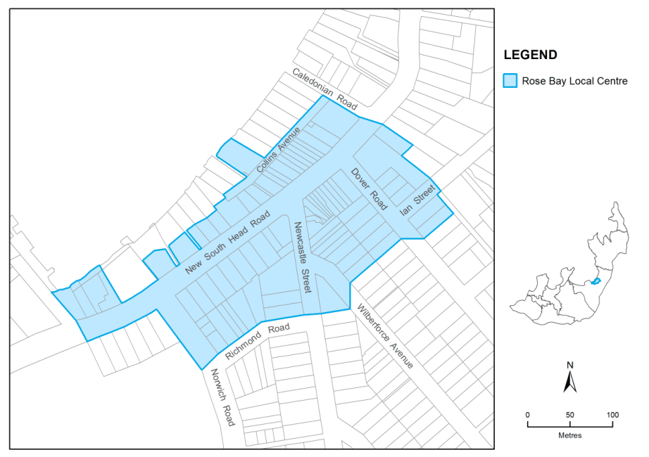
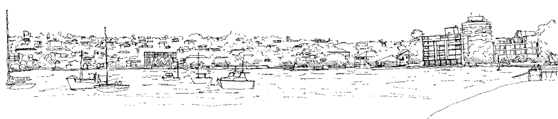

#### D6.1 Introduction

This is Chapter D6 of the Woollahra Development Control Plan 2015 (DCP), Part D Business Centres.  It establishes detailed controls to guide future development in the Rose Bay Centre.

Rose Bay is a unique local centre which enjoys a privileged position adjacent Sydney Harbour at the foot of the South Head peninsula. The historical development of Rose Bay has focused the centre on New South Head Road. The consistent scale of buildings and the distinctive landscape quality evoke an appealing urban village character which is warmly valued by local residents and users of the centre.

#### D6.1.1 Land where this chapter applies

This chapter applies to the Rose Bay Centre, as identified in Figure 1.

FIGURE 1  Location plan

> [Picture on page 5: a picture, saved as a picture (images/chapter-d6-rose-bay-centre-page-5-12.gif, 150 dpi).]

FIGURE 2  View of Rose Bay from the harbour

> [Picture on page 6: a picture, saved as a picture (images/chapter-d6-rose-bay-centre-page-6-2.gif, 150 dpi).]

#### D6.1.2 Development to which this chapter applies

This chapter applies to development that requires development consent.

Generally this will be mixed use retail, business, office and /or residential development, but may also include permitted uses such as child care centres, community facilities, and other uses as permitted by Woollahra LEP 2014.

Development within the Rose Bay Centre should retain and enhance the village character of the centre.

#### D6.1.3 Objectives

The Rose Bay Centre should develop into a high quality medium density urban village with a balanced mix of retail, commercial, residential and leisure uses, which cater primarily for the needs of the local community.

The intention of this chapter is to strengthen and enrich the existing urban structure of the Rose Bay Centre as follows:

O1 To retain and enhance the village atmosphere of the Rose Bay Centre.

a) To encourage contiguous ground floor retail frontage to ensure liveliness of the centre;

b) To limit the width of street frontage of individual shops to preserve the ‘small shop’ character of the centre;

c) To promote a coherent building scale and high quality development;

d) To retain and improve the pedestrian environment by encouraging through block pedestrian connections at nominated locations, and requiring continuous awnings in nominated areas;

e) To enhance the way development contributes to a sense of place;

f) To improve vehicle parking and servicing in the centre and reduce vehicular and pedestrian conflicts;

g) To enhance the public domain of Rose Bay Centre by considering the Public Domain Improvement Plan and Streetscape Design Manual 1999; and

h) To encourage the provision of community services and facilities as part of site redevelopments.

O2 To improve the connections between the Rose Bay Centre and the harbour foreshore.

a) To encourage the creation of a public square between New South Head Road and Collins Avenue, opposite Percival Park;

b) To encourage the construction of pedestrian arcades as part of developments in nominated locations, to improve public access through to the foreshore; and

c) To maximise views to the water from the public domain.

O3 To create a memorable image for Rose Bay.

a) To create defined entrances to the centre;

b) To provide a stronger public domain focus to the centre; and

c) To provide direction and certainty of outcome in relation to build form to ensure: − a coherent street scale; − that new development meets the desired future character; − a variety of building types; and − a high level of amenity.

O4 To improve the Rose Bay Centre’s public domain.

a) Improve the public domain of Rose Bay by using the Public Domain Improvement Program and the Streetscape Design Manual to inform changes;

b) Identify the location of and building envelopes surrounding a new public square in the centre, which support the use of bonus height and FSR controls in the Woollahra Local Environmental Plan 2014 (Woollahra LEP 2014);

c) To improve pedestrian amenity throughout the centre; and

d) To retain the important role that public transport plays in the Rose Bay Centre.

O5 To foster the diverse mix of uses in the Rose Bay Centre.

a) To retain and enhance the combination of retail, commercial, public and residential uses that characterise Rose Bay; and

b) To encourage a range of flexible accommodation to support the diverse mix of uses in the centre.

O6 To conserve and enhance the visual and environmental amenity of all buildings and places of significance in the centre.

a) To identify character buildings within the Rose Bay Centre; and

b) To ensure that alterations and additions to character buildings and heritage items are compatible in scale, form and material with these buildings and items, and adjoining developments.

O7 To improve traffic and parking management in the centre and reduce vehicle and pedestrian conflicts.

a) To identify parking and servicing arrangements for the centre.

O8 To introduce stormwater management measures to control localised flooding, stormwater quality and quantity, and improve the visual and environmental impact of stormwater drainage, particularly at the harbour foreshore.

a) To facilitate the creation of the Rose Bay Square between New South Head Road and the drainage reserve off Collins Avenue to mitigate against local flooding of the centre;

b) To improve the visual and environmental impact of existing stormwater outlets into Rose Bay; and

c) To coordinate overland flow management with public domain improvements.

O9 To enhance the diverse character of streets in the Rose Bay Centre.

a) To carry out public domain improvements to preserve and enhance the unique character of the individual streets in the centre; and

b) To provide specific design criteria for both public and private domain to allow for, and enhance the character of, individual streets.

#### D6.1.4 Relationship to other parts of the DCP

This chapter is to be read in conjunction with the other parts of the DCP that are relevant to the development proposal, including: Part E: General Controls for All Development – this part contains chapters on Parking and Access, Stormwater and Flood Risk Management, Tree Management, Contaminated Land, Waste Management, Sustainability, Signage and Adaptable Housing. Part F: Land Use Specific Controls – this part contains chapters on Child Care Centres, Educational Establishments, Licensed Premises and Telecommunications.

#### D6.1.5 How to use this chapter

This chapter is applicable to all development and redevelopment work on private land in the Rose Bay Centre.

The Rose Bay Public Domain Improvements Plan (1999) should also be used as a guide to works in the public domain, and includes details of street tree planting, footpaths, street furniture, and vehicular and pedestrian crossings.

This chapter of the DCP is structured as follows:
