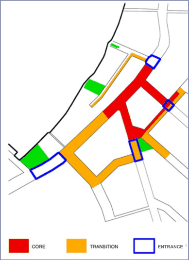

#### D6.3 Urban structure

Urban structure comprises the inter-relationship of topography and orientation, street layout, pattern of buildings, location of parks and public facilities, and any special natural or human made features, of a given area. The Rose Bay Centre is located in a valley close to the harbour foreshore, surrounded by gracious residential areas to the north and east, and an extensive system of recreational facilities to the south-west, encompassing parks, golf courses, tennis courts, and a sailing club.

The Rose Bay Centre has a strong urban village character, due in a large part to its neighbourhood scale, variety of retail and local service establishments, and friendly pedestrian ambience. Despite these attributes, the built form generally lacks cohesion due to the broad palette of materials used in buildings of different eras, and the varying architectural quality. A more distinctive building fabric has the potential to further consolidate the centre’s presence.

The centre is contained within a few blocks, but currently lacks a focus. Some of the most exceptional features of the area, such as the proximity of the harbour and numerous pocket parks, have little presence in the centre. There is the potential to improve access between the existing foreshore parks and the beach, allowing continuous waterfront access from Lyne Park in the west to Dumaresq Reserve in the east. There is also tremendous opportunity to visually connect Pannerong Reserve in the centre and Percival Park on the foreshore, by creating a square at the end of Newcastle Street, to make a unique and memorable focus for Rose Bay.

This chapter identifies the Core Area, Transition Area and Entrances (see Figure 3 Urban structure) within the Rose Bay Centre. This classification reinforces the existing urban structure, and enhances its complexity, providing opportunities for different buildings types and uses, in various parts of the centre.

FIGURE 3  Urban structure

> [Picture on page 13: a picture, saved as a picture (images/chapter-d6-rose-bay-centre-page-13-25.gif, 150 dpi).]
> Words printed on the picture (title and legend, copied from the PDF):
> ENTRANCE

The Core lies between the intersections of New South Head Road with Dover Road and Newcastle Street, and reflects this historically significant route to Watsons Bay. It is the focus of retail activity, defined by buildings which abut the footpath and awnings above, which distinguish it from the surrounding leafy areas. Development in the Core should reinforce its more intense urban quality.

The Transition Areas lie outside the Core in the vicinity of the recreational areas and residential zones, and are an important buffer to these areas. They do not contain the same level of retail activity as the Core but provide residential and commercial uses. They are generally characterised by less continuous building frontage and a stronger landscape presence. The Transition Areas should provide a gradation in development intensity from the Core to the residential and recreational areas.

Entrances are the primary entry points to the centre along New South Head Road, Newcastle Street and Dover Road. Entrances should be more clearly defined to strengthen the centre’s containment, enriching the contrast between this busy pedestrian area and its quieter environs.
