#### D6.4 Street character

The street is the primary organising element of urban structure. The street edge is the place where the public and private domains meet. By defining a particular vision for each street, public domain improvements and private development can be coordinated to produce a desired outcome.

This section of the chapter describes the desired future character of each street in the Rose Bay Centre, based on a synthesis of the public domain objectives set out in Section 6.1.3.  The Rose Bay Centre Public Domain Improvements Plan should be used as a guide to works in the public domain, such as street tree planting, footpath design, street furniture and traffic devices. Applicants should also seek advice from Council’s Technical Services Division.

The following is provided for each street in the centre: street strategies, which briefly outline the urban design criteria for each street; and annotated street sections, which indicate the existing development context and illustrate the desired future character.

This information sets the context for development controls described in Section D6.5 and D6.6, and streetscape changes in the Public Domain Improvements Plan.

#### D6.4.1 New South Head Road

#### Core area

#### Strategy

Identify and reinforce the core of the Rose Bay Centre, by encouraging retail activity, and enhancing its built edge urban quality.

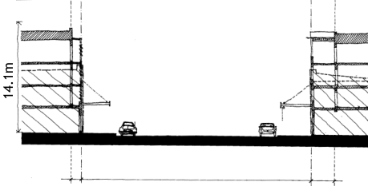

> [Picture on page 16: a picture, saved as a picture (images/chapter-d6-rose-bay-centre-page-16-7.gif, 150 dpi).]
> Words printed on the picture (title and legend, copied from the PDF):
> 14.1m

#### North-western side

#### South-eastern side

Parapets encouraged

Build to the street

alignment with masonry

walls and loggias above

street level

Incorporate sound

attenuation devices

such as wintergardens Continuous awnings

Commercial/residential

uses above street level Typical profile of existing

buildings

1.2m

24m

2.4m

Build to the street

alignment with glazed

retail frontage at street

level and commercial /

residential above

Glazed retail frontage at

street level

No vehicular crossings

- vehicular access

permitted at the rear

#### Transition area

#### Strategy

Create a transition between the Rose Bay Centre core and the recreational/landscape area towards Lyne Park, with a portion of street defined by street trees and a discontinuous wall of buildings on the harbour side.

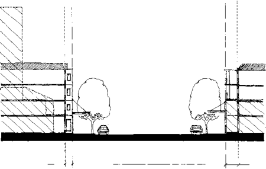

> [Picture on page 17: a picture, saved as a picture (images/chapter-d6-rose-bay-centre-page-17-6.gif, 150 dpi).]

South-eastern side

#### North-western side

Incorporate sound

attenuation devices

A variety of roof forms is

encouraged

Typical profile of

existing buildings

(dashed outline)

Discontinuous awnings

accommodate street tree

planting and highlight

building entries

14.1m

Minimise vehicular

crossings

1.2m

2.4m

#### D6.4.2 Newcastle Street

#### Core area

#### Strategy

Reinforce the built street frontage and establish a connection between Pannerong Reserve and the harbour by improving the landscape quality in Newcastle Street.

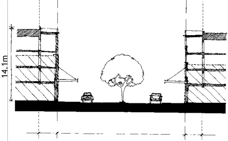

> [Picture on page 17: a picture, saved as a picture (images/chapter-d6-rose-bay-centre-page-17-31.gif, 150 dpi).]
> Words printed on the picture (title and legend, copied from the PDF):
> 14.1m

Eastern side

#### Western side

Parapets encouraged

Build to the street

alignment with masonry

walls and loggias above

street level

Street trees in the

median create an

intimate scale of street

Continuous awnings Typical profile of existing

buildings (dashed outline)

Build to the street

alignment with glazed

retail frontage at street

level

No vehicular crossings -

vehicular access permitted

at the rear

#### Transition area

#### Strategy

Create a transition opposite Pannerong Reserve to denote the residential area from the centre.

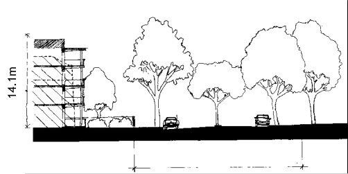

> [Picture on page 18: a picture, saved as a picture (images/chapter-d6-rose-bay-centre-page-18-5.gif, 150 dpi).]
> Words printed on the picture (title and legend, copied from the PDF):
> 14.1m

Eastern side

#### Western side

A variety of roof forms

is encouraged

Buildings encouraged to

overlook the Pannerong

Reserve

Typical profile of

existing buildings

Street trees in the median

create an intimate scale of

street

Commercial/residential

uses above street level Entry canopies

allowed Commercial uses at

street level Build to the existing

building alignment with

front

gardens/courtyards at

street level Minimise vehicular

crossings

FIGURE 4  View down Newcastle Street to New South Head Road

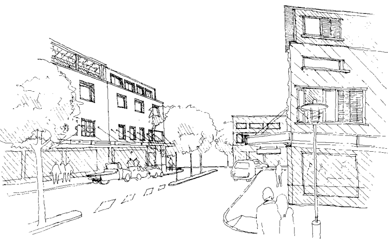

> [Picture on page 19: a picture, saved as a picture (images/chapter-d6-rose-bay-centre-page-19-2.gif, 150 dpi).]

#### D6.4.3 Dover Road

#### Strategy

Create a distinctive framed urban shopping street, defined by retail frontage at street level, with buildings above set back on terraces above, to improve visibility to the Rose Bay Hotel.

#### South-western side

#### North-eastern side

Profile of the Rose Bay

Hotel Parapets encouraged

Build to the street

alignment with masonry

walls and loggias above

street level on the corner

site only, to highlight the

entrance to New South

Head Road Commercial/residential

uses above street level

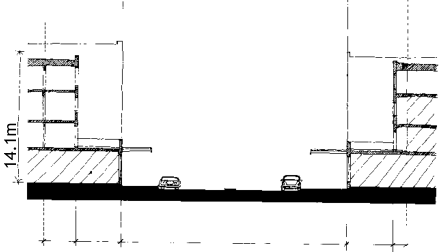

> [Picture on page 20: a picture, saved as a picture (images/chapter-d6-rose-bay-centre-page-20-15.gif, 150 dpi).]
> Words printed on the picture (title and legend, copied from the PDF):
> 14.1m

2.4m

4.2m

4.2m

20m

1.2m

Build behind roof

terraces above street

level with masonry

walls and loggias

to enhance the

amenity of

development and

increase the visibility

of the Rose Bay Hotel

Build to the street

alignment with glazed retail

frontage at street level

Continuous awnings

No vehicular crossings –

vehicular access permitted

at the rear

#### D6.4.4 Wilberforce car park edge

#### Strategy

Define the southern edge of the centre and provide pedestrian access through the existing car park site.

#### North-western side

#### South-eastern side

Encourage parapets

A variety of roof forms

is encouraged Commercial/residential

uses above ground  level

Build to the street

alignment with

masonry walls and

loggias above ground

level

Build to the street

alignment with walls,

loggias and balconies

which overlook the street

Build to the boundary

alignment with glazed

retail frontage at

ground level

Commercial uses at

ground level

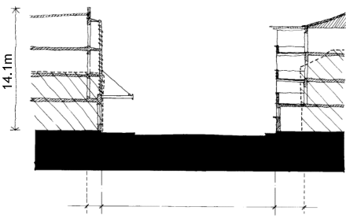

> [Picture on page 21: a picture, saved as a picture (images/chapter-d6-rose-bay-centre-page-21-23.gif, 150 dpi).]
> Words printed on the picture (title and legend, copied from the PDF):
> 14.1m

1.2m

2.4m

Typical profile of

existing buildings

#### D6.4.5 Wilberforce Avenue

#### Strategy

Reconfigure the street alignment to provide a memorable termination to Wilberforce Avenue maintaining the public open space.

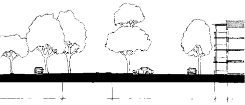

> [Picture on page 22: a picture, saved as a picture (images/chapter-d6-rose-bay-centre-page-22-6.gif, 150 dpi).]

#### South-western side

#### North-eastern side

Supplement the

existing tree planting

For residential zoned land

refer to Part B of this DCP

Angled parking along

Pannerong Reserve

Buildings encouraged to

overlook Pannerong

Reserve Build to the street

alignment in the

commercial zone A variety of roof forms is

encouraged Commercial/residential

uses above street level Commercial uses at street

level Minimise vehicular

crossings

#### D6.4.6 Richmond Road

#### Strategy

Retain the unique character of this predominantly residential street on the periphery of the centre, defined by mature street trees and a discontinuous wall of buildings.

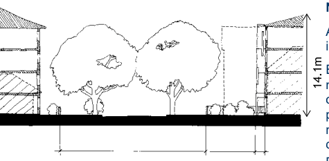

> [Picture on page 23: a picture, saved as a picture (images/chapter-d6-rose-bay-centre-page-23-6.gif, 150 dpi).]
> Words printed on the picture (title and legend, copied from the PDF):
> 14.1m

#### South-eastern side

#### North-western side

Maintain the existing

street trees

A variety of roof forms

is encouraged

Typical profile of

existing buildings For residential zoned

land refer to Part B of

this DCP

20m

6.5m 1.2m

Encourage office and other

non-retail commercial uses

on the ground floor to

provide a transition to

nearby residential

development. Build walls with windows,

loggias and balconies

which overlook the street Build to the existing

building line with front

gardens/courtyards at

street level Minimise vehicular

crossings Build to the street

alignment at the

intersection with Newcastle

Street to reinforce the

corner

#### D6.4.7 Norwich Road

#### Strategy

Create a defined edge, in terms of both landscape and built form definition, between the centre and the recreational/landscape area in the vicinity of Lyne Park and the Royal Sydney Golf Course.

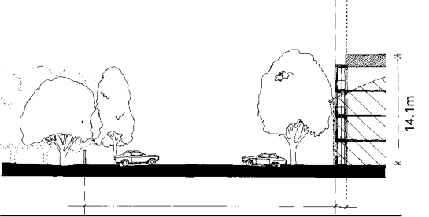

> [Picture on page 24: a picture, saved as a picture (images/chapter-d6-rose-bay-centre-page-24-7.gif, 150 dpi).]
> Words printed on the picture (title and legend, copied from the PDF):
> 14.1m

#### North-eastern side

#### South-western

side Maintain the

existing street

trees

Build to the street

alignment with windows,

loggias and balconies

which overlook the street Commercial/residential

uses above street level

Supplement the

existing street

tree planting

Commercial uses at street

level

New footpath

Typical profile of existing

buildings Minimise vehicular

crossings

#### D6.4.8 Caledonian Road

#### Strategy

Retain the unique character of this landscaped residential street to the harbour.

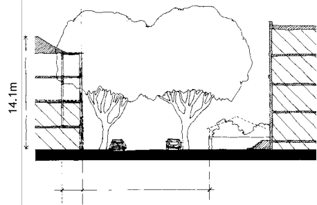

> [Picture on page 25: a picture, saved as a picture (images/chapter-d6-rose-bay-centre-page-25-5.gif, 150 dpi).]
> Words printed on the picture (title and legend, copied from the PDF):
> 14.1m

#### South side

#### North side

Maintain the existing

street trees

Typical profile of existing

buildings For residential zoned land

refer to Part B of this DCP

Build to the street

alignment with

windows, loggias and

balconies which

overlook the street Commercial/residential

uses above street level

2.4m 15m

Access to street level

retail frontage is not

permitted Minimise vehicular

crossings

FIGURE 5  View down Caledonian Road looking towards the harbour

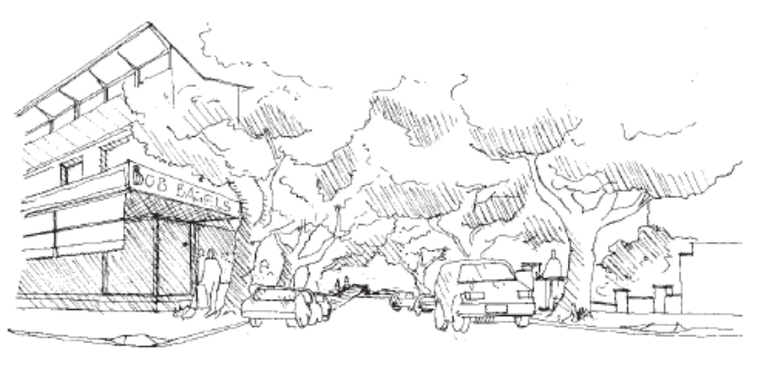

> [Picture on page 25: a picture, saved as a picture (images/chapter-d6-rose-bay-centre-page-25-28.gif, 150 dpi).]

#### D6.4.9 Collins Avenue

#### Strategy

Create a small urban street defined by private tree plantings, strong garden walls, and clearly defined entries on the harbour side, and a continuous and articulated wall of buildings on the south side.

#### South-eastern side

#### North-western

side

A variety of roof forms

is encouraged

For residential

zoned land refer

to Part B of this

DCP

Build to the street

alignment with walls,

windows, loggias,

balconies and terraces

above street level Protect privacy of

residential neighbours

opposite

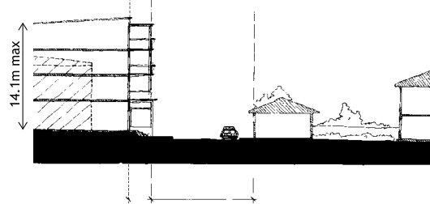

> [Picture on page 27: a picture, saved as a picture (images/chapter-d6-rose-bay-centre-page-27-18.gif, 150 dpi).]
> Words printed on the picture (title and legend, copied from the PDF):
> 14.1m max

10m

2.4m

Protect privacy of

residential neighbours

opposite Typical profile of existing

buildings Commercial/residential

uses above street level Build to the street

alignment with glazed

retail frontage at street

level Widen existing footpath Minimise vehicular

crossings

FIGURE 6  View down Collins Avenue from Caledonian Road

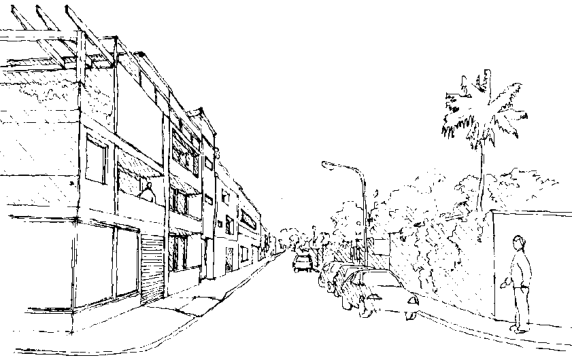

> [Picture on page 27: a picture, saved as a picture (images/chapter-d6-rose-bay-centre-page-27-36.gif, 150 dpi).]

#### D6.4.10  Vickery Avenue

#### Strategy

Strengthen the landscape quality of the street as an entry to Lyne Park with a strong visual connection to the harbour, and link to Tingira Reserve.
