#### D6.5 Built form envelopes: control drawings

#### D6.5.1 Urban form methodology

This section contains control drawings which show building envelopes for every site in the Rose Bay Centre. The envelopes have been tailored to each site, taking into consideration its particular characteristics.

These include: its relationship to the public domain- whether it is located in the Core or a Transition Area, or adjacent to a public park or square; the desired future character of the street in which the site is situated; its size and orientation; the significance of existing buildings and landscape; its optimum development potential; and the potential of adjoining private properties.

This Urban Form Methodology defines a physical outcome for the centre, whilst encouraging innovative architectural design within the building envelopes given. It provides a greater certainty of outcome for Council, community and site owners.

Controls for the ground floor and upper floor levels differ. At street level the integration of retail and commercial uses, gardens areas, vehicular access and street awnings, are the primary needs to be considered. Upper floor level envelopes are designed to facilitate quality residential and commercial development. For this reason there are two control drawings for each urban block in the Rose Bay Centre, illustrating the ground floor and upper floor level envelopes for every site.

The control drawings in this section should be read in conjunction with Section D6.6 which provides further explanation of the envelopes, and introduces other relevant guidelines and controls.

#### D6.5.2 Explanatory legend

The control drawings incorporate the following graphic symbols:

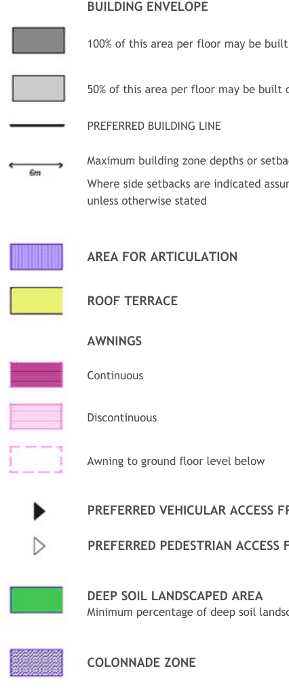

> [Picture on page 30: a picture, saved as a picture (images/chapter-d6-rose-bay-centre-page-30-3.gif, 150 dpi).]
> Words printed on the picture (title and legend, copied from the PDF):
> BUILDING ENVELOPE
> 100% of this area per floor may be built on
> 50% of this area per floor may be built on
> PREFERRED BUILDING LINE
> Maximum building zone depths or setbacks
> Where side setbacks are indicated assume 1m
> unless otherwise stated
> AREA FOR ARTICULATION
> ROOF TERRACE
> AWNINGS
> Continuous
> Discontinuous
> Awning to ground floor level below
> PREFERRED VEHICULAR ACCESS FRONTAGE
> PREFERRED PEDESTRIAN ACCESS FRONTAGE
> DEEP SOIL LANDSCAPED AREA
> Minimum percentage of deep soil landscaped area
> COLONNADE ZONE

#### D6.5.3 Rose Bay Centre urban form

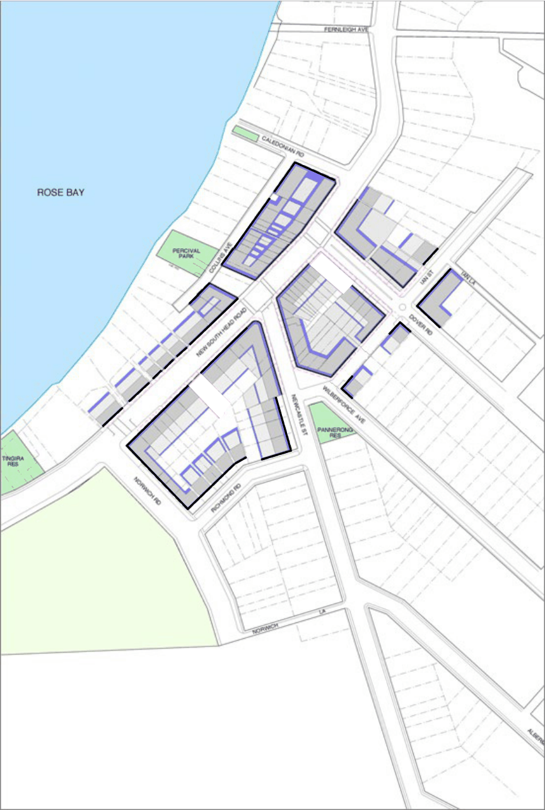

> [Picture on page 31: a picture, saved as a picture (images/chapter-d6-rose-bay-centre-page-31-2.gif, 150 dpi).]

#### D6.5.4 Control drawing 1

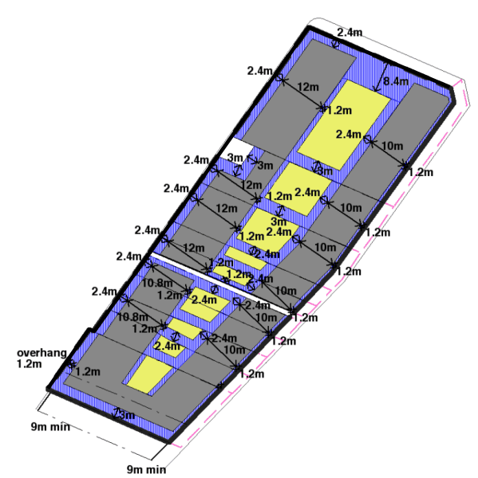

> [Picture on page 32: a picture, saved as a picture (images/chapter-d6-rose-bay-centre-page-32-2.gif, 150 dpi).]

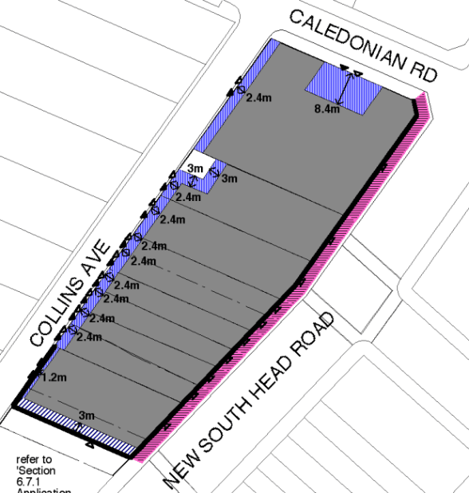

> [Picture on page 32: a picture, saved as a picture (images/chapter-d6-rose-bay-centre-page-32-3.gif, 150 dpi).]

#### Upper floor level

controls

New South Head Road

(north) / Collins Avenue

#### Ground floor level

controls

#### D6.5.5 Control drawing 2

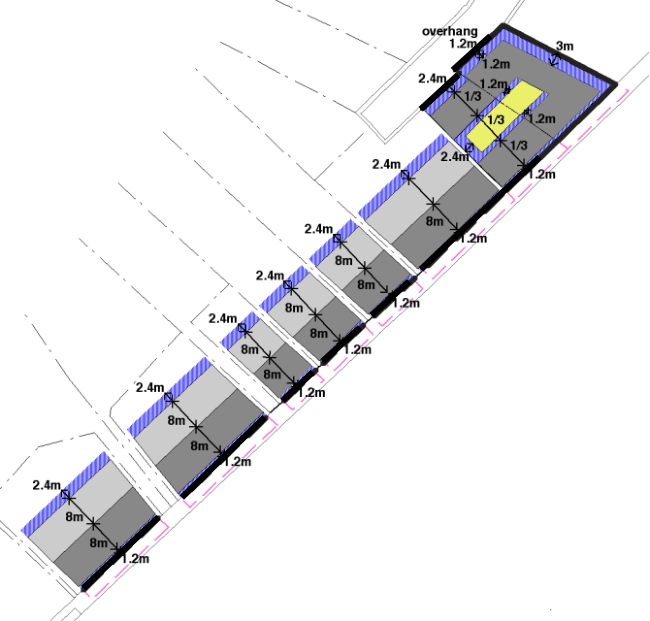

> [Picture on page 33: a picture, saved as a picture (images/chapter-d6-rose-bay-centre-page-33-2.gif, 150 dpi).]

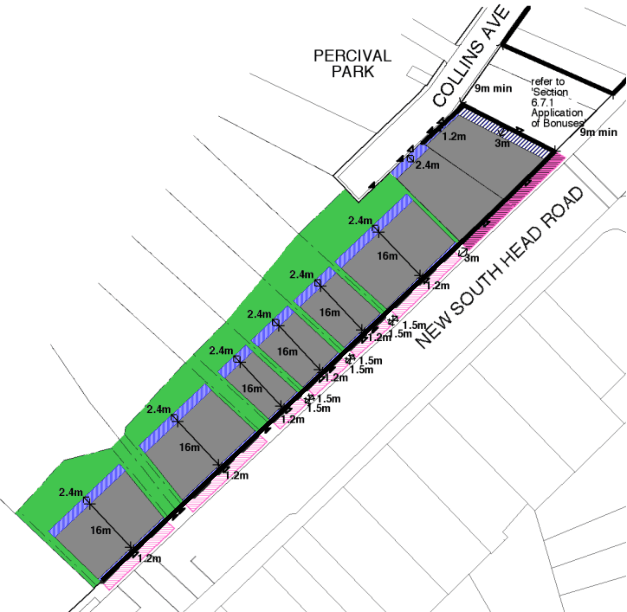

> [Picture on page 33: a picture, saved as a picture (images/chapter-d6-rose-bay-centre-page-33-3.gif, 150 dpi).]

#### Upper floor level

controls

New South Head Road

(south) between

Norwich Road and

Newcastle Street

#### Ground floor level

controls

#### D6.5.6 Control drawing 3

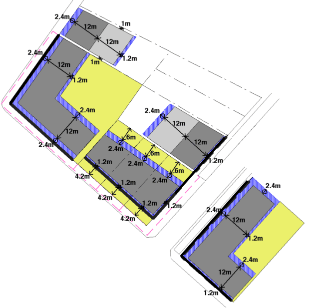

> [Picture on page 34: a picture, saved as a picture (images/chapter-d6-rose-bay-centre-page-34-2.gif, 150 dpi).]

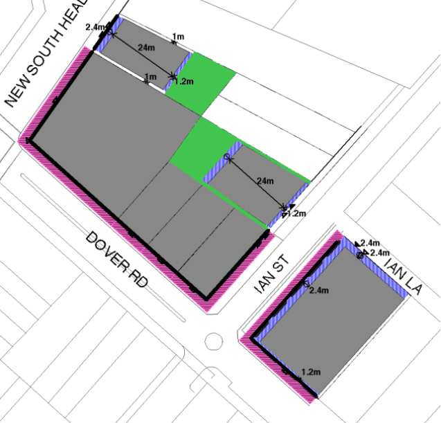

> [Picture on page 34: a picture, saved as a picture (images/chapter-d6-rose-bay-centre-page-34-3.gif, 150 dpi).]

#### Upper floor level

controls

New South Head Road

/ Dover Road / Ian

Street

#### Ground floor level

controls

#### D6.5.7 Control drawing 4

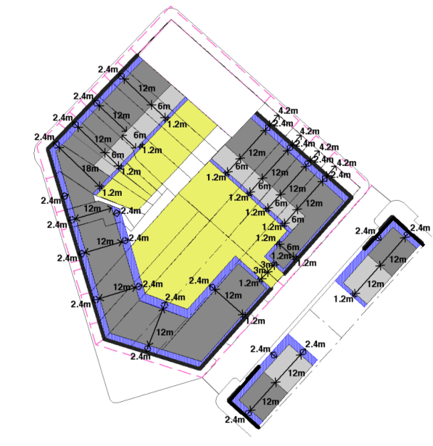

> [Picture on page 35: a picture, saved as a picture (images/chapter-d6-rose-bay-centre-page-35-2.gif, 150 dpi).]

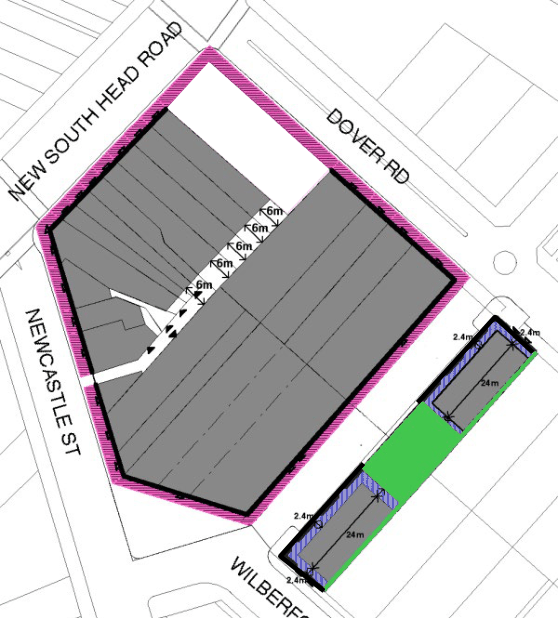

> [Picture on page 35: a picture, saved as a picture (images/chapter-d6-rose-bay-centre-page-35-3.gif, 150 dpi).]

#### Upper floor level

controls

New South Head Road

(south) / Dover Road /

Newcastle Street

Wilberforce car park

edge

#### Ground floor level

controls

eg

#### D6.5.8 Control drawing 5

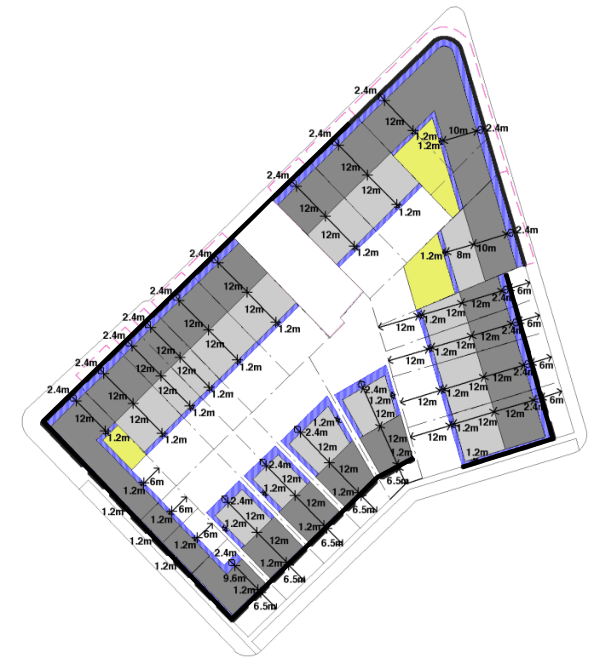

> [Picture on page 36: a picture, saved as a picture (images/chapter-d6-rose-bay-centre-page-36-2.gif, 150 dpi).]

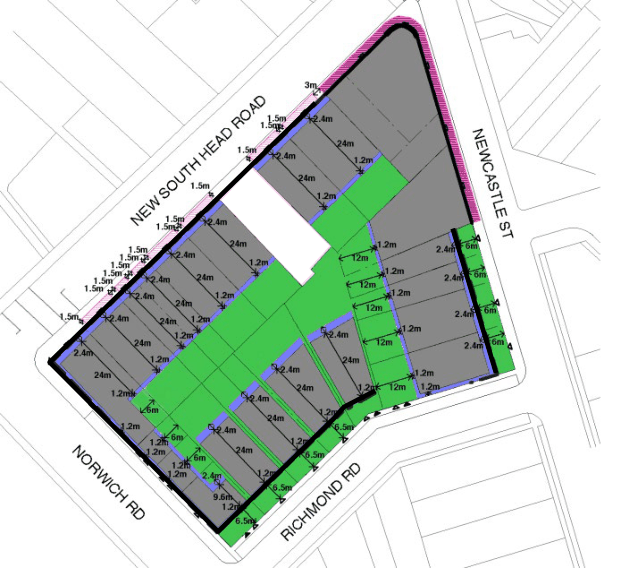

> [Picture on page 36: a picture, saved as a picture (images/chapter-d6-rose-bay-centre-page-36-3.gif, 150 dpi).]

#### Upper floor level

controls

New South Head Road

(south) / Dover Road /

Newcastle Street

#### Ground floor level

controls
