#### D6.6 Built form: Development objectives and controls

#### D6.6.1 General format

This section contains the development controls for identified building and site elements in the Rose Bay Centre which constitute its built form. It provides further explanation of the control drawings contained in Section D6.5 and introduces new controls not described in those drawings.

The following format is used:

#### Introduction

For most policies there is an introduction which explains the need and importance of including that particular element.

#### Objectives

The objectives define Council’s intention. They relate to the aims and objectives in Section D6.3 Urban structure, and the desired future character outlined in Section D6.4 Street character.

#### Controls

The controls establish the means of achieving the objectives. The controls in this chapter are site specific. This means they have been tailored to each site taking into consideration both the private built form and public spaces, to define a desired future outcome.

This section of the DCP must be read in conjunction with the control drawings which illustrate the site-specific controls. Diagrams are incorporated to assist interpretation.

Not all objectives and controls will be relevant to every development. The applicant must nominate any guidelines and controls which they considered irrelevant, and justify that opinion.

#### D6.6.2 Use

The distinctive mix of small scale shops, restaurants and local services in the Rose Bay Centre creates a friendly street environment, and caters well for the daily needs of the centre’s users. Continuous ground level retail frontage offers the benefits of safety, commercial activity and street life. The provision of commercial uses and housing on upper levels makes a significant contribution to the village character, providing street surveillance and activity in the centre outside business hours.

#### Objectives

O1 Enhance the village character of the Rose Bay Centre by encouraging mixed use commercial and residential development.

O2 Create active street frontages in the Rose Bay Centre by locating retail, commercial and community uses at street level.

O3 Discourage large scale retail establishments, by limiting the frontage width of individual retail tenancies.

#### Controls

C1 Design for a mix of uses within buildings.

C2 Design adaptable and durable buildings, spaces and places.

C3 Design for retail, commercial and community uses at ground floor.

C4 Access to residential uses should not occupy more than 20% of a site’s frontage.

C5 The maximum retail frontage for individual tenancies is 15m.

FIGURE 7  Building use Retain the range and intensity of existing retail uses in Rose Bay by limiting the width of

retail frontages

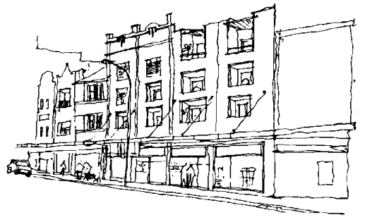

> [Picture on page 38: a picture, saved as a picture (images/chapter-d6-rose-bay-centre-page-38-24.gif, 150 dpi).]

#### D6.6.3 Urban character

#### 6.6.3.1 Building envelopes

The building envelope sets the position of the building on the site, and is described on the control drawings. Buildings in the Rose Bay Core are generally row buildings, with development concentrated to the street frontage. They have no side setbacks at the street frontage so clearly define the edges of the street. Buildings are massed away from the centre of blocks, encouraging solar access, natural ventilation and privacy.

Buildings in the Transition Areas are also concentrated towards the street and are built on or close to the street alignment, accommodating private gardens at the rear in many places. Contiguous front gardens in some areas such as Richmond Road make a significant contribution to the streetscape quality.

The building envelopes in Sections 6.5.2-6.5.8 have been designed to work in conjunction with the height and floor space ratio (FSR) controls in Woollahra LEP 2014.

Note: The maximum FSR for the centre is generally 2:1.  The maximum height of buildings is generally 14.1m (4 storeys).  Bonus height and FSR applies to 682-696 New South Head Road, subject to the provision of the Rose Bay Public Square (see Section 6.6.10.1).

#### Objectives

O1 Enhance the urban village character of the Rose Bay centre by encouraging a coherent street character with consistent building types built to, or parallel to the street alignment.

O2 Take advantage of the centre’s unique assets by orientating buildings to address parks and the harbour where possible.

O3 Retain and promote the pattern of perimeter block development to ensure a high level of amenity to all new development.

O4 Create exterior garden and courtyard spaces.

O5 Accommodate commercial uses by allowing deep building footprints at the ground floor level only.

#### Controls

C1 Development may only occur within the building envelopes shown on the control drawings (see Sections 6.5.2-6.5.8).

C2 Well-designed buildings which achieve the maximum height are encouraged, to enhance the definition of the street edge.

C3 The maximum permissible building depth above ground level is 12m.

C4 A minimum floor to ceiling height of 2.7m for habitable spaces applies in the centre to provide quality internal environments and facilitate future adaptability of uses.

C5 The minimum floor to floor heights for the Rose Bay Centre comply with the table below.

| Level | Use | Height |
|---|---|---|
| Ground floor Retail1 4m |  |  |
| Levels 2 Commercial office or residential 3.4m |  |  |
| Levels 3-5 Residential 3.1m |  |  |

1 Applicants may choose to vary storey height using 3.7m height for ground floor and Level 2 to create double storey spaces with a combined floor to floor height of 7.4m.

FIGURE 8   Building envelope – Potential architectural resolution within a building

envelope

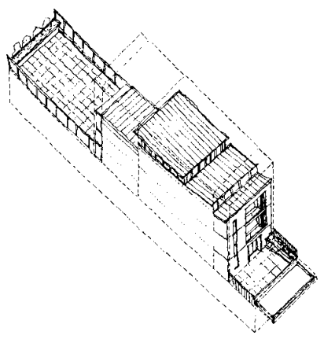

> [Picture on page 40: a picture, saved as a picture (images/chapter-d6-rose-bay-centre-page-40-7.gif, 150 dpi).]

FIGURE 9  Three dimensional controls – Highlighting the building envelope

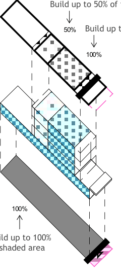

> [Picture on page 41: a picture, saved as a picture (images/chapter-d6-rose-bay-centre-page-41-2.gif, 150 dpi).]
> Words printed on the picture (title and legend, copied from the PDF):
> 50%
> 100%
> 100%
> Build up to 100%
> of shaded area

Build up to 50% of this area

UPPER FLOOR LEVEL CONTROLS

Build up to 100% of this area

ISOMETRIC building envelope shaded

GROUND FLOOR LEVEL CONTROLS

#### 6.6.3.2 Setbacks

The dominant building type in the Core is the party wall building with zero front and side setbacks.

In Transition Areas the architectural typology is more varied and includes free-standing buildings with relatively small side setbacks. The prevalent building alignment is generally close to the street, accommodating small front gardens and entry porches in some places.

Corner buildings throughout the centre are built to both street alignments, providing strong corner definition.

#### Objectives

O1 Retain and enhance the predominant pattern of row buildings only in the Rose Bay Core, and row and free-standing buildings in the Transition Areas.

#### Controls

C1 Building alignment should comply with the building lines shown on the control drawings (see Sections 6.5.2-6.5.8)

C2 Primary door and window openings in living areas should be located towards the street and/or rear garden to protect privacy and encourage integrated private open spaces. Living areas with primary openings facing the side boundary should be avoided.

C3 The design of corner buildings should be considered in relation to street geometry, topography, sight lines and the design of skyline elements.

C4 Front setbacks are identified as building lines on the control drawings (see Sections 6.5.2-6.5.8). Front setbacks should:

a) define a coherent alignment to the public domain;

b) accentuate significant street corners; and

c) accommodate contiguous front gardens in identified areas.

C5 Side setbacks should:

a) protect privacy to adjoining buildings;

b) protect access to natural light and ventilation;

c) provide pedestrian access to the rear of buildings;

d) facilitate views from the public domain to the harbour where possible; and

e) allow stormwater to flow towards the harbour.

C6 Rear setbacks should:

a) provide consolidated landscaped areas at the centre of blocks adjoining residential areas;

b) facilitate natural infiltration of stormwater;

c) protect privacy to adjoining buildings and gardens; and

d) facilitate solar access.

FIGURE 10  Side setbacks – Facilitate views from the public domain to the harbour

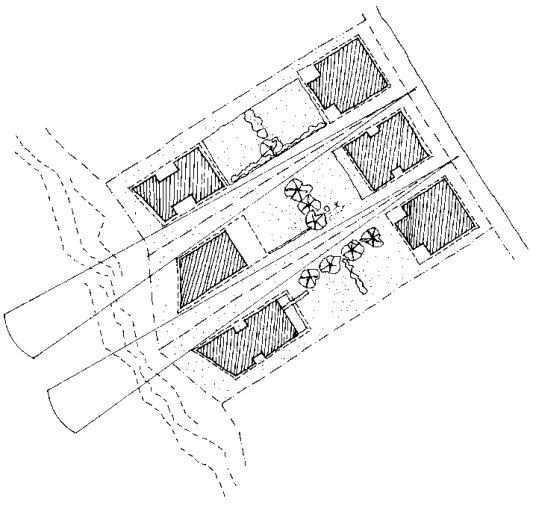

> [Picture on page 42: a picture, saved as a picture (images/chapter-d6-rose-bay-centre-page-42-21.gif, 150 dpi).]

#### 6.6.3.3 Building articulation

Building articulation refers to the three dimensional modelling of a building. The control drawings indicate the area for building articulation on a site by site basis (see Sections 6.5.2-6.5.8).

The Street Façade Articulation Zone (SFAZ) establishes the relationship between a building and the street, through the use of entry porches, loggias, balconies, bay windows and the like. Building facades can be articulated to create a strong street address, and enrich the character of the street. The Dover Road frontage of the Rose Bay Hotel in particular, is an excellent example of a well-articulated facade.

Building articulation should respond to environmental conditions such as orientation, noise, breezes, privacy and views, through the use of appropriate sun shading devices, noise barriers, privacy screens, and the careful location of balconies, terraces and loggias. At the rear of a building, articulation should enhance the relationship between the interior and the garden.

The building line determines the position of the facade wall. In certain areas of Rose Bay the building line has been setback from the street alignment. Compliance with this control is required to ensure that the façade aligns with the neighbours at the side boundary. The SFAZ is positioned behind this building line.

The SFAZ is occupied by two types of space:

External: − open balconies; − void not occupied by built form; and − recessed balconies counted in proportion to the amount of the façade they are open to.

Internal: − habitable rooms; − bay windows; − enclosed balconies; and − wintergardens.

#### Objectives

O1 Promote buildings of articulated design and massing, with building facades that contribute to the character of the street, and provide usable private external spaces.

O2 Encourage buildings to respond to environmental conditions, and promote energy efficient design principles.

O3 Utilise building articulation elements of appropriate scale to their use and context.

O4 Reinforce the development pattern of buildings on the street alignment in the Core.

O5 Reinforce the more open streetscape quality in the Transition Areas.

#### Controls

C1 To achieve high quality architectural resolution on frontages that address a street, the following percentages of internal and external space should be incorporated with the composition of the building for all floors above ground level.

Note: The use of a palette of articulation elements is recommended to achieve high quality architectural resolution.

#### Arrangement ONE – Street Façade Articulation of buildings in the Core area:

a) Buildings in the core area must provide 80% internal space and 20% external space in the SFAZ.

b) Where the control diagrams indicate that articulation on parts of the building envelope that are not in the SFAZ, the mix of internal and external space is discretionary.

Note: This variation requires that the majority of the SFAZ is expressed as solid producing a more building suited to the activity associated with the business core.

FIGURE 11  Street façade articulation in the

Core Area – refer to Articulation

Arrangement ONE

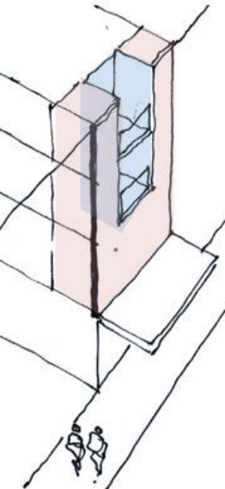

> [Picture on page 44: a picture, saved as a picture (images/chapter-d6-rose-bay-centre-page-44-17.gif, 150 dpi).]

FIGURE 12  Three dimensional controls –

Highlighting the area for building

articulation in the Core

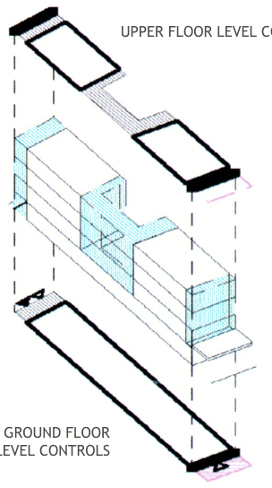

> [Picture on page 44: a picture, saved as a picture (images/chapter-d6-rose-bay-centre-page-44-21.gif, 150 dpi).]
> Words printed on the picture (title and legend, copied from the PDF):
> UPPER FLOOR LEVEL CONTROLS
> GROUND FLOOR
> LEVEL CONTROLS

ISOMETRIC area for building articulation shaded

Arrangement TWO – Street Façade Articulation of buildings in the Transition Area:

a) Buildings in the Transition Area must provide 30% internal space and 70% external space in the SFAZ.

b) Buildings on New South Head Road should be designed to reduce amenity impacts from traffic noise. Bedrooms should be located away from noise sources.

c) Private open space elements such as balconies, should be predominantly north, east and west facing, and should be designed to ensure visual and acoustic privacy of occupants and neighbours.

d) Where the control diagrams indicate that articulation on parts of the building envelope that are not in the SFAZ, the mix of internal and external space is discretionary.

Note: This variation requires a far more open façade compared to the core with greater potential for larger residential balconies.

FIGURE 13  Street façade articultion in the

Transition Area – refer to Articulation

Arrangement TWO

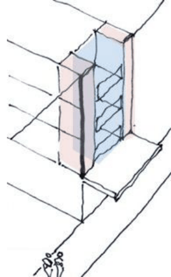

> [Picture on page 45: a picture, saved as a picture (images/chapter-d6-rose-bay-centre-page-45-16.gif, 150 dpi).]

FIGURE 14  Three dimensional controls –

Highlighting the area for building

articulation in the Transition Area

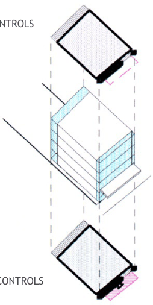

> [Picture on page 45: a picture, saved as a picture (images/chapter-d6-rose-bay-centre-page-45-20.gif, 150 dpi).]

UPPER FLOOR LEVEL CONTROLS

ISOMETRIC area for building articulation shaded

GROUND FLOOR LEVEL CONTROLS

#### 6.6.3.4 Heritage and conservation

Council supports the conservation of the rich mixture of buildings, parks and places of special significance within the Municipality. Woollahra LEP 2014 contains various controls on the conservation of items and areas of environmental and heritage significance. The LEP also contains incentives for developments which include the conservation of heritage items.

The Rose Bay Hotel, the former Rose Bay Post Office and two pines in Vickery Avenue are the only listed heritage items in the Rose Bay Centre. The Rose Bay Centre Urban Design Study 1998 identified an additional five character buildings which are shown in Figure 16. These buildings have high streetscape value because of their strong architectural character and the way in which they address the street. There are no heritage conservation areas in the Rose Bay Centre.

The grove of paperbarks adjoining the west side of Norwich Road is heritage listed and included on the significant tree register.  The paperbarks contribute to the streetscape of Norwich Road by providing a soft edge and afternoon shade. Other tree groves which make a contribution to the streetscape are the bushbox on Richmond Road and figs on Caledonian Road.  These two groves are on both sides of the road and form a united canopy shading the road and footpaths.

#### Objectives

O1 Protect and enhance items of environmental and heritage significance and character buildings (see Figure 16 Character buildings).

O2 All new developments and works to existing developments are to be designed to be compatible with the heritage significance of listed heritage items and nominated character buildings.

#### Controls

C1 Development proposals on sites containing heritage items must retain heritage significance.

C2 Development proposals on sites containing character buildings or heritage items must demonstrate that the architectural and streetscape value of the building would be retained or enhanced by the proposal.

C3 Development to a character building or heritage item is to respect the building and complement and enhance the key characteristics of the building including:

a) street edge definition;

b) its material, detailing and character;

c) its holistic building character related to articulation, massing, and patterns and distribution of wall opening.

Note: Where a development involves a heritage item, a statement of heritage impact must be lodged with a development application. That statement must set out the heritage significance of the place and the effect the proposed works will have on the significance of the heritage item.

FIGURE 15  Rose Bay Hotel

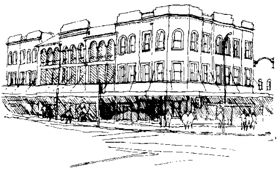

> [Picture on page 47: a picture, saved as a picture (images/chapter-d6-rose-bay-centre-page-47-2.gif, 150 dpi).]

FIGURE 16  Character buildings

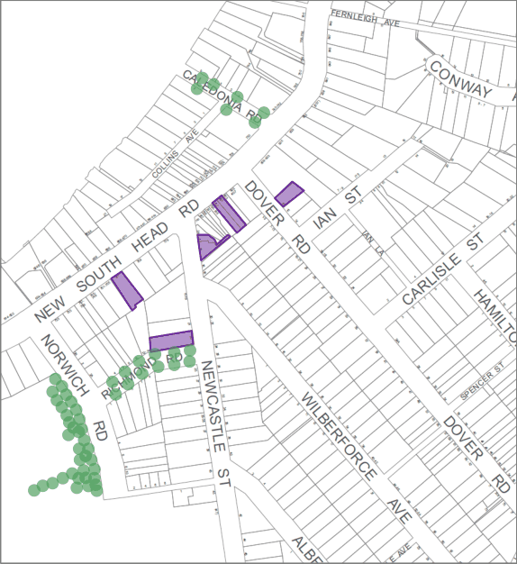

> [Picture on page 47: a picture, saved as a picture (images/chapter-d6-rose-bay-centre-page-47-4.gif, 150 dpi).]

Character building Tree grove

#### 6.6.3.5 Architectural resolution

Buildings in the Rose Bay Centre represent a cross section of 20th century architecture, with no period predominating, and are of varied quality. High quality architectural resolution can help to define a local identity.

#### Objectives

O1 Promote high quality architectural design throughout the Rose Bay Centre to create a desirable living and working environment.

O2 Encourage a more coherent streetscape.

O3 Minimise the negative impacts of glare and reflectivity on adjoining public and private properties.

04 To ensure that development enhances the visual quality and identity of the centre through well considered design, high quality materials and facade colours that do not dominate the street.

#### Controls

C1 A clear street address to each building should be provided. Pedestrian entries should be well defined.

C2 Vehicular entries should be discrete and minimise conflicts with pedestrians.

C3 Materials which are compatible with the existing development context, such as red face brick and rendered masonry, should be encouraged in street facade design.

C4 The colour of the building facade is not intrusive or unreasonably dominant within the streetscape, and is compatible with the character of the centre. Exterior colours should be appropriate to the context, and should not draw undue attention to the building.   The external painting of a building in bright colours, corporate colours or fluorescent colours should be avoided.  Any individual business branding and identity in external painting and colour schemes is to be subordinate to the main colour schemes in the street. (Also refer to Part E of this DCP, Chapter E7 Signage, When external painting of a building constitutes a wall sign).

C5 New buildings and facades do not result in glare that causes discomfort or threatens safety of pedestrians or drivers. Note: A reflectivity report that analyses the potential glare from the proposed new development on pedestrians or motorists may be required.

C6 Extensive areas of unprotected glazing are not permitted.

C7 Predominantly glazed shopfronts are to be provided to ground floor retail areas.

C8 Street corners are to be strengthened by massing and building articulation.

C9 Roller shutters to shopfronts are not permitted.

C10 The design of window and balcony openings should take into account the streetscape, heritage items, privacy, orientation and outlook.

C11 Blank party walls are to be avoided.

C12 Facades are to be richly articulated and should express the different levels of the building and/or its functions.

C13 Commercial space should be designed to permit maximum flexibility for future uses.

C14 All rooms above ground floor level, including kitchens and bathrooms, are to have windows/skylights wherever possible.

C15 The residential component of buildings must contain a variety of apartment sizes and layouts.

FIGURE 17  Facades – Richly articulated with deep modelling and shadows

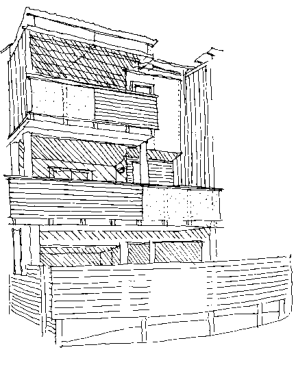

> [Picture on page 49: a picture, saved as a picture (images/chapter-d6-rose-bay-centre-page-49-12.gif, 150 dpi).]

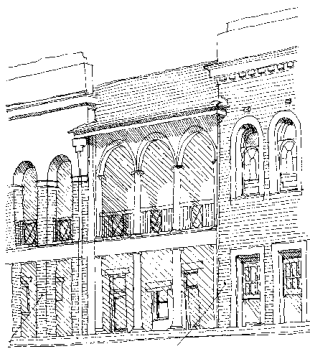

> [Picture on page 49: a picture, saved as a picture (images/chapter-d6-rose-bay-centre-page-49-13.gif, 150 dpi).]

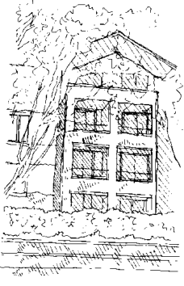

> [Picture on page 49: a picture, saved as a picture (images/chapter-d6-rose-bay-centre-page-49-14.gif, 150 dpi).]

#### 6.6.3.6 Roof design

The Rose Bay Centre Core is characterised by a predominance of buildings with articulated parapets, which contribute to its urban quality.

Roof forms vary with building type and architectural style in the Transition Areas, and include hips, gables, flat roofs and parapets.

#### Objectives

O1 Promote design that contributes to the definition of the Core.

O2 Encourage roof design to create a distinctive silhouette to buildings.

#### Controls

C1 The use of parapets is encouraged in the Core.

C2 The profile and silhouette of parapets, eaves and roof top elements must be considered in roof design.

C3 Where pitched roofs are proposed, the angle of the pitch should be compatible with the existing development context.

C4 Roof design should minimise building bulk and overshadowing.

C5 Roof terraces are encouraged (see detailed provisions in Section 6.6.5.2 Above ground open space).

C6 Air conditioning plant and equipment must be concealed from the exterior and be within the building. When roof plant is proposed it must be integrated with the design of the roof and the composition of the building and not be readily visible from the public domain.

FIGURE 18  Roof design – Pitched roofs integrated with broken parapet lines in the Core

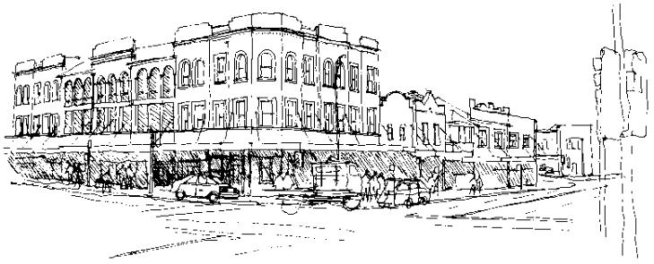

> [Picture on page 50: a picture, saved as a picture (images/chapter-d6-rose-bay-centre-page-50-14.gif, 150 dpi).]

FIGURE 19  Roof design – Roof forms must be contained within the building envelope. Varying roof forms including hips, gables, flat roofs and parapets are encouraged in the

Transition Areas

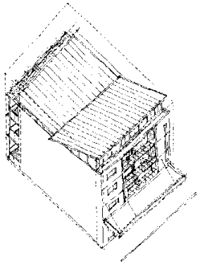

> [Picture on page 50: a picture, saved as a picture (images/chapter-d6-rose-bay-centre-page-50-18.gif, 150 dpi).]

#### 6.6.3.7 Awnings

Relatively continuous awnings provide wet weather protection and shade to shoppers in the busy Core. Awnings in the Transition Areas are more varied and less continuous, and are often used to highlight building entrances.

#### Objectives

Core

O1 Retain and supplement the existing awnings to provide continuous and coherent awning cover along footpaths.

Transition Areas

O2 Retain and supplement the existing awnings to provide discontinuous awning cover along footpaths to accommodate new street tree planting.

#### Controls

Core

C1 Development must provide continuous awnings to street frontages as indicated on the control drawings. Awning design should be suspended steel box section type with a minimum soffit height of 3.2m. Awning height should provide continuity with adjoining properties.

C2 Canvas blinds along the outer edge of awnings may be used to provide sun shading to the east and west facades. These blinds must not carry signage or advertising.

Transition Areas

C3 Development must provide discontinuous awnings where indicated on the control drawings. These awnings should provide cover to building entrances.

C4 The provision of under awning lighting is encouraged. Under awning lighting may be recessed into the soffit of the awning or wall mounted on the building.

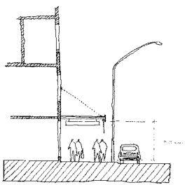

> [Picture on page 51: a picture, saved as a picture (images/chapter-d6-rose-bay-centre-page-51-25.gif, 150 dpi).]

FIGURE 20  Awning design Suspended steel box section type with a minimum

soffit height of 3.2m

FIGURE 21  Three dimensional controls –

Core area

UPPER FLOOR LEVEL CONTROLS

Highlighting the continuous awnings

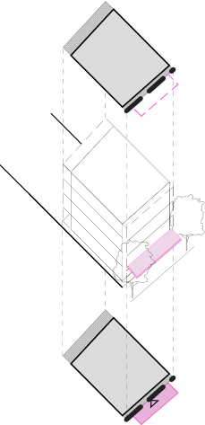

> [Picture on page 52: a picture, saved as a picture (images/chapter-d6-rose-bay-centre-page-52-6.gif, 150 dpi).]

ISOMETRIC Awning shaded

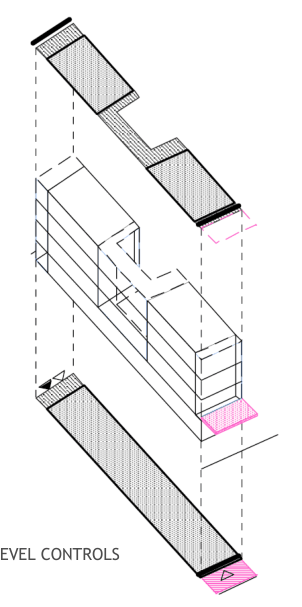

> [Picture on page 52: a picture, saved as a picture (images/chapter-d6-rose-bay-centre-page-52-9.gif, 150 dpi).]

GROUND FLOOR LEVEL CONTROLS

FIGURE 22  Three

dimensional controls –

Transition area

UPPER FLOOR LEVEL CONTROLS

Highlighting the

discontinuous awning

zone which

accommodates street

tree planting.

ISOMETRIC Awning shaded

GROUND FLOOR LEVEL CONTROLS

#### 6.6.3.8 Public art

Public art in developments can enhance the experience of the occupants and contribute to a sense of place.

#### Objectives

O1 To require the provision of public art in significant or large-scale developments.

O2 To integrate the public art so it is a cohesive part of the building design, interior or landscaping of the development.

O3 To design and locate the public art so that the aesthetics and amenity of the art can be appreciated by people within and outside the development.

O4 To enhance the experience of the occupants of the development and their relationship with the development through public art.

O5 To use public art to facilitate a connectedness between the development and the public domain.

#### Controls

C1 Development with a capital investment value of $15M or more includes public art.

C2 The public art is installed on the development site or in the immediate vicinity of the site.

C3 The public art is located so that it is not unreasonably inaccessible or obscured by a building element which makes it impossible to see in full by the building occupants and the general public.

C4 The public art is prepared and undertaken in accordance with the Woollahra Public Art Guidelines for Developers.

#### D6.6.4 Visual and acoustic privacy

Privacy is an important consideration in relation to the residential component of the Rose Bay Centre and neighbours adjacent to the centre, as it is a major determinant of environmental amenity.

#### Objectives

O1 Ensure adequate visual and acoustic privacy to residential apartments in the centre and private open spaces.

O2 Protect the privacy of adjacent residential neighbours.

#### Controls

Visual privacy

C1 Visual privacy is to be protected by providing adequate distance between opposite windows of neighbouring dwellings where direct view is not restricted by screening or planting (see Figure 23 Visual and acoustic privacy).

C2 Main living spaces are to be oriented to the street or rear garden to avoid overlooking between neighbouring properties. Living areas with primary openings facing the side boundary should be avoided.

Acoustic privacy

C3 Buildings are to be sited to minimise the transmission of external noise to other buildings on the site and on adjacent land.

C4 The internal layout of rooms, courtyards, terraces and balconies, the use of openings, screens and blade walls, and choice of materials, should be designed to minimise the transmission of noise externally.

C5 Bedroom areas are separated by way of barriers or distance, from on-site noise sources such as active recreation areas, car parks, vehicle accessways and service equipment areas.

C6 Restaurants and cafes should be designed to minimise the impact of noise associated with late night operation, on nearby residents.

C7 Rear courtyards would only be permitted for restaurant use if Council is satisfied that the hours of operation would not have an unreasonable impact on residential amenity

C8 Noise impact associated with goods delivery and garbage collection, particularly early morning, should be minimised. Note: Council may require a Noise Impact Assessment Report to accompany a Development Application.

FIGURE 23  Visual and acoustic privacy Minimum distances for visual and acoustic privacy

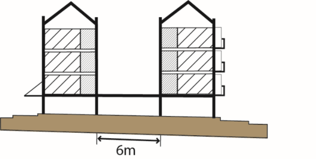

> [Picture on page 54: a picture, saved as a picture (images/chapter-d6-rose-bay-centre-page-54-28.gif, 150 dpi).]

#### Habitable room

A room used for normal

domestic activities that

includes: a bedroom, living

room, lounge room, music

room, television room, dining

room, sewing room, study,

playroom, sunroom and

kitchen.

#### Non-habitable room

A room of a specialised

service nature occupied

neither frequently nor for

extended periods, including a

bathroom, laundry, water

closet, food storage pantry,

walk in wardrobe, corridor,

hallway, lobby or clothes

drying room.

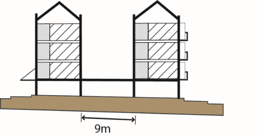

> [Picture on page 55: a picture, saved as a picture (images/chapter-d6-rose-bay-centre-page-55-11.gif, 150 dpi).]

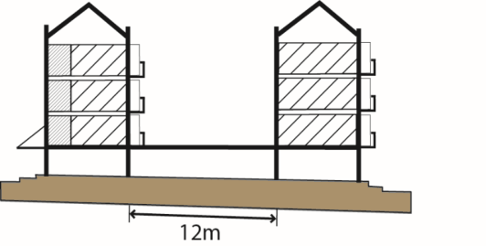

> [Picture on page 55: a picture, saved as a picture (images/chapter-d6-rose-bay-centre-page-55-12.gif, 150 dpi).]

FIGURE 24  Ensure adequate separation between unscreened balconies Privacy at ground floor level provided by suitable sill heights and planting

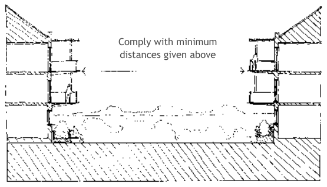

> [Picture on page 55: a picture, saved as a picture (images/chapter-d6-rose-bay-centre-page-55-15.gif, 150 dpi).]
> Words printed on the picture (title and legend, copied from the PDF):
> Comply with minimum
> distances given above

FIGURE 25  Careful location of balconies can increase privacy and reduce their separation

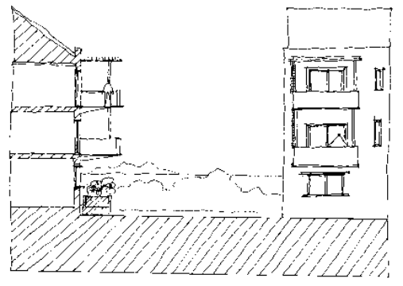

> [Picture on page 56: a picture, saved as a picture (images/chapter-d6-rose-bay-centre-page-56-2.gif, 150 dpi).]

FIGURE 26  Vegetation and balcony screening can increase separation to ensure privacy.

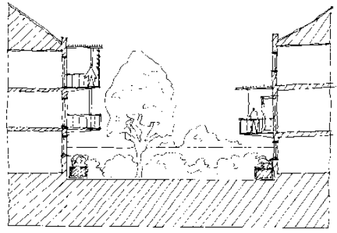

> [Picture on page 56: a picture, saved as a picture (images/chapter-d6-rose-bay-centre-page-56-4.gif, 150 dpi).]

#### D6.6.5 Private open space

Private open space includes landscaped area (such as permeable garden areas), and above ground open space such as roof gardens over car parking, terraces, loggias, balconies or decks. The accessibility of comfortable private and communal outdoor living areas is a major determinant of the ability of occupants to enjoy living and working in the centre. Open space plays an important role in the identity of the Rose Bay Centre, and assists stormwater management.

#### 6.6.5.1 Landscaped area

Landscaped area is an important contributing factor to the identity of the Rose Bay Centre.

Whilst the provision of deep soil landscaped area in the Core is limited due to the deep plan requirements of shops on the ground floor, the existing leafy character of the Transition Areas is formed in a large part by private gardens, which collectively create larger scale landscape spaces.

Deep soil landscaped areas play an important role in stormwater management. Contiguous garden areas assist site drainage and reducing runoff.

There is no deep soil landscaped area requirement for sites located in the Core.

FIGURE 27  Three dimensional controls – Highlighting the area for deep soil landscaped

area

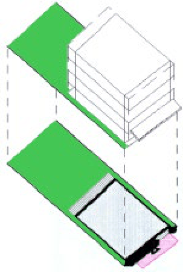

> [Picture on page 57: a picture, saved as a picture (images/chapter-d6-rose-bay-centre-page-57-18.gif, 150 dpi).]

ISOMETRIC At least 50% of the shaded area must contain deep soil landscaped area

GROUND FLOOR LEVEL CONTROLS

FIGURE 28  Rear gardens At least 50% of the area nominated in the control drawing should contain deep soil

landscaped area

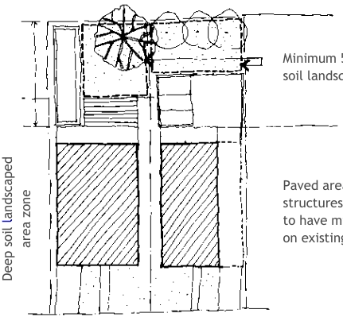

> [Picture on page 58: a picture, saved as a picture (images/chapter-d6-rose-bay-centre-page-58-4.gif, 150 dpi).]
> Words printed on the picture (title and legend, copied from the PDF):
> area zone
> Deep soil landscaped

Minimum 50% deep soil landscaped area

Paved areas and external structures must be sited to have minimum impact on existing trees

FIGURE 29  Contiguous gardens Create contiguous garden areas to form large scale landscape space

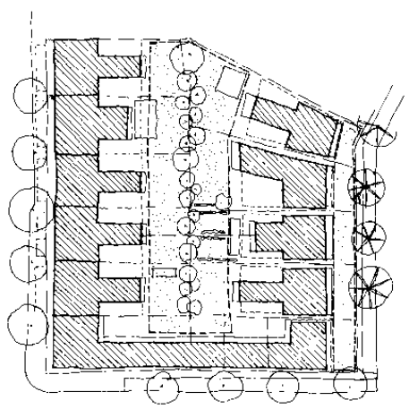

> [Picture on page 58: a picture, saved as a picture (images/chapter-d6-rose-bay-centre-page-58-13.gif, 150 dpi).]

#### Objectives

O1 Maintain and enhance landscape quality on private land.

O2 Encourage contiguous rear garden areas in the middle of blocks to enable retention of existing significant trees and to allow new planting of tall trees.

O3 Encourage contiguous front garden areas to strengthen the street character and allow street surveillance.

O4 Assist in stormwater control by maximising on-site infiltration through the use of permeable surfaces, and providing stormwater detention in the consolidated landscape areas.

O5 Encourage the use of planting to assist in energy conservation in buildings and comfort of outdoor living areas, and to protect privacy through screening.

#### Controls

General

C1 The area of deep soil landscaped area should be at least 50% of the area outside the building envelope.

C2 Planting of larger trees is encouraged to maintain Rose Bay’s existing leafy quality. Where views are an issue, plant high branching native trees, or deciduous trees. In smaller courtyard spaces deciduous tree planting is preferred.

C3 Provide trees and pergolas to shade external areas and control sunlight into buildings.

C4 Paved areas and external structures must be sited to have minimum impact on existing significant trees.

C5 A landscape plan is submitted as part of any development application that includes a component of multi dwelling housing.

Front gardens

C6 Design front gardens to provide a positive setting for the building.

C7 Design front gardens for security by providing adequate lighting to entrances. Avoid planting which may obscure the entry.

C8 Garden structures such as gazebos, clothes lines, play equipment, swimming pools, spa baths and ponds, are not permitted in front gardens.

C9 Garages and parking structures are not permitted forward of the building alignment.

C10 Minimise the impact of driveways in front gardens by design, materials selection and appropriate screen planting.

C11 Driveways, kerb crossings, parking, paved areas and external structures must be sited to have minimum impact on the root zone of existing street trees.

#### 6.6.5.2 Above ground open space

The provision of deep soil landscaped areas, particularly in the Core is limited due to the deep plan requirements of shops on the ground floor, and underground parking. In these areas open space must be provided above ground, as roof gardens over car parking, roof terraces, loggias, balconies, and verandahs (refer to control drawings in Sections 6.5.2-6.5.8).

#### Objectives

O1 Ensure every dwelling in the Rose Bay Centre has access to private open space by providing usable above ground open space on sites where there is no requirement for deep soil landscaped area. Refer to control drawings.

O2 Encourage occupied roof areas with roof gardens behind parapets where private open space at ground level is not available.

#### Controls

C1 Where direct access to ground level private open space is not available, provide at least one balcony, terrace, verandah, loggia, roof terrace or deck for each dwelling, within the area nominated for building articulation. The minimum area of this element is determined by the dwelling size (see table). The minimum permissible depth is 1.8m and the preferred depth is 2.4m. This element should be accessible from a principal living space.

| Dwelling size | Minimum required area of above ground open space |
|---|---|
| Small dwelling: Up to 60m² 8m² |  |
| Medium dwelling: 60m² - 90m² 12m² |  |
| Large dwelling: More than 90m² 16m² |  |

C2 Roof terraces and balconies must be designed to protect the privacy of neighbours.

C3 The profile and silhouette of parapets, eaves and roof top elements must be considered in roof terrace design to provide an attractive building finish when viewed from the public and private domain.

C4 Lightweight pergolas, sun screens, privacy screens and planters are permitted on the roof, provided they do not increase the bulk of the building, and do not significantly affect the views enjoyed by adjoining properties, or those in the vicinity or on the nearby ridges.

C5 Plantings over underground structures should have sufficient soil depth to allow sustainable planting. Note: A site specific landscape specification is to be prepared for landscaping above underground structures. The specification should include considerations such as plant species, soil depth and drainage.

FIGURE 30  Above ground open space Lightweight pergolas, sun screens and planters can enhance the quality of roof spaces,

and provide privacy

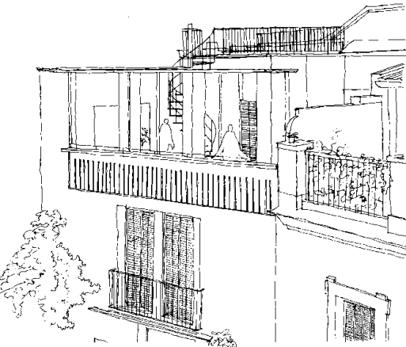

> [Picture on page 61: a picture, saved as a picture (images/chapter-d6-rose-bay-centre-page-61-4.gif, 150 dpi).]

FIGURE 31  Three dimensional controls – Highlighting the area for roof terraces

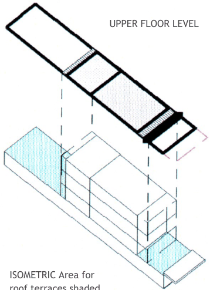

> [Picture on page 61: a picture, saved as a picture (images/chapter-d6-rose-bay-centre-page-61-6.gif, 150 dpi).]
> Words printed on the picture (title and legend, copied from the PDF):
> UPPER FLOOR LEVEL
> ISOMETRIC Area for
> roof terraces shaded

#### 6.6.5.3 Front fences

Front fences occur only in the Transition Areas in the Rose Bay Centre where buildings are set back from the street alignment. They are generally integrated with the architecture of the building, enhancing its character, and contributing to the visual appeal of the street.

#### Objectives

O1 Encourage the design of front fences which enrich the streetscape in Transition Areas.

O2 Ensure street surveillance is possible to assist safety.

#### Controls

C1 The maximum height of front fences is 1.2m.

C2 Fences should be integrated with the building and landscape design through the use of materials and detailing.

C3 Fences should highlight building entrances, and allow for outlook and street surveillance.

#### D6.6.6 Solar access and natural ventilation

#### 6.6.6.1 Solar access

Solar access is a major determinant of environmental comfort. Good passive solar design offers financial benefits by reducing the need for artificial heating and cooling.

#### Objectives

O1 Minimise overshadowing of adjoining properties or publicly accessible spaces.

O2 Building form, spacing, and layout should facilitate good solar access to both the internal and external living spaces, to maximise natural heating and cooling and minimise the use of artificial systems.

#### Controls

C1 Development should comply with the control drawings in Section D6.5 to ensure adequate solar access is provided to neighbouring properties.

C2 Development which does not comply with the control diagrams must maintain existing solar access to existing development for at least three hours between 9am and 3pm on 21 June

to north facing windows of habitable rooms, and at least two hours to at least 50% of the private open space.

C3 Access to sunlight should be achieved for a minimum period of three hours between 9am and 3pm on 21 June to windows of habitable rooms and two hours to private open space of new development.

C4 The overshadowing effect of new buildings on public domain areas are to be considered for the hours of 10am to 2pm on 21 March, 21 June and 24 September.

C5 Locate main living spaces including lounge, dining, kitchen and family rooms towards the north where possible. Consideration should also be given to slope, views, existing vegetation, overshadowing and streetscape.

C6 Skylights which provide the sole source of daylight and ventilation to habitable rooms are not permitted in residential or commercial areas.

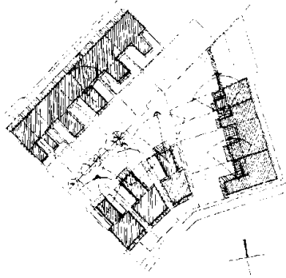

> [Picture on page 63: a picture, saved as a picture (images/chapter-d6-rose-bay-centre-page-63-13.gif, 150 dpi).]

FIGURE 32  Solar access Building form modulated within envelope to

maximise good solar access to

internal and external living spaces

#### 6.6.6.2 Natural ventilation

Building envelopes in this chapter encourage building depths on floors above street level that allow good natural ventilation and light. The location of the Rose Bay Centre in proximity to the harbour provides access to cooling summer breezes.

#### Objectives

O1 All buildings should be designed for good natural ventilation.

#### Controls

C1 Provide windows to all rooms above ground floor level, including kitchens and bathrooms, to facilitate natural light and ventilation. Minimise the reliance on mechanical ventilation or air conditioning above ground level.

C2 Facilitate cross ventilation by locating windows opposite each other where possible. The placement of small low windows on the windward side of a building, and larger higher windows on the leeward side, will encourage cross ventilation.

FIGURE 33  Cross ventilation Thin cross-section design achieves good

cross ventilation and avoids need for

internal rooms

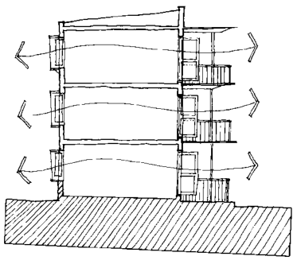

> [Picture on page 64: a picture, saved as a picture (images/chapter-d6-rose-bay-centre-page-64-5.gif, 150 dpi).]

#### D6.6.7 Parking and servicing

#### 6.6.7.1 On-site parking

On-site parking includes surface parking areas, car parking structures, semi-basement and underground parking areas.

The opportunity for on-site parking is restricted in many areas of the Rose Bay Centre. The narrow width of some lots makes it impossible to accommodate more than two spaces onsite, and site excavation for underground parking is made difficult by the level of the existing water table in the centre.

This chapter aims to satisfy the parking demand likely to be generated by future development, whilst facilitating the redevelopment of narrow sites and discouraging over-reliance on cars.

#### Objectives

O1 Facilitate the redevelopment or incremental development of narrow sites by implementing a parking contributions scheme to provide public car parking.

O2 Ensure the impact of car parking on the site and streetscape is handled discretely.

O3 Ensure the design of on-site car parking is safe and efficient, and integrated with the overall site and building design.

O4 Maximise natural light and ventilation to parking areas where possible.

#### Controls

General

C1 Car parking provision must comply with Part E of this DCP, the Chapter E1 Parking and Access.

C2 Car parking should be incorporated within the building, behind the building alignment.

C3 Consolidated parking areas should be provided below ground or screened from the street and concentrated under building footprints, to maximise the area for landscaped area.

C4 Basement parking should be naturally lit and ventilated, where practical. Note: Where the parking involves excavation, Council will normally require geotechnical and hydrological reports prepared in accordance with the Council’s ‘Guide for preparing Geotechnical and Hydrogeological Reports’ to demonstrate that there are no adverse geotechnical or hydrogeological impacts on any surrounding property and infrastructure as a consequence of the carrying out of development.

Retail component

C5 Retail development is required to provide a minimum of 80% of the required parking as an off-site contribution with the balance of the spaces provided on-site as private parking. The provisions for the off-site contribution are detailed in the Woollahra Section 94 Contributions Plan.

Commercial component

C6 Commercial development is required to provide a minimum of 80% of the required parking on-site as private parking with the balance of the required spaces provided as an off-site contribution.

C7 The provisions for the off-site contribution are detailed in the Woollahra Section 94 Contributions Plan.

#### 6.6.7.2 Vehicular access

Vehicular access frontage, as indicated on the control drawings, is the preferred location for vehicular access to private sites (see Sections 6.5.2-6.5.8).

The continuity of retail frontages contributes to the liveliness of the Rose Bay Centre and its village character. Vehicular crossings interrupt street activity, diminish the amenity of the place, and reduce the area for public on-street parking.

#### Objectives

O1 Encourage discrete access to car parking and servicing.

O2 Maximise retail frontage in nominated streets.

O3 Maximise pedestrian safety and amenity by minimising conflict with vehicles.

#### Controls

C1 In the Core vehicular access is only permitted via a rear lane, rear right of way, or side street.

C2 In the Transition Areas vehicular access must be via a rear lane, rear right of way, or side street where such access is available.

C3 Driveway widths should be minimised.

C4 Allow up to one two-way driveway per development. Two single driveways may only be provided where the distance between crossings exceeds 30m.

C5 Driveways to underground car parks should be designed with minimal visual impact on the street, and maximum pedestrian safety. Pedestrian access to the development should be separate and clearly defined. Garage doors should be set back. Access ways to underground car parking should not be located in direct proximity to doors or windows to habitable rooms.

C6 Driveways and kerb crossings must be sited to have minimum impact on the root zone of existing street trees (refer to the Public Domain Improvements Plan and Streetscape Design Manual advice from Council’s Technical Services Division).

C7 Driveways must be located in alignment with the garage. They must occupy a minimum proportion of any front garden area.

FIGURE 34  Three dimensional controls – Highlighting the preferred vehicular access

frontage

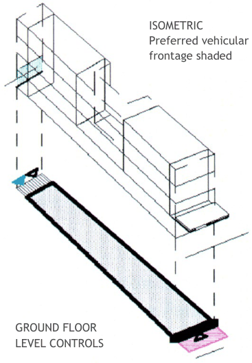

> [Picture on page 66: a picture, saved as a picture (images/chapter-d6-rose-bay-centre-page-66-18.gif, 150 dpi).]
> Words printed on the picture (title and legend, copied from the PDF):
> ISOMETRIC
> Preferred vehicular access
> frontage shaded
> GROUND FLOOR
> LEVEL CONTROLS

FIGURE 35  Vehicular access Driveways and garages designed with minimal impact on the street.

Garages set back with pedestrian access separate and clearly defined.

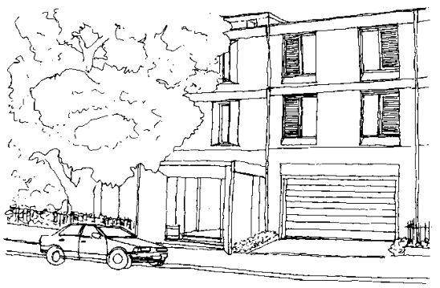

> [Picture on page 67: a picture, saved as a picture (images/chapter-d6-rose-bay-centre-page-67-4.gif, 150 dpi).]

#### D6.6.8 Groundwater (hydrogeology) and geotechnical impacts

Refer to Chapter E2 Stormwater, Flood and Geotechnical Risk Management of Woollahra DCP 2015, including section E2.2.10 Groundwater (hydrogeology) and geotechnical impacts.

#### D6.6.9 Site facilities

Site facilities include loading areas, garbage areas, fire safety systems, mail boxes, external stores, laundries and clothes drying areas. Development should provide appropriate site facilities for retail, commercial and residential uses, and minimise impact on the streetscape.

#### Objectives

O1 Ensure adequate provision of site facilities.

O2 Ensure site facilities are accessible, functional and unobtrusive.

#### Controls

C1 Loading facilities must be provided via a rear lane or side street where such access is available.

Any development which includes a residential component must provide laundry facilities, and at least one external clothes drying area. The public visibility of this area should be minimised.

C2 Hydraulic fire services such as fire hydrants and booster installations are concealed. These services are to be:

a) enclosed with doors if located in the building façade, or

b) housed in a cabinet or enclosure if located external to the building.

The location, design, colour and material of the doors, cabinet or enclosure are visually unobtrusive and suitably integrated with the development, including any fencing and landscaping.

C3 Lockable mail boxes should be provided close to the street, and integrated with front fences or building entries.

C4 Buildings are designed to accommodate venting from ground floor uses, to avoid potential impacts from exhaust and odour, such as cooking smells.

C5 Air conditioning units should not be visible from the public domain.

C6 An electricity substation is to be suitably located, screened and/or concealed so it is not visible from the street, or any other adjoining public place. Council’s preference is for a chamber substation. Any screening or enclosure to conceal the substation is to be visually unobtrusive and suitably integrated with the development, including the fencing and landscape design.

C7 The design and location of all other aboveground utility infrastructure (such as electrical pillars etc.) should minimise visual clutter within the streetscape and provide for a continuous accessible path of travel, where practical to ensure safe and equitable pedestrian circulation for people of all abilities. (Where this provision and Ausgrid’s requirements cannot both be satisfied, the applicant is to develop in consultation with Council and Ausgrid a solution that meets the acceptance of both consent authorities.)

Notes:

• At the DA stage the applicant should demonstrate that they have engaged with Ausgrid and have a network capacity assessment undertaken for the proposed development.

• Where a substation is required, the substation should be identified on the DA plans and addressed in the SEPP 65 Design Verification Statement (also see Apartment Design Guide Objective 3C-2 Amenity of the public domain is retained and enhanced).

• The DCP requirements for substations apply in addition to the Ausgrid Network Standards, such as NS113 Site selection and construction design requirements for chamber substations. Separate Ausgrid approval for the substation will be required.

• A dedicated access way/easement through the site to the substation will also need to be provided in accordance with the requirements of Ausgrid and Council.

#### D6.6.10 Application of bonuses

The Rose Bay Urban Design Study explored the urban potential of the centre, and sought feedback from the community reference group to identify a variety of public domain improvements including: a public square on New South Head Road linking the centre to the harbour foreshore; through block connections, such as arcades, shareways, and through shop links; a shop front community service facility; and public conveniences.

Council supports the construction of the facility and conveniences as part of private developments in the centre. Bonus FSR and height is available in Woollahra LEP 2014 for the provision of a public square.

It should be noted that provision of such facilities does not automatically mean that bonuses will be awarded. Each application will be dealt with on its merits.

#### Objectives

O1 The aim of a bonus system is to encourage the provision of public benefits as part of the redevelopment of privately owned sites. In return Council will offer certain bonuses or concessions with regard to development standards and controls.

#### Controls

C1 In determining the extent of bonuses granted, Council will examine the development against three general criteria:

a) the need for the bonus facility, based on the recommendations of the Rose Bay Urban Design Study;

b) the design and usefulness of the bonus facility provided on site or within the building to the general community; and

c) the effect the inclusion of a bonus facility or facilities has on the building’s bulk and form and the building’s relationship with the character of adjoining development. This chapter identifies specific public facilities which Council wishes to encourage.

#### 6.6.10.1 Rose Bay Centre Square

The Rose Bay Urban Design Study identified the need for a Rose Bay Village Centre. It proposed a ‘square’ on New South Head Road, linking the centre and the harbour foreshore, to create a focus for the centre and to take advantage of its unique setting. Figures 36 and 37 indicate the location of the proposed square and provide concept designs as a guide. Council will consider other designs on their merit.

To facilitate the square, Woollahra LEP 2014 permits a maximum building height of 17.2m (5 storeys) and FSR of 2.25:1, subject to the development being compatible with the desired future character of the centre.  The desired future character is articulated by the controls below.

These maximum height and FSR controls proposed will only be granted to the properties identified in clause 4.4C of Woollahra LEP 2014, and only if the properties are the subject of a single development application.

FIGURE 36  Area designated for the Rose Bay Centre Square

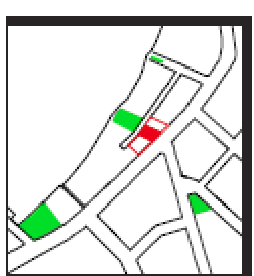

> [Picture on page 70: a picture, saved as a picture (images/chapter-d6-rose-bay-centre-page-70-8.gif, 150 dpi).]

FIGURE 37  Rose Bay Centre Square design concept Generous square creating a strong link at the end of Newcastle Street between the centre

and the harbour foreshore Colonnades provide protected edges to the square

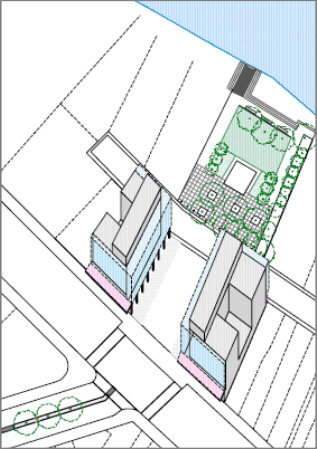

> [Picture on page 70: a picture, saved as a picture (images/chapter-d6-rose-bay-centre-page-70-13.gif, 150 dpi).]

#### Objectives

O1 Improve the visual and physical connection between the centre and the harbour foreshore.

O2 Provide a memorable focus for the Rose Bay Centre.

#### Controls

To be considered for bonus provisions the square must comply with the following controls:

C1 The square must be located in the area designated for the construction of the ‘Rose Bay Centre Square’ (see Figure 36 Area designated for the Rose Bay Centre Square) which corresponds to clause 4.4C in Woollahra LEP 2014.

C2 The square must be a consolidated outdoor space open to the sky with a minimum area of 350m², excluding areas under colonnades.

C3 The minimum aggregate width of the square along both the New South Head Road and Collins Avenue frontages is 9m. For example, a square with two open access points with a width of 4.5m each may be considered.

C4 In mid-winter allow solar access to a minimum 30% of the area of the square at 12 noon and 70% of the area of the square at 3pm.

C5 The maximum building coverage, including colonnades and building articulation, is 70% of the consolidated site area.

C6 Provide a minimum 1.2m wide area for building articulation above street level to New South Head Road and the southern side of the square.

C7 Provide a minimum 2.4m wide area for building articulation above street level to Collins Avenue and the northern side of the square.

C8 A maximum internal plan depth of 12m above ground level applies (see Section

6.6.3.1 Building envelopes).

C9 The inclusion of colonnades is encouraged to provide pedestrian amenity, encourage visual openness to the harbour, and as a distinctive and memorable characteristic of the square.

C10 Any proposed colonnade must have a minimum soffit height of 3.2m. Colonnade design must be visually integrated with the development.

C11 The levels and paving material within the colonnade should be contiguous with the surface of the square.

C12 A wind study and shadow diagram must be submitted with the development application.

Note: Council will consider relaxation of one or a number of development standards and controls in its assessment of applications which include a public square as described above. However, it should be noted that such bonuses are not automatic and each application will be assessed on its merits.

A fifth storey is permissible as in Figure 37 above, subject to the following controls:

C13 The area of the fifth storey must not exceed 40% of the consolidated site area.

C14 The fifth storey must be set back the depth of the area for building articulation to minimise visibility from the public domain. For example, the minimum set back of the bonus storey from the new square is 2.4m.

C15 The fifth storey should be designed to protect the privacy of adjacent dwellings, in particular those in Collins Avenue.

#### Development incentives

If the Rose Bay Centre Square is proposed the following incentives will be considered:

I1 Allow up to 40% of the area of the square to be set aside for private lease for open air cafes and the like, to the benefit of the owners, if the area of the square is less than 600m².

I2 Allow up to 60% of the area of the square to be set aside for private lease for open air cafes and the like, to the benefit of the owners, if the area of the square is greater than 600m².

I3 Reduced on-site parking requirements.

I4 Discounted Section 94 Contributions.

#### 6.6.10.2 Through block connections

The Rose Bay Urban Design Study identified the need for better pedestrian and vehicular circulation within the centre. Council wishes to encourage the inclusion of ‘through block connections’, in specific areas, in private developments. These may include arcades, through shop links, shareways, laneways and rights of way.

Improved pedestrian access to and within public car parking areas is desirable to facilitate convenient use of the centre. There is potential to take better advantage of the centre’s unique location close to the harbour by providing better pedestrian access to Collins Avenue and Percival Park.

Servicing of shops and other commercial uses from the main street frontage, particularly along New South Head Road, Dover Road and Newcastle Street, disrupts the pedestrian amenity and on street parking spaces. In addition it creates conflict with the high volumes of traffic carried by these streets, particularly New South Head Road. In line with the stated design principle in Section 6.6.7.2 Vehicular access, Council is keen to encourage the creation of rear lane access to commercial properties in the centre.

Council may consider the relaxation of one or a number of standards and controls depending on the quality of public area provided and the merits of the particular application.

Council will not relax any standards or controls unless it can be demonstrated that a proposal satisfies the underlying objectives of the DCP and that compliance with relevant development standards would be unnecessary or unreasonable in the circumstances of the case.

FIGURE 38  Areas designated for through block connections

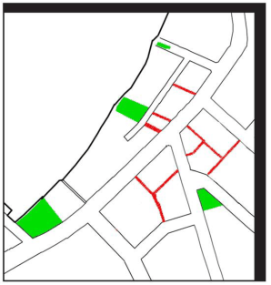

> [Picture on page 73: a picture, saved as a picture (images/chapter-d6-rose-bay-centre-page-73-2.gif, 150 dpi).]

#### Objectives

O1 Improve the pedestrian circulation in the centre by providing arcades, through shop links, and shareways in key locations, as identified in Figure 38 Areas designated for through block connections and Figure 39 Detailed location plan.

O2 Maximise views to the harbour from the public domain.

O3 Facilitate rear site access for car parking and servicing to avoid vehicular crossings on principal streets by providing new laneways and rights of way as identified in Figure 38 Areas designated for through block connections and Figure 39 Detailed location plan.

#### Controls

C1 Through block connections are encouraged by Council on the following basis:

a) Through block connections must be located in the areas shown in Figure 38 Areas designated for through block connections and Figure 39 Detailed location plan).

b) Through block connections must to the extent possible provide a clear sightline from one end to the other, for surveillance and accessibility, in any of the locations identified in Figure 38 Areas designated for through block connections and Figure 39 Detailed location plan.

c) Public use of through block connections should be available at least between the hours of 6am and 10pm daily.

C2 Pedestrian safety and the security of adjacent businesses should be considered in the design of through block connections. Specific consideration must be given to street level lighting at night.

C3 Through block connections must have a minimum width of 3m and be, clear of any obstruction, except for connections through shops.

C4 Paving must be coordinated with public footpaths (refer to the Rose Bay Centre Public Domain Improvements Plan and seek advice from Technical Services).

The following controls apply to arcades:

C5 Retail frontages are to be maximised along arcades.

C6 Arcades must have substantial natural lighting and ventilation.

The following controls apply to new lanes:

C7 Lanes must have a minimum width of 3m if one way, and 5m if two way.

C8 Carriageways and drainage should be coordinated between developments that collectively create new lanes.

C9 Lanes must provide rear service access to properties fronting New South Head Road, Dover Road or Newcastle Street to sites which currently have only one vehicular frontage.

C10 Buildings should address new lanes to provide passive surveillance.

C11  Applicants must demonstrate that the proposed service lane will be of benefit to the traffic circulation system in the Rose Bay Centre as a whole.

FIGURE  39  Detailed location plan Red – Pedestrian link

Orange – Vehicular/pedestrian link

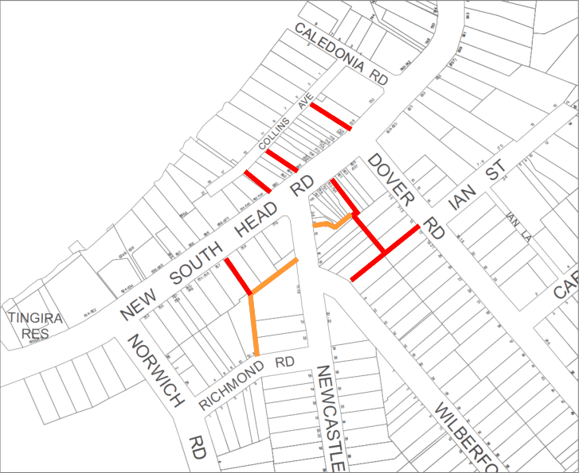

> [Picture on page 74: a picture, saved as a picture (images/chapter-d6-rose-bay-centre-page-74-16.gif, 150 dpi).]

FIGURE 40  Arcades can improve circulation and provide additional retail frontage.

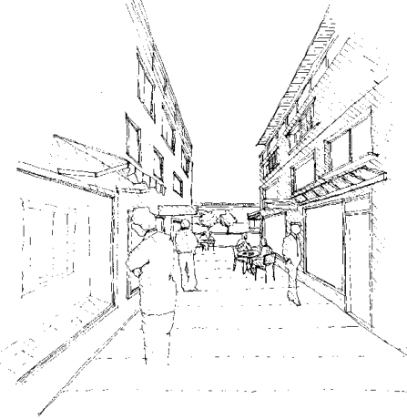

> [Picture on page 75: a picture, saved as a picture (images/chapter-d6-rose-bay-centre-page-75-2.gif, 150 dpi).]

#### 6.6.10.3 Community facility and public conveniences

The Rose Bay Urban Design Study identified the need for a community services facility and public conveniences in the Rose Bay Centre. Council may consider varying of one or a number of standards and controls depending on the suitability and merits of the facilities proposed.

Council will not relax any standards or controls unless it can be demonstrated that a proposal satisfies the underlying objectives of the DCP and that compliance with relevant development standards would be unnecessary or unreasonable in the circumstances of the case.

FIGURE 41  Area designated for the construction of a community facility (highlighted in

red)

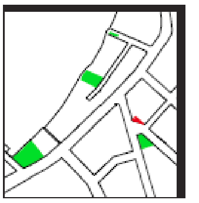

> [Picture on page 75: a picture, saved as a picture (images/chapter-d6-rose-bay-centre-page-75-12.gif, 150 dpi).]

#### Objectives

O1 Provide a conveniently located meeting place for the community, where Council and other public organisations can advertise available community services.

O2 Provide accessible, safe and durable public conveniences which cater for the broad needs of the community.

#### Controls

Community facilities and public conveniences are encouraged by Council on the following basis:

C1 The community facility should be located as identified in Figure 41 Area designated for the construction of a community facility.

C2 The community facility must provide a community display area, public seating and public conveniences.

C3 The minimum area of the community facility is 100m², including conveniences.

C4 The community facility may incorporate a privately operated cafe.

C5 The community facility should clearly address the public domain.

C6 Public conveniences should be incorporated in building developments generally, and should cater for the needs of people with mobility disabilities such as the elderly, and the needs of parents with infants.

C7 The provision of natural light and ventilation to public conveniences is highly desirable.
