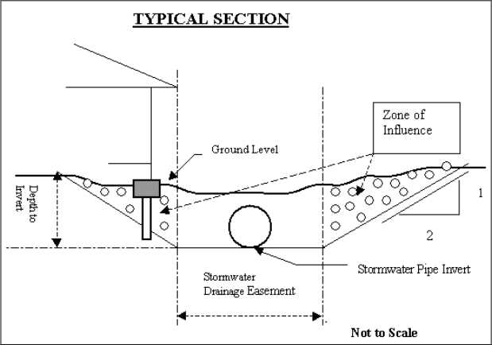

#### E2.2.7 Structures over or near drainage lines and easements

#### Objectives

O1 To provide for future maintenance activities on drainage lines.

O2 To provide and maintain adequate overland flow paths.

#### Controls

C1 Generally, new buildings, structures and overhanging structures are not permitted over existing or proposed drainage lines and easements.

C2 All structural foundations adjoining an easement or drainage line have a minimum depth lower than the invert of the adjacent drainage line. Additional depth is required for foundations adjoining natural water courses. All foundations are designed by a suitably qualified practitioner.

C3 Overland flow paths are maintained over drainage lines and easements. Driveways and landscaped areas may be located on overland flow paths.

Note: Applications must include plans and details relating to structures near a Council drainage line or easement. A dilapidation report including a CCTV inspection of all drainage lines within 3m of any development structure must be submitted with the construction certificate application. If the existing drainage line is in poor condition the drainage line is to be renewed and/or refurbished. The applicant is to submit details on the proposed construction methodology to ensure that Council’s drainage system is protected and supported during any works.

FIGURE 1  Typical section showing the zone of influence

> [Picture on page 19: a picture, saved as a picture (images/chapter-e2-stormwater-flood-and-geotechnical-risk-management-page-19-24.gif, 150 dpi).]

E2.2.8 Connection to Council’s parks, reserves, bushland and

#### natural waterways; Sydney Harbour; and Sydney Water channels

#### Objectives

O1 To manage, conserve and protect Council parks, reserves, bushland and natural waterways.

O2 To maintain existing natural drainage patterns.

O3 To minimise erosion of waterways, slopes and banks.

O4 To control stormwater pollution and improve water quality in streams and groundwater.

#### Controls

#### General

C1 Stormwater discharge to a natural watercourse or Council below ground drainage line within a Council park, reserve or bushland may be permitted subject to a merits based assessment of the proposal by Council’s Open Space and Trees Department.

C2 An environmental impact assessment is submitted addressing the impact on the park, reserve or bushland during and after construction, environmental sensitivity, erosion potential and weed invasion potential.

C3 Stormwater pipes and other structures are not visible on public land. Outlet structures are designed to blend in with the surrounds and should be constructed of natural materials, such as rock. Note: Access through Council’s park land and/ or storage of material on Council park land during construction will not be permitted unless prior written approval has been obtained from Council’s Open Space and Trees Department.

#### Discharge directly to Sydney Harbour

C4 Written approval from the Waterways Authority to discharge stormwater into Sydney Harbour is required. Note: The applicant must seek this approval.  The stormwater system must be designed in accordance with this DCP and any requirements of the Waterways Authority.

#### Discharge to Sydney Water channels

C5 Written approval from Sydney Water to discharge stormwater from the subject property directly into Sydney Water drainage channels is required. Note: The applicant must seek this approval. The stormwater system must be designed in accordance with this DCP and any requirements of Sydney Water.
