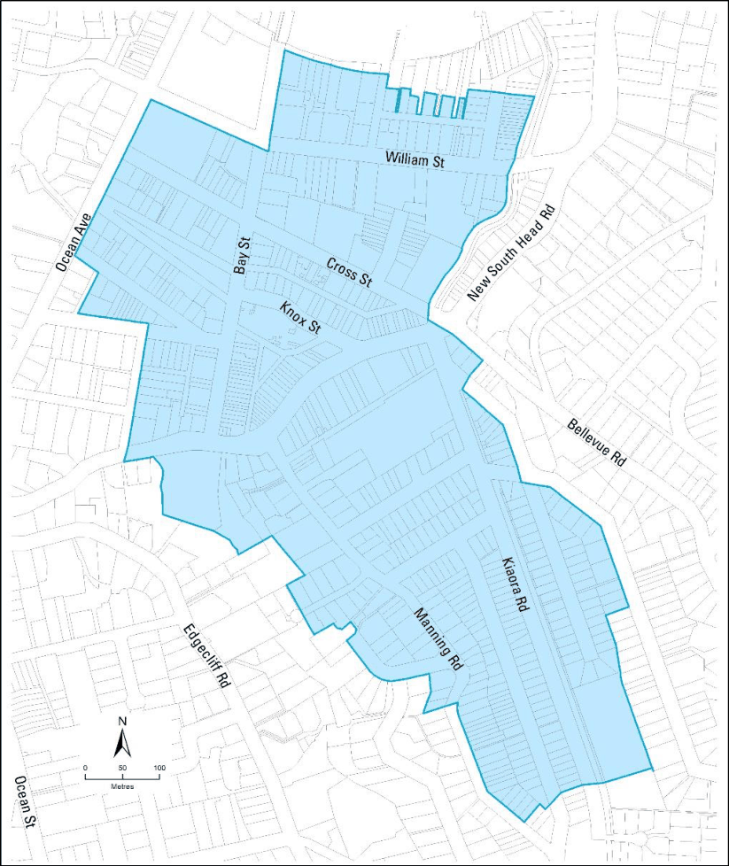
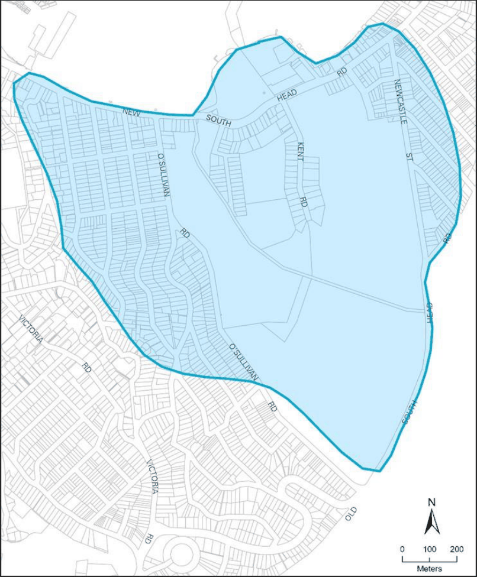

#### E2.2.10 Groundwater (hydrogeology) and geotechnical impacts

#### Introduction

Council will require geotechnical, hydrogeological and vibration assessment reports for development applications which include below ground structures.

Any proposed development with below ground structures must consider the sub-surface conditions and the effects of construction on surrounding properties. In addition, those which are likely to extend below the level of seasonal fluctuations in the groundwater table, must also consider the effect of any changes induced in the sub-surface water levels and the groundwater flow patterns on surrounding properties. Unless site specific information exists to the contrary,

excavations deeper than 1m must be assumed to have this potential to intersect the groundwater level and shall be considered as below ground structures.

Council’s principal objective is to ensure that earthworks and associated groundwater dewatering, during and after construction, will not have any adverse impacts on:

Environmental functions and processes Neighbouring uses Cultural and heritage items Any features of the surrounding land and infrastructure that could be impacted by geotechnical and hydrogeological changes.

Typically, adverse geotechnical impacts may include vibration induced damage and/or settlement from construction methods and equipment; instability of slopes, rock cliffs/faces influenced by excavation, filling or other loading such as footings of structures or construction plants; and inadequate support of adjacent land during and after construction. The vibration during construction can also cause discomfort to people occupying adjoining or nearby buildings.

Typically, adverse hydrogeological impacts may include settlement induced by changes in the groundwater level and seepage problems.

#### Objectives

O1 To ensure that earthworks and associated ground water dewatering, during and after construction, will not have any adverse impacts on: Environmental functions and processes Neighbouring uses Cultural and heritage items Any features of the surrounding land and infrastructure that could be impacted by geotechnical and hydrogeological changes.

O2 To maintain the existing groundwater level, both during and after construction.

O3 To minimise changes in groundwater level to protect surrounding property and infrastructure from damage.

O4 Buildings must be designed and constructed with appropriate support and retention systems to ensure that:

a) There will be no ground settlement or movement, during and after construction, sufficient to cause an adverse impact on surrounding properties and infrastructure.

b) Vibration during construction is minimised or eliminated to ensure no adverse impact on surrounding properties and infrastructure.

c) The risk of damage to adjacent existing property and infrastructure by the new development will be reduced to a level no greater than that from an event with an “unlikely” likelihood of occurrence and “minor” consequence.

Note: “adverse impact” means any damage caused to the improvements on adjoining properties by the demolition, excavation or construction on the development site.

#### Controls General controls that apply to the entire LGA.

C1 Unless site specific information exists to the contrary, excavations deeper than 1m are assumed to have a potential impact on groundwater. Note: Where the groundwater level is high, any proposed development with below-ground structures must consider the sub-surface conditions and the impacts of construction on surrounding properties. Below-ground structures which are likely to extend below the level of seasonal fluctuations in the groundwater table, must also consider the impact of any changes induced in the sub-surface water levels and the groundwater flow patterns on surrounding properties.

#### Requirements

C2 All below-ground structures are fully tanked. These type of structures must not collect and dispose of subsoil/seepage to kerb and gutter.

C3 Groundwater does not discharged to Council’s stormwater network, including stormwater pipes, pits and/or kerb and gutter.

Notes: All below-ground works must also comply with the requirements of the NSW Department of Primary Industries Office of Water. The design statement must confirm that the design of the below-ground structure has been undertaken in accordance with the relevant Australian Standards where applicable.

C4 Development applications which include below ground structures must include the following documents:

a) Structural report

b) Geotechnical and hydrogeological reports

c) Design statement and supporting drawings that show the design measures proposed to minimise risks and to ensure that no adverse impacts will occur.

Note: Council may identify other circumstances where these reports are required. All reports must be prepared in accordance with Council’s guidelines. Council may also require the preparation and submission of a pre-commencement dilapidation report for properties neighbouring the development.

C5 A qualified and experienced geotechnical and/or hydrogeological engineer must prepare the reports.

The reports must include a site-specific risk assessment matrix with appropriate definitions for qualitative measures of likelihood and consequences for assessing the risk of damage to existing developments by the new development.

C6 Where groundwater is present and dewatering is likely to occur on the site, the requirements of Council’s DA Guide under the ‘Investigations’ section must be implemented.

C7 Any geotechnical and hydrogeological reports must contain an Implementation Plan, including a Monitoring Program, Contingency Plan and Construction Methodology.

Note: All reports and requirements must be prepared in accordance with Council’s DA Guide. Geotechnical reports must be prepared by an appropriately qualified Geotechnical Engineer who is NER registered with a minimum of 10 years practice in the geotechnical field in the last 15 years.

C8 For development applications involving activities transmitting significant vibration, vibration from site works (including but not limited to demolition, excavation, sifting, piling and construction) is not to exceed the following limits at any time, as measured from the site boundary:

For continuous vibration: Maximum peak velocity of 0.28 mm/s

For intermittent vibration: Maximum peak velocity of 2.5 mm/s and maximum vibration dose value of 0.2 m/s1.75

For impulsive vibration: Maximum peak velocity of 2.5 mm/s

These are the minimum standards. Some locations may be more susceptible to vibration

impacts and require more stringent vibration limits to protect human comfort and prevent structural damage.

Note: Factors that may influence vibration impacts include, but are not limited to:

Ground conditions Sensitive buildings in the vicinity of the site, e.g. heritage, age, construction type and materials of buildings.

C9 An implementation plan, including a vibration monitoring program and contingency plan, is to be submitted by the applicant. The plan is to include the locations of vibration monitoring sensors, trigger levels for anticipated vibration types and buildings in the neighbourhood, and frequency and duration of monitoring.

As a minimum, vibration monitoring sensors are to be installed and monitored at adjacent properties. The trigger level for the vibration monitoring will be set with the consultation with Structural Engineer following completion of the pre-construction dilapidation surveys of the adjacent buildings, and review geotechnical conditions and construction methodology. Such monitoring should be in place for the duration of all activities outlined in C8.

Notes:

Should vibration limits be exceeded at any time as all activities as defined in C8 during construction, the construction activity causing vibration must cease until the measures to limit the vibration are implemented. At the end of construction, a post construction dilapidation survey of the adjacent properties is to be carried out and compared with pre-construction dilapidation survey for identification of defects (if any) that were likely caused by vibration from construction activities. These matters will also be reflected in the conditions of consent.

#### Land in the Double Bay settlement area

In addition to the general controls in this section, the following applies to the land in the Double Bay settlement area, as shown below.

FIGURE 1  Double Bay settlement area

> [Picture on page 28: a picture, saved as a picture (images/chapter-e2-stormwater-flood-and-geotechnical-risk-management-page-28-5.gif, 150 dpi).]

C10 Temporary changes to the groundwater level, due to construction, must not exceed 0.2m from the average monitored pre-construction groundwater level.

#### Land in the Rose Bay settlement area

In addition to the general controls in this section, the following applies to the land in the Rose Bay settlement area, as shown below.

FIGURE 2  Rose Bay settlement area

> [Picture on page 29: a picture, saved as a picture (images/chapter-e2-stormwater-flood-and-geotechnical-risk-management-page-29-5.gif, 150 dpi).]

C11 Temporary changes to the groundwater level due to construction must not exceed 0.3m from the average monitored pre-construction groundwater level.
