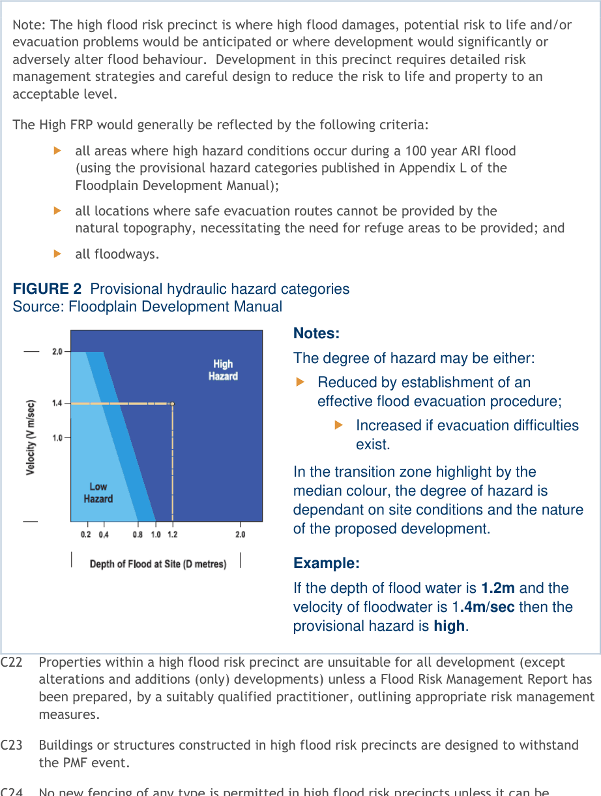

#### E2.3.4 Flood controls

#### Objectives

O1 To minimise risk to people and property.

O2 To ensure that development does not cause flood levels to rise or exacerbate flooding on the surrounding floodplain.

O3 To ensure existing overland flow paths are maintained and to ensure new structures do not obstruct the free flow of floodwaters.

O4 To increase flood hazard awareness.

O5 To reduce the long term risks associated with tidal inundation, elevated sea levels and/or waves overtopping foreshore defences.

O6 To maintain Council’s streetscape objectives in existing commercial and heritage areas.

#### Controls

#### General controls which apply to all developments

Note:  A plan must accompany the application and provide information on any earthworks or filling of land (with suitable contour intervals) and the location of existing and proposed fences, retaining walls and/or any other barriers.

General

C1 All structures have flood compatible building components below the 100 Year ARI level plus 0.5m freeboard.

C2 All electrical equipment (e.g. air conditioners and pool pumps) is located or protected to above the 100 Year ARI level plus 0.5m freeboard.

C3 All storage areas such as shelving are above the 100 Year ARI level plus 0.5m freeboard.

C4 The structure is built to withstand the forces of floodwater, debris and buoyancy up to and including the 100 Year ARI level plus 0.5m freeboard.

C5 Reliable evacuation access for pedestrians is provided from the lowest habitable floor area to a refuge area above the PMF level and designed to withstand PMF water forces.

C6 Suitable flood protection (e.g. a crest up before descent on an access driveway) is provided within the subject site.  Council will not generally allow alteration to existing levels on the public road or its property to achieve flood protection. Note: The Building Code of Australia 2013 has requirements relating to minimum construction standards for specified building classifications in flood hazard areas. Reference should be made to the Code for further information.

Fencing

C7 Fencing is constructed in a manner which does not change the nature or level of flood waters in the area.  Fencing is of a permeable/open type design, however, existing solid fences may be replaced by new solid fences.

C8 Fencing is adequately constructed so as to withstand the forces of floodwaters.

C9 The flood impact of the development is considered to ensure that the development will not increase flood effects elsewhere.  Where a significant change in use of the site is proposed, a flood impact assessment is required.

Overland flow paths

C10 All overland flow paths are free of structures which prevent the free passage of overland flow.

C11 All overland flow paths are designed to convey the 1 in 100 ARI event.

C12 All existing overland flow paths are maintained and the hydraulic capacity of the openings between buildings is maintained.

C13 Overland flow paths are provided on all properties that have upstream contributing catchments of 1,000m or greater.

C14 All overland flow paths are designed to a low hazard classification if possible.

C15 Overland flow paths are designed such that they do not increase velocity or concentrate water on any adjacent property.

C16 In overland flow paths, fencing is generally not be permissible.  However, in low and medium flood risk precincts permeable/open type fences may be approved where it can be demonstrated that there will be no adverse impact on flooding to the subject land or surrounding properties.

C17 Any structure located in an overland flow path is designed to be structurally sound in all flood events.  A flood study may be required.  Structures are designed by a suitably qualified practitioner.

C18 If an overland flow path is not achievable, a 1 in100 ARI drainage system may be accepted as an alternative.

C19  Overland flow paths are grass turfed.

C20 In (sandy) areas with high risk erosion potential, overland flow paths are designed to limit velocity and/or protect against scour. Note: Provisional hazard classifications are defined in Appendix L of the Floodplain Development Manual.

Time limit consents

C21 Where an applicant cannot increase EPLs to take into account the sea level rise planning benchmarks, Council may consider imposing time-limited consent to provide the potential to remove, replace or adapt development in the future.  The consent will require the development to cease and all structures to be demolished and removed and the site to be reinstated to a sustainable landscaped form unless a further consent is obtained allowing for the continuation of the development in its originally approved or modified form. Council will consider the appropriateness of such developments on the merits of individual applications. Note:  It is likely that Council would impose a condition which identifies an appropriate and specific trigger which would require the removal of the development.  For example, if the sea level were to reach a specified height or the erosion of an escarpment receding to a specified distance from the property boundary.

#### High flood risk precincts

> [Picture on page 41: a picture, saved as a picture (images/chapter-e2-stormwater-flood-and-geotechnical-risk-management-page-41-2.gif, 150 dpi).]
> [Picture text on page 41 is stored in the PDF without readable letters (no character map), so it could not be copied; see the original PDF.]
> Words printed on the picture (title and legend, copied from the PDF):
> FIGURE 2  Provisional hydraulic hazard categories
> Source: Floodplain Development Manual
> The degree of hazard may be either:
> Reduced by establishment of an
> effective flood evacuation procedure;
> Increased if evacuation difficulties
> exist.
> In the transition zone highlight by the
> median colour, the degree of hazard is
> dependant on site conditions and the nature
> of the proposed development.
> If the depth of flood water is 1.2m and the
> velocity of floodwater is 1.4m/sec then the
> provisional hazard is high.
> the PMF event.

Note: The high flood risk precinct is where high flood damages, potential risk to life and/or evacuation problems would be anticipated or where development would significantly or adversely alter flood behaviour.  Development in this precinct requires detailed risk management strategies and careful design to reduce the risk to life and property to an acceptable level.

The High FRP would generally be reflected by the following criteria: all areas where high hazard conditions occur during a 100 year ARI flood (using the provisional hazard categories published in Appendix L of the Floodplain Development Manual); all locations where safe evacuation routes cannot be provided by the natural topography, necessitating the need for refuge areas to be provided; and all floodways.

#### Notes:

#### Example:

C22 Properties within a high flood risk precinct are unsuitable for all development (except alterations and additions (only) developments) unless a Flood Risk Management Report has been prepared, by a suitably qualified practitioner, outlining appropriate risk management measures.

C23 Buildings or structures constructed in high flood risk precincts are designed to withstand

C24 No new fencing of any type is permitted in high flood risk precincts unless it can be demonstrated, by a suitably qualified practitioner, that there will be no adverse impact on flooding to the subject land or surrounding properties.

#### Medium flood risk precincts

Note: The medium risk precinct includes all land that is inundated by the 100 year ARI flood that is not classified as high risk.  Areas on the edge of the identified 100 year ARI floodplain where the topography provides low hazard rated excavation routes (using the provisional hazard criteria published in Appendix L of the Floodplain Development Manual) would generally be classified as medium risk.

C25 Properties within a medium flood risk precinct are generally unsuitable for critical and sensitive use development.  Such developments will be considered on their merits, taking into account any proposed risk management measures.

C26 In medium flood risk precincts, impervious and continuous fencing is not permissible unless it can be demonstrated that there will be no adverse impact on flooding to the subject land or surrounding land.

#### Low flood risk precincts

Note: In the low flood risk precinct the likelihood of damages, occurring from flooding, is low. This area can be identified as land within the floodplain that is above the 100 year ARI flood but below the extent of the PMF.

C27 For critical and sensitive developments in low flood risk precincts, all habitable and non-habitable floor levels are no lower than the PMF flood level.

C28 For critical and sensitive developments in low flood risk precincts, all structures have flood compatible building components below the PMF flood level.

C29 For critical and sensitive developments in low flood risk precincts, the applicant is to demonstrate that any structure can withstand the forces of floodwater, debris and buoyancy up to and including the PMF flood level.

#### Other flood prone properties

Note: There are four main floodplains within the Woollahra Municipality: Rushcutters Bay, Double Bay, Rose Bay and Watsons Bay.  A property may be flood prone if it is outside of the identified four floodplains, but subject to overland flows due to one of the following characteristics: the property is on the low side of the road and/ or the boundary levels are below the level of Council’s kerb; the property is lower than surrounding properties; the property is in a natural low point, gully or depression; or the property is adjacent to or contains a flow path, open channel, watercourse or drainage line.

A property may also be flood prone if it is outside of the identified four floodplains, but subject to one of the following characteristics: the property fronts Sydney Harbour with any part of the land below RL 3.35m AHD; the development includes underground habitable areas; or the development includes a low level driveway or an underground car park.

C30 Where a property is outside of the four flood plains, but identified as flood prone, a site specific assessment is required.  A flood analysis may be requested to determine the level of flood risk and to allow the setting of FPLs.

Note: A Flood Risk Management Report prepared, by a suitably qualified practitioner, outlining appropriate risk management measures may be required.
