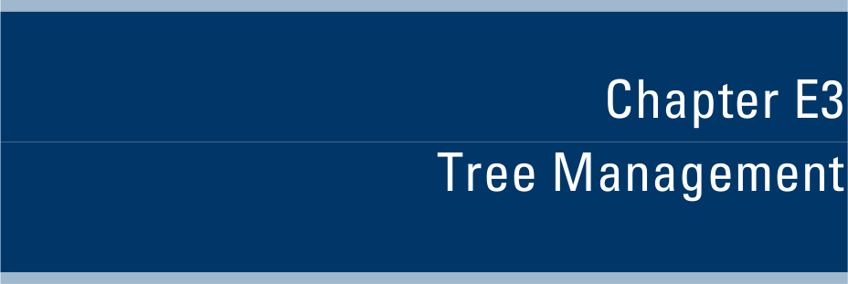

# Woollahra Development Control Plan 2015 - Chapter E3 Tree Management

> This chapter is split into 5 section file(s), one per numbered heading, in the order they appear in the PDF.

Source PDF: [chapter-e3-tree-management.pdf](chapter-e3-tree-management.pdf)

> [Picture on page 1: a picture, saved as a picture (images/chapter-e3-tree-management-page-1-1.gif, 150 dpi).]

### Chapter E3

### Tree Management

### Part E  General Controls for All Development

### CHAPTER E3 APPROVED ON 27 APRIL 2015 AND COMMENCED ON 23 MAY 2015

### Last amended on 14 July 2023

<!-- sections -->
## Sections

1. [E3 Tree Management](01-e3-tree-management.md)
2. [E3.1 Introduction](02-e3-1-introduction.md)
3. [E3.2 Trees and works that require approval](03-e3-2-trees-and-works-that-require-approval.md)
4. [E3.3 Assessing a development application or a tree permit](04-e3-3-assessing-a-development-application-or-a.md)
5. [E3.4 Exempt trees and works](05-e3-4-exempt-trees-and-works.md)
