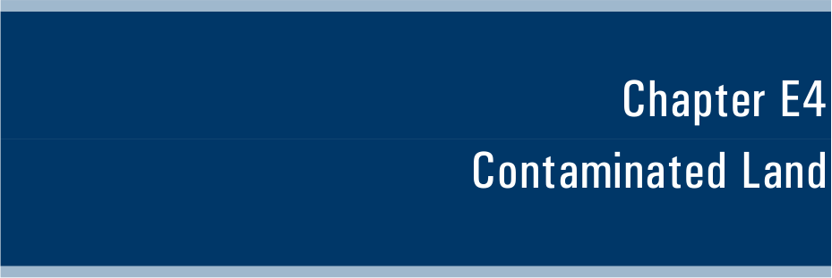

# Woollahra Development Control Plan 2015 - Chapter E4 Contaminated Land

> This chapter is split into 5 section file(s), one per numbered heading, in the order they appear in the PDF.

Source PDF: [chapter-e4-contaminated-land.pdf](https://planfortomorrow.sharepoint.com/sites/Planfortomorrow/Shared%20Documents/00%20NSW-Planning-Resources/dcp/woollahra-development-control-plan-2015/chapter-e4-contaminated-land/chapter-e4-contaminated-land.pdf)

> [Picture on page 1: a picture, saved as a picture (images/chapter-e4-contaminated-land-page-1-1.gif, 150 dpi).]

### Chapter E4

### Contaminated Land

### Part E  General Controls for All Development

### CHAPTER E4 APPROVED ON 27 APRIL 2015 AND COMMENCED ON 23 MAY 2015

<!-- sections -->
## Sections

1. [E4 Contaminated Land](01-e4-contaminated-land.md)
2. [E4.1 Introduction](02-e4-1-introduction.md)
3. [E4.2 Matters to consider when lodging a development application](03-e4-2-matters-to-consider-when-lodging-a.md)
4. [E4.3 Site investigation process required if the land may be contaminated](04-e4-3-site-investigation-process-required-if.md)
5. [E4.4 Matters to consider when preparing a planning proposal](05-e4-4-matters-to-consider-when-preparing-a.md)
