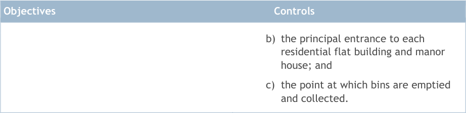

#### E5.5 Residential flat buildings, manor houses, multi dwelling housing and multi dwelling housing (terraces)

The design of waste and recycling storage areas within residential flat buildings, manor houses, multi dwelling housing and multi dwelling housing (terraces) needs to address specific challenges with regard to waste volumes, ease of access and operation of waste sorting and removal systems.

Resources such as the Better Practice Guide for Waste Management in Multi-Unit Dwellings can also be used to inform design of medium density developments.

| Objectives | Controls |
|---|---|
| O1 To promote reuse and recycling in C1 Each dwelling is provided with an indoor residential flat buildings, manor houses, waste and recycling cupboard (or other multi dwelling housing and multi appropriate storage space) for the dwelling housing (terraces) interim storage of a minimum one day’s garbage and recycling generation. C2 For residential flat buildings and manor houses, a communal waste and recycling storage area for housing bins is provided. C3 For multi dwelling housing and multi dwelling housing (terraces), a waste and recycling storage area is provided in the form of an area for each dwelling, or as communal waste and recycling storage area. C4 The size and design of the waste and recycling area or areas accommodate: a) 120L of residual waste per residential dwelling; b) 55L of recyclables per residential dwelling stored in colour coded, shared use, 120L and/or 240L mobile garbage bins; c) 240L shared use mobile garbage bins for food and garden organics. C5 An area or areas suitable to accommodate on-site composting is provided. This may be for a communal facility or an area for each dwelling. C6 Development containing 20 or more residential dwellings provides a garbage compaction unit. |  |

| Objectives | Controls |
|---|---|
| C7 Bulk waste bins are not encouraged and should only be considered for developments containing 12 or more dwellings. |  |
| O2 To ensure that waste and recycling C8 Communal waste and recycling storage collection points are suitably located. rooms should generally be located in a basement location within the main building envelope. Where the storage room is in a separate standalone structure, the room and access to it is designed consistent with Crime Prevention Through Environmental Design (CPTED) principles. C9 Development containing four or more storeys provides a suitable system for the transportation of waste and recyclables from each storey to waste storage and collection areas, such as a garbage chute. This is in addition to the central waste storage area. C10 Development containing 10 or more dwellings provides a dedicated room or caged area for the temporary storage of discarded bulky items which are awaiting removal. This storage area is readily accessible to all residents and located close to the main waste storage area. C11 The travel distance between the waste and recycling storage area to the collection point is not more than 75 metres. For development assessed using State Environmental Planning Policy (Housing for Seniors or People with a Disability) 2004, the maximum distance is 50m. C12 Collection and storage facilities are designed to provide an unobstructed and continuous accessible path of travel (as set out in the Australian Standard 1428 Design for Access and Mobility 2001) from the facility to: a) the entry of any adaptable housing; |  |

> [Picture on page 15: a picture, saved as a picture (images/chapter-e5-waste-management-page-15-1.gif, 150 dpi).]
> Words printed on the picture (title and legend, copied from the PDF):
> and collected.

#### Objectives

#### Controls

b) the principal entrance to each residential flat building and manor house; and

c) the point at which bins are emptied
