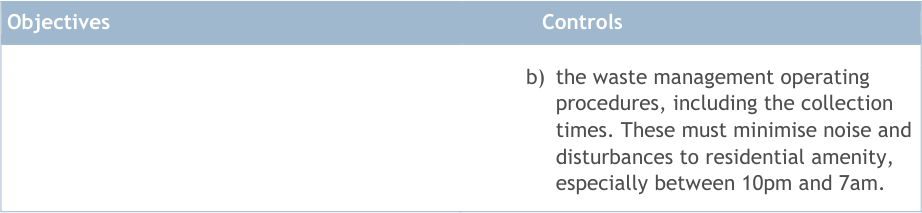

#### E5.6 Commercial and non-residential developments

Developments containing a range of different non-residential uses present unique waste minimisation opportunities and management requirements. Flexibility in size and layout is often required to cater for the different needs of multiple tenants as well as future changes in use.

Noise from waste management activities needs to be managed where commercial uses are located near residential and other noise sensitive uses, particularly between 10pm and 7am. For example, noise when bins are emptied into collection vehicles, especially glass, and the reversing alarms of collection vehicles, can be particularly disturbing when these occur at noise sensitive times, such as late at night or in the early hours of the morning when most people are sleeping.

| Objectives | Controls |
|---|---|
| O1 To promote reuse and recycling in C1 A waste and recycling cupboard is mixed use development. provided for each individual kitchen area in the development, including kitchen O2 To ensure waste management systems areas in hotel rooms, motel rooms and are suitably located and readily staff food preparation areas. accessible to occupants and service providers. C2 Each waste and recycling cupboard is designed to hold a minimum of one day’s O3 To minimise nuisance and noise impacts waste and keep general waste separated on adjoining or nearby residential uses, from recyclable materials. from waste management associated with a pub, registered cub, or other type of C3 A goods lift may be included in multiple licensed premises with a capacity of 100 storey buildings. or more patrons. C4 The size of the waste and recycling storage area or areas is designed to accommodate the rates of waste generation and recyclable material generation identified in Table 1 below. C5 Bulk waste bins are not encouraged and should only be considered for developments containing 12 or more tenancies. C6 Waste and recycling containers should be collected from a rear lane access point, where possible. C7 The SWMMP submitted with the development application must include: a) the location of glass and recycling collection and sorting areas, which are to be shown on the DA plans. Note the installation of a glass crushing machine is encouraged to minimise noise from glass sorting. |  |

> [Picture on page 17: a picture, saved as a picture (images/chapter-e5-waste-management-page-17-1.gif, 150 dpi).]

#### Objectives

#### Controls

b) the waste management operating procedures, including the collection times. These must minimise noise and disturbances to residential amenity, especially between 10pm and 7am.

TABLE 1  Waste and recycling generation rates

| Premises type | Waste generation | Recyclable material generation |
|---|---|---|
| Backpackers hotel 40L/occupant space/week 20L/occupant space/week |  |  |
| Boarding house, guest house 60L/occupant space/week 20L/occupant space/week |  |  |
| Food premises Butcher 80L/100m² of floor area/day Variable Delicatessen 80L/100m² of floor area/day Variable Fish shop 80L/100m² of floor area/day Variable Greengrocer 240L/100m² of floor area/day 80L/100m² of floor area/day Restaurant/café 10L/1.5m²of floor area/day 2L/1.5m²of floor area/day Supermarket 240L/100m² of floor area/day 240L/100m² of floor area/day Takeaway food shop 80L/100m² of floor area/day Variable |  |  |
| Hairdresser, beauty salon 60L/occupant space/week Variable |  |  |
| Hotel, licensed club, motel 5L/bed space/day 1L/bed space/day 50L/100m² of bar area/day 50L/100m² of bar area/day 10L/1.5m² of dining area/day 50L/100m² of dining area/day |  |  |
| Offices 10L/100m² of floor area/day 10L/100m² of floor area/day |  |  |
| Shop up to 100m² floor area 50L/100m² of floor area/day 25L/100m² of floor area/day Shop greater than 100m² floor area 50L/100m² of floor area/day 50L/100m² of floor area/day |  |  |
| Showroom 40L/100m² of floor area/day 10L/100m² of floor area/day |  |  |

Source: Model Waste Chapter 2008 – Department of Environment and Climate Change
