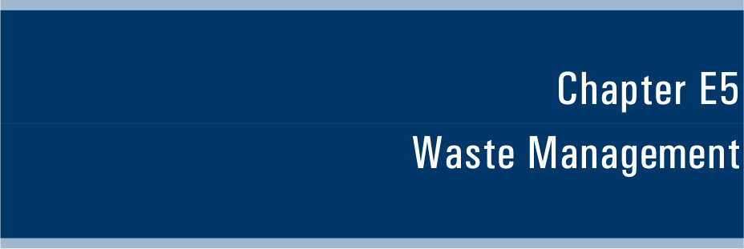

# Woollahra Development Control Plan 2015 - Chapter E5 Waste Management

> This chapter is split into 8 section file(s), one per numbered heading, in the order they appear in the PDF.

Source PDF: [chapter-e5-waste-management.pdf](https://planfortomorrow.sharepoint.com/sites/Planfortomorrow/Shared%20Documents/00%20NSW-Planning-Resources/dcp/woollahra-development-control-plan-2015/chapter-e5-waste-management/chapter-e5-waste-management.pdf)

> [Picture on page 1: a picture, saved as a picture (images/chapter-e5-waste-management-page-1-1.gif, 150 dpi).]

### Chapter E5

### Waste Management

### Part E  General Controls for All Development

### CHAPTER E5 APPROVED ON 27 APRIL 2015 AND COMMENCED ON 23 MAY 2015

### Last amended on 7 December 2020

<!-- sections -->
## Sections

1. [E5 Waste Management](01-e5-waste-management.md)
2. [E5.1 Introduction](02-e5-1-introduction.md)
3. [E5.2 Demolition and construction phase](03-e5-2-demolition-and-construction-phase.md)
4. [E5.3 On-site waste and recycling controls for all development](04-e5-3-on-site-waste-and-recycling-controls-for.md)
5. [E5.4 Dwelling houses, semi-detached dwellings and dual occupancies](05-e5-4-dwelling-houses-semi-detached-dwellings.md)
6. [E5.5 Residential flat buildings, manor houses, multi dwelling housing and multi dwelling housing (terraces)](06-e5-5-residential-flat-buildings-manor-houses.md)
7. [E5.6 Commercial and non-residential developments](07-e5-6-commercial-and-non-residential.md)
8. [E5.7 Mixed use developments](08-e5-7-mixed-use-developments.md)
