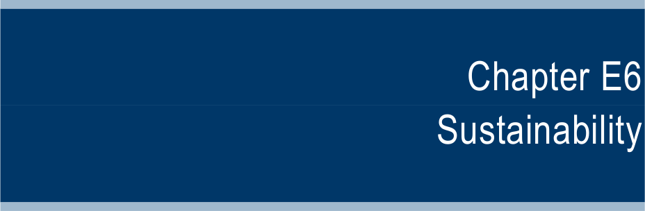

# Woollahra Development Control Plan 2015 - Chapter E6 Sustainability

> This chapter is split into 4 section file(s), one per numbered heading, in the order they appear in the PDF.

Source PDF: [chapter-e6-sustainability.pdf](chapter-e6-sustainability.pdf)

> [Picture on page 1: a picture, saved as a picture (images/chapter-e6-sustainability-page-1-1.gif, 150 dpi).]

### Chapter E6

### Sustainability

### Part E  General Controls for All Development

### CHAPTER E6 APPROVED ON 27 APRIL 2015 AND COMMENCED ON 23 MAY 2015

### Last amended on 22 December 2023

<!-- sections -->
## Sections

1. [E6 Sustainability](01-e6-sustainability.md)
2. [E6.1 Introduction](02-e6-1-introduction.md)
3. [E6.2 Commercial and non-residential buildings](03-e6-2-commercial-and-non-residential-buildings.md)
4. [E6.3 Solar energy systems (including solar panels, solar hot water systems and solar heating systems)](04-e6-3-solar-energy-systems-including-solar.md)
