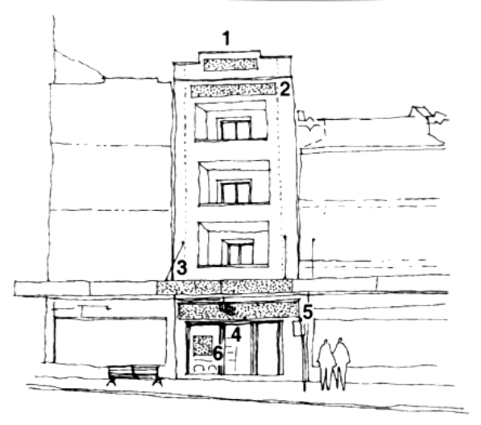
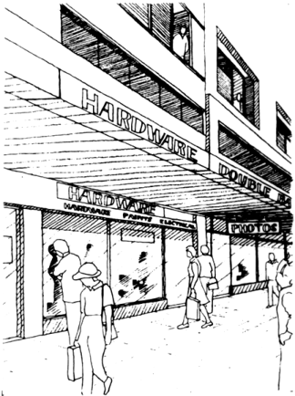

#### E7.2 General signage controls—all areas

Signage is essential to commercial premises, and suitable signage can add interest, character and vitality to the built environment.  However poorly designed or placed signs, or too many signs in one location, can affect streetscape amenity.

It is important that commercial operators thinking about signage for their premises remember that acceptability of an impact depends not only on the extent of the impact but also on reasonableness of, and necessity for, the development that causes it.  In other words, how many signs are reasonably required to convey the message that the premises is operating from the site?

Signage should never dominate and overwhelm the character of the street. It is important for signage to be well designed, appropriate in scale, and of a quality that enhances the character of the area and helps define a local identity.

The signage should be integrated with the building design.  The design, size and colour of signs must not dominate or obscure the architectural character and detail of the building or adjoining buildings. Generally signage should occur below the awning level as signage above the awning level impacts on the visual cohesion of the streetscape.

The objectives and controls in this section apply to signs in the centres and residential areas; additional controls for signage in heritage conservation areas (HCA) also apply, and are set out in Section 7.3 of this chapter. If there is an inconsistency between these general controls and the controls for the HCAs, the controls for the HCAs prevail.

> [Picture on page 7: a picture, saved as a picture (images/chapter-e7-signage-page-7-20.gif, 150 dpi).]

FIGURE 1  Types of signs 1 Building identification sign –

located on the parapet 2 Building identification sign –

located on the façade bay 3 Fascia sign 4 Under awning sign 5 Top hamper sign 6 Window sign

Buildings in Woollahra’s business zones are predominantly mixed use, with active retail uses at street level

and residential or office uses above.  Typically an awning separates the retail frontage from the upper levels.

The façade of the upper levels should not be used to advertise the business at street level.

#### FIGURE 2

Example of signage on awning, top hamper and

windows

> [Picture on page 8: a picture, saved as a picture (images/chapter-e7-signage-page-8-4.gif, 150 dpi).]

#### E7.2.1 Building identification signs and business identification signs

#### Objectives

#### Controls

C1 The signage is:

a) a building identification sign;

b) a business identification sign that is:

O1 To limit the types of signs on buildings to those signs that are less likely to contribute to visual clutter or be otherwise visually intrusive.

i) wall sign (may be a flush wall or painted wall sign);

O2 To preserve the existing and future roofscapes and protect views.

ii) fascia sign, including a sun-blind attached to the outer edge of the fascia;

iii) under awning sign;

iv) top hamper sign;

v) window sign.

Refer to Figure 1 above.

C2 The signage is not one of the following types:

a) roof or sky sign;

b) vertical or horizontal projecting wall sign, other than a projecting wall sign in William Street as permitted in Part C of the DCP, Chapter C1 Paddington HCA;

| Objectives | Controls |
|---|---|
| c) pylon or pole sign; d) sky sign; or e) fin sign. |  |
| O3 To ensure that signage conveys relevant C3 The signage is fixed to a building that has messages and images and provides been lawfully constructed. effective communication in suitable locations. C4 The signage relates to uses that have been lawfully established. O4 To ensure that signage does not contribute to visual clutter or C5 The signage assists in way finding and environmental degradation because of its pedestrian useability. content. C6 Signage relating to a particular business is attached to that section of the building occupied by that business. C7 The signage does not contain advertising that: a) promotes products or services not related to the business being conducted on the site; or b) is for a single product, unless that product is the only merchandise being sold by the business. C8 For a building identification sign, the content is limited to: a) street number; b) name of the building; and c) one logo or graphic. C9 For a business identification sign, the content is limited to: a) street number; b) name and general nature of the business; c) name of the proprietor or business (or both); and d) one recognised logo or trade name (or both). |  |

| Objectives | Controls |
|---|---|
| C10 If a corporate logo or graphic appears as part of the signage, it is compatible with the architecture, materials, finishes and colours of the building, and does not have an adverse impact on the character of the building or streetscape. |  |
| O5 To ensure that signage is sympathetic to C11 The signage is integrated with the the design and architectural character of architectural design of the building, the building. having regard to the building composition, fenestration, materials, finishes and colours. C12 The signage does not obscure or extend over any architectural, decorative or other distinguishing feature of the building. C13 The signage is of a high quality design and finish. |  |
| O6 To ensure that signs do not contribute C14 For signage on a building in a business to visual clutter or environmental zone, the total signage area does not degradation of the public domain exceed a factor of 0.5m² for each metre because of the type, size or location. of the building width at its frontage to a public road. O7 To ensure that signage is limited to that reasonably required to convey C15 For a building identification sign, the message that a particular business the sign: is operating from the premises. a) is located on the main façade of O8 To ensure that signs are an appropriate the building; size and scale for the building on which b) is designed as an integral part of they are erected. the façade; O9 To ensure that signage is compatible c) may be located above awning height; with its context. and O10 To protect the amenity of residential d) is generally composed of content that development. is affixed to the building. O11 To ensure that window signs do not Note: Not all buildings will have a compromise active and desirable building identification sign. pedestrian environments. |  |

| Objectives | Controls |
|---|---|
| O12 To create an active interface between C16 For a business identification sign located ground level retail or commercial in a business zone, the sign: properties and the street. a) is located in that part of the building occupied by the business; b) is primarily located on the awning fascia and under the awning height of the building. Signs, other than walls signs, above the awning height should be avoided; c) does not face a service lane; and d) is not located on a side wall abutting a residential property. C17 Where there are multiple occupancies or uses within a single building or site: a) a coordinated approach to the location and design of signs is taken; and b) a directory of tenants is provided at the ground floor level. C18 For an under awning sign located in a business zone, there is no more than one sign per premises and the sign: a) is a maximum height of 300mm; b) is a maximum length of 2.6m (or two thirds the width of the footpath, whichever is the lesser); c) is not lower than 2.6m from the footpath level as measured from the bottom of the sign; and d) is a minimum distance of 3m from adjoining under awning signs. C19 For a flush wall or painted wall sign located in a business zone, the sign: a) does not exceed 5m²; b) does not extend over or block windows or other openings in the building; c) does not project more than 150mm from the wall; |  |

| Objectives | Controls |
|---|---|
| d) does not protrude above the parapet or eaves; and e) is not illuminated. C20 No more than one flush wall or painted wall sign on any elevation of the building. Note: The external painting of a building may constitute a painted wall sign where the painting uses corporate colours and can be reasonably considered as branding. Refer to Section 7.2.2 below for circumstances when painting of a building may be a painted wall sign. C21 For a servicing and delivery sign, the sign does not exceed an area of 0.35m². C22 For a window sign, the sign: a) does not cover more than 40% of the surface of the window in which it is displayed; and b) if illuminated, is internally illuminated only. C23 Blanked out windows or location of shelving, fixtures, or the like, that do not provide for transparency into the premises and an attractive interface to the street are avoided. |  |
| O13 To ensure that signage in residential C24 For a flush wall or painted wall sign in a zones is discrete and does not impact on residential zone that is for a business the residential character. other than a home business, home industry or home occupation—the sign O14 To ensure that the purpose of signage in does not exceed an area of 2.5m², and residential areas is to identify the no more than one per building. business, but does not seek to blatantly advertise the business. C25 The signage is positioned parallel to the property boundary. |  |
| O15 To ensure that signage does not C26 The colours in the signage are compatible contribute to visual clutter or with the architecture, materials, finishes environmental degradation because of and colours of the building. its colour. |  |

| Objectives | Controls |
|---|---|
| O16 To ensure that the colour of signage is C27 The colours do not have an adverse compatible with the character of the impact on the character of the building streetscape and the desired future or streetscape. character of the area where the signage is located. C28 Corporate colours may appear as part of the sign, but are not used as the principal or dominant colour scheme. C29 Where there are multiple occupancies or uses within a single building, a coordinated colour scheme for signs is provided. |  |
| O17 To ensure that the location and size of C30 The signage does not obscure or signs do not affect public safety. interfere with safety, public directional or traffic signs. O18 To ensure that the illumination of signage does not have an adverse impact on the C31 Illuminated signage is avoided in the amenity of the public domain or residential zones. residential uses. C32 Illuminated signage or floodlighting of O19 To ensure that signs do not cause signs minimises lightspill and does not unreasonable distraction. adversely affect amenity, particularly residential amenity. C33 If the sign is illuminated, the cabling is concealed or integrated with the sign. C34 In the E1 zone, illumination from a neighbourhood shop, such as a convenience store or the like does not exceed a maximum horizontal luminance of 200 lux. C35 Signage does not involve: a) mechanical or animated flashing, pulsing or moving parts; b) neon tubes or fluorescent lighting (located either externally or in a shopfront window); or c) banners, flags or spotlights. |  |

#### E7.2.2 When external painting of a building constitutes a wall sign

Branding a building by painting the facade in the business corporate colours should be avoided. Generally corporate colours involve bright or primary colours. Such colours, when painted over large areas on a building or above the awning level, can be loud and distracting and often do not provide a well-mannered and thoughtful contribution to the streetscape. The corporate colours tend to be inconsistent with the character of the centre and the palette of colours predominantly used in the centre.  Furthermore, bright and primary colours on buildings have the effect of adding to the perceived building bulk. Individual business branding and identity in external painting and colour schemes is to be subordinate to the main colour scheme on the building. Where it is established that a particular colour or combination of colours used to paint a building has the effect of a sign promoting a particular business, that work may be regulated through the development application process, and the provisions in this chapter of the DCP apply, specifically those controls for a painted wall sign.

#### When the external painting of a building constitutes a wall sign

The external painting of a building is taken to constitute a wall sign if any of the following apply:

a) The use of colours in patterns, symbols, messages or other devices promotes the business, a product, an event or an activity.

b) The use of colours in patterns, symbols, messages or other devices conveys information, instructions or directions.

c) When a business, activity or event is readily identifiable from a colour or a colour scheme and regularly uses that colour or colour scheme in its branding.

Painted and flat mounted wall signs tend to be visually prominent, particularly where the building is located on a corner site.  It therefore important that the size and location of these signs on the building are controlled to ensure that the sign is not intrusive or unreasonably dominant, having regard to the streetscape and desired future character of the centre.

#### Controls for a painted wall sign

The controls for a flush wall sign are in Section 7.2 above.  These controls, amongst other things, limit the size of the sign to 5m².
