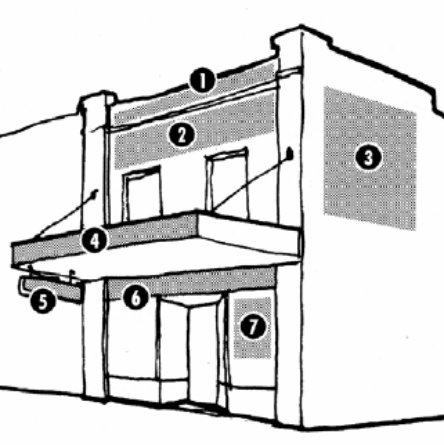

#### E7.3 Heritage conservation areas and on heritage items

Signage within heritage conservation areas and on heritage items is to be sympathetic with heritage significance of the place or item.

Traditionally, signage to retail and other commercial buildings was painted directly on building elements.  Old photographs show that signs were painted on building wall parapet panels, verandah and awning fascias or directly onto glazing.  Broadly there was an integration of signage with the building.  The colour of the signs and signwriting typically included light brown, rich brown, Indian red, chrome green, and in rare instances Prussian blue, black and dark tints, and slate grey, as well as gold and silver leaf.

While replication of older signage is not the aim, reference to lettering styles, traditional locations and colours should be made.

Locating signs on buildings not originally intended for retail use is more difficult, and particular attention is needed as these signs have the potential for a greater impact on heritage significance.

The objectives and controls in this section apply in addition to the general controls in Section 7.2 above.  If there is an inconsistency between these controls and the general controls, the controls in this section prevail. However, if there is an inconsistency between these controls and any control in Part C of the DCP on the heritage conservation areas, the controls in Part C prevail.

> [Picture on page 15: a picture, saved as a picture (images/chapter-e7-signage-page-15-19.gif, 150 dpi).]

FIGURE 3  Types of signs 1  Parapet sign 2  Upper level facade sign 3  Flush wall and painted wall sign 4  Fascia sign 5  Under awning sign 6  Top hamper sign 7  Window sign

#### E7.3.1 Signage in heritage conservation areas and on heritage items

#### Objectives

#### Controls

C1 Existing signs with heritage significance should be retained and conserved.

O1 To conserve existing signs which have heritage significance.

O2 To minimise the number of signs.

C2 Signs should be located on the traditional areas for signs in heritage conservation areas as shown in Figure 3 above.

O3 To provide for signs in appropriate locations on buildings.

C3 The number of signs is limited to those necessary to display the name of the business and/or proprietor and the name of the building (if applicable).

O4 To minimise the impact of signs on the heritage significance of individual buildings and the heritage conservation area generally.

C4 The content of the signage has minimum reference to the particular service provided or products retailed from the premises.

O5 To ensure that the size of signs do not dominate the architectural character of the building or adjoining buildings.

C5 Where the building contains more than two tenants, a directory of tenants is provided at ground floor level on a secondary external wall.

O6 To ensure that the size of signs respond appropriately to the physical context and historical background of the streetscape and HCA as a whole.

C6 For a painted window sign, the sign does not dominate or clutter the shop front window.

C7 A painted window sign on an upper storey window may only be considered for the identification of tenants where appropriate wall surfaces or other areas for signage are not available.

C8 For a top hamper sign, the sign:

a) may be painted;

b) is flush to the external face of the shopfront where practicable, but in any case does not project more than 100mm;

c) is a maximum 600mm wide;

d) is a maximum 6000mm long; and

e) terminates 600mm short of each side boundary.

| Objectives | Controls |
|---|---|
| C9 For a flush wall or painted wall sign, the sign: a) is not constructed or installed on a heritage item; b) does not exceed an area of 2.5m²; and c) is no more than one per building. C10 Notwithstanding C1-C9 above, for a sign in William Street, Paddington, on a residential building used for commercial purposes, the number and type of signs are set out in Refer to Part C of the DCP, Chapter C1 Paddington HCA. |  |
| O6 To ensure that signs do not dominate C11 The signage is not directly fixed by any or obscure the architectural character means to sandstone or face brickwork, and detail of a building or a group of but may be fixed into mortar joints. buildings. C12 The signage is not painted on original O7 To ensure that design, style and colours face brickwork, sandstone, terracotta and of signs complement the historic glazed or tessellated tiling, or any other character of the streetscape but not surface that is traditionally unpainted or mimic historic signage. unfinished by other mediums. C13 No demolition of any part of the structure or building on the site may occur to accommodate the signage. C14 Materials are restricted to those which were traditionally used for signs, including painted timber or board, engraved metal plaque such as bronze or painted masonry. With the exception of metal plaque, these materials are characterised by their non-reflectively. C15 Colours used in the signage are suitable for the architectural style and period of the building. The use of fluorescent paints and iridescent colours are not appropriate. |  |

| Objectives | Controls |
|---|---|
| C16 The design and style of lettering in the signage is suitable for the style of the building and the historic character of the area. C17 Where a number of tenancies occupy the same building or row of properties, the signage is consistent in regards to shape, background colour, size, fixing methods and lighting. Consistent fonts and graphics are encouraged. C18 Consistency in signs between neighbouring buildings which have a common architectural style, whether traditional or contemporary is encouraged. |  |
| O8 To ensure lighting or illumination of signs C19 Where lighting is required, the sign is does not impact on the heritage fabric or painted and externally spotlit. presentation of the place. C20 Internally lit signs, neon signs or signs with neon lettering are generally inappropriate and may only be considered if the sign is inside the shop window and is small and discrete. |  |
