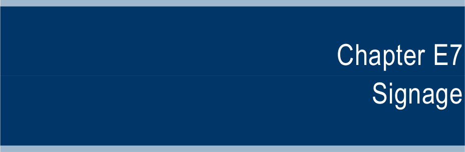

# Woollahra Development Control Plan 2015 - Chapter E7 Signage

> This chapter is split into 4 section file(s), one per numbered heading, in the order they appear in the PDF.

Source PDF: [chapter-e7-signage.pdf](https://planfortomorrow.sharepoint.com/sites/Planfortomorrow/Shared%20Documents/00%20NSW-Planning-Resources/dcp/woollahra-development-control-plan-2015/chapter-e7-signage/chapter-e7-signage.pdf)

> [Picture on page 1: a picture, saved as a picture (images/chapter-e7-signage-page-1-1.gif, 150 dpi).]

### Chapter E7

### Signage

### Part E  General Controls for All Development

### CHAPTER E7 APPROVED ON 27 APRIL 2015 AND COMMENCED ON 23 MAY 2015

### Last amended on 31 May 2024

<!-- sections -->
## Sections

1. [E7 Signage](01-e7-signage.md)
2. [E7.1 Introduction](02-e7-1-introduction.md)
3. [E7.2 General signage controls—all areas](03-e7-2-general-signage-controls-all-areas.md)
4. [E7.3 Heritage conservation areas and on heritage items](04-e7-3-heritage-conservation-areas-and-on.md)
