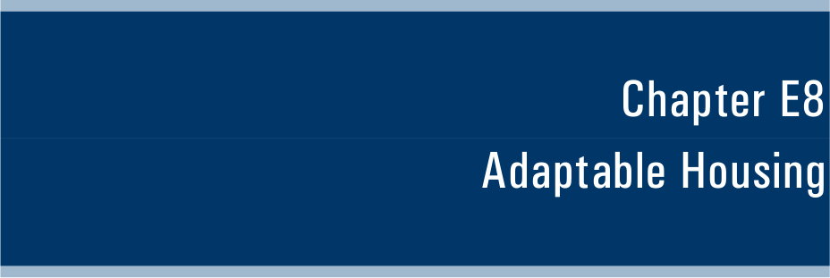

# Woollahra Development Control Plan 2015 - Chapter E8 Adaptable Housing

> This chapter is split into 3 section file(s), one per numbered heading, in the order they appear in the PDF.

Source PDF: [chapter_e8_adaptable_housing.pdf](https://planfortomorrow.sharepoint.com/sites/Planfortomorrow/Shared%20Documents/00%20NSW-Planning-Resources/dcp/woollahra-development-control-plan-2015/chapter-e8-adaptable-housing/chapter_e8_adaptable_housing.pdf)

> [Picture on page 1: a picture, saved as a picture (images/chapter-e8-adaptable-housing-page-1-1.gif, 150 dpi).]

### Chapter E8

### Adaptable Housing

### Part E  General Controls for All Development

### CHAPTER E8 APPROVED ON 27 APRIL 2015 AND COMMENCED ON 23 MAY 2015

### Last amended on 7 December 2020

<!-- sections -->
## Sections

1. [E8 Adaptable Housing](01-e8-adaptable-housing.md)
2. [E8.1 Introduction](02-e8-1-introduction.md)
3. [E8.2 Adaptable housing](03-e8-2-adaptable-housing.md)
