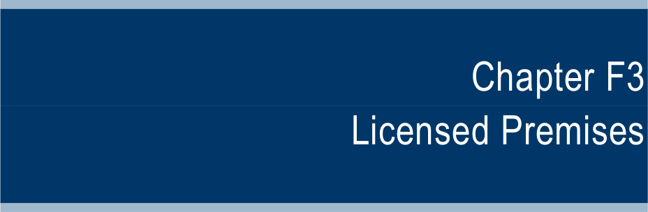

# Woollahra Development Control Plan 2015 - Chapter F3 Licensed Premises

> This chapter is split into 4 section file(s), one per numbered heading, in the order they appear in the PDF.

Source PDF: [chapter-f3-licensed-premises.pdf](https://planfortomorrow.sharepoint.com/sites/Planfortomorrow/Shared%20Documents/00%20NSW-Planning-Resources/dcp/woollahra-development-control-plan-2015/chapter-f3-licensed-premises/chapter-f3-licensed-premises.pdf)

> [Picture on page 1: a picture, saved as a picture (images/chapter-f3-licensed-premises-page-1-1.gif, 150 dpi).]

### Chapter F3

### Licensed Premises

### Part F  Land Use Specific Controls

### CHAPTER F3 APPROVED ON 27 APRIL 2015 AND COMMENCED ON 23 MAY 2015

### Last amended on 31 May 2024

<!-- sections -->
## Sections

1. [F3 Licensed Premises](01-f3-licensed-premises.md)
2. [F3.1 Introduction](02-f3-1-introduction.md)
3. [F3.2 Licensed premises risk rating](03-f3-2-licensed-premises-risk-rating.md)
4. [F3.3 Objectives and controls](04-f3-3-objectives-and-controls.md)
