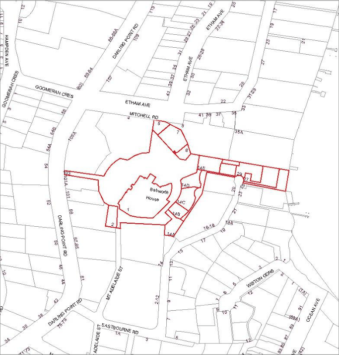

#### G1.1.2 Land where this chapter applies

This chapter applies to land at 103 Darling Point Road, Darling Point (Lots 1-5 SP 70612 and Lots 4, 5, 6, 7, 10, 11, 12, 13, 14, 16 and 17 DP 270253) commonly known as ‘Babworth House’, as identified in Figure 1.

FIGURE 1  Where this chapter applies

> [Picture on page 7: a picture, saved as a picture (images/chapter-g1-babworth-house-darling-point-page-7-13.gif, 150 dpi).]
