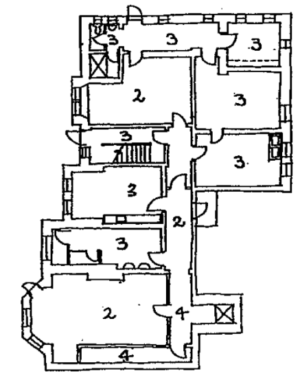
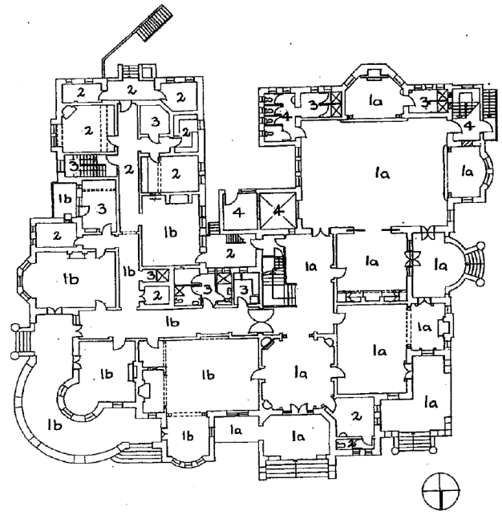
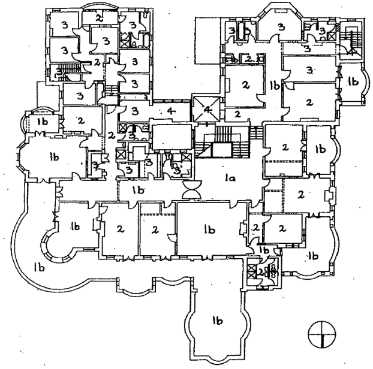
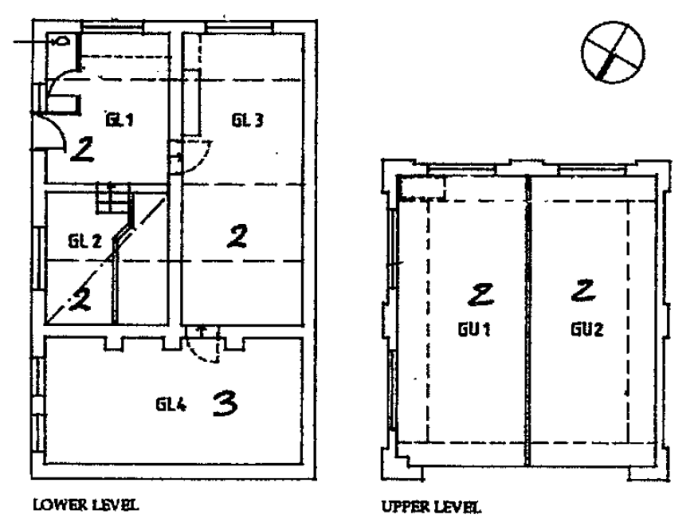
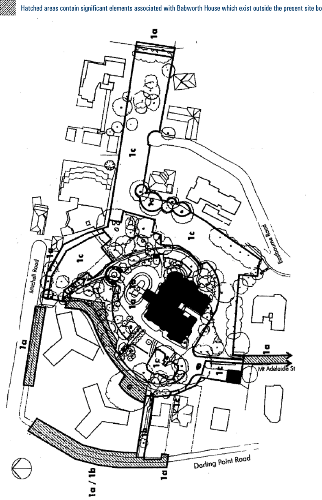
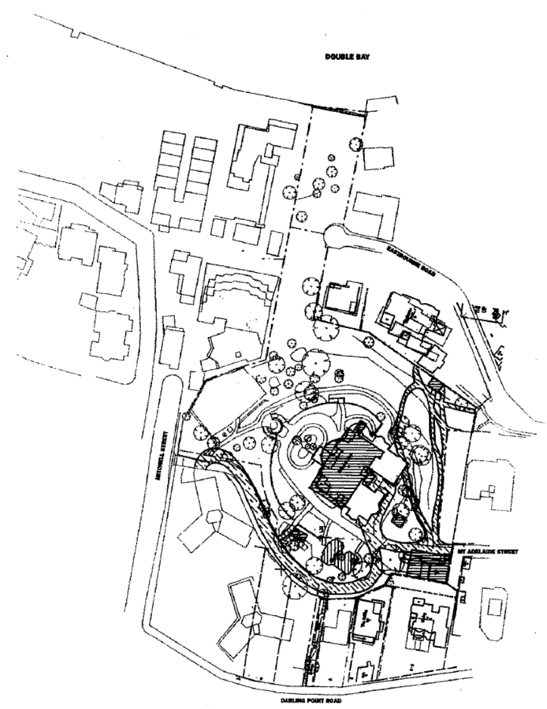

#### G1.4.2 Heritage conservation

Babworth House, its garden and landscape setting is of national significance and should be retained and conserved.

Conserving the cultural significance of Babworth House and grounds is one of the principal objectives of this chapter.

Conservation is defined in the Australia ICOMOS Burra Charter as all the processes of looking after a place so as to retain its cultural significance. It includes maintenance and may, according to circumstances, include preservation, restoration, reconstruction and adaptation and will be commonly a combination of more than one of these.

#### Objectives

O1 To protect and enhance the cultural significance of Babworth House and its setting, including spaces or elements that are of special architectural, social, technical and/or historical interest.

O2 To preserve archaeologically significant artefacts and evidence.

#### Controls

C1 Babworth House, its garden structures and landscape setting is retained and conserved in accordance with the policies of the adopted Conservation Management Plan.

C2 The use of Babworth House and Garage:

a) is consistent with the policies of the adopted Conservation Management Plan;

b) is in accordance with the graded zones of significance for the House and Garage (see Figures 2A-C and 3);

c) contributes to the preservation and enhancement of the House, Garage and grounds (see Figure 4 – 1 and 1b landscaped zones of significance); and

d) is carried out without danger to the fabric and structure of the building.

C3 New buildings and structures are located only within the areas graded 1c under the adopted Conservation Management Plan (see Figure 4) and comply with the building envelope controls in Section 1.4.4.

All building envelopes are to be taken as indicative. Provisions of the Environmental Planning and Assessment Act 1979 and statutory provisions within environmental planning instruments which apply to the land together with the planning principles, objectives and controls mentioned in this chapter are to take precedence over the conceptual building layout (Figure 8) and the building envelopes.

Council may require deletion or modification of building envelopes or buildings if development is considered by the Council to be unsatisfactory in terms of the relevant provisions of the Act, the environmental planning instruments, planning principles, objectives and controls.

C4 The scale of new development is substantially subservient to Babworth House and must respect and must not compromise the conservation of significant garden fabric and layout or the setting of the house.

C5 New development incorporates design elements that complement, but do not mimic the architectural character of Babworth House through:

a) a design idiom that is an appropriate response to the cultural significance of Babworth House and its setting;

b) subservient massing, scale and height;

c) roof forms;

d) proportion and relationship of openings for windows and doors;

e) building materials; and

f) appropriate landscaping relative to the restoration plan for the garden.

C6 A Statement of Heritage Impact, prepared by a suitably qualified person, accompanies the masterplan application. Further statements for detailed development applications are provided. The statements set out the cultural (heritage) significance of the place as a whole and the relevant significant spaces or elements, and the effect of the proposed works on this significance. The statements include discussion on the rationale for the character and scale of the proposed new structures within the Babworth House site.

C7 An Archaeological Assessment, prepared by a suitably qualified person, accompanies development applications and is in accordance with the findings of the Archaeological Zoning Plan1 (refer Figure 5). An Archaeological Assessment includes specific recommendations which address the significance of the site, the impact of the proposal and proposed conservation or mitigation measures.

1 The archaeological zoning plan graphic plan of a place indicating the relative archaeological potential of areas or zones within the place.

FIGURE 2A  Babworth House (basement) - graded zones of significance

> [Picture on page 16: a picture, saved as a picture (images/chapter-g1-babworth-house-darling-point-page-16-2.gif, 150 dpi).]

#### LEVELS OF SIGNIFICANCE

1a Very high significance 1b High significance 2 Medium significance 3 Low significance 4 Intrusive

FIGURE 2B  Babworth House (ground floor) - graded zones of significance

> [Picture on page 16: a picture, saved as a picture (images/chapter-g1-babworth-house-darling-point-page-16-10.gif, 150 dpi).]

FIGURE 2C  Babworth House (first floor) - graded zones of significance

> [Picture on page 17: a picture, saved as a picture (images/chapter-g1-babworth-house-darling-point-page-17-2.gif, 150 dpi).]

FIGURE 3  Garage - graded zones of significance

> [Picture on page 17: a picture, saved as a picture (images/chapter-g1-babworth-house-darling-point-page-17-4.gif, 150 dpi).]

FIGURE 4  Landscaped graded zones of significance 1a – Preservation 1b – Repairs/maintenance 1c – Redevelopment/maintenance

> [Picture on page 18: a picture, saved as a picture (images/chapter-g1-babworth-house-darling-point-page-18-5.gif, 150 dpi).]
> Words printed on the picture (title and legend, copied from the PDF):
> Hatched areas contain significant elements associated with Babworth House which exist outside the present site boundary

FIGURE 5  Archaeological zoning plan

Zone A – Mt Adelaide house and outbuildings

Zone B – Mt Adelaide landscape features

Zone C – Features associated with Babworth House

> [Picture on page 19: a picture, saved as a picture (images/chapter-g1-babworth-house-darling-point-page-19-5.gif, 150 dpi).]
