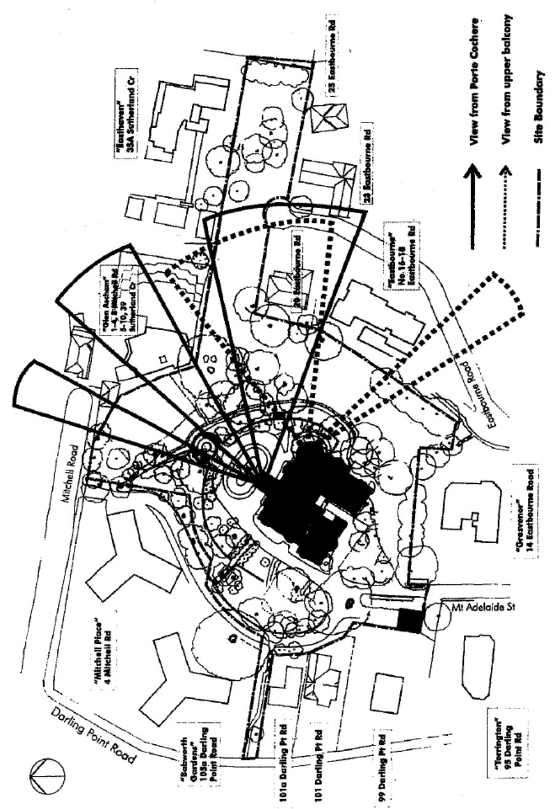
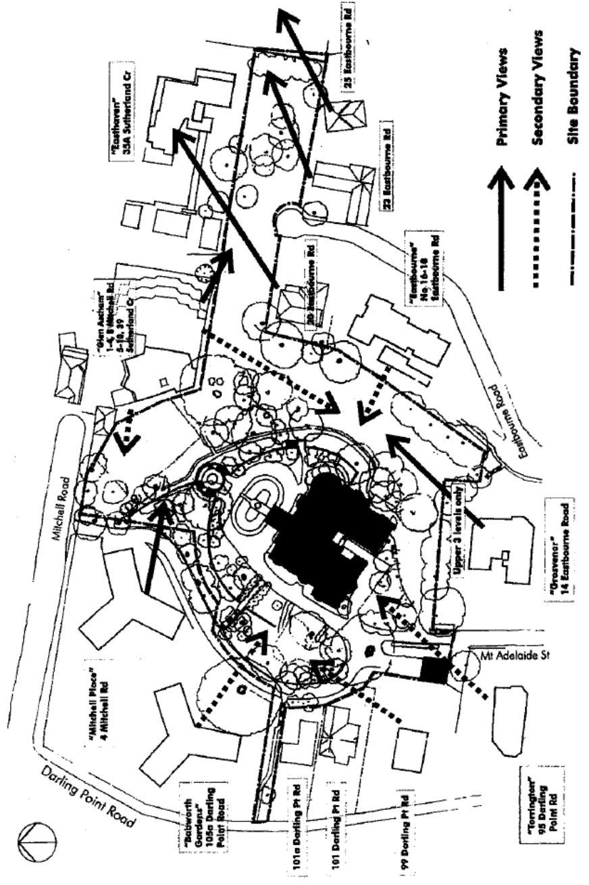
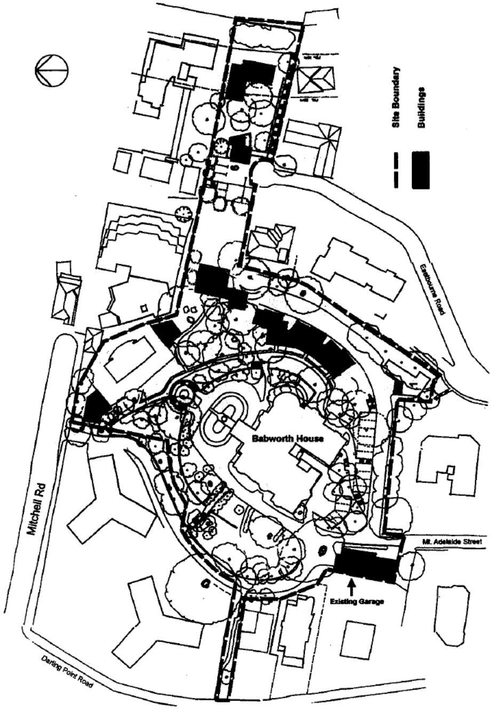

#### G1.4.3 Site layout

Site layout refers to the arrangement of buildings, spaces and access arrangements over the site.

#### Objectives

O1 To achieve a site layout that considers and respects the existing character and cultural significance of the site.

O2 To achieve a site layout that relates to the site analysis referred to in Section 1.4.1 and the adopted Conservation Management Plan.

O3 To protect views to, from and over the site.

O4 To maintain a visual landscape link between Babworth House and the harbour.

O5 To provide a high level amenity for future occupants of the site and maintain the amenity of neighbouring properties.

#### Controls

C1 The site layout:

a) locates new buildings within the landscaped zone of significance (see Figure 4);

b) takes into consideration and respects the dominant position of Babworth House;

c) takes into consideration the orientation and placement of buildings for solar access;

d) retains or where possible enhances the significant attributes of the site (e.g. views, vistas, substantial trees, spaces and elements);

e) relates building and landscape design to the site topography and to the desired future character objective of the site;

f) retains trees in the ‘finger of land’ to the waters of Double Bay, as identified in the adopted Conservation Management Plan;

g) takes advantage of multiple access points and existing driveways;

h) provides opportunities for access to and use of public transport; and

i) respects and does not obscure or confuse the historic site layout.

C2 The site layout provides for retention of the principal view corridors as identified in Figures 6 and 7.

C3 Development is located within the building areas nominated in the Conceptual Layout Plan and Site Precinct Plan (see Figures 8 and 9) and is within the building envelopes nominated in the Building Envelope Diagrams (see Figures 10-18).

Note: All building envelopes are indicative. Provisions of the Environmental Planning and Assessment Act 1979 and statutory provisions within environmental planning instruments which apply to the land together with the planning principles, objectives and controls mentioned in this chapter take precedence over the Conceptual Layout Plan (Figure 8) and the building envelopes (Section 1.4.4).

Council may require deletion or variation of building envelopes or footprints if the proposed development is considered by Council to be unsatisfactory in terms of the relevant provisions of the Act, the environmental planning instruments, planning principles, objectives and controls.

FIGURE 6  Existing view corridors – views from Babworth House

> [Picture on page 22: a picture, saved as a picture (images/chapter-g1-babworth-house-darling-point-page-22-2.gif, 150 dpi).]

FIGURE 7  Existing view corridors – views over Babworth House

> [Picture on page 23: a picture, saved as a picture (images/chapter-g1-babworth-house-darling-point-page-23-2.gif, 150 dpi).]

FIGURE 8  Conceptual layout plan

> [Picture on page 24: a picture, saved as a picture (images/chapter-g1-babworth-house-darling-point-page-24-2.gif, 150 dpi).]
