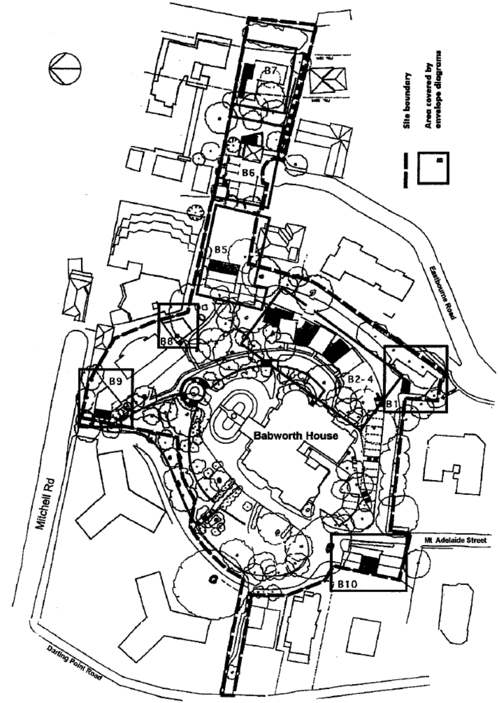
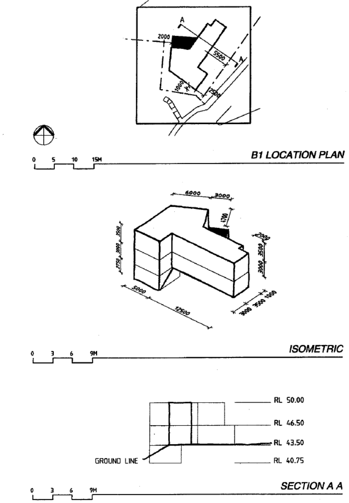
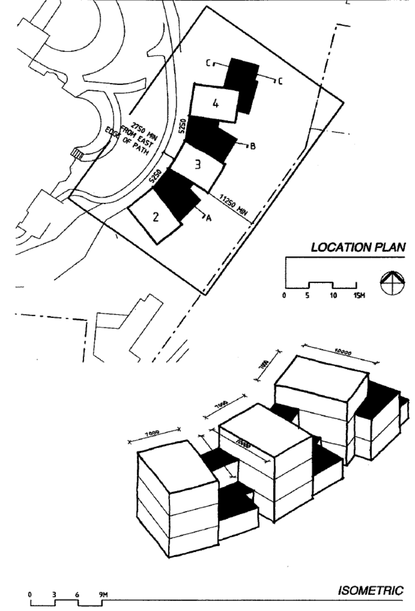
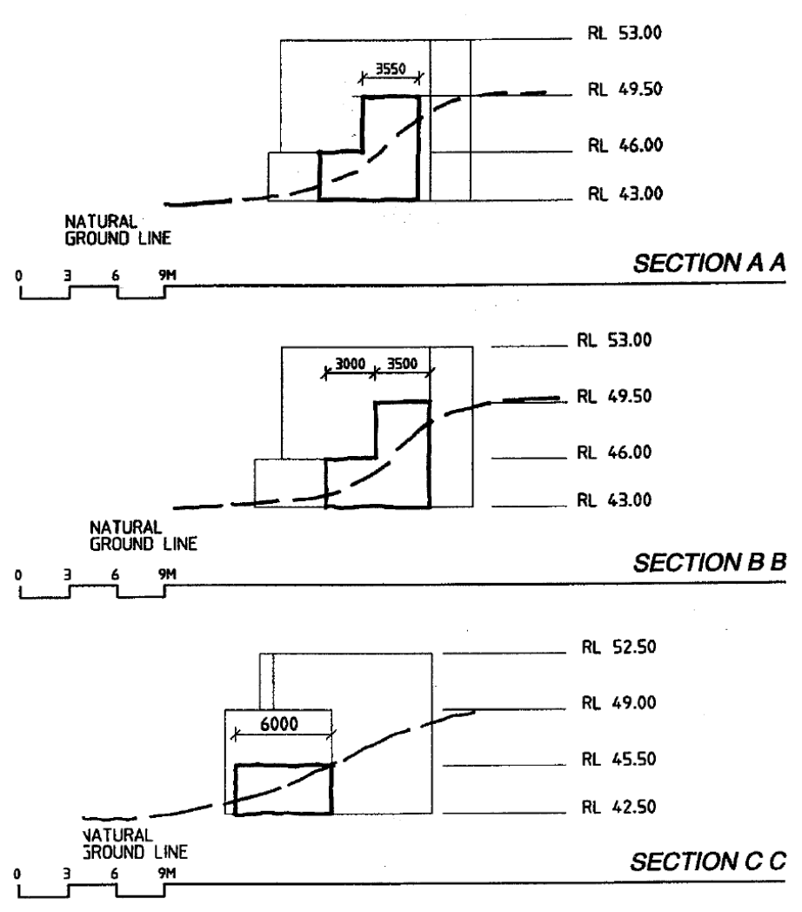
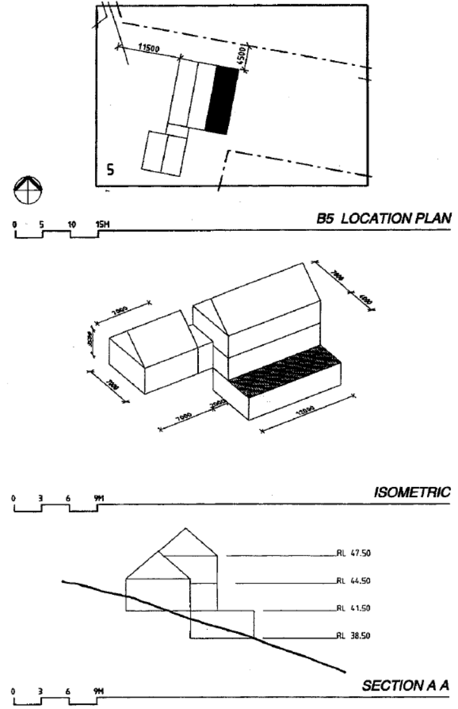
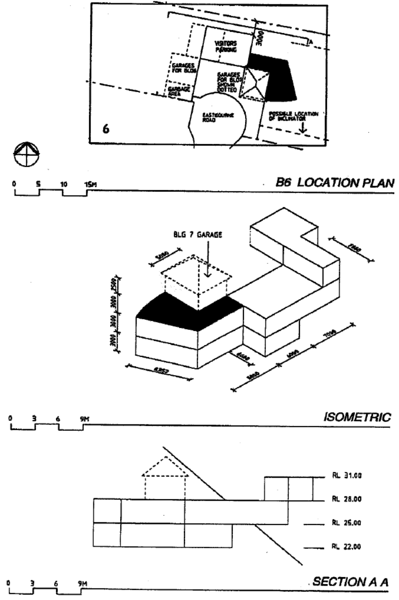
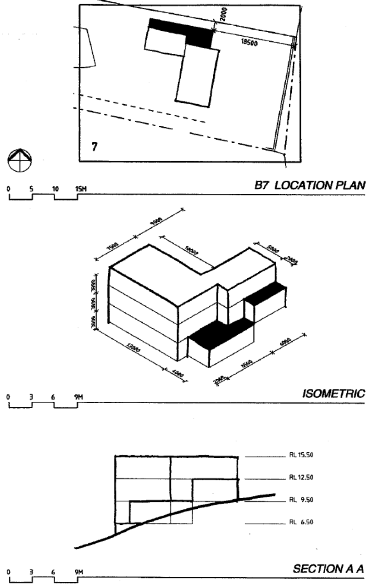
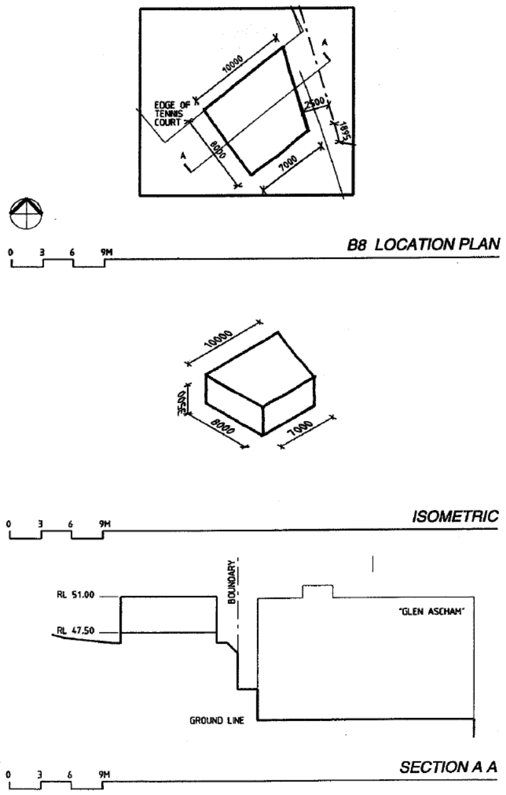
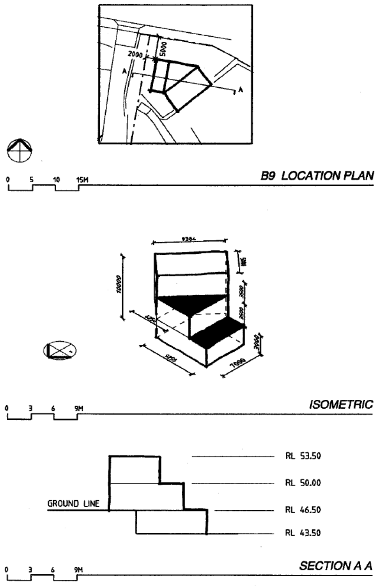
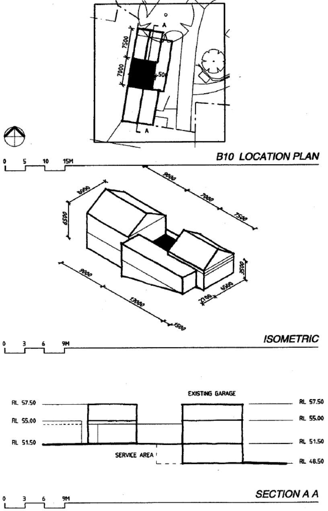

#### G1.4.4 Building envelope

The siting and scale of buildings, including height and setbacks, set the character of development on the site.

Building envelope provisions have been established to control the siting, scale, bulk and height of development so that it satisfies the desired future character objectives and is appropriate in terms of impacts on Babworth House and adjoining properties.

The building envelope represents the maximum limits of development and may not be able to be achieved in all circumstances.

#### Objectives

O1 To ensure the built form and intensity of new development respects the scale and character of Babworth House and does not detrimentally affect the significant attributes on the site.

O2 To ensure the built form and intensity of new development respects the desired future character of the area and does not detrimentally affect the amenity of the area.

O3 To protect principal views to, from and over the site and ensure buildings are of a height and scale which allows the sharing of views.

O4 To allow adequate daylight, sunlight and ventilation to living areas and private open space of new and neighbouring development.

O5 To preserve significant trees and vegetation and retain a landscape link to the harbour.

O6 To maintain where possible the existing topography of the site.

#### Controls

C1 Buildings are located only within the 1c landscape zone of significance as identified under the adopted Conservation Management Plan (see Figure 4) and generally within the nominated building footprints identified in the Conceptual Layout Plan (see Figure 8).

C2 Buildings are located within a building envelope nominated in the Building Envelope Diagrams provided for each precinct. The precincts are those identified on the Site Precinct Plan (see Figure 9). Individual building envelopes are identified in Figures 10-18.

Note: All building envelopes are indicative. Provisions of the Environmental Planning and Assessment Act 1979 and statutory provisions within environmental planning instruments which apply to the land together with the planning principles, objectives and controls mentioned in this chapter take precedence over the Conceptual Layout Plan (Figure 8) and the Building Envelope Diagrams (Figures 10-18).

C3 Council may require deletion or variation of building envelopes or footprints if the proposed development is considered by Council to be unsatisfactory in terms of the relevant provisions of the Act, the environmental planning instruments, planning principles, objectives and controls.

For instance, Council may require additional setbacks from boundaries, variations to the building footprint and variations to the building envelopes, including reduction in height in order to mitigate the impact of development on the residential amenity of the site and adjoining properties, maintain view corridors, promote view sharing, improve or maintain solar access, retain significant trees and site elements and minimise excavation.

C4 Balconies, decks, bay windows, non-retractable awnings or other non-retractable solar screening devices and roof terrace balustrades are to be included within the planes of the building envelopes.

C5 Fascias, gutters, downpipe, eaves up to 0.6m, masonry chimneys, flues, pipes, domestic fuel tanks, cooling or heating appliances or other services, retractable solar screens and blinds, light fittings, electricity and gas meters, aerials, steps, landings may project beyond the planes of the building envelope provided it can be demonstrated that views and privacy are not compromised.

C6 Conserving significant trees, elements, vistas and archaeological remains as identified in the adopted Conservation Management Plan takes precedence over the permissible maximum building envelopes described in Figures 10-18. The envelopes may therefore need minor adjustment.

C7 Stepped buildings are encouraged on steeply sloping land within the building footprints and building envelopes identified in Figures 10-18.

C8 Buildings are sited and designed so that:

a) privacy is provided to adjoining dwellings;

b) sunlight is provided to at least 50% (or 35m² with minimum dimension 2.5m, whichever is smaller) of the main ground level private open space of adjoining properties for a minimum of two hours between 9am and 3pm on 21 June. Where existing overshadowing is greater than this, sunlight is not further reduced by more than 20%;

c) adequate daylight is provided to habitable room areas in adjoining dwellings;

d) building forms enable a sharing of views with surroundings and permit views from public streets and open spaces; and

e) the building footprint minimises cut and fill.

C9 Development has a minimum side boundary setback of 1.5m, increased on a pro rata basis by 0.5m for each additional metre (or part thereof) that the wall height adjacent to the boundary exceeds 3m.

C10 The building envelope complies with the maximum height limit under the Woollahra LEP 2014.

C11 If a variation to the maximum height limit is sought through clause 4.6 “Exceptions to development standards” in Woollahra LEP 2014 for development on any part of the site, it must as a minimum requirement contain the following information:

a) a description of the particular nature and condition of the site and any other circumstances which has led to a design which exceeds the height limit; and

b) a statement which describes how the design satisfies the relevant planning principles, the desired future character objectives and the objectives and performance controls for site layout, building envelope, landscape, open space and acoustic and visual privacy as set down in this chapter.

C12 Development on Lot E is to be of a design and is to use a method of construction which requires minimal excavation. Any building on Lot E is to be of a stepped design which responds to the sloping nature of the land.

C13 All new buildings and works shall not be built within the canopy drip line of significant trees unless information to the satisfaction of the Council can be provided which demonstrates that the construction technique, excavation works, construction works and finished buildings together with associated servicing and landscaping will not have an adverse impact on the immediate and long term preservation, health, vigour and aesthetic quality and the likely future growth habits of the trees.

C14 Buildings B2-B5 are designed and located so as to:

a) ensure the retention of the Cape Honeysuckle (Tecomaria capensis) hedge adjoining the gravel pathway to the east of Babworth House; and

b) ensure that the buildings are not visible from the upper garden terrace adjoining the eastern side of Babworth House (generally with a ground level of RL 53 AHD).

Note: Ground levels shown on the building envelope diagrams are indicative and are required to be accurately determined for development applications by survey carried out by a qualified surveyor.

The number and location of floor levels shown within the building envelope on the isometric and section diagrams are suggestive rather than prescriptive.

FIGURE 9  Site precinct plan

> [Picture on page 28: a picture, saved as a picture (images/chapter-g1-babworth-house-darling-point-page-28-2.gif, 150 dpi).]

FIGURE 10  B1 – Building envelope diagram All levels are to AHD Note: Areas shaded light grey are terraces

> [Picture on page 29: a picture, saved as a picture (images/chapter-g1-babworth-house-darling-point-page-29-4.gif, 150 dpi).]

FIGURE 11  B2 to B4 – Building envelope diagram (location and isometric) All levels are to AHD

> [Picture on page 30: a picture, saved as a picture (images/chapter-g1-babworth-house-darling-point-page-30-3.gif, 150 dpi).]

FIGURE 12  B2 to B4 – Building envelope diagram (sections) All levels are to AHD

> [Picture on page 31: a picture, saved as a picture (images/chapter-g1-babworth-house-darling-point-page-31-3.gif, 150 dpi).]

FIGURE 13  B5 – Building envelope diagram All levels are to AHD Note: The final location of building B5 is subject to a report from an arborist which confirms to Council’s satisfaction that the construction technique, excavation works and finished building together with associated servicing and landscaping will not have an adverse impact on the immediate and long term preservation, health, vigour and aesthetic quality and the likely future growing habits of surrounding trees. The location of building B5 may involve the relocation of the Phoenix Palm to a position on the site agreed to by the Council.

> [Picture on page 32: a picture, saved as a picture (images/chapter-g1-babworth-house-darling-point-page-32-8.gif, 150 dpi).]

FIGURE 14  B6 – Building envelope diagram All levels are to AHD

> [Picture on page 33: a picture, saved as a picture (images/chapter-g1-babworth-house-darling-point-page-33-3.gif, 150 dpi).]

FIGURE 15  B7 – Building envelope diagram All levels are to AHD

> [Picture on page 34: a picture, saved as a picture (images/chapter-g1-babworth-house-darling-point-page-34-3.gif, 150 dpi).]

FIGURE 16  B8 – Building envelope diagram All levels are to AHD

> [Picture on page 35: a picture, saved as a picture (images/chapter-g1-babworth-house-darling-point-page-35-3.gif, 150 dpi).]

FIGURE 17  B9 – Building envelope diagram All levels are to AHD

> [Picture on page 36: a picture, saved as a picture (images/chapter-g1-babworth-house-darling-point-page-36-3.gif, 150 dpi).]

FIGURE 18  B10 – Building envelope diagram All levels are to AHD

> [Picture on page 37: a picture, saved as a picture (images/chapter-g1-babworth-house-darling-point-page-37-3.gif, 150 dpi).]
