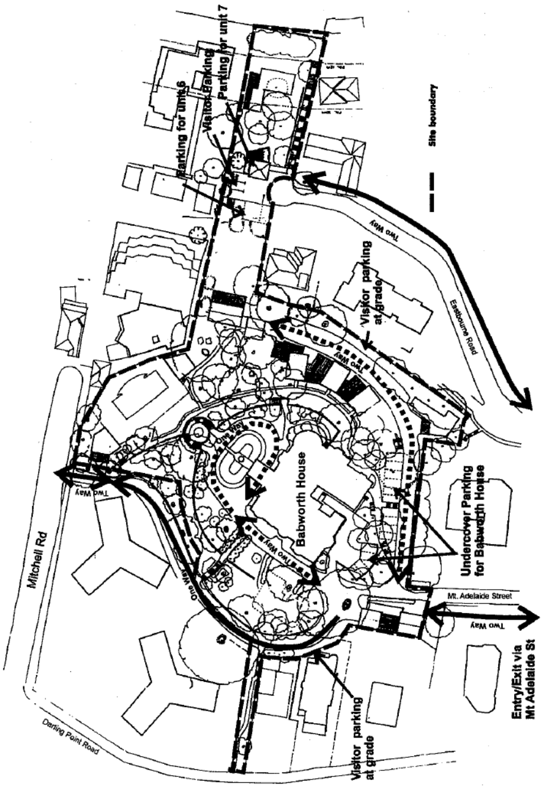

#### G1.4.9 Car parking and servicing

The onsite car parking requirements aim to satisfy the parking demand likely to be generated by residential development while discouraging unnecessary car use and site excavation resulting from the provision of overly-generous amount of on-site parking.

Limiting unnecessary car use and encouraging other modes of transport, such as walking, cycling and public transport helps to improve local amenity and minimise pollution and the use of non-renewable energy sources.

Parking areas, garages and driveways must be designed carefully so that they do not detract from the appearance of the development and the surrounding streetscape.

The design of parking and driveway areas should also acknowledge the need to limit the amount of impervious surfaces over a site and the amount of site excavation.

The overly generous use of impervious surfaces such as paving and bitumen can increase temperature in warmer months and lead to excessive stormwater runoff.

Excessive excavation can lead to site instability and interrupt ground water flows relied upon by surrounding vegetation.

#### Objectives

O1 To maintain the integrity and amenity of Babworth House and its landscaped setting.

O2 To maintain the amenity of adjoining properties and the safe and efficient operation of the local road network.

O3 To provide convenient and safe car parking and access for residents and visitors.

O4 To limit site excavation resulting from development.

O5 To ensure that onsite car parking and driveways do not dominate or detract from the appearance of development and the integrity and amenity of Babworth House and its landscape setting.

O6 To limit the adverse temperature and stormwater run-off impacts of impervious alternative modes of transport.

O7 To encourage the use of public transport and alternative modes of transport.

O8 To encourage suitably landscaped open car parking areas and accessways while providing for the needs of residents and visitors.

#### Controls

C1 The number of car parking spaces to be provided on the site is outlined in the table below.

| Dwelling size | Number of spaces provided |
|---|---|
| 1 bedroom 2+ bedroom Visitors Babworth House | 1 space/dwelling 2 spaces/dwelling ¼ dwellings Maximum of 14 spaces irrespective of use |

C2 For uses other than those identified in PC1 or where variation to the rates set out in PC1 are sought, Council will consider parking provisions on its merits and in light of a traffic and parking report, to be submitted with development applications and other relevant considerations (e.g. heritage and amenity).

C3 Parking facilities are designed and located to:

a) maintain cultural (heritage) significance of the grounds and not detract from the heritage significance of Babworth House and its gardens;

b) provide easy, convenient and safe access to all buildings;

c) enable the efficient use of car spaces and accessways, including safe manoeuvrability for vehicles between the parking areas and the street;

d) preserve significant trees;

e) reduce the visual dominance of car parking areas and accessways;

f) enhance the landscaped setting and character of the site; and

g) generally comply with the vehicular access, parking and servicing arrangements set out in Figure 19. Council may consider other arrangements on their merits.

C4 Innovative solutions in the provision of car parking (e.g. underground, semi-basement) may be implemented, where site conditions permit, to achieve the objectives for parking.

C5 The area of site excavated for the purpose of underground car parking is limited to the building footprint of each building as determined by the building envelope diagrams.

C6 Parking facilities are sited and designed to integrate physically and visually with the landscape and other built elements.

C7 Open car parking spaces are designed, surfaced and graded to facilitate onsite stormwater management in accordance with a Stormwater and Soil Management Plan.

C8 Adequate manoeuvrability and parking is provided for service vehicles.

C9 Utility service reticulation is provided underground.

C10 One car wash bay is provided at the western at-grade visitor parking area and another at the at-grade parking area adjacent to buildings B2-B4. Each bay is to be graded to an internal drainage point and connected to a Sydney Water Corporation sewer. A trade waste agreement from the Corporation will be required for the connection. Council will favourably consider onsite wastewater recycling if the proposal is plausible.

C11 The arrangement of parking spaces and driveways allow vehicles to enter and leave the site in a forward direction.

C12 Accessways and driveways are designed to enable vehicles (the 85th percentile vehicle) to enter the designated parking space in a single turning movement and leave the space in no more than two turning movements.

C13 Visitor car parking areas are designed to minimise impact on adjoining properties in regard to matters including noise and vehicle lights.

FIGURE 19  Vehicular access, parking and servicing

> [Picture on page 50: a picture, saved as a picture (images/chapter-g1-babworth-house-darling-point-page-50-2.gif, 150 dpi).]
