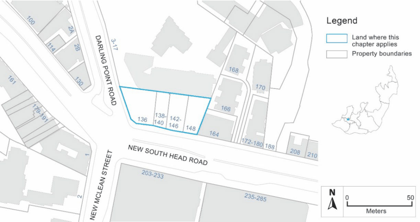

#### G10.1 Introduction

#### G10.1.1 Background

This chapter of Woollahra DCP addresses land at 136-148 New South Head Road, Edgecliff, if developed together. This land is proposed to be redeveloped for a 12 storey mixed use development including retail, office and residential uses, and will activate the pedestrian environment along New South Head Road.

The site is located on the northern side of New South Head Road opposite the Edgecliff commercial centre, and is situated at the north-western corner of the New South Head Road and Darling Point Road intersection. The site contains a heritage building at 136 New South Head Road which must be retained in any redevelopment of the site. There are also heritage items and conservation areas in the vicinity of the site.

The site is currently occupied by 2-4 storeys mixed use buildings, and is immediately surrounded by a mix of commercial, retail, residential and education buildings varying in age, and height from one storey to 14 storeys, with the exception being a 31 storey residential flat building ‘Ranelagh’ located immediately to the north.

The land is zoned MU1 Mixed Use under the Woollahra Local Environmental Plan 2014 (Woollahra LEP 2014) and has a maximum building height of 14.5m and a floor space ratio of 1.5:1. However, the site was the subject of a proponent-led planning proposal which amended the Woollahra LEP 2014 to allow higher density development on the site if certain requirements are met. These amendments commenced on 17 May 2024 under Woollahra Local Environmental Plan 2014 (Amendment No. 38) and have the effect of permitting development with a building height up to 46m and a floor space ratio up to 5:1.

This chapter of the Woollahra DCP will apply to proposed development that seeks to benefit from the greater height and floor space permitted by Woollahra LEP Amendment No. 38.

The site is located within the New South Head Road Corridor, Edgecliff, as identified in the Woollahra DCP, Chapter D2 Mixed Use Centres. The desired future character for the Corridor is:

This mixed use corridor is a highly urban environment and it is important that it meets high standards of visual quality and pedestrian amenity.

This part of New South Head Road is a main entry point to the Municipality and it is important that the experience and journey through the centre makes a positive impression. Everything that can be seen and experienced in the street is therefore relevant.

Development fronting New South Head Road will generally contain four to six storey mixed use buildings. Building facades, in terms of detailing and building materials, should be well designed, with particular consideration to how the buildings are interpreted from moving vehicles, so that the view driving along New South Head Road contributes to the public domain. At street level, buildings should respond to pedestrians by providing human scale design elements, interesting frontages and awnings for protection.

Development within this corridor must consider its impact on the adjoining Paddington heritage conservation area, including Glenmore Road, which is an important gateway entry to Paddington. Development should protect and respond to the character and scale of the heritage conservation area.

The New South Head Road mixed use corridor permits a range of residential and commercial land uses, including restaurants and cafes which should contribute to a more vibrant centre, particularly at night. Though certain types of convenience retailing opportunities are constrained by the restricted parking, it is expected that comparison specialist retailing, such as homewares and furniture shops, and complementary offices, such as medical suites, will capitalise on the excellent access to public transport, high visual exposure and proximity to the Sydney CBD.

This chapter builds on the existing DCP provisions for the New South Head Road Corridor and the Mixed Use Centres. It establishes site specific objectives and controls to guide development having regard to the site and its context, and includes provisions for building envelopes (including stories and setbacks), building design, conservation of heritage, street activation, public domain, dwelling mix, car parking and access, sustainability, and other amenity impacts that could result from future development on the site.

#### G10.1.2 Land where this chapter applies

This site specific chapter applies to the land identified on the map at Figure 1 (the site). The site comprises land at 136-148 New South Head Road, Edgecliff, legally described as:

- Lot 1 DP 663495 (No. 136)

- Lot 1 DP 1092694 (No. 138-140)

- Lot 2 DP 983678 (No 138-140)

- Lot A DP 443992 (No 142-146)

- Lot B DP 443992 (No 148)

The plan applies only if all lots are developed together.

> [Picture on page 4: a picture, saved as a picture (images/chapter-g10-136-148-new-south-head-road-edgecliff-page-4-27.gif, 150 dpi).]

#### FIGURE 1  The site

#### G10.1.3 Development to which this chapter applies

This chapter applies to development requiring consent under the Woollahra Local Environmental Plan 2014.

#### G10.1.4 Objectives

The objectives of this chapter are to ensure that development on the site:

O1 Achieves architectural and urban design excellence.

O2 Incorporates sustainable design principles.

O3 Has a scale, bulk and design that reflects the desired streetscape character, and respects the adjoining and nearby residential development, particularly in terms of the building setback, number of storeys, articulation and distribution of height.

O4 Promotes environmental amenity on the site and surrounding properties, and does not unreasonably compromise the amenity of nearby residential uses having particular regard to overshadowing, visual and acoustic privacy, and view sharing.

O5 Protects the heritage item at 136 New South Head Road, including to retain the scale of, and not overwhelm, the heritage item.

O6 Ensures that the significant values of the heritage items and areas of significance in the vicinity of the site are protected, and new development sensitively responds to heritage significance and the site’s surrounding historic setting.

O7 Provides retail and active uses at ground level street frontages to activate New South Head Road and enhance the public domain.

O8 Minimises traffic and parking impacts.

#### G10.1.5 Relationship to other parts of the DCP

This chapter is to be read in conjunction with other relevant parts of the DCP, including:

Part D: Chapter D2 Mixed Use Centres (New South Head Road Corridor, Edgecliff)

Part D: Chapter D3 General Controls for Neighbourhood and Mixed Use Centres

Part E: General Controls for All Development – this part contains chapters on Parking and Access, Stormwater and Flood Risk Management, Tree Management, Contaminated Land, Waste Management, Sustainability, Signage and Adaptable Housing.

In the event of any inconsistency between this site specific chapter and the other chapters, this chapter prevails.
