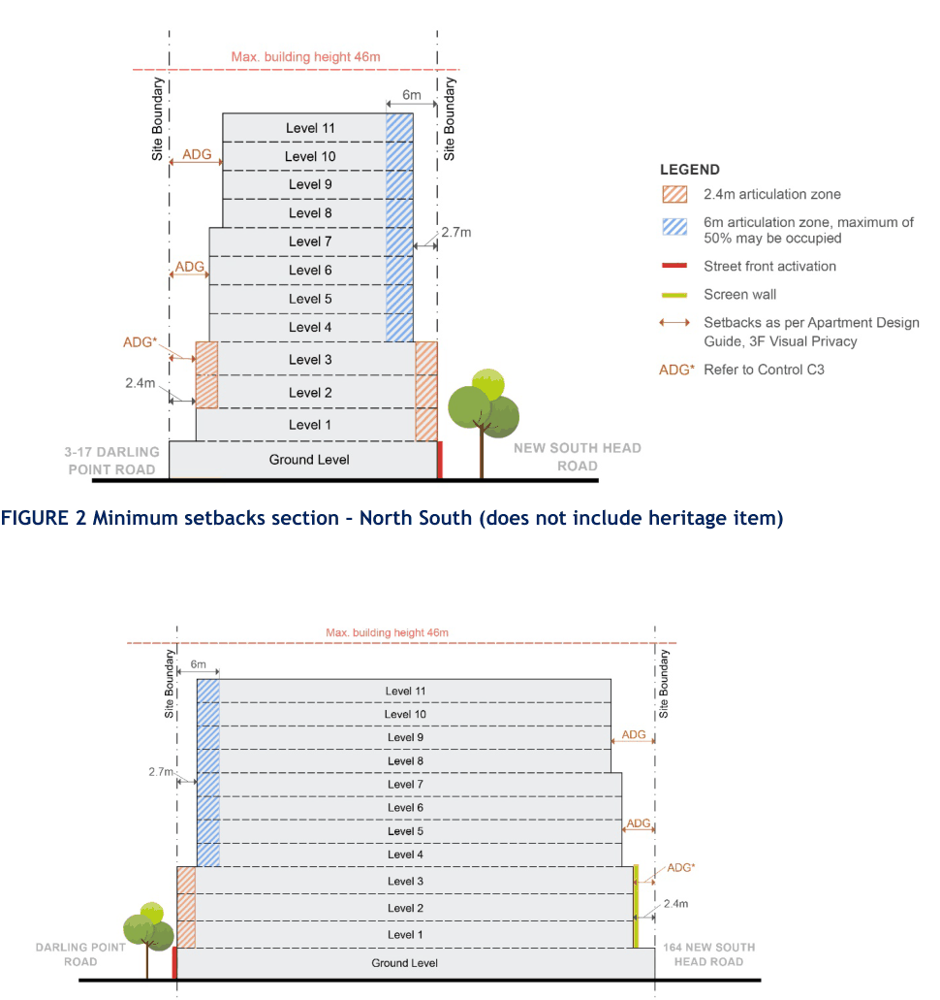
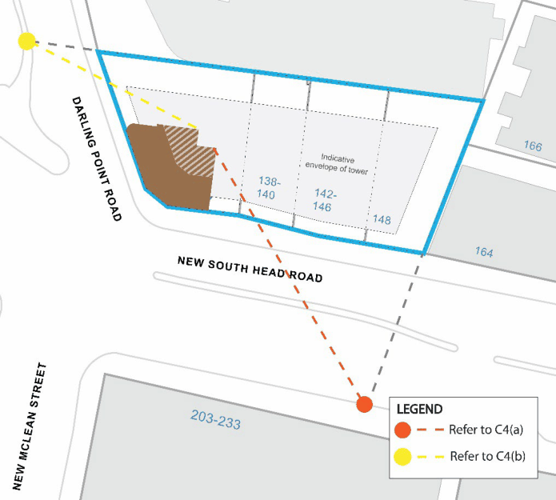
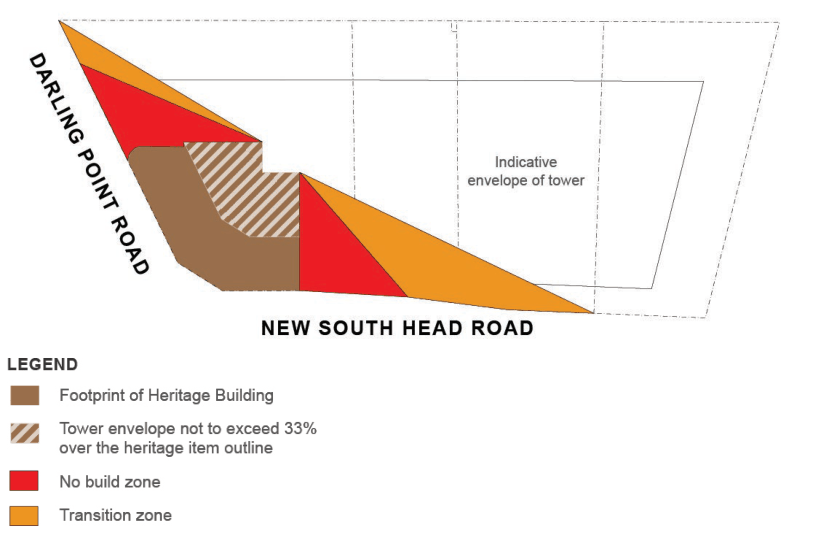
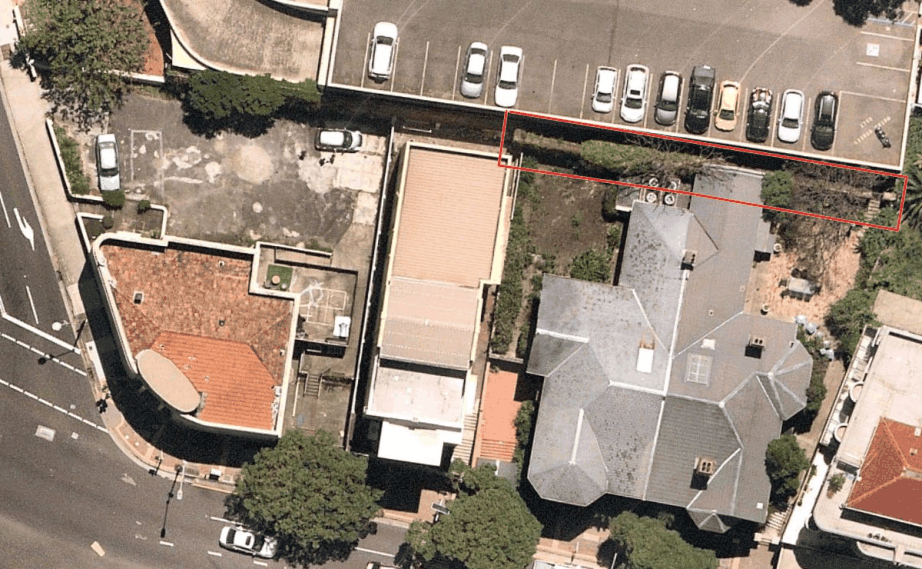

#### G10.2 Development Controls

#### G10.2.1 Desired future character

#### Objectives

O1 To establish the desired future character for the site.

O2 To facilitate development that is compatible with the immediately surrounding area, and the desired future character of the New South Head Road Corridor, Edgecliff.

O3 To ensure that development responds sympathetically to heritage items and conservation areas, within and in the vicinity of the site.

O4 To ensure development exhibits design excellence and sets a benchmark for development in the New South Head Road Corridor and the adjacent Edgecliff commercial centre.

#### Controls

C1 Development on the site must align with the following:

• Mixed use development in a building of no more than 12 storeys, comprising a 4 storey podium with tower setback from the podium

• Non-residential uses are concentrated in the podium, with residential uses above

• Retain the heritage building at 136 New South Head and sensitively integrate the new building

• Highly articulated and sculptural facade that contributes to the visual quality of the site and character of the local area

• Street level activation on the ground floor to New South Head Road

• Enhance the public domain and pedestrian environment

• Diverse range of apartment sizes

• Parking and service areas accessed from Darling Point Road only

C2 Development is consistent with the desired future character for the New South Head Road Corridor, Edgecliff, as set out in Woollahra DCP, Chapter D2 Mixed Use Centres.

C3 Development is subject to a design excellence review process consistent with the provisions in Woollahra Local Environmental Plan 2014, clause 6.11.

#### G10.2.2 Built form and façade articulation

#### Objectives

O1 To ensure that the built form exhibits design excellence through:

(a) a high standard of architectural design, materials and detailing appropriate to the

building type and location,

(b) the form and external appearance of the development, and

(c) relationship of the development with other existing or proposed developments on the

site and neighbouring sites.

O2 To use building setbacks and the graduation and transition of height across the site to:

(a) reduce the apparent bulk and the visual impact of the built form,

(b) protect and conserve the significance of heritage items and any associated significant

settings,

(c) address sensitive interfaces with adjoining buildings,

(d) reflect the slope of landform which transitions down towards Rushcutters Bay, and

(e) provide for view corridors.

O3 To provide a built form that contributes to a coherent and consistent street wall height and alignment to New South Head Road.

O4 To reinforce the site’s corner location, and the visual prominence of the heritage item on the site.

#### Controls

C1 Development is a maximum of 12 storeys and comprises a 4 storey podium. The tower and tower elements (including balconies) are setback from the podium and are no more than 8 storeys. The total number of storeys is measured using a section view across the site (i.e. not the number of visible storeys from a given frontage like New South Head Road).

C2 The tower contains residential uses. The podium levels comprises non-residential uses, other than Level 3 which may also contain residential uses along the northern elevation only.

C3 The built form incorporates minimum setbacks and articulation zones as set out in Figures 2 and 3.  At the Level 3 northern elevation, a setback and articulation zone applies (each 2.4m), unless the uses are residential in which case the setback in the Apartment Design Guide applies. (Also refer to section 10.2.4 and Figures 4 and 5 for setbacks to the heritage item.)

C4 The podium establishes a street wall height of 4 storeys along the New South Head Road frontage, and transitions to 2 storeys at the interface with the heritage item at 136 New South Road so that the podium is below the parapet level of the heritage item.

C5 The building design is highly articulated and sculptural. The tower incorporates curved forms and other design measures to:

(a) break down the volume of the tower and soften the perceived building mass and bulk,

(b) sensitively respond to the heritage item on the site, and

(c) contribute to the architectural quality and aesthetic of the building.

C6 The external areas of the 6m articulation zone are to be occupied by balconies and terrace landscaping and other design elements which do not increase the perceived building bulk and prominence of upper levels.

C7 The tower incorporates extensive use of glazing and continuous balconies.

> [Picture on page 8: a picture, saved as a picture (images/chapter-g10-136-148-new-south-head-road-edgecliff-page-8-8.gif, 150 dpi).]

FIGURE 2 Minimum setbacks section – North South (does not include heritage item)

#### FIGURE 3 Minimum setbacks section – East West (does not include heritage item)

#### G10.2.3 Ground level active frontages

#### Objectives

O1 To ensure that the ground level design and uses integrate with the public domain to give visual connectivity to public spaces and maximise pedestrian activation.

O2 To provide active street frontages on the ground level along New South Head Road.

O3 To enhance the public domain and pedestrian safety along New South Head Road and Darling Point Road.

O4 To incorporate a public plaza adjoining the heritage item at 136 New South Head Road.

#### Controls

C1 At ground floor along the New South Head Road frontage, the building contains retail premises designed to accommodate multiple tenancies to contribute to a vibrant street interface. Exception is provided to uses within the heritage building.

C2 Lobbies and entry foyers to upper levels are located and designed so these do not compromise street level activation, and also contribute to passive surveillance of the public realm. Residential entries are located along the Darling Point Road frontage where possible.

C3 The development incorporates a generous plaza that provides a forecourt to the heritage item, encourages pedestrian activity, and is animated by immediately adjoining active uses.

C4 Awnings are to be provided along New South Head Road to support the active ground floor uses and improve pedestrian amenity.

C5 Retain existing street trees and supplement with new street tree planting.

#### G10.2.4 Heritage and historic setting

The site contains a heritage item of local significance identified in the Woollahra Local Environmental Plan 2014, Schedule 5 Part 1.

• “Building and interiors”, 136 New South Head Road, Edgecliff (Item No: I238) The former Commonwealth Savings Bank of Australia building has aesthetic significance as an example of the Inter-War Functionalist architectural style. It was designed by the Commonwealth Department of the Interior and completed in 1940. The building demonstrates a number of key characteristics of the style, including asymmetrical massing, simple geometric shapes, expression of horizontal and vertical massing, parapet roof and curved facade corner. The former Commonwealth Savings Bank of Australia

building has landmark qualities due to its location on the corner of New South Head Road and Darling Point Road and distinctive architectural style.

The site is also in the vicinity of two other local heritage items:

• “Concrete balustrade”, Darling Point Road, near intersection with New South Head Road, Darling Point (Item No: I114)

• “Ascham school precinct”, 188 New South Head Road, Edgecliff (Item No: I239).

Also contributing to the historic character and setting of the development site are:

• A sandstone retaining wall and stairs located along the northern boundary of the site extending from 138 – 148 New South Head Road, which potentially relates to earlier historical estates (such as Redbank c.1890s, and Ranelagh c.1850s).

• Inter-War period flat buildings adjacent to the site at 164, 166 and 168 New South Head Road which form part of the Brantwood Estate group.

The varied nature of these surrounding heritage items demonstrate the layered history of the area immediately around the site.

#### Objectives

O1 To ensure that the built form and materials sensitively respond to the heritage items and the surrounding historic setting and heritage conservation areas.

O2 To maintain and enhance the significance and prominence of the heritage item at 136 New South Head Road.

O3 To ensure new development forms a backdrop to the heritage item at 136 New South Head Road and allows for three-dimensional appreciation of the heritage building.

O4 To provide active frontages and public domain improvements to showcase the heritage significance of the heritage item at 136 New South Head Road.

O5 To ensure that excavation and demolition works are undertaken in a manner that sensitively addresses and respects the heritage item and historic setting.

#### Controls

Heritage item at 136 New South Head Road

C1 New development is setback and designed so that the parapet of the heritage item is clearly distinguishable, and incorporates recessive and complementary forms to retain the prominence of the heritage building.

C2 Building setbacks, graduation of building bulk, and other measures such as shadow lines or change in materiality are used to provide a clear delineation between the heritage item and the new building.

C3 The three elevations of the heritage building at 136 New South Head are visible from the public domain.

C4 A no build zone and a transition zone apply from the Ground level to Level 3 between the heritage item and the new building:

a) For the eastern façade of the heritage item, the no build and transition zone is to allow view and appreciation of the full eastern façade when viewed from the southern side of New South Head Road, opposite the southeast corner of the site. (Refer to Figure 4)

b) For the northern façade of the heritage item, the no build and transition zone is to allow view and appreciation of the full northern façade when viewed from the northern end of the heritage listed concrete balustrade (item I114) on Darling Point Road. (Refer to Figure 4)

The indicative location of the no build zones and transition zones are set out in Figure 5.

> [Picture on page 11: a picture, saved as a picture (images/chapter-g10-136-148-new-south-head-road-edgecliff-page-11-11.gif, 150 dpi).]

#### FIGURE 4 View lines to eastern and western façades of the heritage building

C5 The no build zone establishes a buffer to the new building so that the heritage building is provided within its own setting and remains visually distinct from the development. The no build zone incorporates a forecourt plaza, and may contain small scale landscaping. No part of the new building is to directly extend from, or abut, the external facades of the heritage building elevations within the no build zone.

C6 The transition zone applies to the podium levels (Ground level to Level 3). The built form within the transition zone incorporates building setbacks to provide a stepped or gradual transition of building bulk from the no build separation zone to the other parts of the development.

C7 From the rear elevation of the heritage building, the new building at Levels 4 to Level 11 may partially cantilever over the heritage building. The maximum overhang of the building (including balconies) is no more than one third of the footprint of the heritage building. (Refer to Figure 5 for indicative location of the overhang)

> [Picture on page 12: a picture, saved as a picture (images/chapter-g10-136-148-new-south-head-road-edgecliff-page-12-5.gif, 150 dpi).]

#### FIGURE 5 Heritage item and new building location

C8 Conserve the exterior form, fabric and architectural detail of the heritage item. Proposed alterations will not remove, diminish or obstruct significant original fabric on any of the facades of the building.

C9 Conserve the significant spaces, fabric and detailing of the interior of the building which contribute to the overall significance of the place. Modifications to the interiors must be sympathetic, enhance or interpret original fabric of significance. Removal of intrusive fabric may be permitted.

C10 Heritage interpretation of the site, incorporating a history of the property, is to be displayed on the site. The interpretation shall cover the entire period of use of the site. Note: This may be required as a condition of consent.

Inter-War flat buildings and historic setting

C11 New development establishes a respectful interface and transition to the adjacent Inter- War flat buildings at 164, 166 and 168 New South Head Road, for example through a sensitive response in bulk, setback and materiality. (Also refer to Figure 3 Minimum setbacks section)

C12 The retaining wall and stairs located along the northern boundary of the site extending from 138 – 146 New South Head Road are to be retained. (Refer to Figure 6)

Note: An archaeological assessment is required with any development application that proposes demolition or works in the vicinity of the rear boundary. The assessment must assess the significance of the brick and sandstone retaining wall on the northern boundary of the site and provide recommendations to incorporate the wall in any development.

In the event that retention of the retaining wall is not possible (to be demonstrated in a structural engineer’s report), the sandstone should be reconstructed or salvaged and used in reinterpretation on the site. This may be required as a condition of consent.

C13 Demolition associated with the Inter-war flat buildings at 138-148 New South Head Road is to salvage and recycle historic building materials.

Note: A Heritage Demolition Report, prepared in accordance with Council’s DA Guide, is required with any development application that proposes demolition of the inter-war buildings. These Inter-War flat buildings may contain historic building materials suitable for salvage, including joinery, stained glass windows, ceiling timbers, timber panel doors and hardware, and marble fireplaces. These may be required as conditions of consent.

C14 Due diligence and a cautious approach to excavation is required on the site given potential archaeological significance.

Note: Aboriginal sensitivity heritage mapping gives potential Aboriginal significance to the

site. An Aboriginal Cultural Heritage Assessment Report will be required at DA stage.

> [Picture on page 13: a picture, saved as a picture (images/chapter-g10-136-148-new-south-head-road-edgecliff-page-13-19.gif, 150 dpi).]

Figure 6 – Location of retaining wall and stairs on the northern boundary of the site

#### G10.2.5 Environmental impacts

#### Objectives

01 To incorporate sustainable design principles in relation to sunlight, natural ventilation, wind, reflectivity, visual and acoustic privacy, and safety and security, as part of a development that exhibits design excellence.

O2 To protect the amenity of nearby dwellings, having particular regard to visual and acoustic privacy and solar access.

O3 To ensure development provides for view sharing.

04 To maintain solar access to Trumper Park and Oval and minimise overshadowing of parks and the public domain.

05 To minimise wind impacts on pedestrians in the public domain and occupants of the site and surrounding properties.

#### Controls

Private

C1 Side boundary setbacks apply consistent with Figures 2 and 3 to address privacy of occupants in adjoining buildings.

C2 In addition to the side boundary setbacks referred to in C1 above, a privacy screen wall applies at Levels 1 to 3 of the podium along the full length of the western elevation adjoining 164 and 166 New South Head Road.

C3 The development maintains solar access to existing dwellings for at least two hours between 9am and 3pm on 21 June:

a) to the north facing windows of habitable rooms; and

b) to at least 50% of the private open space.

Where existing overshadowing is greater than this, access to sunlight is not further reduced.

C4 The development reasonably preserves view sharing corridors, consistent with the principles in Tenacity Consulting v Warringah Council [2004] NSWLEC 140.

Note: Additional provisions also apply as set out in Chapter D3 – General Controls for Neighbourhood and Mixed Use Centres, and the Apartment Design Guide.

Public

C5 Development ensures that existing public open spaces achieve solar access between the hours of 10am and 2pm on 21 June. Where existing overshadowing is greater than this, sunlight is not further reduced.

C6 Notwithstanding C5, development will not cause overshadowing of Trumper Park and Oval between the hours of 10am and 2pm on 21 June, or any additional overshadowing of Trumper Park and Oval.

C7 Development ensures that at least 50% of the surface area of the ground level north facing façade at 203-233 New South Head Road receives at least 3 hours of sun between 9am and 3pm on 21 June.

C8 The building is designed and articulated to achieve the following minimum levels of wind comfort based on the Lawson pedestrian comfort criteria:

(a) for public footpaths – acceptable for walking

(b) for building entries and lobbies – acceptable for standing

(c) for the heritage plaza – acceptable for outdoor dining

(d) for apartment balconies, terraces and roof garden and the like – acceptable for sitting

(e) for the basement including entries – acceptable for walking

Note: An Environmental Wind Assessment must be provided to demonstrate acceptable standards of comfort on and around the site. The assessment is to be prepared by a suitably qualified wind engineer, and include modelling of the detailed design and appropriate ameliorations for negative effects from impacts such as high pressure on entry doors and potential for internal flow issues, high winds on roof terraces and balconies, Helmholtz resonance, and local wind conditions for stationary activities.

#### G10.2.6 Apartment mix

#### Objectives

O1 To promote housing choice through providing a mix of unit dwelling sizes.

O2 To cater for the needs of the existing and future resident population, and encourage a diverse population.

#### Controls

C1 Development on the site is to achieve the apartment mix outlined in Table 1 below:

#### Table 1 Apartment Mix

| Apartment Type | Minimum | Maximum |
|---|---|---|
| Studio/1 Bedroom | 20% | 50% |
| 2 Bedroom | - | 50% |
| 3 Bedroom or more | - | 30% |
| Required bedrooms are to be rounded up to the nearest whole number |  |  |

#### G10.2.7 Vehicular access and car parking

#### Objectives

O1 To restrict new vehicle entries to secondary streets, away from New South Head Road, to minimise congestion and improve public domain and street activation.

O2 To address road safety having specific regard to the landform and the proximity of the New South Head Road and Darling Point Road intersection.

O3 To address pedestrian safety having specific regard to the proximity of the pedestrian crossing at New South Head Road to 203-233 and 235-285 New South Head Road.

O4 To provide a continuous active street frontage along New South Head Road.

O5 To ensure adequate on-site car parking for development on the site.

#### Controls

C1 Vehicular access/egress for the site is from Darling Point Road using a left in/left out direction only. No vehicle access is permitted off New South Head Road. Note: A median strip and associated treatments will be required on Darling Point Road to support the left in/left out motion only.

C2 The driveway is designed to provide access/egress to and from the site using the kerbside lane only.

C3 The driveway crossover is located the maximum possible distance from the New South Head Road and Darling Point Road intersection.

C4 A Traffic and Parking Report is to be provided with a development application for the site and, amongst other matters, address the site’s proximity to the crest of New South Head Road at Darling Point Road. It also is to include a Green Travel Plan and a Travel Access Guide.

C5 The residential parking generation rates in Table 2 below set out the maximum number of spaces to be provided. Whilst parking provision for residential development is capped by a maximum rate, provision should not be substantially below the maximum, so as not to increase parking pressure on the surrounding road network.

Table 2 Residential uses parking generation rates

| Land use | Maximum parking generation rates* |
|---|---|
| Mixed use development (residential component) |  |
| Spaces based on number of bedrooms per dwelling |  |
| 1 bedroom or studio apartment 0.3 space |  |
| 2 bedrooms | 0.6 space |
| 3 or more bedrooms 1.5 spaces |  |
| Visitors | 0.12 space |

\*The number of parking spaces for 1 bedroom and studios, 2 bedrooms and visitor parking for the site has been calculated using E.1.4.2 Residential parking generation rates for

mixed use development and multiplying by the parking multiplier for non-residential uses in the New South Head Road, Edgecliff commercial corridor MU1 Zone (which is 0.6).

Notes:

1\. The base parking generation rates set for non-residential uses are set out in Chapter E1 Parking and Access.

2\. Development will not be eligible to apply to Council’s Resident Parking Permit Scheme.

#### G10.2.8 Site facilities

#### Objectives

O1     To ensure that essential infrastructure and other site facilities are accessible and functional, and do not detract from the streetscape character, heritage and historic setting, or amenity of adjoining residential dwellings.

O2    To locate, conceal or screen mechanical plant and equipment, and electricity substations, so these are not visible from the street and other public spaces.

O3 To minimise the visual and other amenity impacts of loading facilities on the surrounding properties and the street and other public spaces.

#### Controls

C1 Mechanical plant and equipment is located in a basement or car parking level.

C2 If an electricity substation is required the substation is a chamber substation, preferably a basement chamber substation.

C3 Any loading dock for waste or service delivery is located and designed so it is not visually intrusive within the streetscape, and does not detract from fabric and significance of the heritage item at 136 New South Head Road.

#### G10.2.9 Ecologically sustainable development

#### Objectives

O1 To incorporate sustainable design principles in relation to resource, energy and water efficiency, as part of a development that exhibits design excellence.

O2 To incorporate passive design strategies and mitigate the urban heat island effect.

#### Controls

C1 The building achieves a minimum 4-star Green Star rating. Note: This may be required as a condition of consent.

C2 The floorplate design for each level provides for corridors with natural ventilation and natural light.

C3 The rooftop design incorporates:

a) integrated solar photovoltaic panels; and

b) trees and landscaping to reducing the urban heat island effect.

Note: The provisions in Part E of the DCP, Chapter E6 Sustainability and State Environmental Planning Policy (Sustainable Buildings) 2022 also apply.
