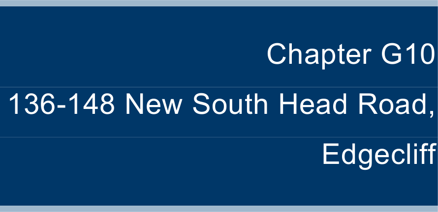

# Woollahra Development Control Plan 2015 - Chapter G10 136-148 New South Head Road, Edgecliff

> This chapter is split into 3 section file(s), one per numbered heading, in the order they appear in the PDF.

Source PDF: [chapter-g10-136-148-new-south-head-road.pdf](https://planfortomorrow.sharepoint.com/sites/Planfortomorrow/Shared%20Documents/00%20NSW-Planning-Resources/dcp/woollahra-development-control-plan-2015/chapter-g10-136-148-new-south-head-road-edgecliff/chapter-g10-136-148-new-south-head-road.pdf)

> [Picture on page 1: a picture, saved as a picture (images/chapter-g10-136-148-new-south-head-road-edgecliff-page-1-1.gif, 150 dpi).]

### Chapter G10

136-148 New South Head Road,

### Edgecliff

### Part G  Site-Specific Controls

### CHAPTER G10 APPROVED ON 25 NOVEMBER 2024 AND COMMENCED ON 2 DECEMBER 2024

<!-- sections -->
## Sections

1. [G10 136-148 New South Head Road, Edgecliff](01-g10-136-148-new-south-head-road-edgecliff.md)
2. [G10.1 Introduction](02-g10-1-introduction.md)
3. [G10.2 Development Controls](03-g10-2-development-controls.md)
