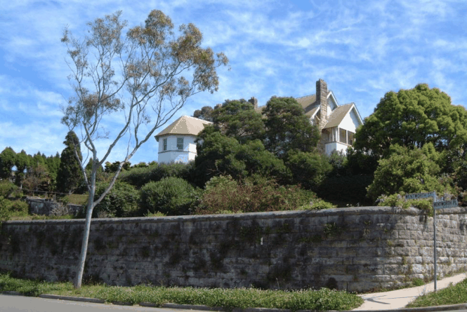
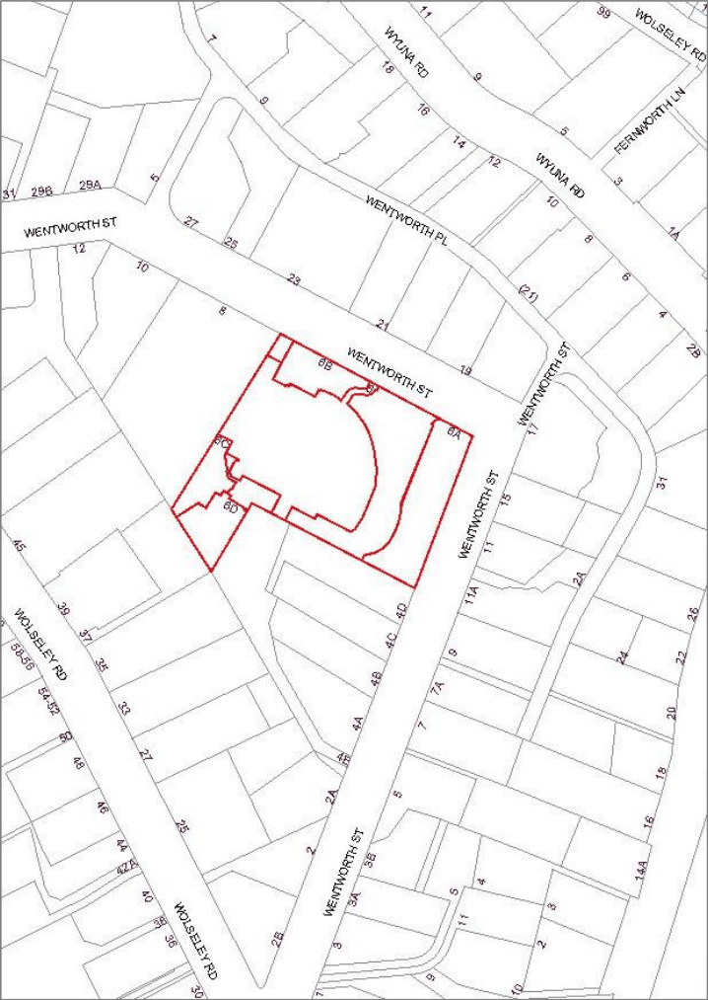

#### G2.1 Introduction

No. 6 Wentworth Street, Point Piper, known as Kilmory, is located on the north-eastern bend of Wentworth Street on the highest part of Point Piper. Because of this elevated position the building and its landscaped grounds can be seen from areas in Vaucluse, Rose Bay and Darling Point.

Kilmory is the largest site on the Point Piper peninsula and the last of that suburb’s grand estates. The property has exceptional local heritage significance and is listed as a heritage item in Woollahra Local Environmental Plan 2014 (Woollahra LEP 2014).

The house occupies a prominent and highly visible position on the site. From parts of Wentworth Street, it presents a striking and dominating form against an uninterrupted skyline. This elevated position also provides the house and the upper landscaped areas with expansive views of Sydney Harbour and the northern foreshore.

The house is an Arts and Crafts style building designed in 1913 by John William Manson of the architectural firm Manson and Pickering for Dr Alexander MacCormick (later Sir Alexander), an eminent member of Sydney’s medical profession. Construction of the house was undertaken by the leading building firm of Stuart Bros. Co. over the period 1913 to 1914.

The house and its landscape setting, including sandstone walling, driveway, entry posts and gates, elevated terraces, gardens and prominent trees are highly significant and contributory elements in the Wentworth Street streetscape.

Because of Kilmory’s heritage significance, its high streetscape value and the interest to redevelop the site, the Council decided to prepare site specific controls. The controls contained in this chapter are based on the Conservation Management Plan for Kilmory, 6 Wentworth Street Point Piper (January 1998 – issue F), which was adopted in part by the Council on 13 August 2001, and a set of conservation principles adopted by the Council on 12 August 2002.

Note: This chapter reflects the site specific development control plan adopted by Council on 16 December 2002, and which commenced on 23 December 2002.

> [Picture on page 5: a picture, saved as a picture (images/chapter-g2-kilmory-6-wentworth-street-point-piper-page-5-27.gif, 150 dpi).]

#### G2.1.1 Land where this chapter applies

This chapter applies to No. 6, 6A, 6B, 6C and 6D Wentworth Street, Point Piper, being Lot 1-7 SP 77598 and Lot 3-6 DP 270495 (see Figure 1). The land is also known as Kilmory.

Note:  For the purpose of this chapter, the whole of the site together with its built and natural elements is known as Kilmory.  A reference in this chapter to Kilmory is intended to include a reference to all elements of the site. Objectives and controls may be provided for the whole site, for the house and for particular elements.

#### FIGURE 1

Land where this chapter applies

> [Picture on page 6: a picture, saved as a picture (images/chapter-g2-kilmory-6-wentworth-street-point-piper-page-6-10.gif, 150 dpi).]

#### G2.1.2 Development to which this chapter applies

This chapter applies to development requiring consent under Woollahra LEP 2014.

#### G2.1.3 Objectives

The objectives of this chapter are:

O1 To conserve the heritage significance of Kilmory.

O2 To provide planning and heritage conservation controls for Kilmory.

O3 To encourage a high standard of architectural and landscape design in new development.

O4 To maintain the visual setting of the house and the streetscape value of Kilmory.

O5 To minimise the impact of new development on adjoining lands.

O6 To encourage a single management structure for Kilmory.

O7 To retain the outer subdivision boundaries of Kilmory.

Notes: Applicants must demonstrate in a statement of environmental effects and through the features of a proposal how development is consistent with the principle objectives of this chapter and the design criteria objectives. Council must not grant consent to the carrying out of development on the land to which this chapter applies unless it is of the opinion that the development would be consistent with the principle objectives of this chapter and the design criteria objectives.

#### G2.1.4 How to use this chapter

This chapter is to be used primarily by: the property owners of Kilmory; applicants seeking consent for development on the site; Council’s assessment officers; and Council’s decision makers.

Applicants, in particular, must read all sections of this chapter in order to ensure that they: obtain an understanding of the chapter and its supporting and relating documents; prepare and submit applications that contain the information necessary to meet the Council’s requirements for development applications; and prepare and submit applications that are consistent with the objectives, requirements, statements, principles and design criteria of the chapter.

Applicants must demonstrate in the statement of environmental effects that is submitted with a development application and through the features of the development proposal that the proposal is consistent with: the principle objectives of the chapter; the existing character elements of the site; the desired future character statement for the site; the planning principles for the site; and the design criteria objectives and design criteria for development.

#### G2.1.5 Relationship to other parts of the DCP

This chapter is to be read in conjunction with the other parts of the DCP that are relevant to the development proposal, including: Part B: Chapter B1 Residential Precincts (Point Piper) Part B: Chapter B3 General Development Controls Part E: General Controls for All Development – this part contains chapters on Parking and Access, Stormwater and Flood Risk Management, Tree Management, Contaminated Land, Waste Management, Sustainability, Signage and Adaptable Housing.

In the event of any inconsistency between this chapter and the other chapters, this chapter prevails unless otherwise specified.

#### G2.1.6 Relationship to other documents

#### Conservation Management Plan

Conservation Management Plan for Kilmory, 6 Wentworth Street, Point Piper (January 1998 – issue F), which was adopted in part by the Council on 13 August 2001, and a set of conservation principles adopted by the Council on 12 August 2002.
