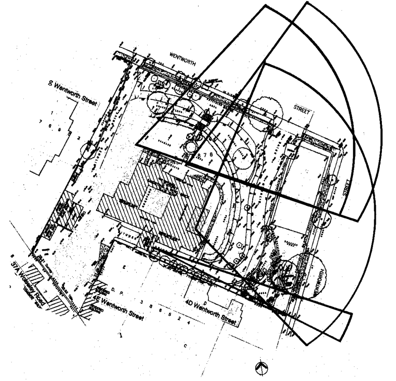
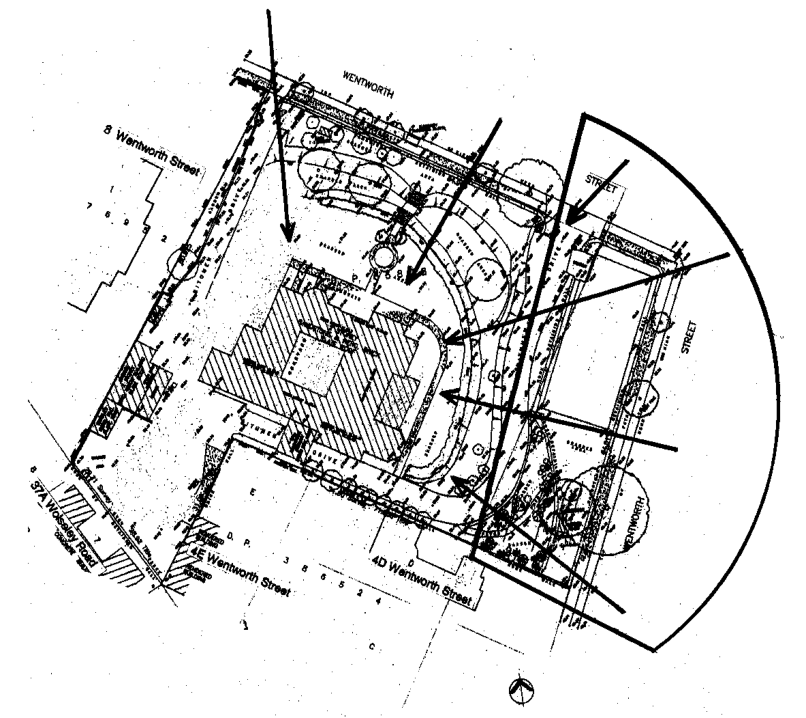
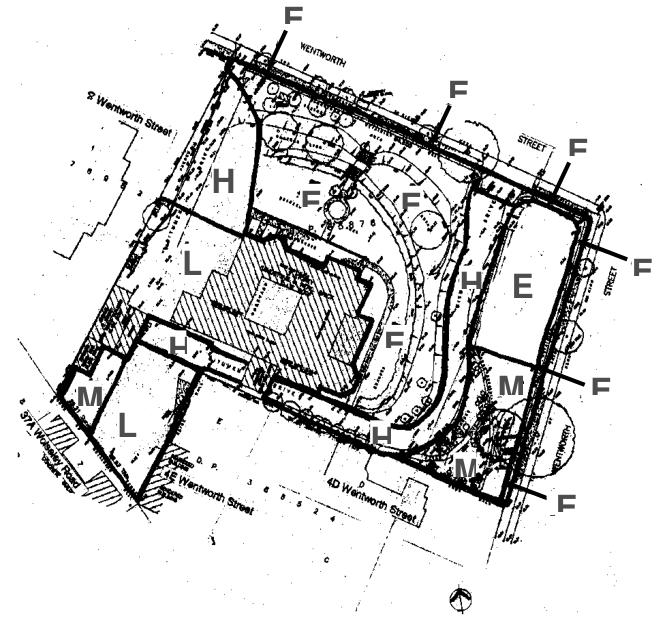
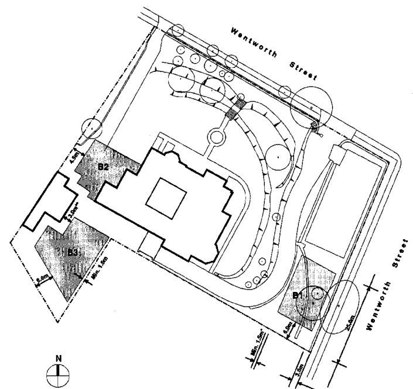
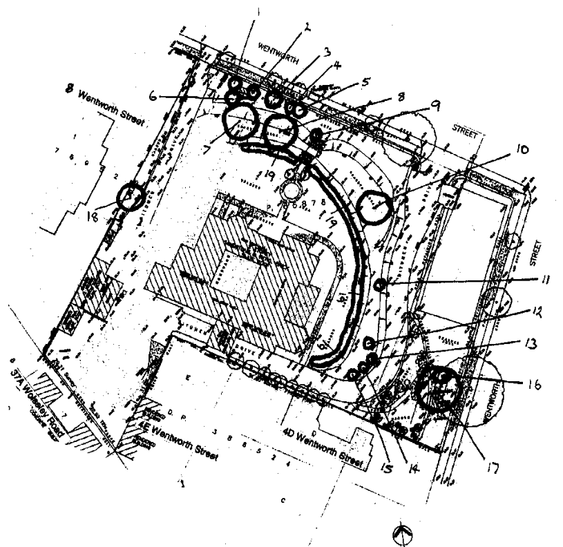
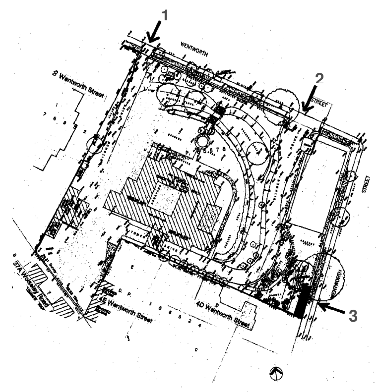

#### G2.4 Design criteria

#### G2.4.1 Heritage conservation

Kilmory is a property that has exceptional local heritage significance. The significance of the property has been documented in the Conservation Management Plan for Kilmory, 6 Wentworth Street Point Piper (January 1998 - issue F) and recognised through its listing as a heritage item in Woollahra LEP 2014. The conservation of Kilmory is the most important of the principle objectives of this chapter.

#### Notes:

Clause 2.3.5 of the Conservation Management Plan for Kilmory, 6 Wentworth Street Point Piper sets out the following summary statement of significance for Kilmory:

1\. The property is of high local significance because it is one of the very few substantially intact estates in Point Piper with original Edwardian house and landscape intact on the early 1909 block subdivision and boundary which has been unaltered. It is a landmark property in Point Piper. The property has maintained significant views to Sydney Harbour, Rose Bay and Bondi. It conveys the scale, detail and set up of a large Edwardian household.

The house is an important, rare and especially large example of the Arts and Crafts Style.

The property is important because of its prominent landmark setting. The house can be seen easily from many positions around the harbour in Point Piper.

2\. Kilmory has historical associations with prominent figures in Sydney: Sir Alexander MacCormick, a distinguished surgeon and entrepreneur; and J.W.Manson a distinguished architect of the Edwardian period in Sydney.

3\. Kilmory is associated with WWII and National Defence and accommodated staff of the Eastern Command.

4\. A major institution for two orders of the Catholic Church in Australia: The Jesuit Fathers, who established the Riverview Preparatory College. The Franciscan Missionaries of Mary for their “Ave Maria” Retreat House.

Clause 2.3.4.1 of the Conservation Management Plan for Kilmory, 6 Wentworth Street Point Piper sets out an assessment of heritage values for Kilmory’s buildings, individual rooms and landscape elements.

Conservation is defined in The Burra Charter as “all the processes of looking after a place so as to retain its cultural significance.” Article 14 of The Burra Charter states:

“Conservation may, according to circumstance, include the processes of: retention or reintroduction of a use; retention of associations and meanings; maintenance, preservation, restoration, reconstruction, adaptation and interpretation; and will commonly include a combination of more than one of these.”

#### Objectives

O1 To conserve the heritage significance of Kilmory.

O2 To ensure that all development, including works and uses, does not have a detrimental impact on the heritage significance of Kilmory.

#### Controls General

C1 Land uses must respect the heritage significance of Kilmory. This may be achieved through uses that:

a) are sympathetic and consistent with the original use of Kilmory, which was a single residence;

b) involve or require minimal change to highly significant fabric and spaces;

c) do not adversely affect the heritage significance of Kilmory;

d) continue or reintroduce activities and practices that contribute to the significance of Kilmory;

e) provide options to allow long-term management and conservation of Kilmory as a whole rather than in a fragmented manner; and

f) retain the boundaries of Kilmory that define the curtilage of the house.

C2 Original building fabric and landscape features must be recorded and conserved.

C3 All conservation work must involve minimum interference to the existing fabric to minimise the loss of heritage significance.

C4 Detrimental intervention may occur only in areas of little or moderate significance and the work must be reversible.

C5 Fabric must be retained in situ unless moving it is the sole means of achieving its survival. It must be recorded to archival standards before disturbance occurs.

C6 Removed fabric of heritage significance must be kept in a secure repository on site after cataloguing and recording.

C7 Fabric must not be demolished or removed before the issue of a construction certificate.

C8 All development must comply in full with the detailed conservation policies 3.6.4 and 3.6.5 of the Conservation Management Plan for Kilmory, 6 Wentworth Street, Point Piper, January 1998 issue F, by Tanner and Associates (pages 39-41).

C9 The distinguishing and important features of Kilmory within the curtilage for the house must be conserved. This is to be achieved by complying with the controls within this chapter, particularly those for:

a) site layout and views, especially those relating to protecting primary views and prohibiting buildings in landscape spaces of exceptional and high significance;

b) building design;

c) open space and landscaping;

d) fences and walls;

e) car parking and driveways;

f) site facilities; and

g) subdivision, maintenance and management.

#### House

C10 Exceptional and highly significant fabric and spaces identified by the conservation management plan, are not to be damaged, destroyed or altered. Some change to areas of little or moderate significance may be permissible in order to accommodate any appropriate future use.

C11 Reticulation of services must be carefully planned without causing damage to fabric or significant interior spaces.

C12 New work must not detract from the heritage significance of the house and it must be reversible as far as practicable.

Note:  The significance of individual rooms and elements in the house is identified in clause 2.3.4.1 of the Conservation Management Plan for Kilmory, 6 Wentworth Street, Point Piper.

> [Picture text on page 15 is stored in the PDF without readable letters (no character map), so it could not be copied; see the original PDF.]

#### Heritage conservation incentives

Woollahra LEP 2014 provides for heritage conservation incentives for listed heritage items. The incentives may relate to the use of buildings and land (beyond those permissible under the land use zone), building works, floor space ratios and the provision of car parking.

The incentive provisions are subject to the Council being satisfied that certain outcomes will be achieved by the proposed development (see below).

In forming a view about a proposal’s impact on heritage significance and the amenity of the neighbouring area the Council will take into consideration matters including: the relevant conservation provisions of Woollahra LEP 2014; objectives and controls in this chapter; other relevant DCP controls and requirements of other plans and policies that apply to the site; and section 79C of the Environmental Planning and Assessment Act 1979.

Notes:

A statement of heritage impact prepared by a person qualified and experience in heritage conservation must accompany development applications.  Guidelines for the preparation of statements of heritage impact can be found in the document produced by the NSW Heritage Office. The heritage impact statement must, as a minimum, describe: the significance of the whole site and the individually significant spaces and elements of the house and grounds, including the landscape elements; the impact of proposed development on that significance; the measures that are proposed to mitigate the impact on significance; the alternative development options that have been identified and why those options have not been pursued in order to achieve the conservation of Kilmory; and how the proposed development will achieve the conservation of Kilmory. The Council will not grant consent to a development application relating to the land unless it has considered a statement of heritage impact. When a proposal seeks to use heritage incentives, the applicant must include within the statement of heritage impact: evidence to demonstrate that all alternative options employing land uses permissible under the current zone for the site have been identified and examined; and the reasons why those options have been discarded in favour of the proposed use.

#### G2.4.2 Site layout and views

Site layout refers to the arrangement of buildings, spaces and access over the site. Site layout influences matters including views to and from the site, retention and protection of vegetation and open space, retention of significant site elements and impact on adjoining properties.

There are significant views to the house and grounds along Wentworth Street and from other areas.

#### Objectives

O1 To achieve a site layout that considers and respects the existing landscape character and heritage significance of the site.

O2 To protect primary views to and from the site.

O3 To provide a high level of amenity for future occupants of the site.

O4 To maintain the amenity of neighbouring properties.

O5 To protect primary views of the site’s significant landscape elements and spaces as seen from within the site, from Wentworth Street and from other areas.

#### Controls General

C1 The site layout must:

a) Retain and where possible enhance the important features of the site, including primary views (Figures 2 and 3), significant trees and vegetation (Figure 6), and landscape areas and elements of exceptional and high significance (Figure 4).

b) Relate building and landscape design to the site’s contours and not involve: large areas of excavation or landfill; or new buildings, structures and landscape elements that block primary views.

C2 New development, including planting, must not have a detrimental impact on the landmark qualities of Kilmory by blocking primary views of the house and significant landscape elements such as the sandstone terraces.

C3 New buildings must not be located in the landscape areas of exceptional and high significance (Figure 4).

C4 The building size and location controls in in Part B of this DCP, Chapter B3 General Development Controls apply to residential development on Kilmory excluding front setback, rear setback and building footprint requirements.

C5 Building footprints and setbacks:

a) New development in the south-western corner, the south-eastern corner and adjoining the western elevation of the existing house must take place within the maximum building footprints and setbacks shown on Figure 5.

b) All extensions to the existing house’s western elevation must be setback from the principal external face of the existing building’s northern elevation to allow views from Wentworth Street of the north-western corner of the existing building, particularly the gable end and archway.

Note: The principal external face of the northern elevation does not include the existing bay and gable projections.

C6 Views to and from the house and from the northern garden area bounded by the Olea europea (Olive) hedge must be retained. In particular the views of the house and significant landscape elements and spaces from Wentworth Street must be retained.

#### FIGURE 2

Primary views from Kilmory

> [Picture on page 17: a picture, saved as a picture (images/chapter-g2-kilmory-6-wentworth-street-point-piper-page-17-16.gif, 150 dpi).]

Note: Views are taken from upper garden area and from eastern ground floor verandah. Views take into consideration reduction of Olive hedge to a height of 1-1.2m.

#### FIGURE 3

Primary views to Kilmory from Wentworth Street. Views over Kilmory from 4D Wentworth Street

> [Picture on page 18: a picture, saved as a picture (images/chapter-g2-kilmory-6-wentworth-street-point-piper-page-18-3.gif, 150 dpi).]

#### FIGURE 4

Landscape areas and elements of significance

> [Picture on page 19: a picture, saved as a picture (images/chapter-g2-kilmory-6-wentworth-street-point-piper-page-19-3.gif, 150 dpi).]

### E

### E

### E

### E

### E

### E

### H

### E E

### L

### E

### H E E

### H

### M E

### M

### L

### H

### M

### E

### E

### E

| Code | Significance value | Area and element |
|---|---|---|
| E Exceptional Eastern and northern sandstone boundary walls on Wentworth Street |  |  |
| E Exceptional Main sandstone gate posts and iron gates on Wentworth Street |  |  |
| E Exceptional Garden and landscape elements on northern and eastern side of house, including terracing, paths and sandstone steps (see Figure 6 for significant trees and vegetation) |  |  |
| E Exceptional Former tennis court area in north-eastern corner |  |  |
| H High Main driveway from Wentworth Street, including kerbs and gutters |  |  |
| H High Vacant area, former site of accommodation wing, north-western corner. A high significance value applies due to: the unbuilt nature of the area, which allows views to the house from Wentworth Street, and views from the house and adjoining garden area; the proximity to the garden area which is of exceptional value; and the potential to reinstate part of garden and terrace area. |  |  |
| M Moderate Garden in south-eastern corner of site (see Figure 6 for significant trees) |  |  |
| M Moderate Vacant area, former drying yard, in south-western corner |  |  |
| L Little Vacant area, former site of 4 storey building, in southern part of site |  |  |
| L Little Vacant area, former site of accommodation wing, adjoining western side of house and south of the house’s northern building line (see Figure 6 for significant trees) |  |  |

Sources:   Tanner and Associates Pty Ltd. Issue F/January 1998. Conservation Management Plan for Kilmory, 6 Wentworth Street Point Piper and Woollahra Council assessment

#### FIGURE 5

Building footprints and setbacks

> [Picture on page 20: a picture, saved as a picture (images/chapter-g2-kilmory-6-wentworth-street-point-piper-page-20-3.gif, 150 dpi).]

| Setbacks | (metres) (min) |
|---|---|
| B1 1.5 from base of driveway retaining wall 6 from southern boundary 3 from eastern boundary |  |
| B2 4.5 from western boundary 3 from existing stables and garages |  |
| B3 1.5 from boundary adjoining No. 4E Wentworth Street 6 from boundary adjoining No. 37A Wolseley Road 3 from existing stables and garage |  |
| Footprints | (m²) (max) |
| B1 110 |  |
| B2 140 |  |
| B3 230 |  |

Notes:

1\. Setback and footprint of building B1 is only achievable subject to relocation of Kentia Palm and removal of Cheese Tree, pending consideration by Council of arborist's report.

2\. Maximum building footprint areas must be located within the area shown shaded for each building.

#### G2.4.3 Building design

To maintain the heritage significance of Kilmory careful consideration must be given to the design of new work to the house and to all new buildings on the site. Good design is also essential for providing sustainable living environments and a high amenity for residents and other users of properties.

The form, scale and height of development and the type of materials and finishes are fundamental design elements. These elements set the character of buildings and influence the way in which new buildings respond to their natural and built context.

#### Objectives

O1 To ensure that new development respects the form, scale, height and character of the existing house on Kilmory and does not detrimentally affect the significant elements on the site.

O2 To encourage high quality contemporary design that is compatible with the heritage significance of Kilmory and the important character elements of the neighbourhood.

O3 To retain principle views to and from the existing house and its significant landscape elements and spaces, especially from Wentworth Street.

O4 To minimise excavation and landfill.

O5 To provide a high level of amenity for future occupants.

#### Controls General

C1 Building height:

a) The maximum height of new development must not exceed the height controls under Woollahra LEP 2014. The maximum height will not be achievable where: proposed buildings would impact on primary views to and from the existing house; the scale of proposed buildings would, individually or collectively, compete with the scale of the existing house; proposed buildings would not satisfy the objectives of the height standard; and in addition, new development labelled B1, B2 and B3 on Figure 5 must not exceed 2 storeys in height.

C2 The scale of new development, including additions to the house and works in the grounds, must be substantially subservient to the scale of the existing house.

C3 New building work, including additions to the house and works in the grounds, must incorporate design elements that complement, but do not mimic the architectural character of the existing house, through:

a) compatible, but distinctly lesser massing, scale and height;

b) similar roof forms (when visible);

c) similar proportions and solid-to-void ratios of openings for windows and doors; and

d) compatible materials, finishes and colours.

C4 The large expanses of walls on new buildings must be broken by articulation, modelling, window openings and similar features.

C5 In order to maintain the visual dominance and character of the existing house, new buildings must display less articulation and diversity than found in the existing house.

C6 Acceptable materials, finishes and colours include:

a) rendered masonry for walls;

b) traditional roof finishes such as lead, zinc, sheet copper or slate or its modern equivalent; and

c) restrained colour schemes that are sympathetic to the external colours of the existing house.

C7 Mirrored or other highly reflective materials (with a reflectivity of 15%) must not be used on building exteriors.

C8 Buildings must have a good thermal mass by using materials such as concrete slab floors, cavity brick, concrete block and stone walls.

#### House

C10 The visual prominence and symbolic significance of the house within its setting must be retained, especially in the context of Wentworth Street.

C11 The appearance of the house as a single, two storey residence with intact roof planes to the north and east must be retained.

C12 The existing northern and eastern roof planes, including those over bay projections and gables, must not be altered by dormers, skylights, vents, aerials or by similar or other elements whether projecting, recessed or flush with the roof planes.

Notes:

When major development is proposed to the existing house or within the grounds, or both, the applicant must submit a design statement with the development application. In the design statement the applicant must demonstrate that the proposed design through the design idiom, scale, massing, materials, detailing and construction techniques appropriately responds to the heritage significance of Kilmory and the neighbourhood’s desired future character. With any development involving new structures and landscaping works within the grounds of Kilmory, the applicant must provide view line diagrams to illustrate the impact on the views and vistas to and from: the house; and the significant landscape elements and spaces of the site.

#### G2.4.4 Open space and landscaping

Kilmory contains numerous landscape elements that are of individual significance and that contribute to the site’s overall significance. These include the sandstone entrance wall, sandstone posts and iron gates on Wentworth Street, the driveway, and the garden area on the northern side of the house.

High quality landscape design is important for a number of reasons. It will integrate the significant landscape elements and the house with new development and new landscape features. It will also contribute to the amenity of the area and the streetscape.

#### Objectives

O1 To allow conservation and interpretation of the significant landscape elements.

O2 To retain significant trees, vegetation and other landscape elements.

O3 To provide an adequate amount of usable open space.

O4 To ensure that an integrated landscape concept for the site is employed.

O5 To ensure that new landscape features do not reduce views to and from the site.

O6 To facilitate and improve stormwater management.

O7 To enhance the appearance, amenity and energy efficiency of housing through integrated landscape design.

#### Controls

C1 Landscape design must demonstrate through the use of plant species, hard landscape elements and materials that an appropriate response to the heritage significance of Kilmory’s garden and landscape has been achieved.

C2 Sandstone boundary walls, terraces, sandstone retaining walls, gate posts and iron gates, and sandstone kerbs and gutters must be retained and conserved.

C3 Existing pathways and sandstone steps must be retained.

C4 Significant trees and vegetation must be retained (Figure 6). Note: Council consent is required for any tree works affecting trees or other vegetation that are prescribed under the Woollahra DCP.

C5 The existing Olea europea (Olive) hedge must be retained and pruned to a height that allows views in a northern and eastern direction from the upper garden level.

C6 New pedestrian accessways are to be designed with regard to:

a) minimising the impact on significant spaces and landscape elements;

b) protecting significant trees and vegetation;

c) enhancing the landscape setting and character of Kilmory;

d) meeting access requirements for older people and people with a disability; and

e) providing privacy and security for new and existing development and neighbouring properties.

C7 The open space and landscaping controls in Part B of this DCP, Chapter B3 General Development Controls Section 3.7.1 (Landscape areas and private open space) apply to development for the purpose of residential development on Kilmory with the exception of C5 and C12.

C8 In the case of residential development other than a dwelling house, each dwelling must have private open space with:

a) at least two hours of sunlight per day in mid-winter;

b) a minimum area of 25m² for dwellings of 2 or more bedrooms;

c) a minimum dimension of 2m; and

d) direct access from a living area of the dwelling.

C9 Private open spaces must be located so that they provide surveillance and privacy in cases where they adjoin communal open spaces.

C10 Methods of delineating private and communal open space must involve landscape features such as hedges, planting beds and changes in level. Fencing within the site is not acceptable, except for safety reasons such as pool fences, or for a tennis court.

C11 A lightweight retractable net must be provided around the tennis court.

C12 Tennis court lighting is not allowed.

#### House

C13 New planting and landscape elements must not reduce views to and from the house, especially from the Wentworth Street context.

Notes:

When major development is proposed for the grounds of Kilmory a detailed landscape plan must be provided with the development application and must be approved by the Council. A landscape plan, prepared by a landscape consultant qualified and experienced in historic gardens, must accompany the development application and include: a description and plan of the significant landscape zones and elements; an arborist’s report on the condition of all significant trees and vegetation and all trees proposed for removal;

a plan for the restoration and reconstruction of significant landscape zones and elements which is consistent with the heritage significance and character of Kilmory’s garden; plant species to be retained and removed; details of new work including: location of proposed lighting watering and irrigation systems drainage and stormwater management new plants, paths and stairs location of private open space facilities location of communal open space and facilities (where multiple occupancy is proposed) methods of delineating private and communal open space and facilities; and other relevant matters identified by the Council’s officers during pre-DA discussions.

#### FIGURE 6

Significant trees and vegetation

> [Picture on page 26: a picture, saved as a picture (images/chapter-g2-kilmory-6-wentworth-street-point-piper-page-26-3.gif, 150 dpi).]

| No. Botanical name Common name No. Botanical name Common name |  |
|---|---|
| 1 Camellia sp. Camellia* | 11 Cupressus spp Cypress Pine |
| 2 Camellia sp. Camellia* | 12 Camellia sp. Camellia |
| 3 Camellia sp. Camellia* | 13 Cupressus spp Cypress Pine |
| 4 Camellia sp. Camellia* | 14 Cupressus spp Cypress Pine |
| 5 Plumeria acutifolia Frangipanni | 15 Cupressus spp Cypress Pine |
| 6 Archontophoenix alexandrae Alexander Palm* | 16 Howea forsteriana Kentia Palm* |
| 7 Araucaria heterophylla Norfolk Island Pine | 17 Glochidion ferdinandii Cheese Tree |
| 8 Ficus rubiginosa Port Jackson Fig | 18 Gordonia axillaris Gordonia |
| 9 Camellia sp. Camellia* | 19 Olea europea Olive |
| 10 Cinnamomum camphora Camphor Laurel |  |

\* Denotes may be transplanted within the site

Source: Woollahra Council assessment

#### G2.4.5 Fences and walls

Kilmory’s northern and eastern sandstone boundary walls are significant heritage elements and also make significant contributions to the streetscape of Wentworth Street.

The walls provide security for the property and at their existing height do not interrupt primary views to the house and its landscape setting.

#### Objectives

O1 To conserve the significant sandstone boundary walls on Wentworth Street.

O2 To retain primary views to the house and its landscape setting from Wentworth Street.

O3 To retain the significant contribution made by the existing northern and eastern sandstone boundary walls to the streetscape of Wentworth Street.

O4 To ensure that new fencing on the southern and western boundaries is compatible with the heritage significance of Kilmory.

O5 To ensure that new fencing on the southern and western boundaries provides adequate privacy and security for Kilmory and for adjoining properties.

#### Controls

C1 Sandstone boundary walls on Wentworth Street must be retained and conserved.

C2 The height of the sandstone boundary walls on Wentworth Street must not be increased.

C3 New fencing on the southern and western boundaries must not exceed 1.8m in height where the site is level with the adjoining site, or 1.8m measured from the low side where there is a difference in level either side of the boundary.

C4 Fencing within the site is not permitted, except for pool fencing or fencing for a tennis court.

C5 Methods of delineating private and communal open space must involve landscape features such as hedges, planting beds and changes in level.

C6 Tennis court fencing associated with a court in the north-eastern corner of the site is to be designed and constructed so that it can be lowered below the existing height of the Wentworth Street boundary wall.

C7 No openings are allowed in the existing sandstone boundary walls on Wentworth Street except for a new garage opening in the south-western corner (Figure 7) and a single pedestrian gate on the northern boundary wall, if required.

C8 The fences and walls controls in Part B of this DCP, Chapter B3 General Development Controls Section 3.7.2 (Fences) do not apply to residential development on Kilmory with the exception of C7 and C15.

#### G2.4.6 Acoustic and visual privacy

Visual and acoustic privacy are important factors in the amenity of a place, particularly for residential uses. Kilmory is located in a dense residential area and is adjoined on two sides by residential development of mixed intensity. Acoustic and visual privacy needs of both future residents of Kilmory and neighbouring development will require sensitive and careful design.

#### Objectives

O1 To protect the acoustic and visual privacy of neighbouring development.

O2 To provide adequate acoustic and visual privacy for future residents of Kilmory.

#### Controls

C1 The acoustic and visual privacy controls in Part B of this DCP, Chapter B3 General Development Controls Section 3.5.4 (Acoustic and visual privacy) apply to residential development on Kilmory.

C2 Trees and other vegetation can be used on the southern and western boundaries to provide acoustic and visual privacy.

C3 Existing vegetation on the southern and western boundaries must be retained and supplemented if necessary.

#### G2.4.7 Access and mobility

Access and mobility provisions are necessary so that development is accessible and able to be used by all members of the community.

The provisions are principally directed towards eliminating barriers to people with a disability and older people and are intended to complement the access controls in this DCP (refer to Part E Chapter E8 Adaptable Housing) .

Because of the heritage significance of the site, access provisions require special consideration at the design stage.

#### Objectives

O1 To ensure that new buildings, associated spaces and any communal areas are accessible, usable or adaptable for all people in the community, including people with a disability and older people.

#### Controls

C1 The access and mobility controls in Part E of this DCP, General Controls for All Development, apply to development for the purpose of dwelling houses and multiple dwellings on Kilmory.

#### G2.4.8 Car parking and driveways

Provision of on-site parking and driveways for Kilmory needs to be carefully planned and introduced so that there are minimal impacts on the heritage significance of the house and landscape elements and minimal disturbances to the existing landform. For these reasons special parking requirements are provided for Kilmory. These requirements are different to those normally required for dwelling-houses and residential flat buildings.

#### Objectives

O1 To maintain the heritage significance of Kilmory.

O2 To ensure that on-site parking and driveways do not dominate the landscape setting of Kilmory.

O3 To maintain the amenity of adjoining properties.

O4 To minimise the impact of car parking facilities and driveways on the streetscape of Wentworth Street.

O5 To provide convenient and safe car parking and access for residents and visitors.

O6 To limit site excavation and changes to the landform of Kilmory.

O7 To minimise stormwater runoff.

#### Controls

C1 The car parking and driveway controls in Part B of this DCP General Development Controls, Chapter B3 Section 3.6 (On-site parking) and Chapter E8 (Parking and Access) apply to development for the purpose of dwelling houses and multiple dwellings on Kilmory  except where inconsistent with the controls in this chapter.

C2 Proposals for new dwellings on the grounds of Kilmory, or for the creation of separate dwellings in the existing house, or both, must provide on-site parking to meet the requirements outlined in the following table.

| Dwelling size | Maximum number of spaces per dwelling |
|---|---|
| 1 bedroom 1 |  |
| 2 bedrooms 1.5 |  |
| 3 or more bedrooms 2 |  |
| Visitors 0.25 |  |

Note: Spaces are to be rounded to the nearest whole number.

C3 Where Kilmory is used for the purpose of a dwelling-house, two on-site parking spaces must be provided.

C4 For uses other than those stated in C2 and C3 or where variations to the rates set out in the table to C2 are sought, the Council will consider parking provision on its merit and in light of matters including:

a) the impact on the heritage significance of Kilmory;

b) the impact on the streetscape of Wentworth Street;

c) the extent of any excavation and the impact on the landform of Kilmory and the provision of deep soil landscaping; and

d) the effect on the bulk, scale and form of new development.

C5 The area of site excavation for the purposes of underground car parking is to be substantially limited to the building footprint of new buildings for which parking is required. In order to protect the significance of the existing house, excavation for the purpose of car parking underneath the footprint of the existing house should not occur.

C6 Car parking and driveways must be designed and located to:

a) conserve the heritage significance of Kilmory;

b) maintain views to and from the house;

c) maintain significant trees and vegetation;

d) provide convenient and safe access to all buildings;

e) prevent traffic conflicts;

f) minimise excavation and changes to the landform of Kilmory;

g) integrate physically and visually with the landform and built elements;

h) enable the efficient use of car spaces and accessways, including safe manoeuvrability for vehicles between the site and Wentworth Street;

i) allow vehicles to enter and leave the site in a forward direction;

j) minimise impacts on adjoining properties in regard to matters including noise and vehicle headlights; and

k) minimise the visual dominance of parking areas, structures and accessways.

C7 Open car parking spaces must be designed, surfaced and graded to facilitate on-site stormwater management set out in a stormwater and soil management plan for Kilmory.

C8 Resident parking must be concealed.

C9 Vehicle entry and exit points are restricted to:

a) the existing points on the northern boundary of the site; and

b) a new point in the south-eastern corner of the site, if required (see Figure 7).

C10 The sandstone gate posts, gates, and associated sandstone walls in the north-eastern corner of the site must be retained and conserved in their existing location, form and configuration.

C11 The existing driveway must be retained and resurfaced with an appropriate pervious surface.

C12 Adequate parking and manoeuvrability must be provided for service vehicles.

#### FIGURE 7

Vehicle entry and exit points

1\. Existing secondary

2\. Existing main

3\. Possible future secondary

> [Picture on page 32: a picture, saved as a picture (images/chapter-g2-kilmory-6-wentworth-street-point-piper-page-32-6.gif, 150 dpi).]

### 1

### E

### E 2

### 3

#### G2.4.9 Site facilities

Residential development requires site facilities such as mail boxes, garbage collection areas and clothes drying areas. Careful consideration to the location and treatment of these facilities can improve the amenity of occupants and mitigate potential adverse visual and odour impacts on adjoining properties.

The impacts of site facilities on the appearance of the existing house, its grounds and the streetscape need to be considered.

#### Objectives

O1 The objectives for site facilities in Part B General Residential apply to residential development on Kilmory.

#### Controls

C1 The controls for site facilities in Part B of this DCP, Chapter B3 General Development Controls, Section 3.7.3 (Site facilities) apply to residential development on Kilmory.

C2 All site facilities must be designed so that they can be used by people with a disability and older people.

C3 Satellite dishes must not be visible from the street.

#### G2.4.10 Stormwater management

Stormwater management is particularly important and necessary for heritage properties due to the potential damage that can be caused to significant fabric and spaces by water penetration, flooding and erosion. The elevated topography and terraced landform of Kilmory also create particular issues for water run-off.

Because of Kilmory’s proximity to Sydney Harbour, stormwater management is essential to ensure that water quality of the harbour is not affected.

#### Objectives

O1 To protect the fabric of the house and the significant landscape elements of Kilmory.

O2 To minimise changes to the hydrological characteristics of Kilmory.

O3 To prevent soil erosion.

O4 To reduce pollution of Sydney Harbour from stormwater run-off.

O5 To encourage water conservation and reuse.

O6 To ensure that the historic drainage channels on the site operate effectively and are integrated with new stormwater management facilities.

O7 To control the quantity and quality of stormwater run-off.

O8 To minimise stormwater run-off impacts on adjoining and neighbouring lands.

O9 To reduce the pressure of new development on domestic water supplies.

O10 To ensure that building and landscape design incorporate techniques for conserving mains water.

#### Controls

C1 The stormwater management controls in Part E of this DCP, Chapter E2 Stormwater and Flood Risk Management apply to residential development on Kilmory.

C2 Development should involve minimal site clearing and earthworks.

C3 Drainage and detention systems must be designed to cater for a 100 year Average Recurrence Interval storm event.

C4 New drainage systems must be designed to:

a) incorporate the effective historic drainage channels of Kilmory;

b) store water for irrigation of landscaped areas;

c) reduce overall mains water usage on the site;

d) control the quality of drainage discharge to Council’s drainage system;

e) ensure that existing systems are not adversely affected;

f) fit in with the hydrology of the natural system as much as possible;

g) retain significant trees and vegetation; and

h) allow for maximum on-site infiltration but subject to: underlying geological conditions the stability of the site the impact of infiltration on the fabric of the house and significant landscape elements the impact of infiltration on adjoining properties.

Notes: Where major development is proposed for the house or the grounds, or both, a stormwater and soil management plan must be lodged with the development application and approved by the Council in conjunction with a consent for the application. The plan must demonstrate how run-off, sedimentation, erosion and groundwater flow is to be managed on the site. Where excavation to a depth of more than 2m is proposed, a geotechnical and hydrogeological report must be provided with the development application.

#### G2.4.11 Safety and surveillance

Safety and surveillance provisions can maximise personal security, reduce anxiety and maintain general safety and well-being within the local environment.

#### Objectives

O1 To ensure a safe environment by promoting crime prevention by design.

O2 To ensure personal and property safety and surveillance for residents and visitors.

#### Controls

C1 Where new dwellings are proposed in the grounds:

a) windows or balconies are to be provided in external walls to habitable rooms adjacent to open spaces; and

b) individual dwellings must be designed to minimise access between roofs, balconies, windows and adjoining dwellings.

C2 Shared and private dwelling entries must be well lit, visible and readily identifiable by visitors and emergency personnel.

C3 Site planning must clearly define communal and private open space areas through distinct landscape features. Fencing is not to be used for this purpose other than on the extreme boundaries of the site.

C4 Pedestrian accessways must be identified as safe routes through:

a) appropriate lighting;

b) casual surveillance from dwellings;

c) minimised opportunities for concealment;

d) landscaping that allows long-distant sight lines between buildings and the street; and

e) avoidance of blind corners.

C5 Lighting must be provided to pedestrian accessways, dwelling entries, driveways and car parks to ensure a high level of safety and security at night. Such lighting may need to be shielded or hooded to minimise nuisance to neighbouring properties.

#### G2.4.12 Subdivision, maintenance and management

The maintenance and management of Kilmory in a consistent manner is critical to its conservation. Issues of land subdivision and land tenure are extremely influential in management practices and outcomes. The current land boundaries of Kilmory define the estate. These boundaries have remained intact since 1909 and are highly significant elements of Kilmory.

Under the NSW land title system there are numerous options that can be used for Kilmory depending on the nature of development.

#### Objectives

O1 To prevent fragmentation of Kilmory into disparate allotments.

O2 To ensure that the site remains under a single management structure.

O3 To ensure that responsibility for management and maintenance of Kilmory is shared fairly and reasonably where the site is under multiple ownership.

O4 To ensure that a consistent standard or estate management occurs.

#### Controls

C1 The boundaries of Kilmory as defined by Lot 1, Deposited Plan 65878 should not be altered.

C2 Subdivision of the land is not preferred.

C3 The property should remain under single title.

C4 In the case where subdivision is proposed:

a) a community title scheme would be suitable for a multiple ownership option and

b) delineation of boundaries by fencing is not acceptable. Allotment boundaries can be delineated by landscape features such as hedges, planting beds and changes in level. Fencing within the site is not acceptable, except for safety reasons such as pool fences and for a tennis court.

Notes:

The Council must not grant consent to an application for subdivision unless it is satisfied that adequate arrangements are in place or will be put into place for: the funding and implementation of conservation works; and the provision of ongoing maintenance, to ensure the ongoing conservation of Kilmory.

Where subdivision is proposed, a management plan, such as one provided under the Community Titles Act, must be submitted with the application for subdivision and approved by the Council.   The plan must address matters including: ongoing care and maintenance of common areas and facilities, including communal open space areas;

conservation management of the house and other significant elements of the estate; funding arrangements for conservation of the house and grounds; and insurances.

When major development or a new land use, or both, are proposed, a decision making procedure must be submitted with the application and approved by the Council. Professionals with appropriate levels of conservation skills and experience must be engaged to provide advice in the decision-making process.  The procedure must be approved by Council prior to commencement of any work. Appropriate direction and supervision by suitably qualified and experienced professionals must be maintained at all stages of works. Records must be kept of findings and decisions.  Copies of all catalogued fabric, reports and records must be placed in a permanent archive such as the Woollahra Local History Library and made publicly available.

#### G2.4.13 Construction and site management

Because of the heritage significance of Kilmory, adequate consideration is required at the design stage of the manner in which construction is staged and the way in which construction vehicles, machinery and facilities enter, move around and leave the site.

#### Objectives

O1 To minimise the adverse impact of the movement of construction vehicles, machinery and facilities on the heritage significance of Kilmory and the amenity of the neighbourhood.

O2 To ensure that construction vehicles access into and from Kilmory is safe and does not create vehicle and pedestrian conflict.

#### Controls

C1 When a major development is proposed for Kilmory a construction management plan must be submitted with the development application and approved by Council.

Note:  A construction management plan for major development must include the following information: proposed movement of construction vehicles, equipment and facilities to, from and within Kilmory; phases of construction; types of vehicles, equipment and facilities to be used throughout the construction; periods and times during the construction when movement to and from Kilmory will occur; steps that are to be taken to mitigate adverse impact on the heritage significance of Kilmory, the amenity of neighbouring properties and on-street parking; and location of materials and machinery stores on Kilmory.
