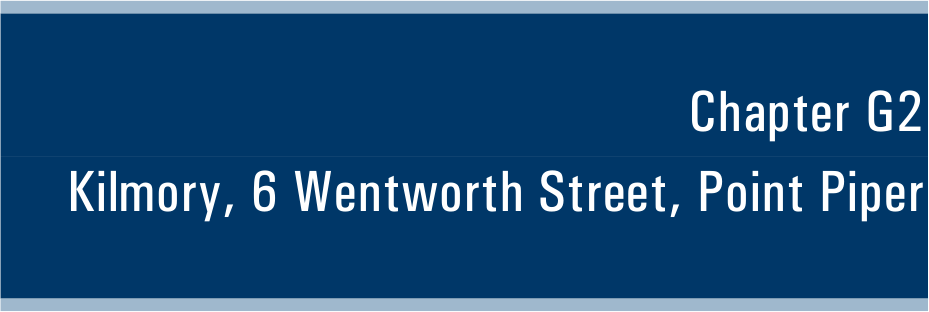

# Woollahra Development Control Plan 2015 - Chapter G2 Kilmory, 6 Wentworth Street, Point Piper

> This chapter is split into 5 section file(s), one per numbered heading, in the order they appear in the PDF.

Source PDF: [chapter_g2_kilmory.pdf](chapter_g2_kilmory.pdf)

> [Picture on page 1: a picture, saved as a picture (images/chapter-g2-kilmory-6-wentworth-street-point-piper-page-1-1.gif, 150 dpi).]

### Chapter G2

### Kilmory, 6 Wentworth Street, Point Piper

### Part G  Site-Specific Controls

### CHAPTER G2 APPROVED ON 27 APRIL 2015 AND COMMENCED ON 23 MAY 2015

Chapter G2  Kilmory,

<!-- sections -->
## Sections

1. [6 Wentworth Street, Point Piper](01-6-wentworth-street-point-piper.md)
2. [G2.1 Introduction](02-g2-1-introduction.md)
3. [G2.2 Character statement](03-g2-2-character-statement.md)
4. [G2.3 Planning and conservation principles](04-g2-3-planning-and-conservation-principles.md)
5. [G2.4 Design criteria](05-g2-4-design-criteria.md)
