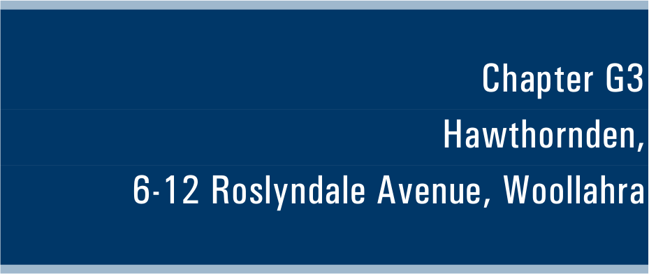
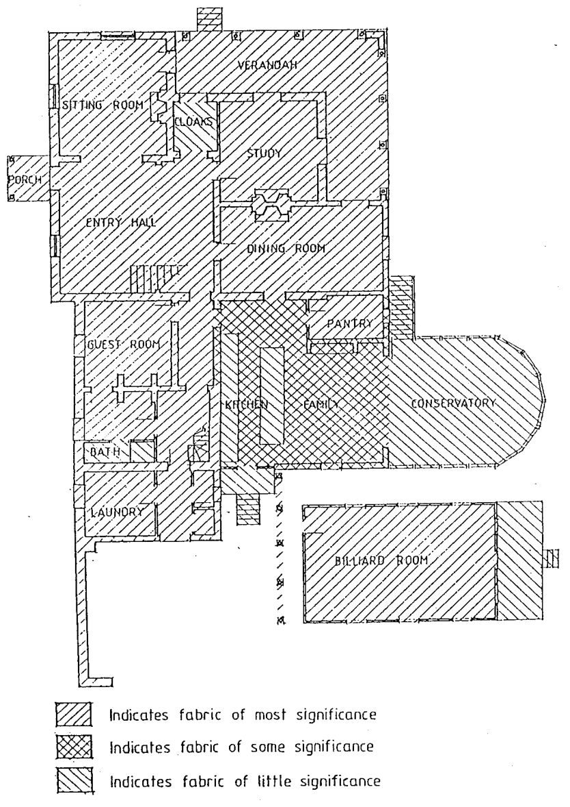
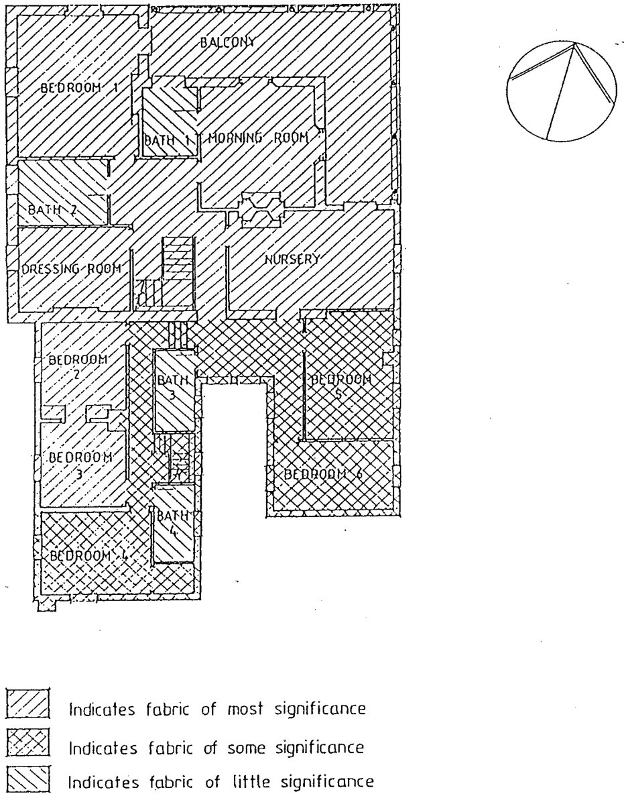
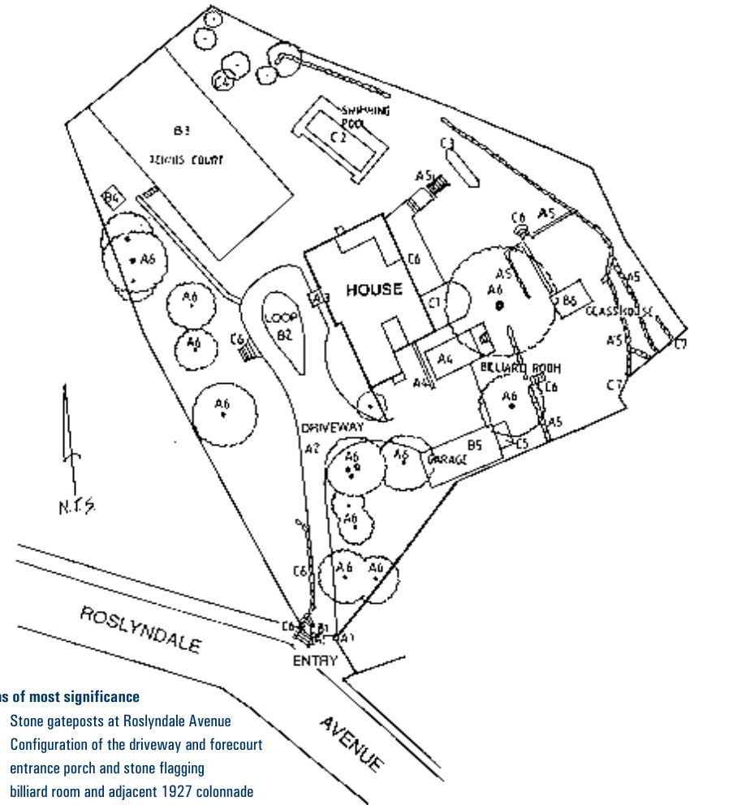
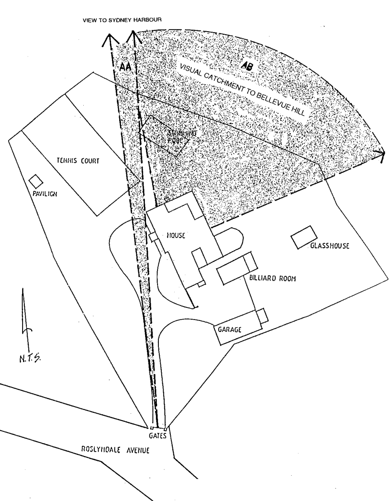
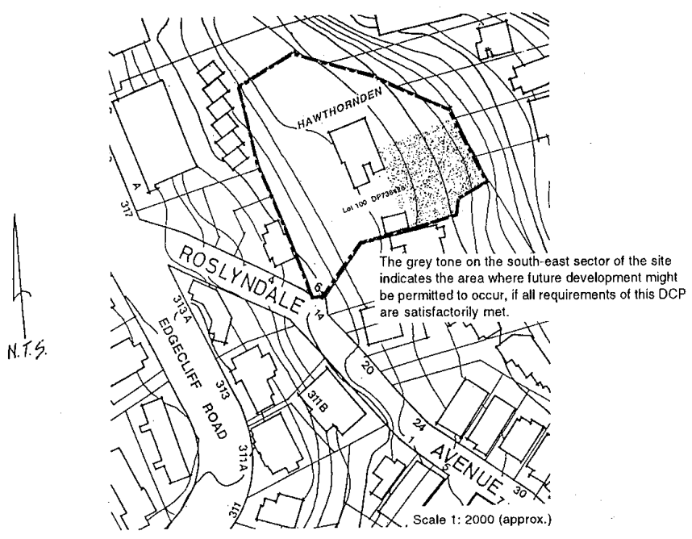

# Woollahra Development Control Plan 2015 - Chapter G3 Hawthornden, 6-12 Roslyndale Avenue, Woollahra

> This chapter is split into 15 section file(s), one per numbered heading, in the order they appear in the PDF.

Source PDF: [chapter_g3_hawthornden.pdf](https://planfortomorrow.sharepoint.com/sites/Planfortomorrow/Shared%20Documents/00%20NSW-Planning-Resources/dcp/woollahra-development-control-plan-2015/chapter-g3-hawthornden-6-12-roslyndale-avenue-woollahra/chapter_g3_hawthornden.pdf)

> [Picture on page 1: a picture, saved as a picture (images/chapter-g3-hawthornden-6-12-roslyndale-avenue-woollahra-page-1-1.gif, 150 dpi).]

Chapter G3 Hawthornden,

### 6-12 Roslyndale Avenue, Woollahra

### Part G  Site-Specific Controls

### CHAPTER G3 APPROVED ON 27 APRIL 2015 AND COMMENCED ON 23 MAY 2015

Chapter G3  Hawthornden,

### 6-12 Roslyndale Avenue, Woollahra

### Contents

G3.1 INTRODUCTION ........................................................................................ 1 G3.1.1 Land where this chapter applies ........................................................... 1 G3.1.2 Development to which this chapter applies .............................................. 1 G3.1.3 Objectives ...................................................................................... 1 G3.1.4 Relationship to other parts of the DCP ................................................... 2 G3.1.5 Relationship to other plans and documents .............................................. 2 G3.1.6 Decision-making criteria ..................................................................... 2 G3.1.7 Conservation outcomes ...................................................................... 3

G3.2 THE CULTURAL SIGNIFICANCE OF THE SITE ..................................................... 4 G3.2.1 Statement of significance ................................................................... 4 G3.2.2 Rankings of significance ..................................................................... 5

G3.3 THE CURTILAGE FOR THE SITE ................................................................... 10

G3.4 CONSERVATION POLICY FOR THE SITE.......................................................... 11 G3.4.1 The conservation policy: general principles ............................................ 11 G3.4.2 The existing house ........................................................................... 12 G3.4.3 Other site elements ......................................................................... 12 G3.4.4 Implementation of the conservation policy ............................................. 13

G3.5 SPECIFIC DEVELOPMENT CONTROLS ............................................................ 14 G3.5.1 Subdivision .................................................................................... 14 G3.5.2 The dwelling .................................................................................. 14 G3.5.3 Heights ......................................................................................... 15 G3.5.4 External materials, colours and finishes ................................................. 16 G3.5.5 Garden elements, landscaping and management of significant vegetation ....... 16 G3.5.6 Protection of viewsheds .................................................................... 17 G3.5.7 Future development in the grounds ...................................................... 18 G3.5.8 Pedestrian and vehicular access and parking ........................................... 19 G3.5.9 Conservation incentives relating to heritage items .................................... 19

G3.6 REQUIREMENTS FOR DEVELOPMENT APPLICATIONS AFFECTING THE SITE ............. 20 G3.6.1 Preparatory steps ............................................................................ 20 G3.6.2 Minor development .......................................................................... 20

APPENDIX 1 – CURTILAGE OF THE SITE .................................................................. 21 Background ............................................................................................. 21 History of development .............................................................................. 21 Methodology for determining a curtilage ......................................................... 22 Conclusion .............................................................................................. 25

APPENDIX 2 – CONSERVATION POLICY: CONSTRAINTS ................................................ 26 Constraints arising from the statement of significance ........................................ 26 Constraints arising from the Burra Charter ....................................................... 26 Constraints arising from the physical circumstances of the site ............................. 27

#### G3.1 Introduction

This chapter applies to the place known as Hawthornden, situated at 6-12 Roslyndale Avenue, Woollahra, which is listed on the Heritage Schedule to the Woollahra Local Environmental Plan 2014 (Woollahra LEP 2014).

Conservation is the process of retaining these significant qualities. It generally aims at preserving as much as possible of the original fabric and setting of the heritage item or place. This chapter lays down Council’s requirements for the conservation of Hawthornden and the assessment of any proposals for future development or use of the site.

Note: This chapter reflects the site specific development control plan adopted by Council on 25 November 1996, and which commenced on 4 December 1996.

#### G3.1.1 Land where this chapter applies

The land to which this chapter applies is situated at 6-12 Roslyndale Avenue, Woollahra, being Lot 100, DP738428.

The dwelling house, known as Hawthornden, the gardens, gate posts, gates, and Bunya Pine are listed as heritage items in the schedule to Woollahra LEP 2014. The house, gardens and trees are also listed as heritage items on the register of the National Trust of Australia (NSW).

#### G3.1.2 Development to which this chapter applies

This chapter applies to development requiring consent under Woollahra LEP 2014.

#### G3.1.3 Objectives

The objectives of this chapter are:

O1 To define and conserve the cultural significance and curtilage of the property known as Hawthornden at 6-12 Roslyndale Avenue, Woollahra.

O2 To encourage the preservation, restoration or reconstruction of its buildings/landscape elements (including vegetation) and setting which together contribute to its heritage significance.

O3 To specify controls to ensure that any future development within its curtilage is subservient to the principal building and is undertaken in a manner that is sympathetic to and does not detract from its overall heritage significance and the heritage significance of the adjacent heritage item at 14 Roslyndale Avenue.

#### G3.1.4 Relationship to other parts of the DCP

This chapter is to be read in conjunction with the other parts of the DCP that are relevant to the development proposal, including: Part B: Chapter B1 Residential Precincts (Woollahra) Part B: Chapter B3 General Development Controls Part E: General Controls for All Development – this part contains chapters on Parking and Access, Stormwater and Flood Risk Management, Tree Management, Contaminated Land, Waste Management, Sustainability, Signage and Adaptable Housing.

In the event of any inconsistency between this chapter and the other chapters, this chapter prevails unless otherwise specified.

#### G3.1.5 Relationship to other plans and documents

#### Conservation Study

Applicants must refer to the Conservation Study of Hawthornden, prepared by Rod Howard Heritage Conservation Pty Ltd, August 1994.

#### G3.1.6 Decision-making criteria

In making a decision on any development application with regard to Hawthornden, Council will take into account the extent to which it complies with the following criteria:

a) the provisions of this DCP, Woollahra LEP 2014 and the Conservation Study;

b) the objectives in Section 3.1.3 above;

c) the statement of significance in Section G3.2 and illustrated in Figures 1, 2 and 3;

d) the site curtilage as defined in Section G3.3 and illustrated in Figure 5;

e) the conservation policy in Section G3.4;

f) the detailed controls in Section G3.5; and

g) the conservation outcomes in Section 3.1.7 below.

#### G3.1.7 Conservation outcomes

The purpose of this chapter is to achieve the following conservation outcomes:

a) The exterior form, fabric and architectural detail of the 19th century and significant early 20th century sections of Hawthornden will be conserved. Any proposed alterations will not diminish or destroy significant original fabric on any of the facades of the building.

b) Significant spaces, fabric and detailing of the interior of the building which contribute to the overall significance of the place will be conserved. There will only be minimal and sympathetic alterations to heritage fabric or areas of most significance.

c) Generally, all future alterations or additions to the buildings will read as new work. For example, details such as skirting, window and door frames and ceiling cornices will be similar and sympathetic, but not identical.

d) The curtilage, setting and significant viewsheds from Hawthornden to the north and north-east will be preserved.

e) The grounds, including especially the mature trees, distinctive functional spaces, driveway, and stone stairways and retaining walls will be conserved.

#### G3.2 The cultural significance of the site

The first step in the conservation process is to identify and understand what is significant about the heritage item and/or place. This is in the form of a statement of significance, based on the terminology of the Burra Charter. Various items and elements of the site are then ranked in order of their heritage significance, as shown in Figures 1, 2 and 3.

#### G3.2.1 Statement of significance

The cultural significance of the site is based on the following value criteria:

#### Historical

Hawthornden has historical significance as one of the oldest 19th century mansions (1858) in the suburban area of Sydney to survive with its regional setting and approach.

The whole of the site, one of the largest remnants in this locality, is evidence of the history of subdivision and social development in Woollahra in the 19th century, including subdivision into smaller leasehold estates.

#### Social

Hawthornden has social significance through its past use as a suburban estate and its successive occupance by prominent figures of the day, including one who become Treasurer of the newly formed State of Queensland, another who later became Chief Justice and Lt. Governor of NSW, and several leading businessmen and directors.

Hawthornden provides evidence of affluent, upper-middle class life in the State since 1860, as demonstrated through the dignity of the house, its relationship to the garden, the spacious layout of the grounds, the nature of the various subservient buildings, and the range of its recreation facilities.

Hawthornden is held in high esteem by the local community, who value the presence of the large, landscaped and treed grounds in an area of Woollahra otherwise dominated by intensive subdivision and high densities of building.

#### Aesthetic

Hawthornden has aesthetic value deriving from the relative intactness of its Victorian Regency architecture, with colonial revival overlays, the spaciousness of its landscaped grounds, and its skilful perched siting and setting, in which the house is seen against trees, harbour and sky when viewed from the entrance gates, the driveway and from the Bellevue Hill Ridge.

Valuable, mature trees dating from the earliest period of development remain on this site, and have a rich visual presence in the surrounding locality. The composite palette of plantings that has accumulated over the last 140 years serves to enhance the setting, frame the house, and integrate it well into its site.

#### Technical/Educational

In terms of its footprint, form, fabric and spatial arrangements, Hawthornden is largely intact and maintains some of its mid-Victorian structural qualities as well as many of its colonial revival details, ceilings, sashes, tile roof, etc. The house is a distinguished example of the remodelling work of the colonial revival architects, Wilson, Neave and Berry. It is unusual in their output in that it was a conversion of a plain Victorian Regency style house (subsequently refurbished in the filigreed 1880s ‘boom’ style) into a colonial [Georgian] revival house with a Mediterranean style verandah. Together with the contemporary neighbour Struan Lodge (14 Roslyndale Ave.) also by Wilson, Neave and Berry, built on the 1918 subdivision, it forms an interesting enclave of that firm’s work.

The early specimen trees provide important evidence of late 19th century and early 20th century plantings and gardening practice in the Woollahra area. The successive planting overlays are each typical of their period, reflecting the prevailing style of landscaping at the time, the plants’ availability in local nurseries, and the occupants’ tastes and preferences.

#### Representativeness

Hawthornden is a good representative example of a generous 19th century suburban state with a substantial stone mansion and landscaped grounds designed for and occupied since 1860 by affluent, upper-middle class residents of some eminence in NSW society.

It is also a good representative example of how such estates were successively subdivided as a consequence of increased pressure for land in this locality.

#### Rarity

Hawthornden has rarity value in the Sydney metropolitan area as a private property, particularly with colonial revival style detailing, to have survived with its original building and an ample, core part of its setting largely intact.

It is also a rare example of the first houses erected on the edge of the ridge cliffs (hence Edgecliff Road) area of the Cooper Estate.

#### G3.2.2 Rankings of significance

Heritage elements of various degrees of significance are listed below.

#### Most significance

In general terms the elements of most significance are: the external form and plan configuration of the mansion (the house); extant 19th century built fabric; extant fabric from the 1927 modifications; and the setting and landscaped grounds.

FIGURE 1  Plan of ground floor indicating significant fabric Source: Rod Howard Heritage Conservation Pty Ltd. 1994

> [Picture on page 10: a picture, saved as a picture (images/chapter-g3-hawthornden-6-12-roslyndale-avenue-woollahra-page-10-3.gif, 150 dpi).]

FIGURE 2  Plan of first floor indicating significant fabric Source: Rod Howard Heritage Conservation Pty Ltd. 1994

> [Picture on page 11: a picture, saved as a picture (images/chapter-g3-hawthornden-6-12-roslyndale-avenue-woollahra-page-11-3.gif, 150 dpi).]

FIGURE 3  Items of heritage significance

> [Picture on page 12: a picture, saved as a picture (images/chapter-g3-hawthornden-6-12-roslyndale-avenue-woollahra-page-12-2.gif, 150 dpi).]
> Words printed on the picture (title and legend, copied from the PDF):
> A1 Stone gateposts at Roslyndale Avenue
> A2 Configuration of the driveway and forecourt
> A3 entrance porch and stone flagging
> A4 billiard room and adjacent 1927 colonnade

#### Items of most significance

A5 Original stone staircase and retaining in the garden

A6  Bunya Pine and other 19th century and early 20th century trees

A7 Viewshed to the north (see Figure 4)

A8 Viewshed to the north-east (see Figure 4)

#### Later elements of little significance

C1 Glazed conservatory

C2 Swimming pool

C3 Lower pond

C4 Circa 1978 tennis pavilion (cabana)

C5 Later (eastern) addition to the garage

C6 Recent stone borders, steps and retaining walls in the garden areas

C7 Recent brick boundary wall near the south-eastern corner of the site Plus recent plantings and alterations to the garden

#### Items of lesser significance

B1  Wrought iron entrance gates (not original)

B2  Teardrop carriage loop

B3 Tennis court

B4 Timber tennis pavilion

B5 Portion of the garage post-1927

B6 Glass house (renewed several times)

FIGURE 4  Viewsheds to the north and north-east

> [Picture on page 13: a picture, saved as a picture (images/chapter-g3-hawthornden-6-12-roslyndale-avenue-woollahra-page-13-2.gif, 150 dpi).]

#### G3.3 The curtilage for the site

A curtilage may be defined as the area of land surrounding heritage items of places which is essential for their interpretation and the maintenance of their cultural significance.

It has been determined that the curtilage comprises the whole of the property as it currently exists, i.e. Lot 100, DP738428, and shown on the plan in Figure 5.  The reasons for this determination are set out in Appendix 1 of this chapter.

However, should it become necessary for any development to be undertaken in order to generate funds to meet the cost of conserving the heritage fabric of the place, this may occur within the curtilage but only in the south-east sector of the site, and provided it is small in scale, subservient to the purposes of the main building, and no subdivision or strata titles on the land are involved.  Such development must be undertaken in a manner that is sympathetic to and does not detract from the overall heritage significance of the dwelling house, the place as a whole and the adjacent heritage item at 14 Roslyndale Avenue.

FIGURE 5  The curtilage for Hawthornden The curtilage is indicated by the broken line on the below plan and encompasses the whole of Lot 100 DP 738428. This plan is indicative only, and the boundaries are subject to verification through survey.

> [Picture on page 14: a picture, saved as a picture (images/chapter-g3-hawthornden-6-12-roslyndale-avenue-woollahra-page-14-17.gif, 150 dpi).]

#### G3.4 Conservation policy for the site

The conservation policy for the site includes the physical constraints and those arising from the statement of significance and Burra Charter, which are set out in Appendix 2 of this chapter.

#### G3.4.1 The conservation policy: general principles

P1 Any conservation work undertaken on the house, significant site elements, or its setting should retain or recover the cultural significance of the place.  The ‘significant elements’ are those noted in Section 3.2.2.

P2 The perception of the house and setting as a consistent, holistic entity should be retained, as should all the component elements that contribute to its distinctive character as a Victorian ‘gentleman’s residence’.

P3 No new construction, demolition or modification which would adversely affect the setting should be allowed and/or which would interrupt or obstruct:

a) the existing view of the house and beyond it to the Harbour gained by passers by looking down the entrance driveway from Roslyndale Avenue (see viewshed AA shown on Figure 4);

b) the existing view from the house itself north to the Harbour and east to Double Bay and Bellevue Hill (see viewshed AB on Figure 4); and

c) the successive views outward (as above) as one moves around the grounds.

P4 Elements of significance occur in all portions of the site and should be retained and conserved in a manner appropriate to their degree of significance.  Adaptation may be permitted where it does not substantially detract from the place’s cultural significance.

P5 Fabric deemed to be of little significance may be removed or modified if it is intrusive, inappropriate, or harms significant fabric or stylistic elements.  However, any such fabric should be recorded before removal.

P6 An appropriate use should be found for the site which respects its original purpose, fabric and various spaces which facilitated its use and enjoyment.

P7 All works on items deemed to be of high significance should be carried out under the direction and supervision of experienced conservation practitioners.

P8 Any work carried out in the south eastern sector of the property must not have an adverse effect on the heritage significance of 14 Roslyndale Avenue.

#### G3.4.2 The existing house

P1 The exterior form and architectural detail of the 19th century and significant 20th century sections of the building as identified on Figures 1 and 2 should be conserved.

P2 No alterations which could interfere with, or diminish, original (1858) or 1927 remodelled fabric on any of the facades of the building as identified on Figures 1 and 2.

P3 The design of any new development within the property adjacent to the existing house should be similar to the architectural form, scale and character of that building and not detract from the cultural significance of the place.

P4 Any construction activity occurring in the immediate vicinity of the building should be accompanied by all necessary precautionary action to prevent damage or other interference which could reduce its significance.

P5 Significant interior spaces and principal features of the building which contribute to the overall significance of the place should be conserved.  Only minimal and sympathetic alterations that are reversible and do not damage or remove significant fabric should be permitted in areas of most significance.

P6 The billiard room should be retained and conserved.  However, it has already been moved once in the past, and if - as part of any new development - it proves impractical to retain it in its present position, consideration could be given to relocating it, but only within the south-east sector of the site.

#### G3.4.3 Other site elements

P1 The sandstone gate piers at Roslyndale Avenue and the entrance driveway with tear drop loop in front of the house should be retained in their present location and configuration, and their sandstone elements conserved.

P2 The historic open, sunny and spacious entrance forecourt should be retained.

P3 The existing ground levels, and the various garden spaces and elements listed in the statement of significance as being of ‘most significance’ should be retained.

#### G3.4.4 Implementation of the conservation policy

Every effort should be made to conserve the setting and historical fabric of most significance, and no intervention should be instigated without careful consideration of the alternative processes outlined in the Burra Charter to accomplish this end.

Fabric and site features deemed to have lesser significance should also be conserved wherever possible, with as little intervention as possible.

A program of maintenance should be established to ensure the continued good condition of all these elements.

Conservation works should be carried out in the following ways: conservation of remaining fabric of most significance in situ; removal of intrusive and, if necessary, non-significant fabric; reconstruction of elements of most significant fabric to be based on existing evidence and to match existing intact fabric as closely as possible; and preservation or restoration of the setting and landscape elements of most significance.

If retention of fabric of lesser significance adversely affects the proper conservation and adaptive reuse of fabric of most significance, it should be removed, but before doing so, it should be fully recorded and documented.

All demolition work of fabric of lesser significance that is deemed essential in any adaptive works to the house should be carried out in a manner which would not affect the fabric of most significance.

Any new works should be designed, located and executed in a manner which enhances and does not interfere with the significant elements of the house.  New buildings or extensions should be designed in sympathy with the house.

#### G3.5 Specific development controls

The controls below are based on the conservation policy in the previous section. The controls are to guide future development on the site.

#### G3.5.1 Subdivision

Given that the curtilage consists of the whole site, a proposal for any further subdivision (including strata subdivision) of the property would be unacceptable to Council, being inconsistent with the objective of maintaining Hawthornden’s integrity as a heritage item.

#### G3.5.2 The dwelling

#### Exterior

C1 The exterior form, fabric and architectural detail of the 19th century and significant early 20th century sections of the dwellings as identified in Figures 1 and 2 are to be conserved. Proposed alterations must not diminish or destroy significant original fabric on any of the facades of the building.

C2 Any proposed new structures should be consistent with the plain, rectangular form of the dwelling.

C3 The walls of any ground floor extensions to the dwelling should be of ashlar sandstone blocks of similar proportions, surface treatment and mortar jointing as in the original walls. However, the walls of the first floor should be of brick, cement rendered, ruled out with joints to indicate the original sandstone coursing, and painted to match the rest of the building.

C4 The proportions of the openings and their timber frames in any new structures or extensions should be similar, but not identical, to those of the dwelling.

C5 Any supporting columns, e.g. in a new verandah, should be of the same Tuscan style, capitals, relative proportions and material as those of the 1927 remodelling.

C6 All windows should be of the wooden, double-hung sash type, with four or six panes similar to those on the northern section of the house.

C7 Any new roof should match the hipped form of the house.  Its tiling should match the existing Wunderlich French pattern tiles installed in 1927.

C8 New chimneys should be constructed to similar form, height, materials and detailing to the original chimneys at the northern end of the house.

#### Interior

C1 Significant interior spaces, fabric and detailing of the building identified in Figures 1 and 2 which contribute to the overall significance of the place are to be conserved. Only minimal and sympathetic alterations will be permitted to heritage fabric or areas of most significance.

C2 The internal joinery of the windows, particularly those in the northern section of the house should be carefully conserved.  Joinery for windows in future alterations or extensions to the eastern or southern sections of the house should generally be similar to, but need not be identical with, those in the northern section.

C3 It is desirable, wherever possible, to conserve the original ceilings and cornices or those fitted during the 1927 remodelling of the house.  If conservation work uncovers earlier ceilings above the latter which could be restored or preconstructed, expert advice sought as to whether they should have precedence over the 1927 fabric.  Ceilings fitted after 1927 are not regarded as having heritage significance, and could be replaced by ones that resemble either the original ceilings or those of the 1927 refitting.

C4 Skirting boards should be of timber and generally follow the form and dimensions of those in the north-eastern rooms of the house.

C5 Light fittings should generally be sympathetic to the historic character of the house.

C6 Fireplaces, grates, mantelpieces and their surrounds should generally be in the style and materials of those typical of the mid to late Victorian period, or of the early 20th century, and not be fitted uncharacteristically forward of the fireplace opening.

C7 Because Victorians used both a wide range of paint colours and wall papers in interior decoration, and schemes used in the colonial revival style are generally more muted and plainer, it is not possible to specify any particular scheme in this DCP.  In any case, interior decoration is an area in which some allowance should be made for personal taste and self-expression.  However, it is recommended that the advice of a period interior designer or house historian be sought when interior redecoration is being considered.

#### G3.5.3 Heights

C1 The wall height of any proposed extension or addition must not exceed the height of the walls of the existing dwelling.

C2 The roof height, pitch and form of any proposed extension or addition should preferably be up to 500mm lower than that of the main building.

C3 The height of any new self-standing, subsidiary structures on the site should not exceed that of the existing billiard room and garage.  An increase could be permitted to the extent (i.e. by the number of metres of vertical fall) that the proposed new structure would be downslope of those present structures.  Any increase allowed must consider the effect of the height on the amenity and heritage significance of the adjacent property at 14 Roslyndale Avenue.

#### G3.5.4 External materials, colours and finishes

C1 Generally, the materials, finishes and colours of new structures on the site should be sympathetic to those of the existing 1927 colonial revival architectural style.

C2 The colours of any new works should match those of the exterior walls of the existing building.  The present colour (ivory/cream) is generally regarded as appropriate; however, alternatives could be approved if investigations reveal that these were original (1858) or used in the 1927 redecoration.

C3 The colour of elements such as shutters, verandah railings, and the external woodwork of windows and doors should be of an appropriate contrasting hue.  The present dark green is appropriate, but alternatives could be approved if investigations reveal that these were original (1858) or used in the 1927 redecoration.

C4 The driveway, including the tear drop loop of the entrance forecourt should continue to be of bitumen, with sandstone kerbing.

#### G3.5.5 Garden elements, landscaping and management of significant vegetation

C1 The existing levels and features of the various garden spaces such as sandstone stairways, retaining walls, paths and edging should be retained.

C2 The sandstone gate piers at Roslyndale Avenue and the entrance driveway and carriage loop at the front of the house should be conserved.

C3 The entrance forecourt should be retained.  The interior of the tear-drop loop should be paved with gravel and its slope and levels should be adjusted just sufficiently to collect and drain water away from the front of the house.  A Bangalay Palm could be planted within the northern section of the loop, as in the 1920s.

C4 Trees dating from the 19th and early 20th century should be protected and conserved. Any remedial work should be undertaken by a qualified and experienced arborist. Note: Council consent is required for any tree works affecting trees or other vegetation that are prescribed under the Woollahra DCP.

C5 Where mature trees have become senescent or have been poisoned, consideration should be given to their replacement, if possible in advance of their final demise and removal. Given the desire of owners of more recently built neighbouring dwellings on the western perimeter also to have access to sun and views across the grounds of Hawthornden to the north-east, consideration could be given to replacing them by plants with a similar character and design intent, but of more modest height and canopy spread.  However, ‘signature’ or landmark plantings such as the Bunya Pine should only be replaced by the same species.

C6 Some plants popular in the late 19th and early 20th century such as Camphor Laurel, Wild Olive, Giant Bamboo and Privet, have since been declared noxious because of their rapid reproductive capacities.  Should they die, they should not be replaced by the same species. An effort should be made to select plants with a similar character and design intent, but with a more modest height and canopy spread and no propensity to multiply.

C7 Not all plantings made since 1927 have been well located, and as they are of little heritage value, Council is prepared to consider applications for their removal or relocation to a more appropriate position.  This applies particularly to the two Liquidambars planted at the northern end of the entry forecourt, as they obstruct the view to the harbour from the entrance drive and have no heritage significance.

C8 The steeply sloping banks, turfed in buffalo grass, of the terraced eastern garden are characteristic of the late 19th and early 20th century, and should be retained and carefully maintained.

C9 The various garden ‘rooms’ and divisions in the south-east sector have no particular heritage value, although some of the mature plantings on the periphery do.  Council would be prepared to consider applications for the redesign of this area by a qualified conservation landscape architect.

C10 Access to the excellent views outwards to the east could be improved by the judicious location of selected breaks in the screening planting.  Council would be prepared to consider applications for this purpose, subject to the preparation of a landscape planting plan proposing an appropriate scheme prepared by a conservation landscape architect.

C11 Although the tennis court and the swimming pool are listed as being of lesser and no heritage significance respectively, the provision and location of these facilities is suitable and appropriate for this type of property.  It is desirable, though not mandatory, that they be conserved. Note: Council consent is required for any tree works affecting trees or vegetation that are prescribed under Woollahra LEP 2014.

#### G3.5.6 Protection of viewsheds

C1 No construction of buildings or planting of trees should take place which would obstruct the viewsheds defined in Figure 4.

C2 Some consideration should be given to the desire of neighbours on the western side of Hawthornden’s boundary for access to view to the north-east.  Judicious pruning of exuberant tree canopies by a skilled arborist could assist in facilitating that aim.

#### G3.5.7 Future development in the grounds

#### General

No new structures shall be permitted other than in the south-east sector of the site (see Figure 5), where views outwards are blocked by thick plantings (some of heritage value), both within and beyond the property.  Consideration must be given to the impact of any new structure on the heritage significance of the property at 14 Roslyndale Avenue.

C1 Only structures which satisfy the service or recreational needs of the occupants of the dwelling would be considered in that quarter.

C2 The design of any new development within the south-east sector or adjacent to the existing house should be sympathetic to the architectural form, scale and character of that building, and be of such a limited mass as in no way to compete with it.

C3 Any construction activity occurring in the immediate vicinity of heritage buildings should be accompanied by all necessary precautionary action to prevent damage or other interference which could reduce their significance.

C4 In order to avoid damage to the roots of trees of heritage significance (e.g. the 19th century Camphor Laurels) the use of pier and beam construction rather than traditional foundations may need to be considered.

C5 The billiard room should be retained and conserved.  However, as this has already been moved one before, consideration may be given to adjusting the location of this element, but only within the south-east sector of the site.

C6 Should demolition of the glass house, post-1927 alterations to the garage, or a section of the garden’s sandstone retaining walls be proposed to allow new subservient structures to be erected to improve the amenity of the dwelling, Council is prepared to consider this. Although each of these elements has some significance, the loss of one, or possibly two, of them would not adversely affect the interpretation of the site.  However, they must be recorded before any approved demolition occurs.  If they are to be retained, they should be treated in such a manner that their significance is not diminished.

#### Setback requirements

The subdivision of this site occurred in 1918 and the existing setback of the 1927 garage and man’s quarters do not comply with Council’s general setback standards in this DCP.

Given that situation and the width and configuration of the Hawthornden site, it may be inappropriate for the general side setback controls to be applied to future development on that

site.  Generally, however, any new subservient structure in the south-east section of the site should be set back no less than 7m from the eastern boundary, and 3m from the southern boundary.

#### G3.5.8 Pedestrian and vehicular access and parking

C1 It would better suit the heritage value of Hawthornden to maintain the present arrangements for pedestrian and vehicular access.

C2 If future owners were to consider that provision for visitor parking should be upgraded, Council is prepared to consider a proposal, provided it does not adversely affect the heritage fabric or cultural significance of the place.

#### G3.5.9 Conservation incentives relating to heritage items

Refer to clause 5.10(10) of Woollahra LEP 2014.

#### G3.6 Requirements for development applications affecting the site

#### G3.6.1 Preparatory steps

Persons preparing a development proposal should make a prior study of: Council’s heritage report information requirements; the statement of significance as set out in Section 3.2.1 of this chapter; the curtilage as set out in Section G3.3 of this chapter; and the specific controls as set out in Section G3.5 of this chapter

before proceeding to the drafting of any plans or development application.

#### G3.6.2 Minor development

Minor development such as: routine maintenance; interior redecoration of rooms remodeled after 1930; planting or replanting schemes for small shrubs, perennials and annuals; and relocation of minor garden elements

does not require a development application to be submitted.

However, applicants should check with Council officers whether any other Council codes or development control plans are applicable to the development proposed.

<!-- sections -->
## Sections

1. [Appendix 1 – Curtilage of the site](01-appendix-1-curtilage-of-the-site.md)
2. [1 The original allotment](02-1-the-original-allotment.md)
3. [2 Maintaining original boundaries](03-2-maintaining-original-boundaries.md)
4. [3 Environmental context and setting](04-3-environmental-context-and-setting.md)
5. [4 Significant natural and human-made features](05-4-significant-natural-and-human-made.md)
6. [5 Design and layout](06-5-design-and-layout.md)
7. [6 Access and transportation links](07-6-access-and-transportation-links.md)
8. [7 and 8. Combinations and interrelationships](08-7-and-8-combinations-and.md)
9. [9 Viewsheds and visual linkages](09-viewsheds-and-visual-linkages.md)
10. [10 Proportion and scale](10-proportion-and-scale.md)
11. [11 Vegetation and its role](11-vegetation-and-its-role.md)
12. [12 Landmark qualities](12-landmark-qualities.md)
13. [13 Archeological features](13-archeological-features.md)
14. [14 Framing, screening and buffer zones](14-framing-screening-and-buffer-zones.md)
15. [Appendix 2 – Conservation policy: constraints](15-appendix-2-conservation-policy-constraints.md)
