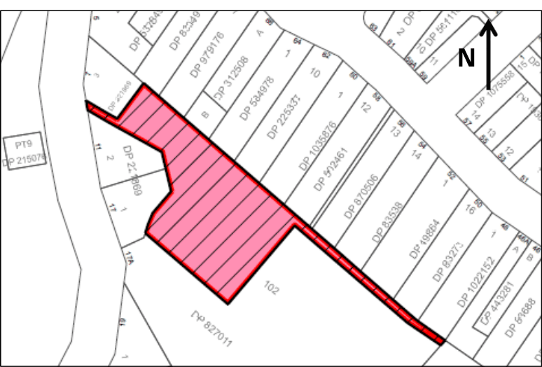

#### G4.1 Introduction

Land at 9A Cooper Park Road, Bellevue Hill, is zoned to 2(b) Medium Density Residential under Woollahra Local Environmental Plan 2014 (Woollahra LEP 2014). Woollahra LEP 2014 also sets a maximum building height of 9.5m and a floor space ratio of 0.63:1 for the land.

It is envisaged that the land will be redeveloped for a residential purpose.  The LEP controls will permit medium density residential development. The controls in this chapter seek to guide development on the land.

Note: This chapter reflects the site specific development control plan adopted by Council on 16 December 2013, and which commenced on 8 January 2014.

#### G4.1.1 Land where this chapter applies

This chapter applies to land known as 9A Cooper Park Road, Bellevue Hill, being Lot 101 DP 827011, as identified on the plan below.

> [Picture on page 5: a picture, saved as a picture (images/chapter-g4-9a-cooper-park-road-bellevue-hill-page-5-13.gif, 150 dpi).]

### N

#### G4.1.2 Development to which this chapter applies

This chapter applies to development requiring consent under Woollahra LEP 2014.

#### G4.1.3 Objectives

The objectives of this chapter are:

O1 To facilitate development that is permissible under the provisions of Woollahra LEP 2014.

O2 To guide the design and location of development to address the amenity of adjoining properties.

#### G4.1.4 Relationship to other parts of the DCP

This chapter is to be read in conjunction with the other parts of the DCP that are relevant to the development proposal, including: Part B: Chapter B1 Residential Precincts (Bellevue Hill South) Part B: Chapter B3 General Development Controls Part E: General Controls for All Development – this part contains chapters on Parking and Access, Stormwater and Flood Risk Management, Tree Management, Contaminated Land, Waste Management, Sustainability, Signage and Adaptable Housing.

In the event of any inconsistency between this chapter and the other chapters, this chapter prevails unless otherwise specified.

#### G4.1.5 Relationship to other documents

State Environmental Planning Policy No. 65 - Design Quality of Residential Flat Development

The New South Wales Government’s State Environmental Planning Policy No. 65 - Design Quality of Residential Flat Development (SEPP 65) is a mandatory consideration for development applications involving a residential flat building that is 3 or more storeys and contains 4 or more self-contained dwellings.

SEPP 65 contains principles for good design and provides guidance for evaluating the merit of design solutions, and is supported by the Residential Flat Design Code 2002.  The Code contains detailed information about how development proposals can achieve the design quality principles in the SEPP, addressing matters such as building separation and building configuration.

Where SEPP 65 applies, the development application must be accompanied by a design verification from a qualified designer, confirming that: he or she designed, or directed the design, of the development; and the design quality principles set out in SEPP 65 are achieved for the development.
