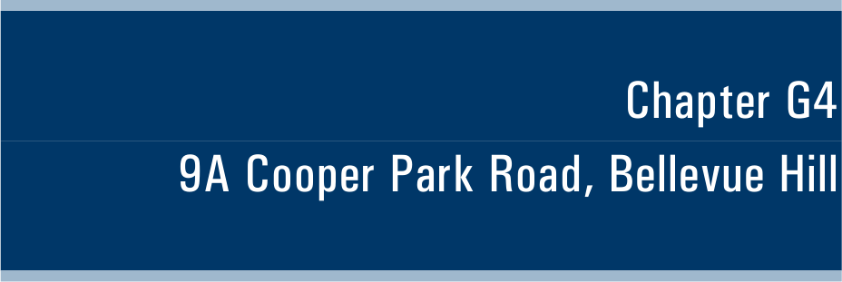

# Woollahra Development Control Plan 2015 - Chapter G4 9A Cooper Park Road, Bellevue Hill

> This chapter is split into 3 section file(s), one per numbered heading, in the order they appear in the PDF.

Source PDF: [chapter-g4-9a-cooper-park-road.pdf](https://planfortomorrow.sharepoint.com/sites/Planfortomorrow/Shared%20Documents/00%20NSW-Planning-Resources/dcp/woollahra-development-control-plan-2015/chapter-g4-9a-cooper-park-road-bellevue-hill/chapter-g4-9a-cooper-park-road.pdf)

> [Picture on page 1: a picture, saved as a picture (images/chapter-g4-9a-cooper-park-road-bellevue-hill-page-1-1.gif, 150 dpi).]

### Chapter G4

### 9A Cooper Park Road, Bellevue Hill

### Part G  Site-Specific Controls

### CHAPTE R G4 APPROVED ON 27 APRIL 2015 AND COMMENCED ON 23 MAY 2015

### Last amended on 12 April 2021

<!-- sections -->
## Sections

1. [G4 9A Cooper Park Road, Bellevue Hill](01-g4-9a-cooper-park-road-bellevue-hill.md)
2. [G4.1 Introduction](02-g4-1-introduction.md)
3. [G4.2 Design and siting of development](03-g4-2-design-and-siting-of-development.md)
