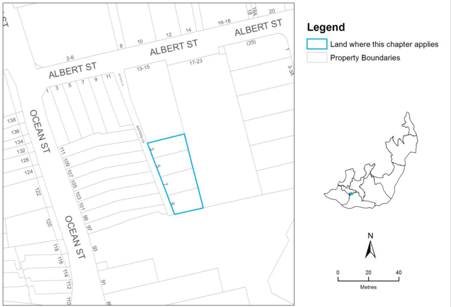

#### G5.1 Introduction

#### G5.1.1 Background

This chapter applies to land that was formerly part of the Sisters of Charity property known as Monte Oliveto.  It identifies the conservation significance of the site and its relationship to the Woollahra Heritage Conservation Area.

The original property at 13 Albert Street was subdivided, and the new lots at 3-9 Sisters Lane were developed for two storey contemporary terrace style housing, consistent with the controls in the original development control plan (DCP) for the site, adopted on 26 June 2000, and which commenced on 15 September 2000.

Recognising that the site is largely developed, this chapter only reflects those parts of the original site-specific DCP that may be relevant to further development on the site, such as additions and alterations.

#### G5.1.2 Land where this chapter applies

This chapter applies to land identified on the map at Figure 1. The land comprises Nos.3-9 Sisters Lane, being Lots 1- 4 DP 1047567.

FIGURE 1  Subject sites

> [Picture on page 5: a picture, saved as a picture (images/chapter-g5-3-9-sisters-lane-edgecliff-page-5-17.gif, 150 dpi).]

#### G5.1.3 Development to which this chapter applies

This chapter applies to development requiring consent under Woollahra Local Environmental Plan 2014 (Woollahra LEP 2014).

Given that the site has been largely redeveloped, it is likely that development would generally involve only additions and alterations.

#### G5.1.4 Objectives

The objectives of this chapter are:

O1 To ensure that development of the site takes place in a manner which is compatible with the character and built form of the locality.

O2 To ensure that any development has regard to the two heritage items, “Fenton” and “Carmel” at No. 8 and 24 Albert Street in the vicinity of the site.

O3 To ensure that any development on the site reflects its location within, and strengthens the integrity of the Woollahra Heritage Conservation Area.

#### G5.1.5 Relationship to other parts of the DCP

This chapter is to be read in conjunction with the other parts of the DCP that are relevant to the development proposal, including: Part C: Chapter C2 Woollahra Heritage Conservation Area (Rosemount Precinct); and Part E: General Controls for All Development – this part contains chapters on Parking and Access, Stormwater and Flood Risk Management, Tree Management, Contaminated Land, Waste Management, Sustainability, Signage and Adaptable Housing.

In the event of any inconsistency between this chapter and the other chapters, this chapter prevails.
