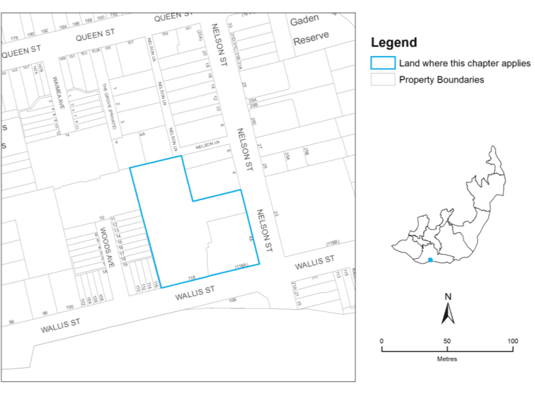

#### G6.1 Introduction

#### G6.1.1 Background

This chapter applies to Brougham, its grounds and trees located at 4A Nelson Street and 118 Wallis Street, Woollahra.  These properties are listed as heritage items under Woollahra LEP 2014.

The original landholding at 118 Wallis Street, formerly known as ‘Brougham Hostel’ was used as a child welfare home under the guidance of various health organisations of the State Government. That land has since been subdivided, and a seniors living development, known as Emanuel Gardens, has been developed to the west and north-west of the heritage building, Brougham.

This chapter establishes parameters for any further development on either 4A Nelson Street or 118 Wallis Street to ensure that development has regard to the heritage significance of Brougham, its mature garden setting and the surrounding neighbourhood amenity.

Note: This chapter reflects the site specific development control plan adopted by Council on 22 May 1995, and which commenced on 31 May 1995.

#### G6.1.2 Land where this chapter applies

This chapter applies to land identified on the map at Figure 1.  The land comprises 4A Nelson Street (Lot 3 DP 1150167) and 118 Wallis Street (SP 61424) and contains the building known as ‘Brougham’ and its grounds.

FIGURE 1  Subject sites

> [Picture on page 5: a picture, saved as a picture (images/chapter-g6-4a-nelson-street-and-118-wallis-street-woollahra-page-5-19.gif, 150 dpi).]

#### G6.1.3 Development to which this chapter applies

This chapter applies to development requiring consent under Woollahra Local Environmental Plan 2014 (Woollahra LEP 2014).

#### G6.1.4 Objectives

The objectives of this chapter are:

O1 To ensure the conservation of Brougham and its mature garden setting.

O2 To ensure the protection of significant trees located on the site.

O3 To require that any new development or work is in harmony with the design, scale, form and character of Brougham and its mature garden setting.

#### G6.1.5 Relationship to other parts of the DCP

This chapter is to be read in conjunction with the other parts of the DCP that are relevant to the development proposal, including: Part C: Chapter C2 Woollahra Heritage Conservation Area (Nelson Precinct); and Part E: General Controls for All Development – this part contains chapters on Parking and Access, Stormwater and Flood Risk Management, Tree Management, Contaminated Land, Waste Management, Sustainability, Signage and Adaptable Housing.

In the event of any inconsistency between this chapter and the other chapters, this chapter prevails.

#### G6.1.6 Relationship to other plans and documents

#### Conservation Study

Applicants must refer to the Conservation Plan prepared by Dawson Brown and Ackert Pty. Ltd. for the Department of Planning, dated February 1991, and titled "Brougham's Hostel Woollahra".
